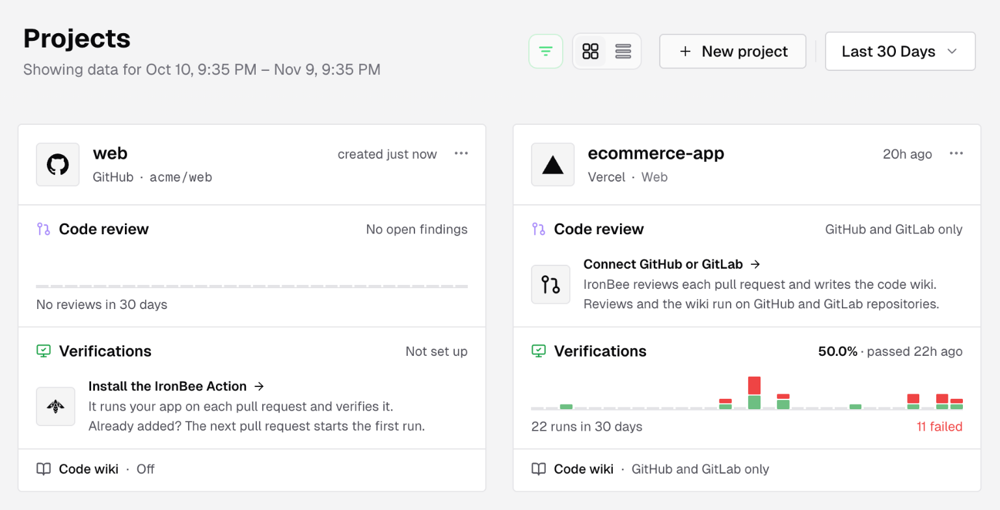
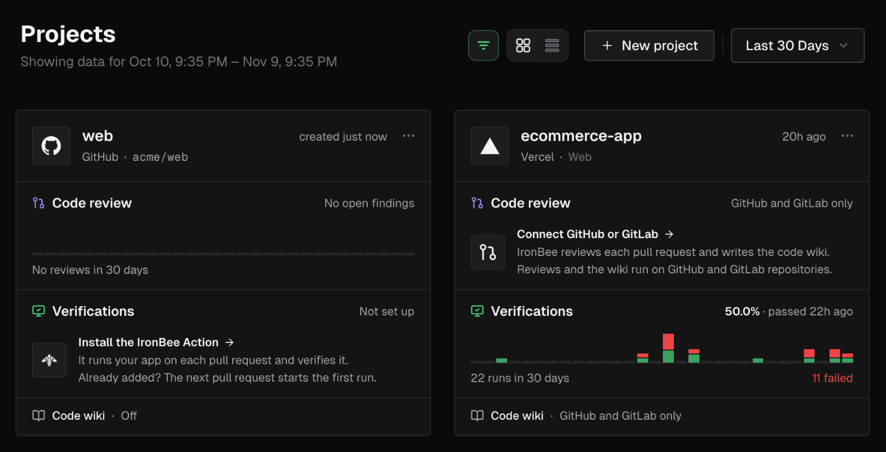

# Documentation project instructions

## About this project

- This is the external, customer-facing documentation for **IronBee**, your AI QA engineer that catches bugs before you ship
- Built on [Mintlify](https://mintlify.com); pages are MDX files with YAML frontmatter
- `docs.json` holds the navigation and the redirects, and is the source of truth for the page tree
- Run `mint dev` to preview locally
- Run `mint broken-links` to check links
- This file, `DOCUMENTATION_STRUCTURE.md` and `.atlas-analysis.json` are internal and listed in `.mintignore`

## What IronBee is

IronBee reviews pull requests and verifies code changes the way a QA engineer would, and keeps the evidence. There are three ways in.

**Code review.** Once the IronBee GitHub App covers a repository, or a repository is picked in a connected GitLab group (gitlab.com only), IronBee reviews its pull requests or merge requests.
- A review starts when a pull request opens or gets a push (per the **Automatic reviews** setting), from a comment command (`@ironbee-ai` on GitHub; the group's service account `@ironbee-<group path>`, or `@ironbee`, on GitLab), or from **Review now** in the console. `ironbee review` reviews a local branch from the CLI.
- On GitHub it posts a review with inline comments, a summary in the pull request description, and the **IronBee review** check. On GitLab it posts a review note with inline threads, a summary note, and the **IronBee review** pipeline status, which holds a merge only with **Block merges** on.
- The console shows pull requests and findings under **Code review** (**Pull requests**, **Rules**, **Memories**, **Settings**) and on each project's **Code review** tab.

**Platform verification runs.** IronBee runs the verification on its own infrastructure.
- A run is started by the IronBee GitHub Action, the IronBee GitLab component, the Vercel integration, the Netlify extension, `ironbee verify`, or **Run instant verification** in the console.
- A Vercel or Netlify project is verified only after it's enabled with a verification type, **Web** or **API**; **None** starts nothing. Installing the GitHub App makes every repository it covers a project with the type **None**, and so does picking a repository in a GitLab group.
- Results appear in three places:
  - on the pull request or merge request, for a run bound to a connected repository: a check (a pipeline status on GitLab), an inline comment on each finding with a suggested fix, and a summary comment. The GitHub Action and the GitLab component then leave their own report comment out
  - the Netlify deploy page
  - the console

**The CLI.** `@ironbee-ai/cli` wraps AI coding agents (Claude Code, Cursor, Codex) so they verify their own changes locally with IronBee DevTools. CLI verification cycles also appear in the console.

**The console** (console.ironbee.ai) shows:
- projects
- code review: pull requests, findings, rules, memories and settings
- each GitHub or GitLab project's code wiki: pages IronBee writes from the default branch and keeps current, with its settings
- each project's verification runs, with the evidence (recording, screenshots, actions, network, traces, logs) and a live view while a run is in progress
- each project's scenarios: flows written in plain words, run against an environment one action at a time, with their editor and their runs
- project settings: environments, variables, secrets
- **Settings > Usage**: the team's credits this month, what code review and verification used, and the rate card
- Search: the command palette and the query builder

## Terminology

Use these terms. When you describe something on screen, quote the console label exactly as the UI shows it.

| Use | Avoid | Notes |
|-----|-------|-------|
| verification run | job, task, test run | One verification of a deployment, commit or change. Say "verification job" only when you quote CLI output or `ironbee verify` fields |
| verification | test, check | Use "check" only for GitHub and Vercel checks and the **Checks** tab. On GitLab, say "pipeline status" |
| verification cycle | loop, iteration | CLI only: one verify pass inside an agent session |
| session | run, task | CLI only: one AI client session |
| activity | step, action | CLI only: one agent turn. In the console scenario docs, **action** (an Act, Assert, Extract or Wait row) and **Step** (the grouping row) are console labels, so use them there |
| scenario | test case, script, flow (as a noun for the feature) | Console: a saved flow in a project, run against an environment. CLI: a saved scenario in `.ironbee/scenarios/`. When both could apply, say which one |
| verdict | outcome | The CLI's verdict (`pass`, `fail`, `not_applicable`). In the console the column is **Result** |
| fix | patch, correction | The agent's self-correction. **Suggested fixes** is a console tab label |
| code review | PR review, review bot | IronBee's review of a pull request. "Review" alone is fine once the context is clear |
| finding | issue, problem | A problem a code review or a verification run reports. On a verification run's detail the console tab is **Findings**, or **Issues** for older runs and CLI cycles |
| rule, memory | guideline, instruction, knowledge | Code review: a rule says what must or must not happen (kinds **Check** and **Skip**); a memory says what is true and never raises a finding |
| span | trace item, event | OpenTelemetry spans in the **Traces** tab |
| environment, variable, secret | stage, env var, credential | Project settings |

Console labels, quoted verbatim:
- **Status:** Created, Queued, Starting, Running, Completed, Failed, Cancelled, Interrupted, Unknown
- **Result:** Pass, Fail, Not applicable, Soft fail, Unknown
- **Trigger:** Vercel, Netlify, GitHub Actions, GitLab CI, API, CLI, Console
- **Scenario row kinds:** Act, Assert, Extract, Wait, Step, Import. Sections: Setup, Main, Teardown
- **Code review status:** Reviewing, Changes requested, Passed, Could not complete, Cancelled, Retracted, Reviewed, Not reviewed
- **Finding severity:** Critical, High, Medium, Low
- **Scenario outcome:** Passed, Failed, Soft fail, Setup failed, Run error, Ran out of time, Browser tools lost, Stopped before it started, Stopped, Running, Starting. In the verification list a failed scenario run's status reads **Run error**

## Product components and their doc sections

| Component | Docs | Notes |
|-----------|------|-------|
| IronBee GitHub App | Integrations > `integrations/github` | Repository access, sign-in with GitHub, code review, and the checks and PR comments of verification runs |
| GitLab connection | Integrations > `integrations/gitlab` | A gitlab.com top-level group connected from the console: repository access, code review of merge requests, the code wiki |
| Code review | Code review (`code-review/*`) | The GitHub and GitLab sides (`on-github`, `on-gitlab`) and the console pages. The CLI's `ironbee review` stays under CLI |
| `ironbee-ai/ironbee-action` | Integrations > GitHub Action (`github-action/*`) | Use `@v1` in examples, the moving tag of the latest release; never an exact version, so readers don't have to keep updating it. The workflow secret `IRONBEE_API_KEY` is passed as the `ironbee_api_key` input |
| `ironbee-ai/ironbee-gitlab` CI/CD component | Integrations > GitLab component (`gitlab-component/*`) | The GitLab twin of the GitHub Action, with the same inputs and report. Use `gitlab.com/ironbee-ai/ironbee-gitlab/verify@v1` in examples, never an exact version. The credential inputs read the `IRONBEE_API_KEY`, `ANTHROPIC_API_KEY`, `CLAUDE_CODE_OAUTH_TOKEN` and `GITLAB_TOKEN` CI/CD variables by default |
| Vercel integration | Integrations > `integrations/vercel` | Preview deployments of enabled projects |
| Netlify extension | Integrations > `integrations/netlify` | Deploy previews and branch deploys of enabled sites |
| `@ironbee-ai/cli` npm package | CLI | Wraps AI coding agents; `ironbee verify` starts platform verification runs; `ironbee review` reviews a local branch; `ironbee credits` shows credit use |
| IronBee Console | Console | Web UI at console.ironbee.ai |

## CLI conventions

- Install: `npm install -g @ironbee-ai/cli`
- Sign in: `ironbee login`. Set up a project: `ironbee install`
- Verification modes:
  - `ironbee verification enable` / `disable`. Enabled means assist mode.
  - `ironbee verification auto enable` switches to enforce mode.
  - `ironbee verification strict|fix|model` adjust the behavior.
- Platforms: `ironbee <browser|node|python|backend|android|terminal> enable|disable`
- Platform verification runs: `ironbee verify run web|api`
- Three config layers:
  - Global: `~/.ironbee/config.json`
  - Project: `.ironbee/config.json`, committed
  - Project-local: `.ironbee/config.local.json`, gitignored
- Credentials: `service.oauthToken` / `service.apiKey`, or `IRONBEE_SERVICE_OAUTH_TOKEN` / `IRONBEE_SERVICE_API_KEY`. `IRONBEE_ACCESS_TOKEN` is read only by `verify`, `review` and `credits`. An OAuth token always wins over an API key. `collector.*`, `IRONBEE_OAUTH_TOKEN` and `IRONBEE_API_KEY` are legacy aliases
- Personal file: `~/.ironbee/projects/<token>/personal.json`, read only by `ironbee review` and `ironbee credits`

## Navigation

`docs.json` is the source of truth. Each tab has an icon. The tabs are:

- **Overview:** the home page (`index.mdx`). It is the only way back to the home page besides the logo, so there is no separate Home link in the sidebar
- **Get started:** introduction, quickstart, key concepts, help
- **Integrations:** GitHub App, GitLab, Vercel, Netlify, then the GitHub Action and GitLab component groups
- **Code review:** overview, on the pull request (GitHub), on the merge request (GitLab), then the console pages (pull requests, rules and memories, settings)
- **CLI:** get started, concepts, guides, configuration, advanced, AI clients
- **Console:** projects, code wiki (the wiki and its settings), verifications, scenarios (scenarios, editor, references and imports, runs), search, settings

When you remove or rename a page, add a `redirects` entry in `docs.json`. Keep these inbound URLs working, because the product and the website link to them:
- `/cli/get-started/getting-started`
- `/integrations/github`
- `/integrations/netlify`
- `/console/access-tokens`
- `/console/account`

## SEO and GEO

- Give every page a unique `title`. When pages share a sidebar label, keep the short label in `sidebarTitle` and make the `title` specific: `CLI configuration` with `sidebarTitle: Configuration`
- Write `description` as plain text of 50-160 characters, with no Markdown. It is the meta description and the page's line in `llms.txt`
- Use `keywords` only for search synonyms the prose avoids on purpose, such as "test case" on the scenario pages
- Mintlify generates the sitemap, `robots.txt`, canonical URLs, OG images, JSON-LD, `llms.txt` and `llms-full.txt`. Don't add custom versions
- `seo.organization` in `docs.json` points at the ironbee.ai organization entity. Keep its `sameAs` list in sync with the website
- `markdown.instructions` is appended to every page's Markdown and to `llms.txt`. Keep it short and factual

## Style preferences

- Active voice, second person ("you")
- Sentence case for headings and frontmatter titles
- Bold for UI elements, quoted exactly as the console shows them: click **Run verification**, open **Settings**
- Code formatting for commands, file paths, env vars, config keys and action inputs: `ironbee install`, `.ironbee/config.json`, `IRONBEE_SERVICE_API_KEY`, `ironbee_api_key`
- Backtick-wrap any token that starts with `<` or `>` to avoid MDX parse errors: `` `<1s` ``, `` `>15m` ``
- Use a short hyphen (`-`), never an em dash (U+2014), including in image alt text, tables and frontmatter
  - When you remove an em dash, replace it with a hyphen or other punctuation. Don't just delete it
- En dash (U+2013) only for numeric ranges
- No emojis, except when quoting product output verbatim
- No trailing summaries; end sections cleanly

## Site design

`index.mdx` is a custom-mode page built with the `ib-*` classes in `style.css`, whose tokens follow the ironbee.ai palette. `style.css` also restyles Mintlify's chrome: the top tabs are chips with an icon, and the active tab has a background and a border. Follow these rules when you change either:

- Keep every border radius at 4px or less, including buttons, cards, chips, the code group, the top tabs and the sidebar's active page (desktop `#sidebar` and the phone menu `#mobile-nav`).
- Section eyebrow labels are neutral gray, with no accent color and no dot.
- Check the page in light and dark themes and at mobile width.

## Screenshots

- Console screenshots live in `images/console/<area>/` as a light and a dark capture of the same screen: `<name>-light.png` and `<name>-dark.png`.
- Embed both, right under the text they illustrate. The `ib-shot` classes in `style.css` show the one that matches the reader's theme:

  ```mdx
  
  
  ```

- Clip each shot to the part the text explains, a card, table, dialog or panel about 600-1000 px wide. A full-window capture is unreadable in the content column.
- Keep the console's top bar out of the frame, since it shows the plan name. Never show real people's names or emails, prices, plans, seats, limits, or a take-over control.
- Capture from the console running on mock data, not from a real account.
- On GitHub, code review shows severity and kind marks and the **Open in IronBee** button as the console's own SVG badges, not emoji. The docs use copies of them from `images/code-review/badges/`, shown inline with the `ib-mark` classes in `style.css`. Re-copy them from the console frontend's `public/badges/` when they change.

## Content boundaries

- This docs site is for **external customers**:
  - Don't document internal infrastructure (AWS CDK, Aurora, Redis, Lambda internals, admin CLI).
  - Don't document internal API endpoints or the database schema.
- Verification evidence (video, screenshots) is for the customer's use. Explain how to access and read it, not how it's stored
- Document only what customers can see or use in the product
  - Flag features that are visible but disabled as "coming soon"
- The console docs cover the verification list and the verification detail. Don't document agent session pages (session timeline, activities, fixes)
- Never mention human take-over in the live view
- Plans, prices and plan limits live only on `console/pricing.mdx`. It mirrors [ironbee.ai/pricing](https://ironbee.ai/pricing) word for word, and the website wins when they differ. Don't repeat prices or limits on other pages; link to the Pricing page instead
  - The same goes for credits: other pages say what uses credits and what's free, never how many a plan gets or a job costs
  - Plans are priced in credits. Leave out the website's session limits (its sessions row and session lines) when you mirror it
- The public REST API has no reference docs for now. That includes running a saved scenario through the API
- Security and compliance content changes only with the owner's sign-off
  - This covers `help/compliance.mdx` and the Security card in `getting-started/introduction.mdx`
- A feature that hasn't reached production yet is written on a branch and published together with its release
