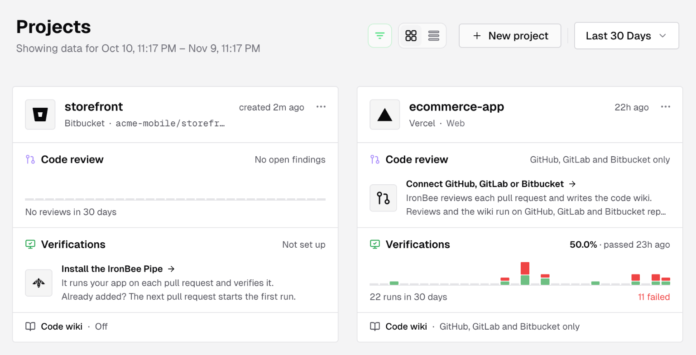
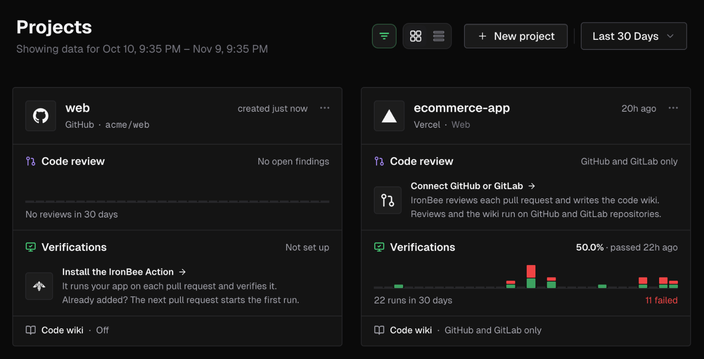

# Documentation project instructions

## About this project

- This is the external, customer-facing documentation for **IronBee**, your AI QA engineer that catches bugs before you ship
- Built on [Mintlify](https://mintlify.com); pages are MDX files with YAML frontmatter
- `docs.json` holds the navigation and the redirects, and is the source of truth for the page tree
- Run `mint dev` to preview locally
- Run `mint broken-links` to check links
- This file, `DOCUMENTATION_STRUCTURE.md` and `.atlas-analysis.json` are internal and listed in `.mintignore`

## What IronBee is

IronBee reviews pull requests and verifies code changes the way a QA engineer would, and keeps the evidence. There are three ways in.

**Code review.** Once the IronBee GitHub App covers a repository (on a GHE.com tenant or a GitHub Enterprise Server, the App IronBee creates there when the host is registered), or a repository is picked in a connected GitLab group (on gitlab.com, or on a registered GitLab Self-Managed server or Dedicated tenant) or Bitbucket workspace (bitbucket.org only, Premium included), IronBee reviews its pull requests or merge requests. Registering a host needs the Enterprise plan.
- A review starts when a pull request opens or gets a push (per the **Automatic reviews** setting), from a comment command (`@ironbee-ai` on GitHub, GitLab and Bitbucket; on GitLab, the group's service account `@ironbee-<group path>` too; on a GHE.com tenant or a GitHub Enterprise Server, the App's slug, `@ironbee-ai` with the default App name), or from **Review now** in the console. `ironbee review` reviews a local branch from the CLI.
- On GitHub it posts a review with inline comments, a summary in the pull request description, and the **IronBee review** check. On GitLab it posts a review note with inline threads, a summary note, and the **IronBee review** pipeline status, which holds a merge only with **Block merges** on. On Bitbucket it posts inline comments, a review comment, a summary comment and the **IronBee review** build status, which holds a merge only through Bitbucket's merge checks (Premium, with the builds check and **Prevent a merge with unresolved merge checks** on the branch; `ironbee host merge-check` adds both). On every host, cloud or self-hosted runner, the review never approves and never requests changes, so a host's "no changes requested" check only reacts to people.
- The console shows pull requests and findings under **Code review** (**Pull requests**, **Rules**, **Memories**, **Settings**) and on each project's **Code review** tab.

**The self-hosted runner.** On an Enterprise agreement, code review runs in the customer's own CI instead, from IronBee's image and with the customer's own model provider. On GitHub Actions it is a reusable workflow, on GitLab CI/CD a component in a runner project, and on Bitbucket Pipelines a custom pipeline with a trigger app. It runs under a license with an end date and a developer limit, and uses no credits. Its status is **Code Review Result**. The console keeps its settings, rules and memories, and lists its pull requests and runs from counts, with no findings. `ironbee runner setup|add|check` sets it up.

**BYOM (Bring Your Own Model).** An Enterprise account registers one model endpoint of its own in **Settings > BYOM**, and once BYOM is enabled, which needs a passing connection test, every job IronBee runs for it calls that model: code reviews (the CLI's `ironbee review` included), the code wiki, code security scans and platform verification runs. The jobs still run on IronBee's infrastructure; only their model calls go to the endpoint, in Anthropic Messages, OpenAI Chat Completions or OpenAI Responses format. Each save runs a connection test, and a job on the account's model is charged the rate card times 0.5, rounded up. An owner or an admin manages it; members and billing admins see it read-only. It's managed in the console alone, with no API route or CLI command. It isn't the self-hosted runner, which runs code review in the customer's own CI.

**The account's switches.** Code review, the code wiki and code security each have a switch for the whole account at the top of the product's account settings page (**Code review for this account**, **Code wiki for this account**, **Code security for this account**), on by default, and a switch on each repository. A product runs on a repository only while both are on. Code review on the self-hosted runner is the exception: the runner reviews a repository whose own switch is off, and the account's switch off refuses every registration and run of it. Turning the account's switch off cancels nothing, keeps posts, pages and records, and changes no repository's switch; turning it on queues nothing by itself.

**Platform verification runs.** IronBee runs the verification on its own infrastructure.
- A run is started by the IronBee GitHub Action, the IronBee GitLab component, the IronBee Bitbucket Pipe, the Vercel integration, the Netlify extension, `ironbee verify`, or **Run instant verification** in the console.
- A Vercel or Netlify project is verified only after it's enabled with a verification type, **Web** or **API**; **None** starts nothing. Installing the GitHub App makes every repository it covers a project with the type **None**, and so does picking a repository in a GitLab group or a Bitbucket workspace.
- Results appear in three places:
  - on the pull request or merge request, for a run bound to a connected repository: a check (a pipeline status on GitLab, a build status on Bitbucket), an inline comment on each finding with a suggested fix, and a summary comment. The GitHub Action, the GitLab component and the Bitbucket Pipe then leave their own report comment out
  - the Netlify deploy page
  - the console

**The CLI.** `@ironbee-ai/cli` wraps AI coding agents (Claude Code, Cursor, Codex) so they verify their own changes locally with IronBee DevTools. CLI verification cycles also appear in the console. From a shell it also starts verification runs (`ironbee verify`), reviews a local branch (`ironbee review`), sets up the self-hosted runner for code review on GitLab, GitHub and Bitbucket (`ironbee runner`), and prepares a GitLab Dedicated or Self-Managed instance, a gitlab.com group's IP restriction, or a Bitbucket Cloud branch's merge checks for IronBee (`ironbee host`).

**The console** (console.ironbee.ai) shows:
- projects
- code review: pull requests, findings, rules, memories and settings
- each GitHub, GitLab or Bitbucket project's code wiki: pages IronBee writes from the default branch and keeps current, with its settings. An owner or admin can share a wiki through a public link, which opens the wiki alone at `console.ironbee.ai/share/code-wiki/...` with no account
- each GitHub, GitLab or Bitbucket project's code security: scheduled scans of the default branch, their records and runs, with its settings. Off until an owner or admin turns it on for a repository, credit-charged, and seen by owners and admins only. It posts nothing on the pull request. One scan runs at a time per account, oldest waiting first; at most two free follow-up runs come after a scan. Its records, decisions and runs can also be read and a scan started through the code security API
- each project's verification runs, with the evidence (recording, screenshots, actions, network, traces, logs) and a live view while a run is in progress
- each project's scenarios: flows written in plain words, run against an environment one action at a time, with their editor and their runs
- project settings: environments, variables, secrets
- **Settings > Usage**: the team's credits this period, by product, day, project and run, the credits it bought, and the rate card. On Free and Team, owners and billing admins buy credits there with **Add credits**
- **Settings > BYOM**: the account's own model endpoint, its connection test and its last failure
- Search: the command palette and the query builder

## Terminology

Use these terms. When you describe something on screen, quote the console label exactly as the UI shows it.

| Use | Avoid | Notes |
|-----|-------|-------|
| verification run | job, task, test run | One verification of a deployment, commit or change. Say "verification job" only when you quote CLI output or `ironbee verify` fields |
| verification | test, check | Use "check" only for GitHub and Vercel checks and the **Checks** tab. On GitLab, say "pipeline status"; on Bitbucket, "build status" |
| verification cycle | loop, iteration | CLI only: one verify pass inside an agent session |
| session | run, task | CLI only: one AI client session |
| activity | step, action | CLI only: one agent turn. In the console scenario docs, **action** (an Act, Assert, Extract or Wait row) and **Step** (the grouping row) are console labels, so use them there |
| scenario | test case, script, flow (as a noun for the feature) | Console: a saved flow in a project, run against an environment. CLI: a saved scenario in `.ironbee/scenarios/`. When both could apply, say which one |
| verdict | outcome | The CLI's verdict (`pass`, `fail`, `not_applicable`). In the console the column is **Result** |
| fix | patch, correction | The agent's self-correction. **Suggested fixes** is a console tab label |
| code review | PR review, review bot | IronBee's review of a pull request. "Review" alone is fine once the context is clear |
| finding | issue, problem | A problem a code review or a verification run reports. On a verification run's detail the console tab is **Findings**, or **Issues** for older runs and CLI cycles |
| rule, memory | guideline, instruction, knowledge | Code review: a rule says what must or must not happen (kinds **Check** and **Skip**); a memory says what is true and never raises a finding |
| scan, record | audit, vulnerability, issue | Code security: a scan reads the default branch (kinds **Full**, **Incremental**, **Follow-up**); a record is one problem it found. A record's verdict is **Confirmed** (a "confirmed finding", the only kind with a severity), **Lead to validate** (a "lead") or **Rejected** |
| decision | disposition, status, triage state | Code security: what the team does with a record. The console label is **Decision**. In the API the field is `disposition` and a lead is `needs_validation`; use those only in code formatting |
| follow-up run | continuation, leftovers run | Code security: a free run that reads what a scan put off, at the same commit. The console's kind is **Follow-up** |
| profile, execution | depth, mode, dynamic analysis | Code security settings: **Profile** is how far a scan goes; **Execution** is whether it may run the repository's code. Code review's setting is depth, not profile |
| self-hosted runner | on-prem reviewer, self-hosted review, BYOM | IronBee code review in the customer's own CI. Say "your own runner" or "a runner of yours" for GitHub's, GitLab's or Bitbucket's CI runners |
| BYOM | custom LLM, bring your own key, self-hosted model | IronBee's cloud jobs on the account's own model endpoint, as **Settings > BYOM** names it. Spell it out, BYOM (Bring Your Own Model), on the BYOM pages, in key concepts and on the home page. Any other page may say BYOM alone, with a link to `/byom/overview`, or to `/console/byom` where it names the settings page, at its first mention. After that, say "your model" or "your endpoint", or BYOM alone as the console does ("a job on BYOM", "the BYOM settings", "the BYOM endpoint"). Never use it for the self-hosted runner |
| the account's switch | master switch, kill switch | A product's switch for the whole account: **Code review for this account**, **Code wiki for this account**, **Code security for this account**. A repository's own switch stays "the repository's switch" |
| license | licence | The self-hosted runner's license. Quote "licence" only in product output (log lines, status text), which spells it that way |
| runner project, trigger app | | The self-hosted runner's GitLab project that holds its pipeline (GitLab only), and its Forge app that starts the pipeline (Bitbucket only) |
| registered host | enterprise instance, on-prem install | A GHE.com tenant, a GitHub Enterprise Server, a GitLab Self-Managed server or a GitLab Dedicated tenant registered in the console. Say "tenant" for GHE.com and Dedicated, "server" for GHES and Self-Managed, "instance" for either GitLab one. GitHub Enterprise Cloud on github.com is github.com, not a registered host |
| span | trace item, event | OpenTelemetry spans in the **Traces** tab |
| environment, variable, secret | stage, env var, credential | Project settings |

Console labels, quoted verbatim:
- **Status:** Created, Queued, Starting, Running, Completed, Failed, Cancelled, Interrupted, Unknown
- **Result:** Pass, Fail, Not applicable, Soft fail, Unknown
- **Trigger:** Vercel, Netlify, GitHub Actions, GitLab CI, Bitbucket Pipelines, API, CLI, Console
- **Scenario row kinds:** Act, Assert, Extract, Wait, Step, Import. Sections: Setup, Main, Teardown
- **Code review status:** Reviewing, Changes requested, Passed, Could not complete, Cancelled, Retracted, Reviewed, Not reviewed
- **Finding severity:** Critical, High, Medium, Low
- **Security record verdict:** Confirmed, Lead to validate, Rejected. **Severity** (confirmed only): Critical, High, Medium, Low, Informational. **Decision:** Open, Accepted, Fixed elsewhere, Not an issue
- **Security scan:** kinds Full, Incremental, Follow-up, No scan. Started by: Scheduled, Run by hand, API. **Profile:** Auto, Quick, Standard, Deep. **Scheduled scan** and the wiki's **Rebuild from scratch:** Daily, Weekly, Every two weeks, Monthly
- **Self-hosted runner list:** Reviewed, Retracted, Not reviewed. Run status: Running, Succeeded, Failed, Cancelled, Skipped, Never completed. Run kinds: Review, Answer, Follow-up, Retract. On project cards: By its workflow, By its runner project, By its pipeline, Off in IronBee's cloud
- **Scenario outcome:** Passed, Failed, Soft fail, Setup failed, Run error, Ran out of time, Browser tools lost, Stopped before it started, Stopped, Running, Starting. In the verification list a failed scenario run's status reads **Run error**

## Product components and their doc sections

| Component | Docs | Notes |
|-----------|------|-------|
| IronBee GitHub App | Integrations > `integrations/github`, `integrations/github-enterprise` | Repository access, sign-in with GitHub, code review, and the checks and PR comments of verification runs. `integrations/github-enterprise` covers GitHub Enterprise Cloud (IP allow lists), and GHE.com and GitHub Enterprise Server registered under **GitHub Enterprise** on **Integrations > GitHub** (Enterprise plan) |
| GitLab connection | Integrations > `integrations/gitlab`, `integrations/gitlab-self-managed` | A top-level group on gitlab.com (Premium and Ultimate in its **Premium and Ultimate groups** section), or on a GitLab Self-Managed server or Dedicated tenant registered under **GitLab Self-Managed and Dedicated** (Enterprise plan), connected from the console: repository access, code review of merge requests, the code wiki |
| Bitbucket connection | Integrations > `integrations/bitbucket` | A bitbucket.org workspace: IronBee's Forge app, installed by a workspace admin and connected from the app's page in the workspace's settings. Repository access, code review of pull requests, the code wiki. The mention is `@ironbee-ai`, as on GitHub. Premium: the **Bitbucket Cloud Premium** section |
| Code review | Code review (`code-review/*`) | The GitHub, GitLab and Bitbucket sides (`on-github`, `on-gitlab`, `on-bitbucket`) and the console pages. The CLI's `ironbee review` stays under CLI |
| `ironbee-ai/ironbee-action` | Integrations > GitHub Action (`github-action/*`) | Use `@v1` in examples, the moving tag of the latest release; never an exact version, so readers don't have to keep updating it. The workflow secret `IRONBEE_API_KEY` is passed as the `ironbee_api_key` input. On GitHub Enterprise Server, examples use `ironbee-ai/ironbee-action/ghes@v1` (`github-action/guides/github-enterprise`) |
| `ironbee-ai/ironbee-gitlab` CI/CD component | Integrations > GitLab component (`gitlab-component/*`) | The GitLab twin of the GitHub Action, with the same inputs and report. Use `gitlab.com/ironbee-ai/ironbee-gitlab/verify@v1` in examples, never an exact version. The credential inputs read the `IRONBEE_API_KEY`, `ANTHROPIC_API_KEY`, `CLAUDE_CODE_OAUTH_TOKEN` and `GITLAB_TOKEN` CI/CD variables by default. On Self-Managed and Dedicated, examples include the customer's copy, `$CI_SERVER_FQDN/<copy path>/verify@v1`, with `IRONBEE_GITLAB_PROJECT` (`gitlab-component/guides/self-managed`) |
| `ironbee-ai/ironbee-bitbucket` pipe | Integrations > Bitbucket Pipe (`bitbucket-pipe/*`) | The Bitbucket Pipelines twin of the GitHub Action, with the same variables (in capitals) and report. Use `docker://ghcr.io/ironbee-ai/ironbee-bitbucket:v1` in examples, never an exact version. A pipe sees a repository variable only when the step passes it, so examples pass `IRONBEE_API_KEY: $IRONBEE_API_KEY` and the step's own `BITBUCKET_OAUTH_TOKEN` |
| `ironbee-ai/ironbee-github-runner` reusable workflow | Features > Code review > Self-hosted runner (`code-review/self-hosted-runner/github`) | Its check is **Code Review Result**, not **IronBee review**. Use `@v1` in examples |
| `ironbee-ai/ironbee-gitlab-runner` CI/CD component `code-review` | `code-review/self-hosted-runner/gitlab` | Listed in GitLab's CI/CD Catalog, included by the customer's runner project. Use `gitlab.com/ironbee-ai/ironbee-gitlab-runner/code-review@v1` in examples |
| `ironbee-ai/ironbee-bitbucket-runner` block and trigger app | `code-review/self-hosted-runner/bitbucket` | The custom pipeline `ironbee-code-review` in `bitbucket-pipelines.yml`, plus the customer's own Forge trigger app. The block names its release; show no image reference |
| Vercel integration | Integrations > `integrations/vercel` | Preview deployments of enabled projects |
| Netlify extension | Integrations > `integrations/netlify` | Deploy previews and branch deploys of enabled sites |
| `@ironbee-ai/cli` npm package | CLI | Wraps AI coding agents; `ironbee verify` starts platform verification runs; `ironbee review` reviews a local branch; `ironbee credits` shows credit use; `ironbee runner` sets up the self-hosted runner for code review (`cli/guides/runner`); `ironbee host` prepares GitLab instances, group IP restrictions and Bitbucket merge checks (`cli/guides/hosts`) |
| BYOM | Features > BYOM (`byom/*`), its console page `console/byom` | What BYOM is, the endpoint's side, the formats, failures, and **Settings > BYOM**. Key concepts gives it a section, **Jobs on BYOM** on `console/usage` holds its credits product by product, and the self-hosted runner's overview says how the two differ. Other pages give it one line and a link |
| Code security | Features > Code security (`code-security/*`), its console pages under **In the console** (`console/code-security*`) | `code-security/*`: what it is, where it runs, how a scan works, and its API. The console pages: the project tab, its records and runs, and the settings at the account and repository level |
| IronBee Console | Console | Web UI at console.ironbee.ai |

## CLI conventions

- Install: `npm install -g @ironbee-ai/cli`
- Sign in: `ironbee login`. Set up a project: `ironbee install`
- Verification modes:
  - `ironbee verification enable` / `disable`. Enabled means assist mode.
  - `ironbee verification auto enable` switches to enforce mode.
  - `ironbee verification strict|fix|model` adjust the behavior.
- Platforms: `ironbee <browser|node|python|backend|android|terminal> enable|disable`
- Platform verification runs: `ironbee verify run web|api`
- Three config layers:
  - Global: `~/.ironbee/config.json`
  - Project: `.ironbee/config.json`, committed
  - Project-local: `.ironbee/config.local.json`, gitignored
- Credentials: `service.oauthToken` / `service.apiKey`, or `IRONBEE_SERVICE_OAUTH_TOKEN` / `IRONBEE_SERVICE_API_KEY`. `IRONBEE_ACCESS_TOKEN` is read only by `verify`, `review` and `credits`. An OAuth token always wins over an API key. `collector.*`, `IRONBEE_OAUTH_TOKEN` and `IRONBEE_API_KEY` are legacy aliases
- Personal file: `~/.ironbee/projects/<token>/personal.json`, read only by `ironbee review` and `ironbee credits`
- Account hosts: a remote on a host other than github.com, gitlab.com and bitbucket.org is GitHub's or GitLab's only when it's one of the account's GitHub or GitLab hosts, which the CLI asks IronBee for and keeps for a day. The GitHub Actions server and the GitLab CI server count without asking. The claim and the binding then carry the host: `<host>:owner/repo` on GitHub, `<host>:<path>` on GitLab. Link to `/cli/concepts/projects#your-accounts-github-and-gitlab-hosts` rather than restating the rule
- `ironbee runner` and `ironbee host` are documented on `cli/guides/runner` and `cli/guides/hosts`; other pages give them one line and a link
- `GITLAB_TOKEN` goes to one host only: the GitLab CI job's server, else the host `GITLAB_HOST` names, else gitlab.com

## Navigation

`docs.json` is the source of truth. Each tab has an icon. The tabs are:

- **Overview:** the home page (`index.mdx`). It is the only way back to the home page besides the logo, so there is no separate Home link in the sidebar
- **Get started:** introduction, quickstart, key concepts, help
- **Integrations:** GitHub App, GitHub Enterprise, GitLab, GitLab Self-Managed and Dedicated, Bitbucket, Vercel, Netlify, then the GitHub Action, GitLab component and Bitbucket Pipe groups
- **Features:** a tab that opens a menu (`menu` in `docs.json`) of five items. **Code review** holds the code review pages: overview, on the pull request (GitHub), on the merge request (GitLab), on Bitbucket, then the console pages (pull requests, rules and memories, settings), then the self-hosted runner (overview, on GitHub, on GitLab, on Bitbucket). **Code security** holds its own pages (overview, how a scan works, API), then its console pages under **In the console** (scans, records and runs, settings), like code review's. **BYOM** holds its own pages, then its console page under **In the console**, like code security. **Code wiki** and **Verification** are shortcuts: each lists one page, that feature's first page in the **Console** tab, and nothing else
- **CLI:** get started, concepts, guides, configuration, advanced, AI clients
- **Console:** projects, code wiki (the wiki and its settings), verifications, scenarios (scenarios, editor, references and imports, runs), search, settings

The shortcuts depend on two things, so keep both:
- In `docs.json` the **Features** tab comes last, after **Console**. Mintlify opens a page under the first tab that lists it, so a shortcut's page opens under **Console**, with the console's sidebar. `style.css` draws the tab after **Integrations** with `order`
- A menu item's `href` doesn't work for this: a relative one renders as `/`, and an absolute one opens a new browser tab

When a feature gets console pages and nothing else, add them to the **Console** tab and give the **Features** menu a shortcut to the first one. When it also gets pages of its own, as code review and code security have, list its console pages only under its **Features** item, after its own pages.

When you remove or rename a page, add a `redirects` entry in `docs.json`. Keep these inbound URLs working, because the product and the website link to them:
- `/cli/get-started/getting-started`
- `/integrations/github`
- `/integrations/netlify`
- `/console/access-tokens`
- `/console/account`

## SEO and GEO

- Give every page a unique `title`. When pages share a sidebar label, keep the short label in `sidebarTitle` and make the `title` specific: `CLI configuration` with `sidebarTitle: Configuration`
- Write `description` as plain text of 50-160 characters, with no Markdown. It is the meta description and the page's line in `llms.txt`
- Use `keywords` only for search synonyms the prose avoids on purpose, such as "test case" on the scenario pages
- Mintlify generates the sitemap, `robots.txt`, canonical URLs, OG images, JSON-LD, `llms.txt` and `llms-full.txt`. Don't add custom versions
- `seo.organization` in `docs.json` points at the ironbee.ai organization entity. Keep its `sameAs` list in sync with the website
- `markdown.instructions` is appended to every page's Markdown and to `llms.txt`. Keep it short and factual

## Style preferences

- Active voice, second person ("you")
- Sentence case for headings and frontmatter titles
- Bold for UI elements, quoted exactly as the console shows them: click **Run verification**, open **Settings**
- Code formatting for commands, file paths, env vars, config keys and action inputs: `ironbee install`, `.ironbee/config.json`, `IRONBEE_SERVICE_API_KEY`, `ironbee_api_key`
- Backtick-wrap any token that starts with `<` or `>` to avoid MDX parse errors: `` `<1s` ``, `` `>15m` ``
- Use a short hyphen (`-`), never an em dash (U+2014), including in image alt text, tables and frontmatter
  - When you remove an em dash, replace it with a hyphen or other punctuation. Don't just delete it
- En dash (U+2013) only for numeric ranges
- No emojis, except when quoting product output verbatim
- No trailing summaries; end sections cleanly

## Site design

`index.mdx` is a custom-mode page built with the `ib-*` classes in `style.css`, whose tokens follow the ironbee.ai palette. `style.css` also restyles Mintlify's chrome: the top tabs are chips with an icon, and the active tab has a background and a border. Follow these rules when you change either:

- Keep every border radius at 4px or less, including buttons, cards, chips, the code group, the top tabs and the sidebar's active page (desktop `#sidebar` and the phone menu `#mobile-nav`).
- The **Features** tab is a menu button. `style.css` gives it the active chip while one of its pages is open, and keeps its menu and the menu's rows at 4px corners. Check a new tab at 1024px, the narrowest width that shows the tab row.
- Section eyebrow labels are neutral gray, with no accent color and no dot.
- Check the page in light and dark themes and at mobile width.

## Screenshots

- Console screenshots live in `images/console/<area>/` as a light and a dark capture of the same screen: `<name>-light.png` and `<name>-dark.png`.
- Embed both, right under the text they illustrate. The `ib-shot` classes in `style.css` show the one that matches the reader's theme:

  ```mdx
  
  
  ```

- Clip each shot to the part the text explains, a card, table, dialog or panel about 600-1000 px wide. A full-window capture is unreadable in the content column.
- Keep the console's top bar out of the frame, since it shows the plan name. Never show real people's names or emails, prices, plans, seats, limits, or a take-over control.
- Capture from the console running on mock data, not from a real account.
- On GitHub, code review shows severity and kind marks and the **Open in IronBee** button as the console's own SVG badges, not emoji. On Bitbucket, the marks are emoji. The docs use copies of them from `images/code-review/badges/`, shown inline with the `ib-mark` classes in `style.css`. Re-copy them from the console frontend's `public/badges/` when they change.

## Content boundaries

- This docs site is for **external customers**:
  - Don't document internal infrastructure (AWS CDK, Aurora, Redis, Lambda internals, admin CLI).
  - Where the code is processed is customer-facing: the United States (AWS us-west-2, Oregon), as the host registration forms show it under **Where the code is processed**.
  - Don't document internal API endpoints or the database schema.
- Verification evidence (video, screenshots) is for the customer's use. Explain how to access and read it, not how it's stored
- Document only what customers can see or use in the product
  - Flag features that are visible but disabled as "coming soon"
- The console docs cover the verification list and the verification detail. Don't document agent session pages (session timeline, activities, fixes)
- Never mention human take-over in the live view
- Plans, prices and plan limits live only on `console/pricing.mdx`. It mirrors [ironbee.ai/pricing](https://ironbee.ai/pricing) word for word, and the website wins when they differ. Don't repeat prices or limits on other pages; link to the Pricing page instead
  - The same goes for credits: other pages say what uses credits and what's free, never how many a plan gets or a job costs
  - Purchased credits: other pages say who can buy them (owners and billing admins, on Free and Team), how they're spent and that they stay valid for 12 months. The price of a credit and the smallest and largest purchase live on `console/pricing.mdx` only, under **Buy credits**, like plan prices; other pages link there
  - Plans are priced in credits. Leave out the website's session limits (its sessions row and session lines) when you mirror it
- The public REST API has no reference docs for now, except the code security routes on `code-security/api` and IronBee's addresses (`/v1/vcs-network`, its `egressAddresses`) on `byom/your-endpoint`. Running a saved scenario through the API stays undocumented
- API examples use `curl -s`, the base URL `https://api.service.ironbee.ai`, and `-H "X-API-Key: $IRONBEE_API_KEY"`
- Self-hosted runner: never state the license's price, developer bands or numbers; link to Pricing. Don't show the image's Docker Hub organization or name, or the registration API call; link to the runner repositories for steps done by hand
  - Give the secrets' setup facts (which secret, where to store it) without threat framing: no "anyone who can push a branch reads the secrets or writes the status", no "the account's full API key"
  - Jev: an optional classifier from Typesafe, off by default, used only with the customer's own Typesafe key; what it receives goes from the customer's CI to Typesafe and never passes through IronBee. No vendor measurements, no prices
- Code security: never name the skill, or the models behind a scan on IronBee's model. On BYOM the model is the customer's own, and the models measured on it may be named, as `byom/formats-and-models` does. The run details' **Skill**, **Agents** and **Sandbox** lines stay undocumented, and so do the API fields behind them (`skillProfile`, `skillCommit`, `counts.agents`, `counts.refusals`, `counts.prompts`, `counts.notEnforced`) and `runStatus`
- Security and compliance content changes only with the owner's sign-off
  - This covers `help/compliance.mdx` and the Security card in `getting-started/introduction.mdx`
- A feature that hasn't reached production yet is written on a branch and published together with its release
