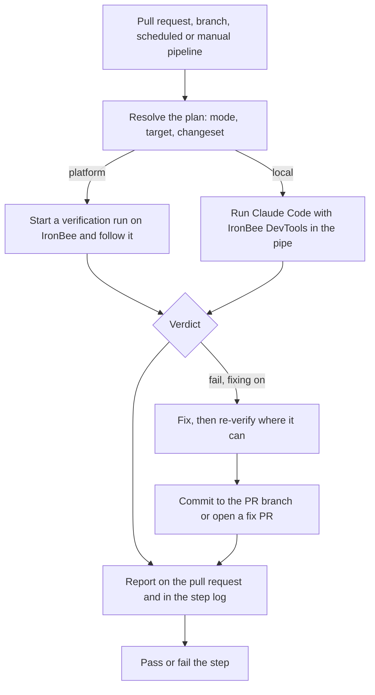

Every run of the IronBee Pipe follows the same path:
1. It resolves a plan and verifies the change.
2. When fixing is on, it fixes what failed and commits the fix.
3. It reports on the pull request and passes or fails the step.

Only the verification step differs between the two [modes](/bitbucket-pipe/concepts/verification-modes): on IronBee (platform mode) or on your Bitbucket Pipelines runner (local mode). The pipe runs the same steps as the [GitHub Action](/github-action/concepts/how-it-works) and the [GitLab component](/gitlab-component/concepts/how-it-works), in the same order.

---

## The run, step by step

<Steps>
  <Step title="Plan">
    The pipe decides the mode, the target and the changeset, and logs them together with the reason for the mode and the minimum `max-time` the step needs. It stops here, before installing anything, when the run can't work: no target, or an invalid variable value.
  </Step>
  <Step title="Verify">
    **On IronBee:** the pipe installs the IronBee CLI and runs `ironbee verify run web`. That starts a verification run on IronBee and follows it until it ends.
    - For an app that runs in the pipe, the pipe installs, builds and starts it first, and IronBee reaches it through a reverse tunnel.
    - The recording, screenshots and logs are kept in the IronBee Console.

    **On your runner:** the pipe installs Chromium, IronBee DevTools and Claude Code, writes `.ironbee/config.json` and runs `ironbee install --client claude`. Claude Code then verifies the change through IronBee DevTools. The evidence goes to the step's artifacts and to IronBee.
  </Step>
  <Step title="Fix">
    This step runs when the verification fails, fixing is on (`VERIFICATION_APPLY_FIX`) and an Anthropic credential is set.
    - **On IronBee:** a Claude Code run in the pipe edits the files to fix the reported issues. For an app that runs in the pipe, the pipe then restarts it and runs a second verification. A deployed URL isn't re-verified, because the deployment still serves the code that was deployed.
    - **On your runner:** the agent fixes and re-verifies in the same session. With fixing off, it reports what it finds and changes no file.
  </Step>
  <Step title="Commit">
    The pipe commits and pushes the fix itself, with the step's [Bitbucket token](/bitbucket-pipe/get-started/getting-started#the-bitbucket-token); the agent only edits files. Only the files the fix changed are committed.
    - On a pull request, the fix goes to the pull request's source branch.
    - Otherwise it goes to a new `ironbee/fix-<sha7>-<build_number>` branch with a pull request.
    - A fix whose re-verification fails is not pushed.

    Fix commits end in `[skip ci]`, so a fix doesn't start a pipeline that verifies it again.
  </Step>
  <Step title="Report">
    The report is posted as a pull request comment, updated in place on later runs. It links to the run in the IronBee Console. When IronBee publishes the run on the pull request itself, the pipe posts no comment. Bitbucket has no step summary, so the report is also printed in the step log under **IronBee Verification Report** and saved as `report.md` in the step's artifacts.
  </Step>
  <Step title="Pass or fail">
    The last step fails the pipe, and with it the step, when the verification fails or ends without a verdict.
  </Step>
</Steps>

---

## What gets verified

The pipe binds each run to the change behind the pipeline, so the verification looks at what changed rather than at the whole repository.

| Pipeline | What gets verified |
|----------|--------------------|
| `pull-requests:` | The whole pull request |
| `branches:` | Off the main branch: every commit since the branch left the main branch. On the main branch: the pushed commit against its parent |
| `custom:` with `EVENT_NAME: manual` or `schedule` | On IronBee: the commit against its parent. On your runner: the whole application |

Bitbucket doesn't tell a pipe which commit a push started from, so a push is measured from where its branch left the main branch. See [Running in Bitbucket Pipelines](/bitbucket-pipe/guides/running-in-pipelines).

To verify the application without the repository, for example a private repository whose workspace isn't connected to IronBee, set `IRONBEE_BIND_REPOSITORY: "false"`.

---

## Where results appear

- **On the pull request:** the pipe's report comment, with a link to the run in the console. When the repository's [Bitbucket workspace is connected](/integrations/bitbucket), IronBee publishes a run on IronBee itself instead: a build status on the verified commit and, on a pull request, inline comments and a summary comment. The pipe then leaves its comment out.
- **In the pipeline:** the report in the step log, the step's pass or fail result, and the step's artifacts. The `IRONBEE_VERDICT`, `IRONBEE_MODE`, `IRONBEE_JOB_ID`, `IRONBEE_JOB_URL`, `IRONBEE_ARTIFACTS_URL` and `IRONBEE_PLATFORM_PUBLISHES` [outputs](/bitbucket-pipe/configuration/configuration#outputs) are available to the step's `after-script` on every run, and to its later script lines when the pipe passes.
- **In the IronBee Console:** runs on IronBee appear on the project's **Verifications** tab with the trigger **Bitbucket Pipelines**. The project is the Bitbucket project unless you set `IRONBEE_PROJECT`. See [Verifications](/console/verifications).

---

## What's next?

<CardGroup cols={2}>
  <Card title="Platform and local verification" icon="split" href="/bitbucket-pipe/concepts/verification-modes">
    Choose where the verification runs.
  </Card>
  <Card title="Running in Bitbucket Pipelines" icon="git-branch" href="/bitbucket-pipe/guides/running-in-pipelines">
    Pipelines, fix behavior and the report.
  </Card>
</CardGroup>
