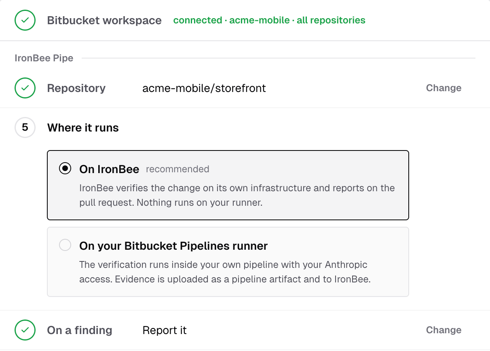
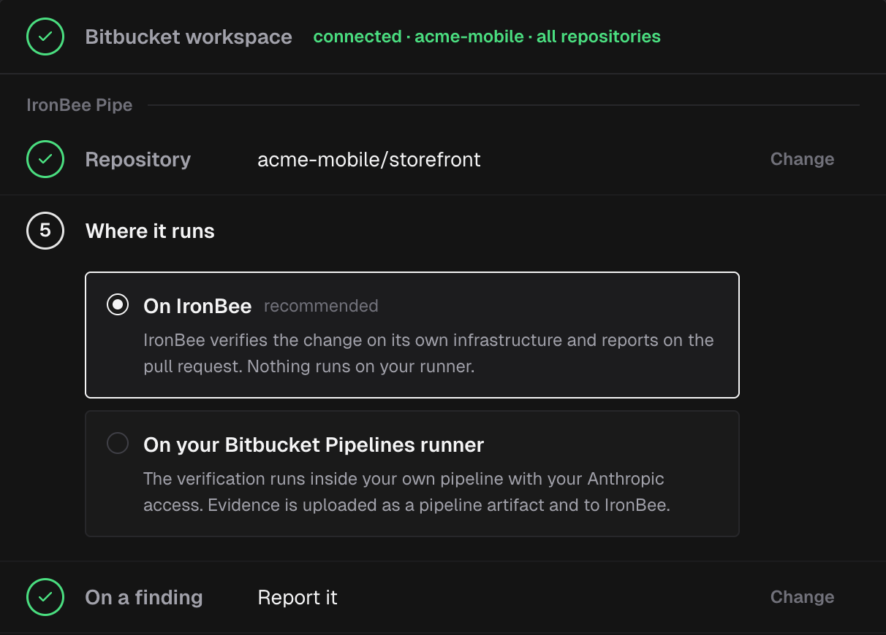

The IronBee Pipe verifies every pull request and every push to your main branch against your running application and reports the result on the pull request. It's the Bitbucket Pipelines counterpart of the [IronBee GitHub Action](/github-action/get-started/getting-started) and the [IronBee GitLab component](/gitlab-component/get-started/getting-started), with the same inputs, decisions and report. It can run the verification in one of two places:

- **On IronBee**: IronBee verifies the change on its own infrastructure. Nothing is installed in your pipeline.
- **On your Bitbucket Pipelines runner**: the verification runs inside the pipe, in your pipeline, with your own Anthropic access.

When the verification finds a problem, the pipe can report it, or also write the fix and commit it.

The pipe is a Docker image, `docker://ghcr.io/ironbee-ai/ironbee-bitbucket`, that a step of your `bitbucket-pipelines.yml` runs. Its source is on [GitHub](https://github.com/ironbee-ai/ironbee-bitbucket). This guide gets it running in a few minutes. For the mechanics behind it, see [How it works](/bitbucket-pipe/concepts/how-it-works).

---

## Prerequisites

- An [IronBee account](https://console.ironbee.ai) and your account API key. Owners and admins find it in the console under **Settings > Account**. Other members can ask an owner or admin for it.
- To verify **on IronBee**: the repository's workspace [connected to IronBee](/integrations/bitbucket). A public repository also works without it.
- To verify **on your Bitbucket Pipelines runner**, or to have findings fixed: an Anthropic API key from [console.anthropic.com](https://console.anthropic.com), or a Claude Code OAuth token from `claude setup-token`.
- A repository on bitbucket.org with Pipelines turned on. Bitbucket Data Center isn't supported.

---

## Set it up from the console

The fastest path is the console, which writes the pipeline file for you.

<Steps>
  <Step title="Connect Bitbucket">
    Open **Settings > Getting started**. On the **Bitbucket** card, click **Add the Pipe**, or **Connect Bitbucket** to connect your Bitbucket workspace first. See [Bitbucket](/integrations/bitbucket). On **Projects**, a Bitbucket project's **Install the IronBee Pipe** opens the same steps for that repository.
  </Step>
  <Step title="Answer three questions">
    In the **IronBee Pipe** step:
    - **Repository**: the repository the pipeline file and the variables go into.
    - **Where it runs**: **On IronBee** (recommended) or **On your Bitbucket Pipelines runner**.
    - **On a finding**: **Report it**, or **Fix it too**.

    
    
  </Step>
  <Step title="Set it up on Bitbucket">
    Fill in how your app starts, then add the repository variables the console lists: **Open repository variables** opens the repository's settings. Click **Copy and open Pipelines**: the console copies the file and opens the repository's Pipelines page. Paste it into a new `bitbucket-pipelines.yml` at the repository's root and commit. If the repository already has one, add the step to it instead; **Copy the pipeline file** copies the file again. The commit is a push, and that push starts your first verification.
  </Step>
</Steps>

The console listens for the first pipeline and moves on when it arrives. The rest of this page builds the same file by hand.

---

## Add the pipe

Add the pipe to `bitbucket-pipelines.yml` with one of the two starters below. Each defines the step once and runs it on every pull request and on pushes to `main`.

<Tabs>
  <Tab title="On IronBee, report only">
    ```yaml
    image: atlassian/default-image:5
    options:
      runtime:
        cloud:
          version: 3
    definitions:
      services:
        docker:
          memory: 7128
      steps:
        - step: &ironbee-verify
            name: IronBee verify
            size: 2x
            max-time: 90
            services: [docker]
            auth:
              system:
                scopes: [read:pullrequest:bitbucket, write:pullrequest:bitbucket, write:git:bitbucket]
            # What the pipe keeps for the step's Artifacts tab: the run's evidence.
            artifacts:
              - .ironbee/upload/**
            script:
              - pipe: docker://ghcr.io/ironbee-ai/ironbee-bitbucket:v1
                variables:
                  IRONBEE_API_KEY: $IRONBEE_API_KEY
                  BITBUCKET_OAUTH_TOKEN: $BITBUCKET_OAUTH_TOKEN
                  VERIFICATION_MODE: "platform"
                  VERIFICATION_APPLY_FIX: "false"
                  # Where the app runs during the pipeline: on this runner ...
                  APP_INSTALL_COMMAND: "npm ci"
                  APP_BUILD_COMMAND: "npm run build"
                  APP_START_COMMAND: "npm run start"
                  APP_PORT: "3000"
                  # ... or at a preview URL instead of the four lines above:
                  # APP_URL: "https://preview.example.com"
    # One pipeline per change: every pull request's, and the main branch's after a merge.
    pipelines:
      pull-requests:
        '**':
          - step: *ironbee-verify
      branches:
        "main":
          - step: *ironbee-verify
    ```
  </Tab>
  <Tab title="On your runner, fixing too">
    ```yaml
    image: atlassian/default-image:5
    options:
      runtime:
        cloud:
          version: 3
    definitions:
      services:
        docker:
          memory: 7128
      steps:
        - step: &ironbee-verify
            name: IronBee verify
            size: 2x
            max-time: 90
            services: [docker]
            auth:
              system:
                scopes: [read:pullrequest:bitbucket, write:pullrequest:bitbucket, write:git:bitbucket]
            # What the pipe keeps for the step's Artifacts tab: the run's evidence.
            artifacts:
              - .ironbee/upload/**
            script:
              - pipe: docker://ghcr.io/ironbee-ai/ironbee-bitbucket:v1
                variables:
                  IRONBEE_API_KEY: $IRONBEE_API_KEY
                  BITBUCKET_OAUTH_TOKEN: $BITBUCKET_OAUTH_TOKEN
                  ANTHROPIC_API_KEY: $ANTHROPIC_API_KEY
                  VERIFICATION_MODE: "local"
                  VERIFICATION_APPLY_FIX: "true"
                  # Where the app runs during the pipeline: on this runner ...
                  APP_INSTALL_COMMAND: "npm ci"
                  APP_BUILD_COMMAND: "npm run build"
                  APP_START_COMMAND: "npm run start"
                  APP_PORT: "3000"
                  # ... or at a preview URL instead of the four lines above:
                  # APP_URL: "https://preview.example.com"
    # One pipeline per change: every pull request's, and the main branch's after a merge.
    pipelines:
      pull-requests:
        '**':
          - step: *ironbee-verify
      branches:
        "main":
          - step: *ironbee-verify
    ```
  </Tab>
</Tabs>

Replace the four `APP_*` lines with your own install, build and start commands and the port your app listens on. If your app is already deployed at a public preview URL, delete the four lines and set `APP_URL` instead. The pipe needs one of the two: without a target the run stops before it verifies anything. See [Verifying your application](/bitbucket-pipe/guides/verifying-your-app).

What the step's other lines are for:
- **`auth`** gives the step's own token, `BITBUCKET_OAUTH_TOKEN`, the scopes the report comment and the fixes need. See [The Bitbucket token](#the-bitbucket-token).
- **`services: [docker]`**, **`size: 2x`** and the Docker service's **`memory`** leave room for an app the pipe starts with Docker Compose. **`runtime: cloud: version: 3`** and **`atlassian/default-image:5`** are what such a build needs. A run on IronBee that verifies a deployed URL needs none of the four. See [Docker Compose](/bitbucket-pipe/guides/verifying-your-app#docker-compose).
- **`artifacts`** keeps the files the pipe leaves in `.ironbee/upload/` on the step's **Artifacts** tab. See [Evidence](/bitbucket-pipe/advanced/evidence).

A `2x` step spends two build minutes for every minute it runs.

Bitbucket doesn't type-check a pipe's variables, so quote every value, as in `APP_PORT: "3000"`. The pipe sees a repository variable only when the step passes it, so every credential is named under `variables:`, as in `IRONBEE_API_KEY: $IRONBEE_API_KEY`.

To have findings fixed while verifying on IronBee, pass an Anthropic credential, set `VERIFICATION_APPLY_FIX: "true"` and raise `max-time` to `150`, as the console does for **Fix it too**: a fixed app on the runner is verified a second time. Before that re-verification, the pipe runs `APP_BUILD_COMMAND` and `APP_START_COMMAND` again. When the start command hands off to Docker Compose or a service, set `APP_RESTART_COMMAND`; see [Apps started through Docker Compose or a service](/bitbucket-pipe/guides/verifying-your-app#apps-started-through-docker-compose-or-a-service). On your runner, `VERIFICATION_APPLY_FIX: "false"` has the agent report what it finds and change no file.

<Tip>
  At the start of every run, the pipe logs the `max-time` its configuration needs. Set at least that much on the step: a pipe can't read its step's `max-time`, so it can't warn you. When Bitbucket stops a step mid-run, the verification is cancelled with it.
</Tip>

`:v1` follows the latest release, so your pipeline gets fixes without editing the file.

---

## Add the repository variables

In your repository, open **Repository settings > Pipelines > Repository variables** and add each variable. Mark each one **Secured**.

| Variable | Value | Needed for |
|----------|-------|------------|
| `IRONBEE_API_KEY` | Your IronBee account API key | Every run |
| `ANTHROPIC_API_KEY` | An Anthropic API key | Verifying on your runner, or fixing |
| `CLAUDE_CODE_OAUTH_TOKEN` | A Claude Code OAuth token, instead of `ANTHROPIC_API_KEY` | Verifying on your runner, or fixing |

Pass the Claude Code token with `CLAUDE_CODE_OAUTH_TOKEN: $CLAUDE_CODE_OAUTH_TOKEN` instead of `ANTHROPIC_API_KEY`. Your Anthropic key or token stays in Bitbucket: the pipe uses it only in your pipeline, and IronBee never receives it.

The next pull request or push to `main` starts a verification run.

---

## The Bitbucket token

The pipe posts the report comment, pushes the fix commit and opens the fix pull request with `BITBUCKET_OAUTH_TOKEN`, the short-lived token Bitbucket gives every step. No variable needs to be created for it. The step's `auth` decides what it can do:

| Scope | What for |
|-------|----------|
| `read:pullrequest:bitbucket` | Reading the pull request and its comments |
| `write:pullrequest:bitbucket` | The report comment and the fix pull request |
| `write:git:bitbucket` | The fix commit and the fix branch |

Pass it to the pipe as `BITBUCKET_OAUTH_TOKEN: $BITBUCKET_OAUTH_TOKEN`. The token ends with the step, and the pipe never prints it.

Without the token, the pipe still verifies:
- The report stays in the step log, with a warning.
- A run that produced fixes fails, because it has nothing to push them with. The fixes exist only in the pipe.

A run on IronBee that only reports needs no token. When IronBee publishes the run on the pull request itself, the pipe posts no comment at all. See [The report](/bitbucket-pipe/guides/running-in-pipelines#the-report).

---

## Forks

Bitbucket runs no pipeline for a pull request from a fork, so the pipe never verifies one.

---

## Next steps

<CardGroup cols={2}>
  <Card title="Platform and local verification" icon="split" href="/bitbucket-pipe/concepts/verification-modes">
    How the pipe decides where the verification runs.
  </Card>
  <Card title="Running in Bitbucket Pipelines" icon="git-branch" href="/bitbucket-pipe/guides/running-in-pipelines">
    How the pipe behaves on each pipeline and what it reports.
  </Card>
  <Card title="Verifying your application" icon="play" href="/bitbucket-pipe/guides/verifying-your-app">
    An app in the pipe, Docker Compose, or a deployed URL.
  </Card>
  <Card title="Configuration" icon="settings" href="/bitbucket-pipe/configuration/configuration">
    Every variable and output, with defaults.
  </Card>
</CardGroup>
