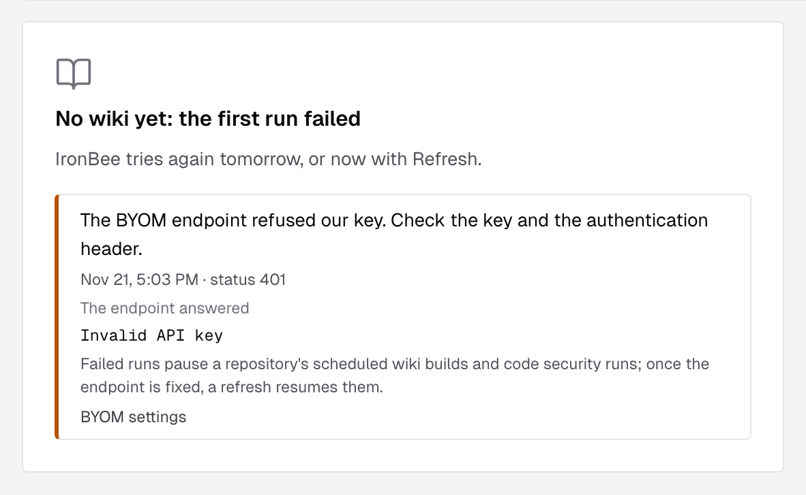
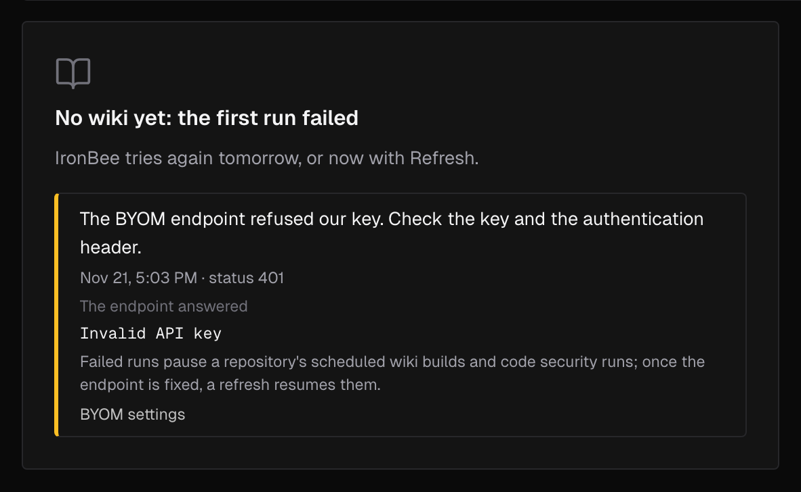

Once BYOM (Bring Your Own Model) is on, your endpoint's answers decide whether a job can finish. This page says what to expect, what a job that failed on your endpoint says and where, and what to do about each kind of failure.

---

## Once it's on

- **From the next job, every job of the account runs on your model,** the ones no person starts among them: a repository's scheduled wiki refreshes, scheduled code security scans and their follow-up runs. Jobs already running when you enable BYOM finish on IronBee's model.
- **There's no fallback.** While BYOM is enabled, no job moves to IronBee's model when your endpoint fails, and none to another model of yours.
- **A job on your model says so.** A pull request's jobs, a code security run and a verification's details show **BYOM** beside the job's credits, and so does each such charge on [Credit usage](/console/usage#charges).
- **An edit applies within 20 seconds.** Saving new settings runs the connection test again, and a running job's calls go to the edited endpoint within 20 seconds of the save.
- **Disabling stops the running jobs.** From the next job, the account's jobs run on IronBee's model again. Jobs running on your endpoint stop calling it within 20 seconds and fail; none moves to IronBee's model. Deleting the settings does the same.
- **The model moves a verification's verdict, its time and its credits.** Measured on one page and one prompt: some models passed the run and others failed it on a finding they raised themselves, and one model took more than ten times the calls of another. A model that widens a run takes more minutes, and so more credits.
- **Your server's sampling settings apply.** IronBee's engines send no temperature or other sampling field, so the server's defaults, often the model's own, decide, and they can decide whether a review finishes at all. See [Sampling defaults](/byom/server-recipes#sampling-defaults).
- **A cancelled job's call already sent runs to its end** at your endpoint: your provider or your server does that call's work in full. See [Capacity](/byom/your-endpoint#capacity).

---

## What a failed job says

A job that failed on a model call while your endpoint's last answer to it was a failure ends with one of two error types:

| Error type | Meaning |
|------------|---------|
| `byom_unavailable` | The model path never answered |
| `byom_failed` | Any other failure of the model |

A code review always takes `byom_failed`, also when the model path never answered. The public API carries it as `error.type` on a code review or verification job, and as `errorType` on a code security run. The CLI prints it before the message, and the verification page shows it as the run's error type.

### In the console

The job's page says what your endpoint did, in a sentence that begins "The BYOM endpoint", with what to do about it, the time, the status your endpoint gave, and an excerpt of its error with your key and secret headers' values taken out. **BYOM settings** opens [Settings > BYOM](/console/byom). On a failed wiki build or code security run, it adds that failed runs pause the repository's scheduled runs.

**Settings > BYOM** shows your endpoint's **Last failure** until its next success clears it. See [Last failure](/console/byom#last-failure).

A job that finished although your endpoint's last answer to it was a failure, such as a review whose summary call failed, keeps a note on its page: "The BYOM endpoint failed during this job. The job finished without the step that needed it." A later successful call of the same job clears it. Its status, result and charge stay a finished job's.

### On the pull request and in the API

The public places carry fixed words alone, never the host, an address, your endpoint's text or a number: a check run, a merge request's status, a pull request's comment, verification's check output, and the public API's `error.message`, which the CLI prints. The words are "The BYOM endpoint" and a reason, then "; see the console."

| What happened | The public words | What the console adds |
|---------------|------------------|-----------------------|
| The endpoint couldn't be reached | could not be reached | Check that it's up and that it allows IronBee's addresses |
| Its address isn't public | is not reachable from IronBee | A model on a private network isn't supported in the cloud; the self-hosted runner reviews code with it |
| Its certificate wasn't trusted | refused our secure connection | Add your authority's certificate to the CA bundle |
| It answered with a redirect | answered with a redirect | Use the address it redirects to |
| It refused the key | refused IronBee's credential | Check the key and the authentication header |
| It didn't know the route or the model | does not know the model | Check the base URL, the format and the model name |
| It refused a prompt as too long | refused a prompt as too long | Check the declared context window against the server's own setting |
| It limited IronBee's requests | limited IronBee's requests | Raise its rate limit or its concurrency |
| Its account has no credit left | has no credit left at its provider | Add credit or raise the limit at the provider |
| An error of its own, a timeout, an answer not in the format's shape, a refused request | failed | Which of these it was |
| BYOM was disabled or deleted while the job ran | was disabled, or was removed | |
| Its format changed while the job ran, to one the job couldn't go on in | had its format changed during the job | A job started after the change runs on the new format |
| Its provider refused the request under its usage policy | 's provider refused the request under its usage policy | Such a check can flag harmless content now and then; the job can be run again |

A job ended by a deadline shows the deadline instead. A slow or stalled endpoint ends jobs that way, and the **Last failure** on **Settings > BYOM** is then the pointer to it.

A failed job is free or charged as the same failure on IronBee's own model is, at the BYOM rate. For a verification, `byom_unavailable` is free and `byom_failed` is charged its started minutes at the BYOM rate. See [Jobs on BYOM](/console/usage#jobs-on-byom).

---

## Provider out of credit

When your endpoint's account at its provider has no credit left, or has reached its spending limit, a job fails at once: the call isn't sent again, and the job's words are "The BYOM endpoint has no credit left at its provider; see the console." Add credit or raise the limit at the provider. The connection test tells this apart from a rate limit too, and fails with the same advice.

On Anthropic's API, the account's credit must also cover Claude Code's traffic. Measured on 2026-11-22: an account refused for credit on every request Claude Code made still answered plain requests, so the connection test passed while every verification failed at its first call. Other products may run on such an account. Check that its credit covers Claude Code's requests before you rely on verification.

---

## A request refused under the provider's usage policy

A request your endpoint's provider refuses under its usage policy isn't sent again:

- A job that can't go on without that call fails at once, with the words "The BYOM endpoint's provider refused the request under its usage policy; see the console."
- A job that can finish without it, such as a review that loses one reader call or its summary, finishes. Its page keeps a note when that refusal was your endpoint's last answer to the job.

IronBee knows such a refusal by the codes OpenAI and OpenRouter give in their errors, OpenRouter's also for a block by one of its providers' content filters. A block can fall on a harmless request: OpenAI's check flagged Claude Code's own compaction prompt once in 37 compaction calls, and Gemini's content filter, through OpenRouter, blocked a request in two runs of IronBee's verification set, all on synthetic content. Running the job again may pass.

---

## A verdict the model couldn't write

A verification whose model writes its verdict as invalid JSON, past Claude Code's own retries, ends with the error type `agent_error` and the message "The model did not write a valid verdict." No failure of your endpoint lies under it: the model answered, and its answer couldn't be read as a verdict.

---

## Other verification failures

- **A Claude model newer than IronBee's Claude Code.** Anthropic's API refuses a Claude Code version older than the one a model asks for, at Claude Code's first call. The settings pass the connection test and the other products run, but verifications fail at their first call, at no credit, with the API's own sentence in the console. See [Claude models and IronBee's Claude Code version](/byom/formats-and-models#claude-models-and-ironbees-claude-code-version).
- **A request too large.** One request to your endpoint is bounded at 16 MiB, and a long verification can reach it before its window is full. That call fails as `request_too_large`. See [The request bound](/byom/formats-and-models#the-request-bound).
- **A silent server.** A verification's call that gets no byte for too long is cut and sent again, which costs the run time. See [Verification's limits on silence](/byom/formats-and-models#verifications-limits-on-silence).

---

## An outage pauses scheduled runs

A few hours of an endpoint outage fail several runs of a repository, and that pauses its scheduled wiki builds and code security scans, as any failures do. Once your endpoint is fixed, start a run by hand to resume them: **Refresh** on the [code wiki](/console/code-wiki#refresh-the-wiki), or a scan on [code security](/code-security/how-a-scan-works#when-scans-stop-coming).

---

## If IronBee reports a compromise

If IronBee tells you that the keys it holds for BYOM may have been read:

<Steps>
  <Step title="Rotate the key">
    Rotate the key at your endpoint or at your provider, and any secret header's value that grants access.
  </Step>
  <Step title="Save the new values">
    Save the BYOM settings with the new values, which runs the connection test. While IronBee's temporary block is on, which the notice says, every job on BYOM fails, whatever you save. Rotate and save anyway: your jobs resume on the new key when the block is lifted.
  </Step>
</Steps>

IronBee disables nothing. Once the block is lifted, until you rotate, your jobs run on the old key. To stop them meanwhile, disable BYOM yourself: the account's next jobs then run on IronBee's model, and jobs running on BYOM stop within 20 seconds and fail.

---

## What's next?

<CardGroup cols={2}>
  <Card title="BYOM settings" icon="settings" href="/console/byom">
    The record, its last failure, and enable, disable, edit and delete.
  </Card>
  <Card title="Prepare your endpoint" icon="server" href="/byom/your-endpoint">
    Reach, capacity and the limits worth setting on your side.
  </Card>
</CardGroup>
