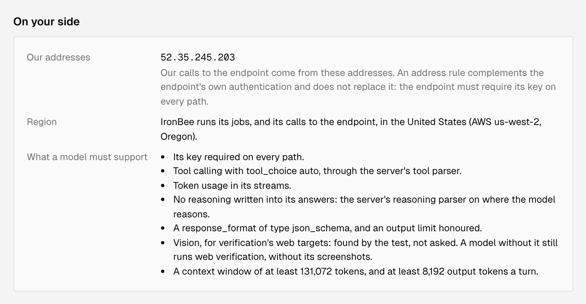
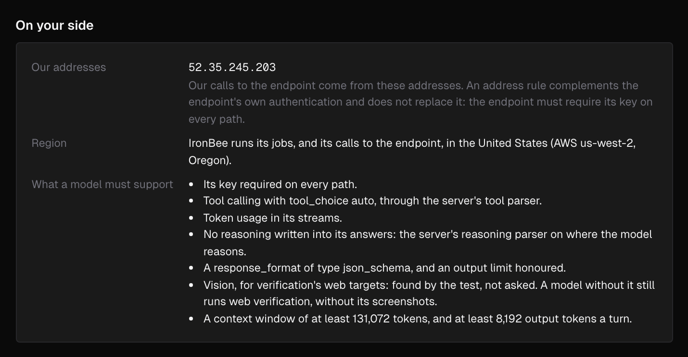

This page is what to do on your side before you save your BYOM (Bring Your Own Model) settings. The connection test checks most of it when you save; what it can't see is said below. For the flags of a server of your own, see [Server recipes](/byom/server-recipes).

---

## Security

Your endpoint's own key decides who may call it. What you do depends on where the model is served.

### An endpoint of your own

For a server or gateway of yours, the form's **Other**:

- **Accept connections from IronBee's addresses alone.** The form lists them under **Our addresses**, and the public API answers them too. See [IronBee's addresses](#ironbees-addresses).
- **Require the key on every path**, not only on the route IronBee calls. A server that checks no key itself, or checks it on some paths alone, goes behind a [reverse proxy](/byom/server-recipes#a-reverse-proxy-in-front) that checks it.
- **Give IronBee a key made for BYOM alone**, scoped to the model the BYOM settings name, and limited on your side, with a spending or a rate limit, where your gateway can.
- **Keep the server's own logs private.** A server may print its key there: SGLang 0.5.23 does in its start log. Where a server reads its key from its environment, as vLLM reads `VLLM_API_KEY`, pass it that way.

<Warning>
An address rule adds to the endpoint's own authentication and doesn't replace it. The endpoint must require its key on every path, whatever the connection test says: the test calls only your format's route.
</Warning>

### Your own Anthropic or OpenAI key

With the **Anthropic** or **OpenAI** preset there's no address rule to set: neither API takes an allowlist of IronBee's addresses. The control is the key:

- **Anthropic:** a key made for BYOM, scoped as Anthropic allows, such as a workspace kept for IronBee with a spending limit on it, and rotated there.
- **OpenAI:** a key made for BYOM, scoped as OpenAI allows, such as a project kept for IronBee, the models it may call and a budget on it, and rotated there.

---

## Reach

- **Public HTTPS.** The endpoint answers HTTPS from the internet, on port 443 or a port from 1024 to 65535, with a certificate a public authority signed or one the CA bundle you give signed.
- **Public addresses only.** Its name resolves to public addresses. A model on a private network isn't supported in the cloud; the [self-hosted runner](/code-review/self-hosted-runner/overview) reviews code with such a model from your own CI.
- **No redirects.** IronBee never follows one: give the address it redirects to.
- **A plain base URL.** No query, no fragment, no user or password in it.

### IronBee's addresses

Every call IronBee makes to your endpoint comes from one IPv4 address, `52.35.245.203`: let it in on your endpoint's port. When you pick **Other**, the form shows it under **On your side**, with the region the calls come from and what a model must support in the format you picked:




The public API answers the same list as `egressAddresses`, with any API key or OAuth token of your account, so a script can keep your rule in step with it:

```bash
curl -s https://api.service.ironbee.ai/v1/vcs-network \
  -H "X-API-Key: $IRONBEE_API_KEY"
```

It's the same address a [registered GitLab instance](/integrations/gitlab-self-managed) or [GitHub Enterprise Server](/integrations/github-enterprise) lets in.

---

## What to serve

| Need | Why |
|------|-----|
| The route of your format: `<base URL>/v1/messages`, `<base URL>/chat/completions` or `<base URL>/responses` | Every call of every job goes there |
| Tool calling with `tool_choice: auto`, through the server's tool parser | Every product calls tools, and a verification's verdict is a tool call |
| No reasoning written into the answers' text: the server's reasoning parser on, where the model reasons | Reasoning in the text breaks structured answers |
| Token usage in streams: the input and the output counts | vLLM and SGLang send it when a request asks for it, which IronBee's requests do |
| On OpenAI Chat Completions: structured output (a `response_format` of type `json_schema`), and an output limit that's honored | The engines ask for JSON of a schema, and cap every turn |
| On OpenAI Responses: an output limit that's honored, and stateless calls (`store: false`) that return the model's reasoning as encrypted content and take it back, as OpenAI's API does | Every call on that route is stateless, and a tool round sends the model's reasoning back |
| On OpenAI Responses: a `developer` message anywhere in `input`, not only first | A system message written between turns goes in its place as one |
| A stream passed through as it comes | A gateway that holds a stream back before passing it on stalls IronBee's clients |

The form doesn't ask what the test finds on its own: whether the model reads images, which output-limit field the endpoint takes, the highest effort level whose answers stay clean, whether it takes sampling fields, a JSON schema, and one together with tools, whether its answers stay clean with thinking, whether it takes a system entry inside the messages, and on Chat Completions whether it needs the model's reasoning handed back with its tool calls. IronBee applies what the test found to every call: an effort level higher than the one found is lowered to it, and fields the endpoint refused are left out.

### Answer errors at once

An endpoint that holds its response headers before an error costs each of IronBee's retries the same hold again. Measured: a refusal held 30 seconds before its 429 kept a verification retrying for several minutes. Refuse early.

When a client gives up on a call, IronBee closes the endpoint's request and sends the call again after a timeout. A server that goes on working on a request whose connection was closed takes each retry as new work. Measured on 2026-11-21, neither vLLM 0.34.0 nor SGLang 0.5.23 does, on either route, whatever state the request was in. A gateway or reverse proxy in front of the server may still go on with the server's request after IronBee's side closed it.

---

## Size

- **Context window:** at least 131,072 tokens, as you declare it, and the server's own context setting no smaller than what you declare. Ollama's default is smaller, and a server whose window overflows may drop the oldest messages without an error: declare the smaller of the two numbers.
- **Output tokens a turn:** at least 8,192, and at most half the window.
- **A model that thinks wants an output limit well above that floor.** Its thinking and its answer share the turn's limit: Claude's thinking counts toward `max_tokens`, and the Responses API's `max_output_tokens` holds reasoning and answer together. OpenAI's documents advise at least 25,000 tokens for the two. An answer cut while the model was still reasoning comes back with little or no text.
- **A larger window leaves a review more room.** 131,072 tokens is the least IronBee accepts, not what it recommends.

### The window is your lever on cost

In the form's words: "Our engines fill the window you declare, so a full call is billed by your provider for that many tokens, at its long-context rate where it has one, and counts against your key's tokens a minute. A smaller window, never below 131,072 tokens, is your lever on what a full call costs."

- **OpenAI:** for each of the known models, a request of more than 272,000 input tokens is priced higher, by OpenAI's documents twice the input rate and 1.5 times the output rate, for the whole request. Your key's tokens a minute follow its tier.
- **Anthropic:** Haiku 5.5 is priced higher on a prompt of more than 100,000 tokens, by Anthropic's documents five times. Your key's tokens a minute follow its tier.
- **Your own server:** the window you declare is what one call holds on your card, the rest of the calls queuing. See [what one card gives](/byom/server-recipes#what-one-card-gives).

---

## Capacity

- **One job sends up to 16 calls at once,** times the account's jobs running together.
- **A server that answers 429 slows jobs down.**
- **A call that gets no first byte for 10 minutes is cut and sent again.** Measured on 2026-11-22 with calls held silent in front of vLLM 0.34.0: a review's call held 700 seconds was cut at 600 and sent again, and the review succeeded; one held 400 seconds came back whole.
- **Warm the server before you save.** A server's first start can spend many minutes compiling: SGLang's first start on a small GPU took over ten. The connection test gives a call 30 seconds, so start the server and send it a request of your own first.
- **A cancelled job's call already sent runs to its end on your server.** Measured on 2026-11-21 on vLLM 0.34.0: after a review was cancelled, its request then reading a 127,042-token prompt ran 21 seconds more, and one more call of the job followed, none after it. Your provider or your server does that call's work in full.

---

## Limits of your own

Set a spending or a rate limit on your gateway or at your provider. IronBee's caps on a job's tokens guard against a job that runs away; they aren't a budget, and code security runs with no spending stop of IronBee's on BYOM.

---

## What's next?

<CardGroup cols={2}>
  <Card title="Formats and models" icon="shuffle" href="/byom/formats-and-models">
    Choose the format, and see the models measured so far.
  </Card>
  <Card title="Server recipes" icon="terminal" href="/byom/server-recipes">
    vLLM, SGLang, Ollama and NIM, and the reverse proxy in front.
  </Card>
</CardGroup>
