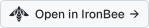
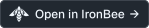
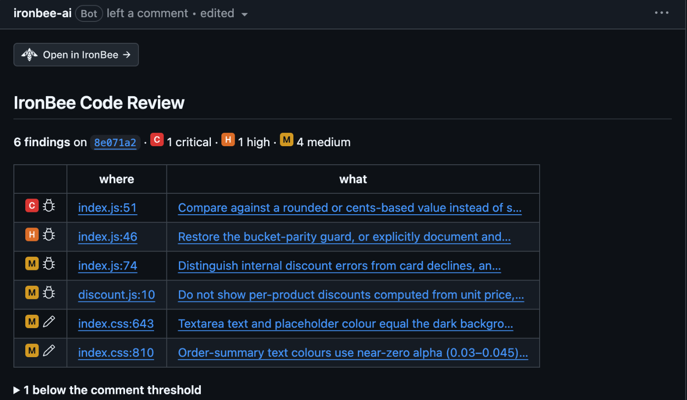
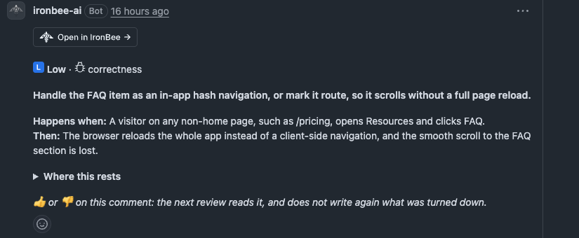
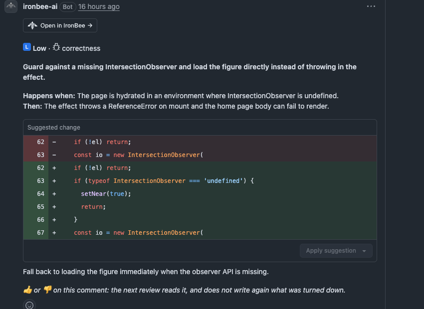
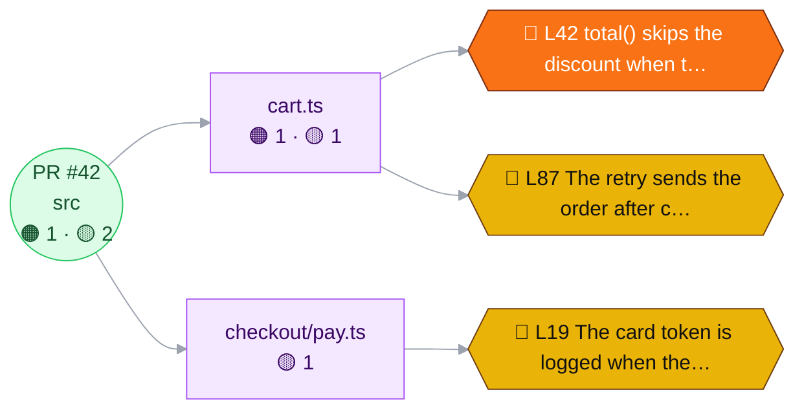
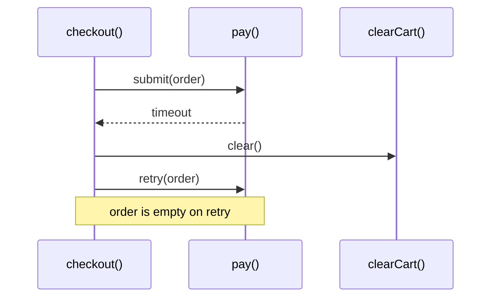
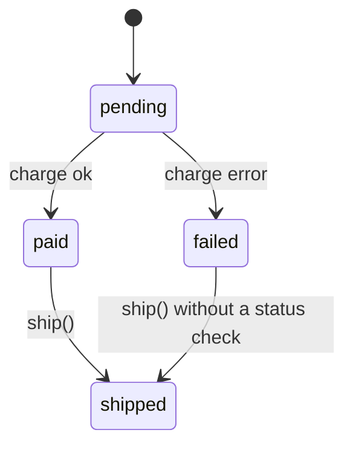
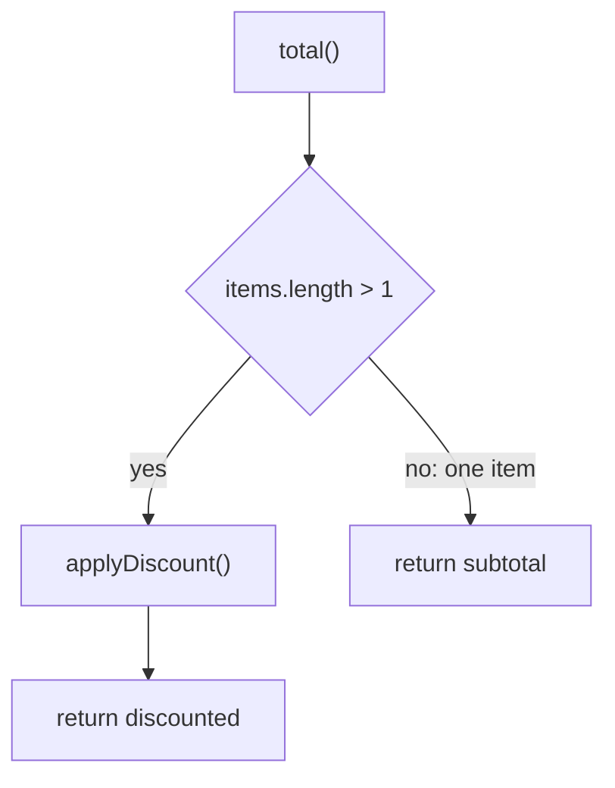
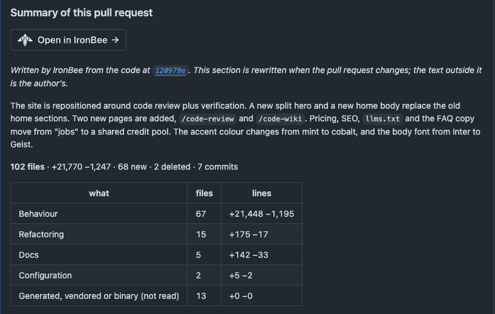

IronBee reviews the pull requests of a repository that's connected through the [IronBee GitHub App](/integrations/github) and has code review turned on. It posts a review with inline comments, adds a summary to the pull request's description, and sets the **IronBee review** check. Everything it writes appears as `ironbee-ai[bot]`. To turn code review on, see [Code review](/code-review/overview).

Each review also appears in the console, with its findings. See [Pull requests](/code-review/pull-requests). To review a branch before you open a pull request, use [`ironbee review`](/cli/guides/code-review) in the CLI.

---

## What starts a review

These pull request events start an automatic review:

| Event | Reviewed when **Automatic reviews** is |
|-------|----------------------------------------|
| Pull request opened | **On open and every push** or **On open only** |
| Pull request reopened | **On open and every push** or **On open only** |
| Draft marked ready for review | **On open and every push** or **On open only** |
| New commits pushed | **On open and every push** |

With **Only when asked**, nothing starts on its own. Other events, such as an edited title or a new label, never start a review.

These settings keep an automatic review from running:

| Setting | What it does |
|---------|--------------|
| **Draft pull requests** | **Wait until ready**, the default, skips drafts until they're marked ready for review. **Review drafts too** reviews them like any other pull request |
| **Pull requests opened by bots** | **Not reviewed**, the default, skips a pull request a bot opened, and that bot's own pushes to it. A person's push to a bot's pull request is reviewed |
| **Target branches** | Only pull requests that merge into a matching branch are reviewed, such as `main` or `release/*`. Empty means every branch |
| **Skip by label** | A pull request with one of these labels is skipped. Case doesn't matter |
| **Skip by title** | A pull request whose title contains one of these words is skipped. The match is a whole word in any case, so `WIP` doesn't match "Wipe" |

These settings hold back automatic reviews only. A person who asks with [`@ironbee-ai review`](#commands), or with [**Review now**](/code-review/pull-requests#review-now) in the console, still gets a review. Comments and pushes from bots never start anything.

When code review is off for the repository, IronBee doesn't review its pull requests and ignores commands there. See [Code review settings](/code-review/settings) for where each setting lives and who can change it.

---

## The review IronBee posts

IronBee posts one GitHub review on the commit it read. The review is a comment: it never approves a pull request or requests changes. Whether a finding holds a merge is up to [the check](#the-ironbee-review-check).

### The review body

The body opens with an **Open in IronBee** button, which opens the pull request in the console:

Under it comes the heading **IronBee Code Review**, the same in every **Comment language**, on every review: the first one, a follow-up, or one with no findings. Then come:

- **The head line:** the number of findings on the commit, with the counts by severity, such as **3 findings** on `abc1234` ·  1 high ·  2 medium.
- **Notes on how the review was made**, in italics. For example, how many files **Paths to ignore** left out ("_2 files left out by the repository's settings._"), that **Auto** depth read a large change at a lighter depth, or a **Partial review** note naming the files that weren't read in full, which the next review reads.
- **The team's rules and memories** the review applied ("Applied 2 rules and 1 memory: ..."), and any of the repository's rule files it left out as invalid, with why. See [Rules and memories](/code-review/rules-and-memories).
- **The findings table:** one row per finding, most severe first. The first column holds the severity and kind marks, **where** links to the line at the reviewed commit, and **what** links to the finding's inline comment. After 10 rows, the rest fold under **+N more**.
- **Findings below the comment threshold:** the findings whose severity is under the **Comment on findings of** setting, folded under **N below the comment threshold**. A low finding that reads as a minor remark is listed there too, whatever that setting says. They get no inline comment of their own and never hold a merge.
- **A diagram** of where the findings sit: the folders and files of the change, each finding colored by its severity. See [Diagrams](#diagrams).
- **The feedback line:** "_👍 or 👎 on a comment teaches the next review._"

When the review finds nothing, the heading is followed by "No findings on `abc1234`."

The head line, the findings table and each inline comment mark a finding's severity and kind with small icons that follow your GitHub theme:

| Severity | Icon |
|----------|------|
| Critical |  |
| High |  |
| Medium |  |
| Low |  |

The kind is the finding's category:  correctness,  security, or  editorial, for text, names or tests that disagree with the code. A finding the review rated down instead carries why:  preference,  style,  docs,  test only or  debug only.

Diagrams, the pull request summary and replies on a thread can't hold images, so they mark severity with colored dots: 🔴 critical, 🟠 high, 🟡 medium and 🔵 low. A review too long to hold the icons uses the same dots.

### Inline comments

Each finding gets an inline comment on its line of the diff. A comment holds, in order:

1. An **Open in IronBee** button, which opens the finding in the console.
2. The severity and the kind:  **High** ·  correctness.
3. The finding, in bold.
4. **Happens when:** the condition that triggers it, and **Then:** what goes wrong.
5. **How it happens**, a folded diagram, on a finding about an order of events, a state or a path through the code. See [Diagrams](#diagrams).
6. A suggested fix, as a GitHub suggestion you can apply with **Commit suggestion**. Turn these off with **Suggested fixes**. When a fix can't be a suggestion, it's a code block headed "Suggested fix (replaces lines 12-14):".
7. The team's rules and memories the finding relies on, one line each: "Rule `name`" or "Based on team memory `name`", with its level and first line, or a link to the repository file it comes from. See [Rules and memories](/code-review/rules-and-memories).
8. **Where this rests**, a folded list of the lines the finding relies on, such as a caller, a definition or the place a guard is missing.
9. **The same fix also answers:** other findings, in other files, that the same change fixes.
10. For a finding from one of IronBee's built-in checks, the source it relies on: "Source: ...".
11. The feedback line: "_👍 or 👎 on this comment: the next review reads it, and does not write again what was turned down._"

A finding on a line just outside the diff is placed on the nearest line the diff shows, with "_About line 42, just outside the diff._" Such a comment never offers a one-click suggestion. If GitHub refuses an inline comment, IronBee lists every finding in the review body instead.

Two inline comments as GitHub shows them, the first with **Where this rests** folded and the second with a suggested fix:

The **Comment language** setting sets the language of the comments, the body and the summary. Code, names, suggested fixes, severities, kinds and command words stay as they are.

### Diagrams

IronBee draws its diagrams in Mermaid, which GitHub renders in place, from the pull request's own code. The examples below use a made-up change.

**Where the findings sit.** The review body maps the findings onto the change: the pull request at the root, then the folders and files with their counts by severity, then each finding as a hexagon in its severity's color, with its kind, its line and the start of its title. A file shows its three most severe findings and folds the rest into **+N more**. On a large change, folders and files fold too, behind a dotted line. The map is left out only when the review body would be too long for GitHub.

**How it happens.** A finding that depends on an order of events, a state or a path through the code carries a diagram of it, folded under **How it happens** in its inline comment. It uses the names from the code and draws at most six boxes. There are three kinds:

<Tabs>
<Tab title="Order of events">
A sequence diagram, for steps that fail only in a certain order, such as a callback, a retry or a lifecycle. The functions are the participants, each step is an arrow, and a note marks the step that fails.

</Tab>
<Tab title="State">
A state diagram, for a wrong or missing move between named states. It shows only the states involved and labels the wrong move with its condition.

</Tab>
<Tab title="Path">
A flowchart, for a branch, a guard or an early return that sends execution the wrong way. It shows the decision and its outcomes, and marks the path that fails.

</Tab>
</Tabs>

A finding that sits in a single value or expression, such as a missing validation, a wrong constant or a typo, gets no diagram. The **Diagrams** setting turns off the **How it happens** diagrams; the map in the review body stays. The pull request summary draws the same three kinds under **How it fits together**.

---

## The pull request summary

With **Pull request summary** on, IronBee adds a section at the end of the pull request's description, headed **Summary of this pull request**, with an **Open in IronBee** button under the heading. Its first line says where it comes from:

> _Written by IronBee from the code at `abc1234`. This section is rewritten when the pull request changes; the text outside it is the author's._

The section walks the approver through the change: an overview, **Why:**, and these parts, each shown only when it has something to say:

- the change in numbers, by kind: behavior changes, refactoring, tests, docs, configuration, generated files, and files that weren't read
- **Impact**: what the change reaches, in fixed fields in this order: **UI**, **API**, **Data**, **Configuration**, **Dependencies** and **Breaking**. Each field holds up to three points and shows only when it has one
- **What changed**, grouped by what each part of the change is about
- **How it fits together**, with diagrams and a folded map of which changed files use which
- **Where to look**, with the review's findings on each file
- **A reading order**
- **What this change leaves out**, such as "No test file is changed."
- **Files** and **Commits**, folded

IronBee writes only inside its own section, between two hidden markers, and rewrites it in place when the pull request changes. The author's text around it is never changed. If the description is empty, the section is all there is.

---

## Follow-up reviews

After the first review, a push (with **Automatic reviews** on **On open and every push**) or `@ironbee-ai review` starts a follow-up review. It reads what changed since the last review, not the whole pull request again. When the author's changes since the last review make up more than 75% of the pull request's changed lines, it reads the whole diff again. `@ironbee-ai full review` reads the whole pull request.

A follow-up review checks the earlier findings again:

- **A finding whose file the push changed**, anywhere in that file, is read against the new code.
- **Every other open finding** is read again too, against what the push changed, so a fix in another file can mark it addressed.

A finding the push didn't touch closes only on a change the author pushed, never on what a merge from the base branch brought in. A push that only merges the base branch reads none of the untouched findings again.

When something changed, IronBee replies on the finding's thread:

| What IronBee finds | Its reply | The thread |
|--------------------|-----------|------------|
| The finding was fixed | "Looks addressed in `abc1234`: ..." | Resolved, when **Close fixed threads** is **Resolve the thread** |
| The code it was about was removed | "The code this comment was about was removed in `abc1234`." | Resolved, when **Close fixed threads** is **Resolve the thread** |
| The finding is still there | "Still applies after `abc1234`, now at `src/cart.ts:42`: ..." | Left open |
| A fixed finding came back | "Applies again after `abc1234`, now at `src/cart.ts:42`: ..." | Reopened, if IronBee had resolved it |
| The code changed and the comment no longer describes it | "The code here changed in `abc1234` and this comment no longer describes it." | Left as it is |

With **Reply only**, IronBee replies and leaves the threads of fixed findings open for you to resolve. When the change makes a finding more or less severe, the reply ends with "Severity now 🟠 **High** (was medium)." IronBee replies only when something changed: a finding still at the same place gets no new reply.

After you apply a fix IronBee asked for, the follow-up review doesn't post a new finding that only remarks on the trade-off the fix made, or that asks you to undo it. A defect the fix brings in is still reported.

Under its heading, the follow-up review's body starts with what happened since the last review: "**Since `abc1234`** (now `def5678`): 1 new · 2 addressed · 0 no longer applicable · 3 still open". When people [turned findings down](#replies-reactions-and-resolved-threads), the line ends with a count such as "· 1 turned down". Then come the new findings, with their table, and a fold, **Still open from earlier reviews**, listing the earlier findings that are still open, linked to their threads. An earlier finding that was listed in the review body has no thread to reply on, so what changed about it is listed under **Earlier findings without a thread**, one line each. New findings don't repeat what an earlier review said, or what someone turned down.

---

## The IronBee review check

Every review sets the **IronBee review** check on the commit it reviewed. **Details** opens the pull request in the console. See [Pull requests](/code-review/pull-requests).

### While the review runs

The check starts as **IronBee review · in progress**. Its summary names the depth, such as "review (Standard) in progress", and the credits the review will use. As the review moves on, the title shows how far it is, such as **IronBee review · 40% · reviewing changes**. The steps are preparing, reviewing changes, checking findings and writing the review.

### When the review is done

The title says what the review found:

| Review | Title |
|--------|-------|
| First review, with findings | `3 findings · 1 high · 2 low` |
| First review, nothing found | `Nothing to add` |
| Follow-up review | `2 open · 1 high · 1 low · 1 new · 3 addressed`, or `Nothing open · 0 new · 2 addressed` |
| Part of the change wasn't read | The title ends with `· partial` |
| After a person resolves one of IronBee's threads | `2 open · 2 low · 1 resolved by people` |

The summary starts with the commit, the change's size, how long the review took and the credits it used. A follow-up review's summary adds what changed since the last review, such as "Since `abc1234`: 1 new · 2 addressed · 0 no longer applicable · 1 turned down · 3 still open", with the turned-down count only when there are some. Links lead to **The review** and **The pull request's summary**. The details below hold the review's findings table and, after a follow-up review, the findings it found addressed.

### Conclusions

| Conclusion | When |
|------------|------|
| Success | No open finding reaches the **Block merging when** threshold |
| Action required | An open finding reaches the threshold: **Medium or worse open**, the default, or **High or worse open**. With **Never**, the check never blocks |
| Neutral | The review didn't run, couldn't finish, or was retracted. See the titles below |
| Cancelled | The review was cancelled |

The **Action required** conclusion holds a merge only where the branch's protection rules require the **IronBee review** check. Without that, it's information only.

Only open findings count toward the conclusion. A finding listed below the comment threshold never counts, and neither does a finding whose thread a person resolved or that a person [turned down](#replies-reactions-and-resolved-threads). When a person resolves or unresolves one of IronBee's threads, IronBee rechecks the conclusion right away. The title shows what's open now, and the summary gains a line such as "_Rechecked after a thread was resolved or unresolved: ..._". A thread IronBee resolved itself doesn't count as resolved by people.

A neutral check never holds a merge. Its title names what happened:

| Title | What happened |
|-------|---------------|
| **IronBee review · too large to review** | The pull request changes more than 1,000 files, or more than 100,000 lines (additions and deletions together). Nothing was read. Split the change into smaller pull requests |
| **IronBee review · already reviewed** | A pull request between two long-lived branches, such as `develop` into `main`, whose changes were all reviewed in their own pull requests. The summary lists them |
| **IronBee review · out of credits this month** | The team's credits for the month are used up. See [When credits run out](#when-credits-run-out) |
| **IronBee review · not enough credits** | This review needs more credits than the team has left this month |
| **IronBee review · could not complete** | An error on IronBee's side. The summary says why. A new push, or asking again, starts a new review |
| **IronBee review · not published** | The review was written but couldn't be posted, and what was posted was taken back. A new push, or asking again, starts a new review |
| **IronBee review**, with the summary "retracted" | Someone retracted the review with [`@ironbee-ai retract`](#commands) |

A settings change applies from the repository's next pull request event. A check already on GitHub keeps its result until the next review.

---

## Commands

Write a command in a comment on the pull request's **Conversation** tab, mentioning `@ironbee-ai`:

| Command | What it does | IronBee's reply |
|---------|--------------|-----------------|
| `@ironbee-ai review` | Reviews the newest commit. After the first review, it reads only what changed since the last one | "Reviewing `abc1234` now." If nothing was pushed since the last review: "Nothing was pushed since the last review (`abc1234`). `@ironbee-ai` full review reads the whole pull request again." If a review is already running: "The review running now, at `abc1234`, covers it." |
| `@ironbee-ai full review` | Reads the whole pull request again, even when nothing was pushed | "Reading the whole pull request again at `abc1234`." |
| `@ironbee-ai pause` | Stops automatic reviews of this pull request. Asking still gets a review | "Paused: no automatic review of this pull request until `@ironbee-ai` resume. `@ironbee-ai` review still reviews it when asked." |
| `@ironbee-ai resume` | Starts automatic reviews again | "Resumed: the next push is reviewed again." |
| `@ironbee-ai retract` | Takes IronBee's review off the pull request: deletes its inline comments and its own comments, replaces each review body with "_(retracted)_", since GitHub keeps a submitted review, removes the summary section from the description, and sets the check to neutral. What a verification run posted on the pull request stays | None. The check's summary reads "retracted" |

Only the pull request's author and people whose GitHub association with the repository is owner, member or collaborator can give commands. IronBee doesn't act on commands or questions from anyone else. `retract` needs one of those three associations: being the pull request's author isn't enough.

IronBee reads a command in these forms:

- Case doesn't matter: `@IronBee-AI Review` works.
- A colon or comma after the mention, and `please` before the command: `@ironbee-ai: review`, `@ironbee-ai, please review`.
- `again`, `please` or `now` after the command, and a closing `.` or `!`: `@ironbee-ai review again`.
- `re-review` and `rereview` mean `review`. `full re-review` means `full review`.
- Text before the mention, on the same line: `Fixed both. @ironbee-ai review`.
- The command must end its line. With more words after it, IronBee reads the comment as a question.
- Quoted lines (starting with `>`) and code blocks are skipped. When a comment holds several commands, the first one counts.
- `retract` works anywhere after the mention: `@ironbee-ai please retract this`.

When people send `pause` and `resume` in turn, the newest one decides. IronBee answers an older one with "Superseded by a later pause: it is paused, as the newest one says." or the `resume` equivalent.

Anything else that mentions `@ironbee-ai` is a message to IronBee. If it's a question, IronBee answers it in a reply, from its open findings and the code. Only new comments count: editing a comment to add a mention or a command does nothing. Mentions in an inline review comment, or in the text of a review, aren't read.

The command words are English, whatever the **Comment language**.

---

## Replies, reactions and resolved threads

IronBee reads what people do with its comments. As with commands, only the pull request's author and people whose association with the repository is owner, member or collaborator count.

| What you do | What IronBee does | Setting |
|-------------|-------------------|---------|
| Reply under one of IronBee's inline comments with a question, or an argument against the finding | Answers on the thread right away, from the code at the newest commit. If you're right, it withdraws the finding and resolves the thread. Otherwise it says the finding stands, or that the code can't settle it. It answers up to three times on one thread, and not on a thread a person resolved or hid | **Answer questions** |
| Reply that turns the finding down, such as "won't fix" or "intended" | At the next review, records the finding as turned down, without a reply. IronBee doesn't raise it again | Always |
| Give an IronBee comment a thumbs-up or a thumbs-down | At the next review, a comment with more thumbs-down than thumbs-up is turned down and not raised again, and later reviews learn from it. Heart, hooray and rocket count as a thumbs-up, confused as a thumbs-down | **Learn from the team's reactions** |
| Hide an IronBee comment | At the next review, the comment is turned down and not raised again, whatever the reason you chose. Hidden as spam, off-topic or a duplicate, it also teaches later reviews. Hidden as resolved or outdated, it doesn't | **Learn from the team's reactions** |
| Resolve one of IronBee's threads | The finding no longer counts as open, and IronBee [rechecks the check](#conclusions) right away. At the next review, the finding is recorded as turned down, and later reviews don't raise it again. A thread resolved without a code change also teaches later reviews | **Block merging when** sets what the recheck concludes. Learning needs **Learn from the team's reactions** |
| Mention `@ironbee-ai` with a question in the conversation | Answers in a reply | Always |

A finding that's turned down gets no reply. It leaves the open counts and no longer holds a merge. With **Close fixed threads** on **Resolve the thread**, IronBee resolves its thread. In the console, it's listed under **Turned down**; see [Findings](/code-review/pull-requests#findings).

With **Answer questions** off, IronBee doesn't answer replies under its comments. It still reads a reply that turns a finding down.

---

## When a review doesn't run

| Situation | What you see on GitHub |
|-----------|------------------------|
| A draft, with **Draft pull requests** on **Wait until ready** | Nothing until it's marked ready for review |
| A pull request a bot opened, with **Pull requests opened by bots** on **Not reviewed** | Nothing |
| A pull request paused with `@ironbee-ai pause` | Pushes aren't reviewed until `@ironbee-ai resume` |
| A push, with **Automatic reviews** on **On open only** or **Only when asked** | Nothing |
| A target branch that isn't in **Target branches** | Nothing |
| A label from **Skip by label**, or a word from **Skip by title** | Nothing |
| Files that match **Paths to ignore** | The review runs without them, and its body counts them |
| Code review turned off for the repository | Nothing, and commands are ignored |
| Too large, already reviewed, out of credits, or an error | A neutral [IronBee review check](#conclusions) that says why |

Asking with `@ironbee-ai review` or **Review now** reviews a pull request that the first six rows hold back.

---

## Credits

A review uses credits, whether it started on its own, from `@ironbee-ai review` or `@ironbee-ai full review`, or from **Review now**. What it costs depends on the change's size and the review's depth. See [Pricing](/console/pricing).

These use no credits:

- answers to replies under IronBee's comments, and answers to questions in the conversation
- `pause`, `resume` and `retract`
- the recheck after a person resolves or unresolves a thread
- IronBee's read of how its comments were received, when the pull request is closed or merged
- a review that was too large, already reviewed, couldn't complete or wasn't published
- `@ironbee-ai review` when nothing was pushed since the last review

### When credits run out

When the team's credits for the month are used up, IronBee doesn't review, answer questions, or act on `pause` and `resume` until the credits reset or the team's allowance is raised. `retract` and the recheck still work.

- A review, automatic or asked for, sets a neutral **IronBee review · out of credits this month** check and reads nothing. If the commit already has an **IronBee review** check, IronBee leaves that check as it is, so a refusal never lifts a blocking result, and replies on the pull request instead.
- A question, `pause` or `resume` gets a reply: "This team's IronBee credits for this month are used up, so this pull request was not reviewed. Reviews start again when the credits reset or the team's allowance is raised."
- A reply under one of IronBee's comments gets no answer.

---

## What's next?

<CardGroup cols={2}>
  <Card title="Pull requests in the console" icon="git-pull-request" href="/code-review/pull-requests">
    Every reviewed pull request, its findings and its reviews.
  </Card>
  <Card title="Code review settings" icon="settings" href="/code-review/settings">
    Triggers, depth, output and merge blocking, for the account and each repository.
  </Card>
</CardGroup>
