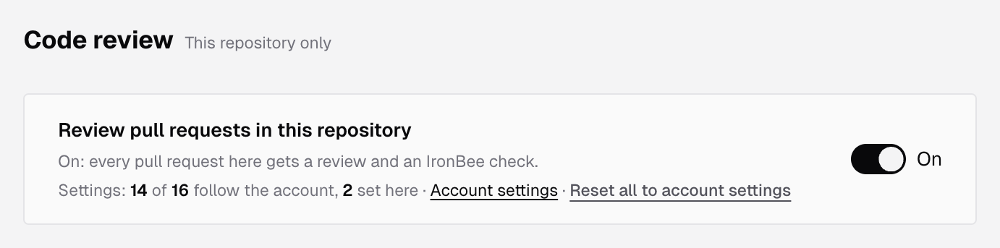
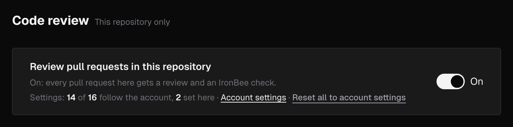

IronBee reviews the pull requests of every GitHub repository the IronBee GitHub App covers. Each review reads the change against the rest of the repository and reports what it finds:

- **On GitHub:** a review with an inline comment for each finding, a summary added to the pull request description, and the **IronBee review** check.
- **In the console:** every pull request with its reviews and findings, under **Code review** in the sidebar and on each project's **Code review** tab.

To review a branch before you open a pull request, run `ironbee review` from the CLI. See [Code review of your local checkout](/cli/guides/code-review).

The same App also gives each repository a [code wiki](#code-wiki), on the project's **Code wiki** tab next to **Code review**.

---

## Turn it on

Install the [IronBee GitHub App](/integrations/github) on your repositories. Every repository the App covers becomes a project, and code review is on for it from the start: the account setting **Review new repositories automatically** is **On** by default. The repository's [code wiki](/console/code-wiki) starts at the same time, unless **Write a wiki for newly connected repositories** is off in [Code wiki settings](/console/code-wiki-settings).

To stop reviewing one repository, an owner or admin opens the project's **Settings > Code review** and turns off **Review pull requests in this repository**. See [Code review settings](/code-review/settings).

---

## What starts a review

- **A pull request opens, or gets a new push.** **Automatic reviews** decides which of these start a review: **On open and every push** (the default), **On open only**, or **Only when asked**. By default, a draft waits until it's ready for review, and a pull request opened by a bot isn't reviewed.
- **You ask for one.** Comment `@ironbee-ai review` on the pull request, or click **Review now** on its page in the console.

A follow-up review reads only what changed since the last one, and answers the threads it opened before. See [Code review on GitHub](/code-review/on-github).

---

## What a review looks at

| Setting | What it decides |
|---------|-----------------|
| **Review depth** | **Auto** (the default) picks the depth by the size of the change. **Quick**, **Standard** and **Deep** fix it |
| **Focus areas** | **Bugs and logic** is always on. **Security** and **Docs, names and tests** are on by default |
| **Extra checks** | Optional passes, all off by default, such as **Linter rules** or **Missing tests** |
| **Rules and memories from the repository** | Whether the review reads the rules and memories kept in the repository, on by default |

[Rules and memories](/code-review/rules-and-memories) tell the review what your team expects. A rule says what must or must not happen and can raise a finding. A memory says what is true in a part of the code and never raises one on its own.

Every finding has a severity, **Critical**, **High**, **Medium** or **Low**, and a category: correctness, security, or docs, names and tests.

---

## Code wiki

IronBee writes a [code wiki](/console/code-wiki) of each repository the GitHub App covers, from its default branch: what the code does, where to start, how its parts depend on each other, and one page for each area, with every claim linked to the lines it comes from. It's written again as pull requests merge, and it uses no credits.

The wiki starts when the repository is connected, like code review, and you read it on the project's **Code wiki** tab. To choose which repositories get one and in which language, see [Code wiki settings](/console/code-wiki-settings).

---

## Credits

Each review uses credits by the size of the change and the depth it runs at. Answers to questions, replies, rechecks and retractions use none. When the account's credits run out, the **IronBee review** check says so instead of reviewing. See [Pricing](/console/pricing) for the rates and each plan's credits.

---

## What's next?

<CardGroup cols={2}>
  <Card title="On the pull request" icon="github" href="/code-review/on-github">
    The review, its comments, the summary, the check and the commands.
  </Card>
  <Card title="Pull requests in the console" icon="git-pull-request" href="/code-review/pull-requests">
    Every pull request with its reviews and findings.
  </Card>
  <Card title="Rules and memories" icon="book-marked" href="/code-review/rules-and-memories">
    Tell the review what your team expects.
  </Card>
  <Card title="Settings" icon="settings" href="/code-review/settings">
    Triggers, depth, focus, comments and merge blocking.
  </Card>
  <Card title="Code wiki" icon="book-open" href="/console/code-wiki">
    Pages that explain each repository's code, kept current as pull requests merge.
  </Card>
  <Card title="Review from the CLI" icon="terminal" href="/cli/guides/code-review">
    Review a local branch with `ironbee review` before you open a pull request.
  </Card>
</CardGroup>
