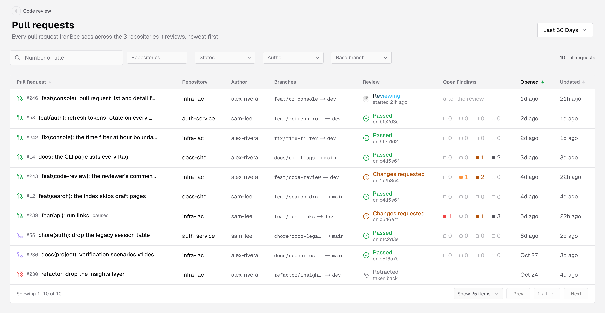
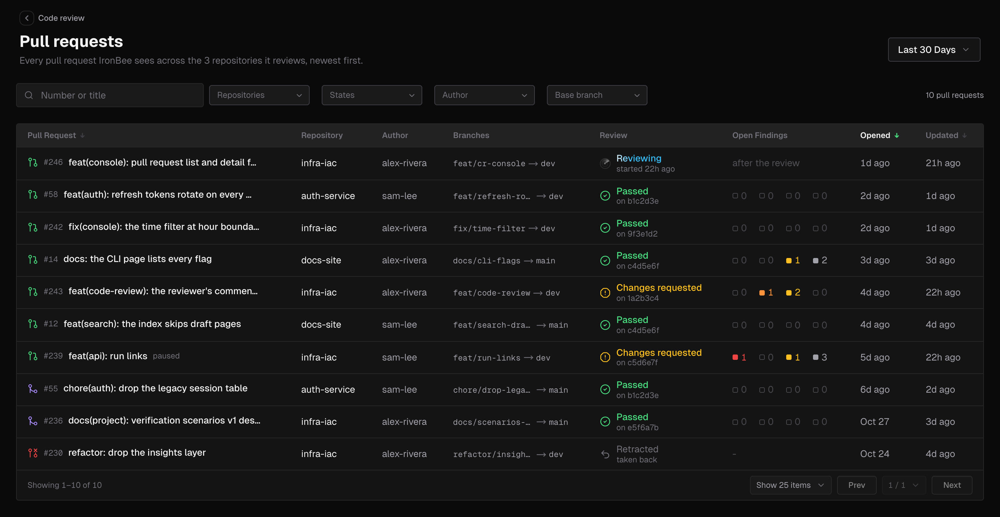
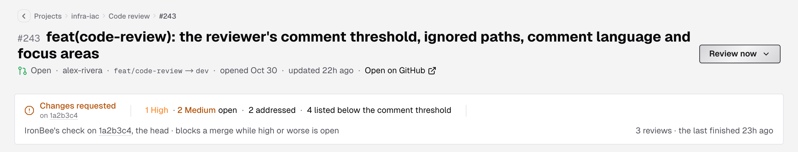
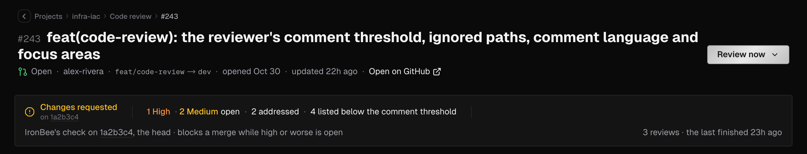
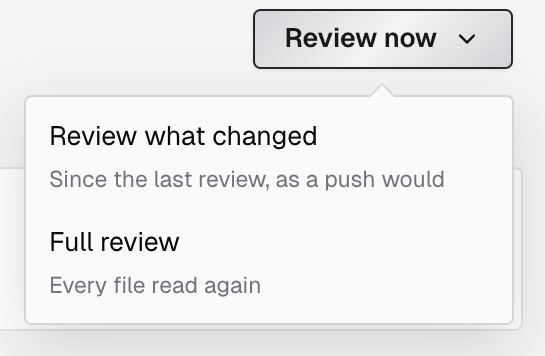
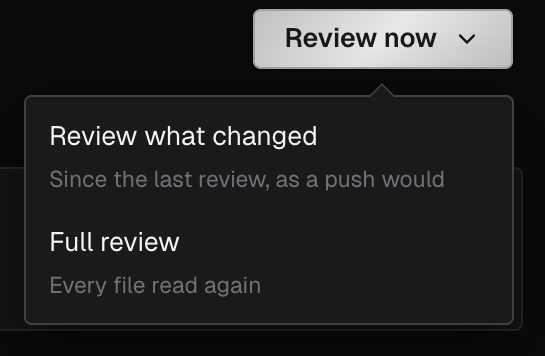
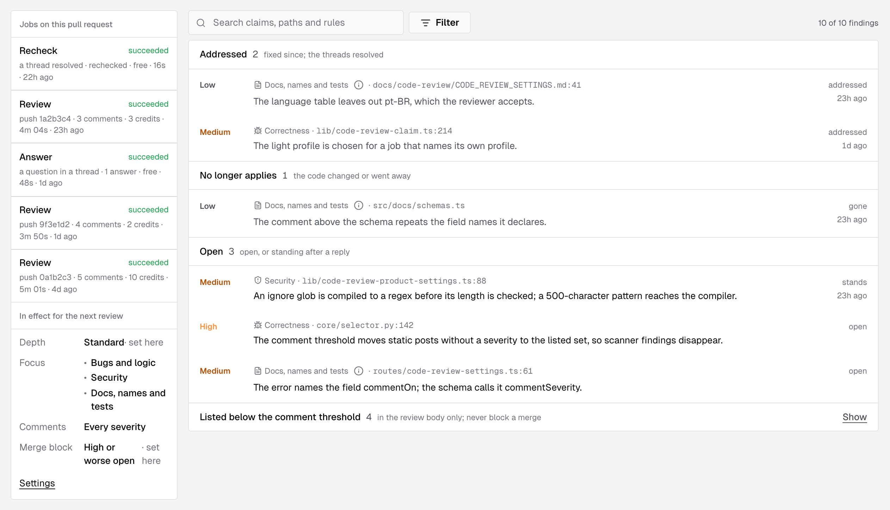
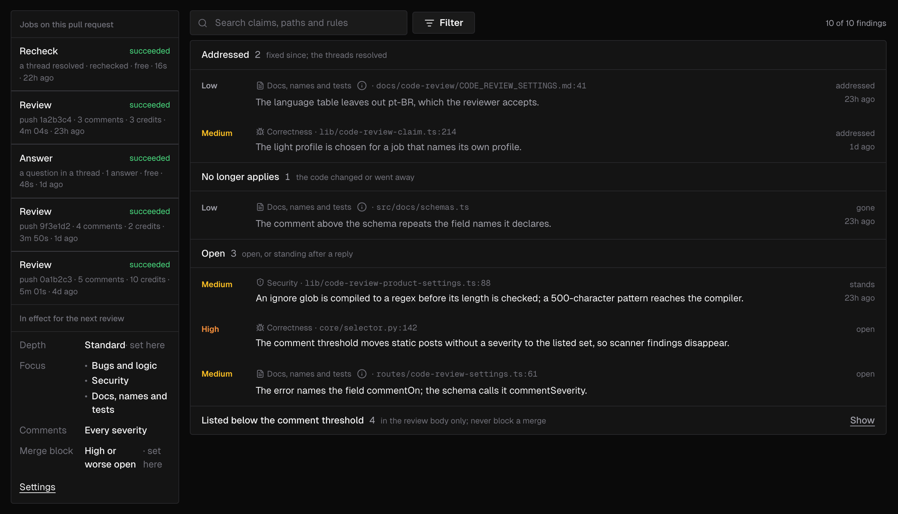
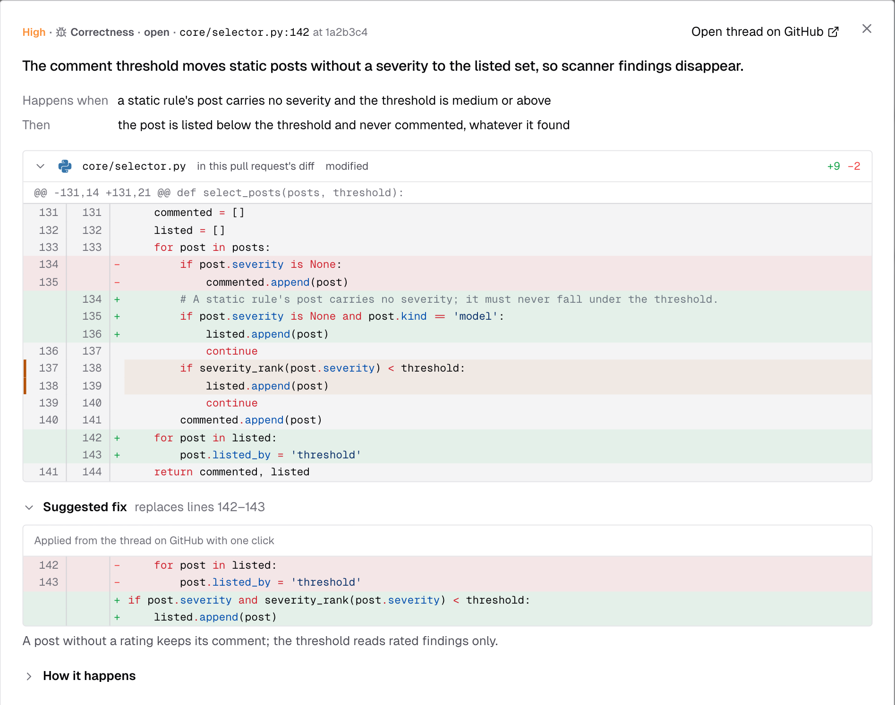
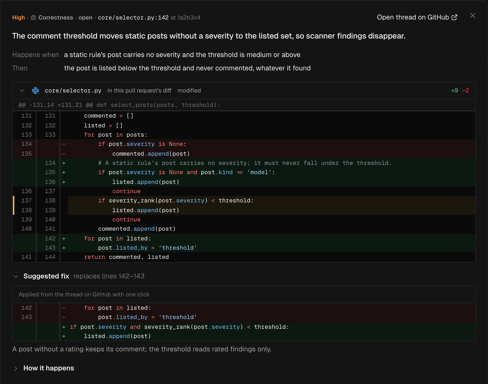

The console lists the pull requests of your GitHub repositories with what IronBee's code review said about each one. Open a pull request to read its findings, follow the jobs that ran on it, and see the settings its next review will use. How a review works is covered in [Code review](/code-review/overview), and what it posts on GitHub in [Code review on GitHub](/code-review/on-github).

---

## Find the pull requests

Two lists show the same rows and open the same pull request page.

| List | Where | What it shows |
|------|-------|---------------|
| **Pull requests** | The sidebar's **Code review > Pull requests** | The pull requests of every GitHub repository connected to your account, newest opened first. Archived projects aren't included |
| **Code review** tab | A project's first tab | One repository's pull requests, most recently updated first. The project picker in the page header switches to another repository |

Next to a project's **Code review** tab, its [Code wiki](/console/code-wiki) tab explains the repository's code.

On [Projects](/console/projects), a GitHub project's card links in too:

- Click the project's name or its **Code review** row to open the project's **Code review** tab with the same date window.
- Click a bar of the **Code review** row to open the pull requests reviewed in that slice of the window.

Click a row in either list to open its [pull request page](#the-pull-request-page).

---

## Filter and search

- **The date filter** in the page header shows the pull requests IronBee reviewed in that window: those whose latest review started inside it. Pick **Last 24 Hours**, **Last 7 Days**, **Last 30 Days**, **Last 90 Days**, or a **Custom Range**. A pull request with no review in the window isn't listed.
- **Number or title** finds a pull request by its number, with or without `#`, or by words from its title.
- **Repositories** (sidebar list only) and **States** (**Open**, **Merged**, **Closed**) take several values at once. Each option shows how many pull requests it has.
- **Author** and **Base branch** take one value. Pick it from the menu, which shows each one's count, or type a GitHub login or a branch name. **Any author** and **Any branch** clear them.
- **Clear filters** resets them all. The count at the end of the bar says how many pull requests are left, such as **12 of 40 pull requests**.

In the sidebar list, click a repository's name in a row to show only that repository's pull requests.

---

## Columns

| Column | What it shows |
|--------|---------------|
| **Pull Request** | The pull request's state icon (open, merged or closed, with a dashed icon for a draft), its number and title. **paused** marks a pull request whose reviews are paused |
| **Repository** | Sidebar list only. The repository the pull request belongs to |
| **Author** | The GitHub login that opened it |
| **Branches** | The head branch and the base branch it merges into |
| **Review** | Where IronBee's review stands, with a detail line under it. See [Review](#review) |
| **Open Findings** | The open findings by severity. See [Open findings](#open-findings) |
| **Opened** | Sidebar list only. When the pull request was opened |
| **Last Review** | **Code review** tab only. When the latest review finished, or `-` while none has |
| **Updated** | When the pull request last changed |

Hover a time in **Opened** or **Updated** to see the full date and time.

You can sort by **Pull Request** (its number), **Opened** and **Updated**. A page shows 25 rows; switch to 50 or 100 under the list.

While a review runs, the list refreshes on its own until it ends.

---

## Review

The **Review** column, and the band on the pull request page, show one of these words with a detail line under it:

| Review | Detail line | Meaning |
|--------|-------------|---------|
| **Reviewing** | **started 2m ago** | A review is running |
| **Changes requested** | **on a1b2c3d** | IronBee's check on GitHub is blocking: an open finding reaches the repository's merge block severity |
| **Passed** | **on a1b2c3d** | IronBee's check passed: no open finding reaches the merge block severity |
| **Could not complete** | **the review could not finish** | The review failed or gave up, and the check says so |
| **Cancelled** | **the review was stopped** | The review was cancelled before it finished |
| **Retracted** | **taken back** | IronBee took back everything it had posted on the pull request |
| **Reviewed** | **no check written** | IronBee published a review but wrote no check |
| **Not reviewed** | The reason | No review was published. The reasons are below |

For **Changes requested** and **Passed**, the detail line names the commit the check is on. It adds **an earlier commit**, as in **on a1b2c3d, an earlier commit**, when that isn't the commit IronBee last reviewed. The merge block severity is the **Block merging when** setting; see [Code review settings](/code-review/settings).

**Not reviewed** gives the first reason that applies:

| Detail line | Why |
|-------------|-----|
| **a draft** | The pull request is a draft. Whether drafts are reviewed is the **Draft pull requests** setting |
| **a bot's pull request** | A bot opened it. Whether bots' pull requests are reviewed is the **Pull requests opened by bots** setting |
| **reviews paused** | Someone paused IronBee's reviews on this pull request from GitHub. See [Code review on GitHub](/code-review/on-github) |
| **no review yet** | IronBee hasn't published a review of this pull request |

---

## Open findings

The **Open Findings** column shows four counts, always in this order: critical, high, medium and low. A zero is drawn hollow. Hover a count to read it, such as **2 High open** or **no Medium finding open**.

Before IronBee has published a review, the column shows `-`, or **after the review** while the first one runs.

---

## Empty lists

| The list says | When |
|---------------|------|
| **No pull requests yet** | The repository, or the account, has no pull requests yet. They appear as GitHub tells IronBee about them |
| **No reviews in this window** | There are pull requests, but IronBee reviewed none of them in the selected dates. Pick a longer window |
| **Nothing matches** | The filters leave no pull request. **Clear filters** resets them |
| **No GitHub repository connected** | Sidebar list: no repository is connected through the GitHub App. **Integrations** opens the integrations page |
| **Code review runs on GitHub repositories** | **Code review** tab of a Vercel, Netlify or CLI project. **Install the GitHub App** and **Integrations** lead to setting it up |

---

## The pull request page

The page's title is the pull request's number and title. The line under it gives:

- the state (**Open**, **Merged**, **Closed**, or **draft**)
- the author
- the head and base branches
- when it was opened, or merged
- when it was last updated
- **paused**, when reviews are paused on it
- **Open on GitHub**

If GitHub hasn't sent the pull request's details yet, the line says **GitHub has not described this pull request yet**.

The breadcrumbs lead back to the list you came from: **Pull requests** and the repository from the sidebar list, or **Projects**, the project and **Code review** from a project's tab. **Review now** sits on the right of the header; see [Review now](#review-now).

While a job runs on the pull request, the page refreshes on its own until it ends.

---

## The status band

The band under the header sums up what IronBee says of the pull request, from left to right:

1. **The review**: the same word and detail line as the list's **Review** column. The commit links to GitHub.
2. **What's open**: the open findings by severity, such as **1 Critical · 2 High open**, or **nothing open**. Then **3 addressed** and **2 listed below the comment threshold** when there are any. These counts match the findings list under the band.
3. **The check**: **IronBee's check on a1b2c3d, the head**, or **an earlier commit** when the check isn't on the latest commit IronBee reviewed, or **no check on GitHub**. After it comes the merge block in effect: **blocks a merge while medium or worse is open**, **blocks a merge while high or worse is open**, or **never blocks a merge**.
4. **The reviews**: how many reviews IronBee published and when the last one finished, such as **3 reviews · the last finished 2h ago**, or **no published review**.

---

## Jobs and settings in effect

The rail on the left of the page has two parts. In a narrow window, it moves under the findings.

### Jobs on this pull request

Every job IronBee ran on the pull request, newest first. When there are more than the rail shows, the last line says how many older ones are left out, such as **4 older not shown**. With no job yet, the rail says **No job has run on this pull request.**

Each job shows its kind, its status, and a line with what started it, what came of it, its [credits](/console/pricing) (what it used, what it's expected to use while it runs, or **free**), how long it ran and when it was created. Hover the line to see the date and time.

| Kind | What started it, as the line says |
|------|-----------------------------------|
| **Review** | **asked · from the console** or **asked · through the API** for a review someone asked for, with **full** for a full review. **push a1b2c3d** for a review a push started, or **on a1b2c3d** |
| **Reply** | **a reply in a thread**, or **a review asked for in a thread** when the reply asked for a review |
| **Answer** | **a question in a thread** |
| **Recheck** | **a thread resolved** |
| **Reactions** | **learning from reactions** |
| **Retract** | **taking the review back** |

What came of a job reads **4 comments** or **2 answers**, the reviewer's own word for the run, or why it failed. A cancelled job adds nothing there.

The status is one of **queued**, **starting**, **running**, **publishing**, **succeeded**, **failed** or **cancelled**. A job that hasn't ended has a **Cancel** link; see [Cancel a job](#cancel-a-job).

### In effect for the next review

The settings the next review of this pull request will use:

| Line | Shows |
|------|-------|
| **Depth** | **Auto**, **Quick**, **Standard** or **Deep** |
| **Focus** | **Bugs and logic**, which is always on, and the focus areas turned on: **Security**, **Docs, names and tests** |
| **Comments** | Which findings get a comment of their own: **Every severity**, **Medium and above** or **High and above** |
| **Merge block** | **Medium or worse open**, **High or worse open** or **Never** |

A value the repository sets for itself, rather than taking the account's, is marked **set here**. When code review is off for the repository, the section says **Code review is off for this repository**. **Settings** opens the repository's code review settings; see [Code review settings](/code-review/settings).

---

## Review now

**Review now** asks IronBee to review the pull request again. It opens a menu with two choices:

| Choice | What it does |
|--------|--------------|
| **Review what changed** | Reviews what changed since the last review, as a push would |
| **Full review** | Reads every file of the pull request again |

A review you ask for runs even when reviews are paused on the pull request. It spends the account's credits; see [Pricing](/console/pricing).

After you pick one, a message confirms what happened:

- **Review queued**: **IronBee reads the pull request and posts what it finds on GitHub.** The job appears at the top of the rail as **Review** with **asked · from the console**, and the band and the list's **Review** column read **Reviewing**.
- **A review is already queued**: the review already waiting covers your ask, and nothing more was queued.
- **A review is already running**: ask again once it has ended.

If the review can't start, **Couldn't start the review** says why: code review is off for the repository, the team's credits are used up, or too many reviews were started in a minute.

The button is disabled, with the reason on hover, when:

- the project is archived: **The project is archived**
- code review is off: **Code review is off for this repository**
- the team's credits are used up, with the date they reset
- a job is already running: **A job is already running on this pull request**

Owners, admins and members see **Review now**. Billing admins don't.

---

## Cancel a job

A job that hasn't ended has a **Cancel** link in the rail. Click it to stop the job:

- **Cancel requested**: **The job stops at its next step.** Its status then reads **cancelled**.
- **The job had already ended**: it finished before the cancel reached it.

A job that is publishing its result can't be cancelled. Its link is disabled with **Not while publishing**, and the job ends when the delivery does.

Owners, admins and members see **Cancel**. Billing admins don't.

---

## Findings

The findings list on the right holds every finding of the pull request, grouped by what became of it. A group shows the number of findings in it and what it means:

| Group | It says | What's in it |
|-------|---------|--------------|
| **Withdrawn** | **taken back by IronBee** | Findings IronBee withdrew |
| **Addressed** | **fixed since; the threads resolved** | Findings the code has fixed since |
| **No longer applies** | **the code changed or went away** | Findings whose code changed or was removed |
| **Open** | **open, or standing after a reply** | Findings still open, including those IronBee kept after a reply on the thread |
| **Listed below the comment threshold** | **in the review body only; never block a merge** | Findings below the **Comment on findings of** setting. They are listed in the review body, have no comment of their own, and never hold a merge. The group is folded until you click **Show** |

The groups come in that order, and a group with nothing in it is left out. **Open** always shows, so an empty one says so. Inside a group, the findings that changed most recently come first, then the rest by severity, worst first, and by file and line. A long group shows 20 findings at first. The buttons under it, such as **Show 20 more** and **Show all 45**, show the rest, and a count such as **20 of 45 shown** says how many you see.

### A finding's row

Each row shows:

- **The severity**: **Critical**, **High**, **Medium** or **Low**. If a later job rated the finding again, the row shows the new severity.
- **The category**: **Correctness**, **Security**, or **Docs, names and tests**, which has an info mark that explains it.
- **The file and line**, where the finding stands now.
- **The claim**: what IronBee says is wrong.
- **The state**: **open**, **stands**, **addressed**, **changed**, **gone** or **withdrawn**, with when it last changed.

Click a row to open it in the [finding dialog](#the-finding-dialog).

### Filter the findings

- **Search claims, paths and rules** matches the claim, the file path, and the rules, memories and skills the finding cites.
- **Filter** opens a panel that narrows the list by **Severity**, **Category** and **State**, each option with its count, and to findings that **Cites a rule or memory**.
- The count beside the button reads like **8 of 14 findings**. Each filter in force shows as a chip you can remove, and **Clear all** removes them all.

The filters and the open finding are kept in the page's address, so a copied link opens the same view.

With no findings, the list says **No findings on this pull request**: IronBee hasn't published a review, or it had nothing to say. When the filters hide every finding, it says **No finding matches these filters**.

---

## The finding dialog

The dialog shows one finding in full. Its first line gives the severity, the category, the state, and the file and line **at** the reviewed commit. **Open thread on GitHub** opens the finding's comment thread. Under it, the claim is the dialog's title.

The sections follow in this order. A section with nothing to show is left out.

1. **Happens when** and **Then**: what triggers the problem, and what happens next.
2. **The code**: the part of the pull request's diff that holds the finding, with its lines marked. The header gives the file, how it changed, its added and removed lines, and **in this pull request's diff**. Click the header to fold it. When the diff can't be shown, a note says why, followed by the lines IronBee quoted:
   - **The file is not in the pull request's diff any more.**
   - **GitHub gives no diff for this file (binary, or too large).**
   - **The pull request changes more files than the console reads from GitHub.**
   - **The quoted lines are not in the diff any more.**
3. **Suggested fix**: the fix from the finding's comment, as a diff, with the lines it replaces, such as **replaces lines 12–14**. Its caption reads **Applied from the thread on GitHub with one click**. A note from the reviewer may follow. If the comment can't be read, the dialog says **The comment could not be read from GitHub.** or **The comment is no longer on GitHub.**
4. **How it happens**: a diagram of the order, state or path behind the finding. Folded until you open it.
5. **Where this rests**: other places in the code the claim relies on. Each links to the file at the reviewed commit, with its line, such as **Line 42 in a1b2c3d**, and the lines themselves.
6. **Cites**: the **Rule**, **Memory** and **Skill** entries the finding relies on. See [Rules and memories](/code-review/rules-and-memories).
7. **History**: what happened to the finding, in order:
   - **Posted by the review at a1b2c3d**.
   - Each later change: **Still open**, **Stands**, **Addressed**, **The code changed**, **The code went away** or **Withdrawn**, with **after a reply on the thread** and the commit when they apply. IronBee's sentence about it follows. **Read the whole reply on GitHub** opens the reply, a line such as **now rated high** shows a new severity, and **the thread was resolved by someone else** says a person, not IronBee, resolved it.
   - How the thread stands now: **Thread open on GitHub**, **Thread resolved by IronBee**, **No comment on GitHub any more**, or **Listed in the review body; no comment of its own**.

**Suggested fix** and **How it happens** appear when the review wrote them; the **Suggested fixes** and **Diagrams** settings turn them on or off.

### Move between findings

The footer shows where the finding stands in the list, such as **3 of 14**, and the buttons **Previous** and **Next**. **Next** names the next finding's file and line. The order is the list's, with its filters.

Press `←` and `→` to move, and `Esc` to close. Inside the code, the arrow keys scroll it instead.

---

## Who can see and do what

| Capability | Who can do it |
|------------|---------------|
| View the pull request lists, the pull request page and the finding dialog | Everyone |
| **Review now** | Owner, Admin, Member |
| **Cancel** a job | Owner, Admin, Member |

Billing admins see neither button. On an archived project, **Review now** is disabled. See [Roles and permissions](/console/roles).

---

## What's next?

<CardGroup cols={2}>
  <Card title="Code review" icon="git-pull-request" href="/code-review/overview">
    How IronBee reviews a pull request.
  </Card>
  <Card title="Code review on GitHub" icon="github" href="/code-review/on-github">
    What IronBee posts on the pull request itself.
  </Card>
  <Card title="Code review settings" icon="settings" href="/code-review/settings">
    Depth, focus areas, comments and the merge block.
  </Card>
  <Card title="Rules and memories" icon="book-open" href="/code-review/rules-and-memories">
    What a finding can cite, and how to manage it.
  </Card>
</CardGroup>
