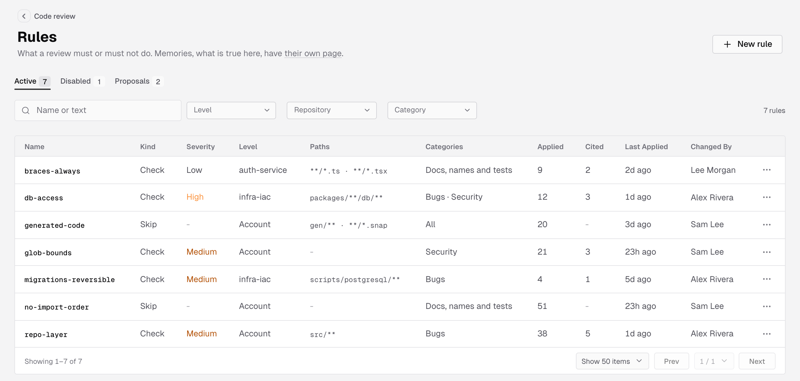
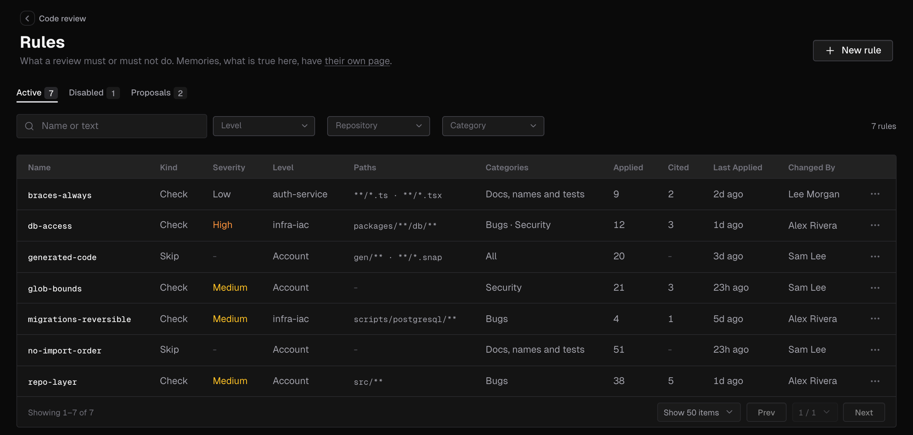
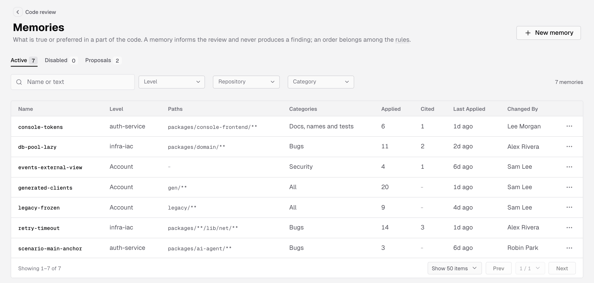
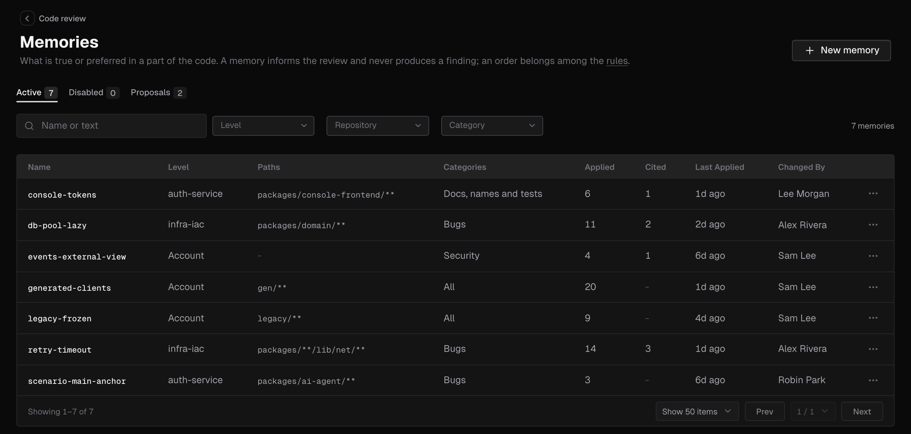
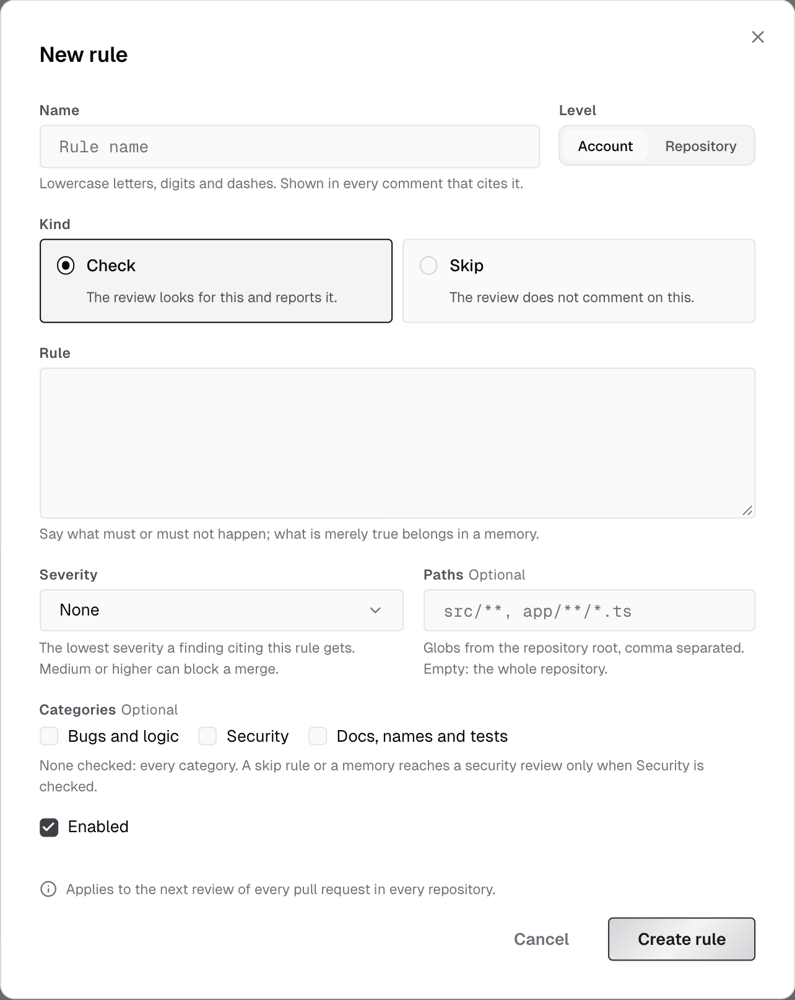
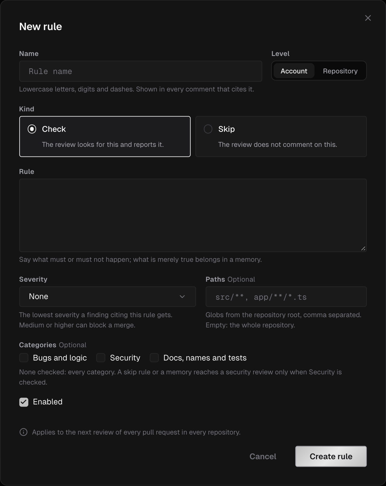
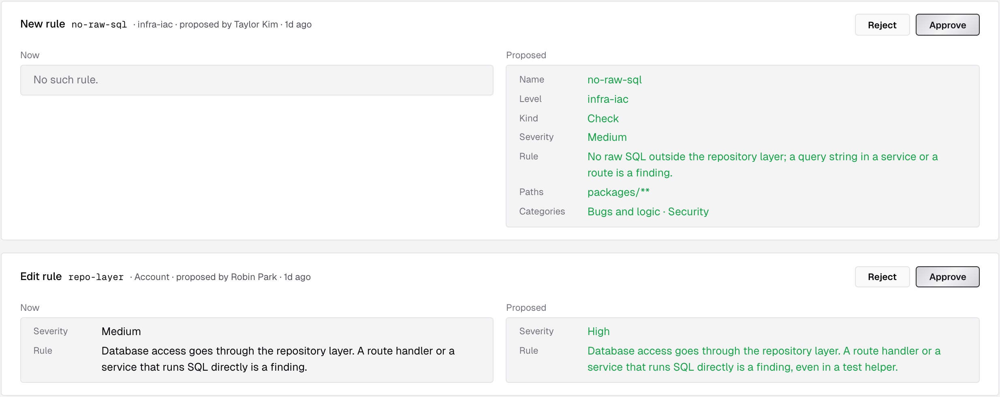
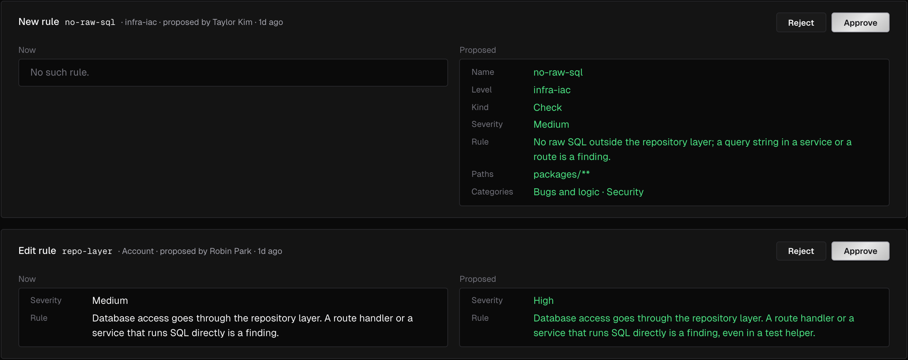

Rules and memories teach IronBee's code review what your team expects:

- **A rule** says what a review must or must not do: look for something and report it, or leave something alone.
- **A memory** says what is true or preferred in a part of the code. It informs the review and never produces a finding of its own.

You write them in two places:

- In the console, on the **Rules** and **Memories** pages under **Code review** in the sidebar.
- In the repository, as Markdown files under `.ironbee/`. See [Repository files](#repository-files).

Changes apply to the next review. A comment that rests on a rule or a memory cites it by name, and the review body lists the rules and memories the review applied. See [Code review on GitHub](/code-review/on-github).

---

## Rules

Every rule has a kind:

| Kind | What the review does |
|------|----------------------|
| **Check** | Looks for this and reports it. A finding cites the rule and the changed line that breaks it |
| **Skip** | Doesn't comment on this |

A rule's **Severity** is **None**, **Low**, **Medium**, **High** or **Critical**. It's the lowest severity a finding that cites the rule gets. With the default [**Block merging when**](/code-review/settings#on-the-pull-request) setting, an open finding at **Medium** or higher keeps the **IronBee review** check from passing.

When you change a **Check** rule, reactions to earlier findings that cite it no longer hold back new ones. See **Learn from the team's reactions** in [Code review settings](/code-review/settings#on-the-pull-request).

Write a rule as what must or must not happen. What is merely true belongs in a memory.

---

## Memories

A memory tells the review what is true or preferred in a part of the code, so it can judge whether something is a defect there. For example: code under `src/legacy/` only gets security fixes, or a helper is the preferred way to read configuration.

A memory never asks for a finding. When a finding rests on one, the finding cites it. Where a memory and a rule disagree, the rule applies.

Memories come from your team, written in the console or in `.ironbee/memories/`. IronBee doesn't turn reactions into memories: the **Learn from the team's reactions** setting handles thumbs-downs, resolved threads and hidden comments on its own.

To change a memory, click its row and edit it. To stop the review reading it without deleting it, clear **Enabled** in the dialog or pick **Disable** from the row's menu. A disabled memory moves to the **Disabled** tab until you turn it back on or delete it. Rules work the same way.

---

## Where an item applies

Each rule and memory has a level, optional paths and optional categories.

**Level:**
- **Account:** every repository of the account.
- **Repository:** one repository, picked in the dialog.

**Paths:** globs from the repository root, such as `src/**` or `app/**/*.ts`, separated by commas. `*` matches within one path segment and `**` across segments. Empty means the whole repository.

**Categories:** the focus areas the item is for, as in [Code review settings](/code-review/settings#review). None checked means every category.

| Category | In a repository file |
|----------|----------------------|
| **Bugs and logic** | `correctness` |
| **Security** | `security` |
| **Docs, names and tests** | `editorial` |

An item that names only a focus area you turned off doesn't apply.

A **Skip** rule or a memory reaches the security pass only when **Security** is checked. One with no category checked doesn't reach it, and the review still reports any other security defect. Only owners and admins can check **Security** on a skip rule or a memory.

**When items disagree:** the narrower one wins. An account item is the widest, a repository item is narrower, and an item with paths is the narrowest.

**When there are many items:** if a review can't read them all, it keeps the most specific first: items with paths, then repository items, then account items. Among rules, a higher severity comes first.

---

## Turned off in a repository

An account rule or memory can be turned off in one repository, everywhere in it or under some paths, while other repositories keep it. The console shows where it's off:

- In the dialog of an account item, **Turned off in** lists each repository, with its paths or **the whole repository**.
- With the **Repository** filter set, an account item that repository turned off is dimmed, and its **Level** reads **Off in** the repository, with the paths when it's off under some paths only.

To keep an item to some repositories or paths, give it a **Repository** level or **Paths**. In a repository, turn a file off for one folder with [`disable.md`](#turn-a-file-off-for-a-folder).

---

## The Rules and Memories pages

Open **Code review** in the sidebar and pick **Rules** or **Memories**. Both pages work the same way.

**Tabs:** **Active**, **Disabled** and **Proposals**, each with its count.

**Filters**, on **Active** and **Disabled**:

| Filter | Options |
|--------|---------|
| Search | **Name or text** |
| **Level** | **Any level**, **Account**, **Repository** |
| **Repository** | **Any repository**, or one of the account's GitHub or GitLab repositories. Shows that repository's items and the account's |
| **Category** | **Any category**, **Bugs and logic**, **Security**, **Docs, names and tests** |

**Clear filters** resets them. Beside the filters, the page counts what it shows, such as **12 rules**. Pages hold 25, 50 or 100 items.

**Columns:**

| Column | What it shows |
|--------|---------------|
| **Name** | The item's name. Click it, or the row, to open the item |
| **Kind** | Rules only: **Check** or **Skip** |
| **Severity** | Rules only: the rule's severity, or `-` for none |
| **Level** | **Account**, or the repository's name |
| **Paths** | The item's paths, or `-` for the whole repository |
| **Categories** | The item's categories, or **All** |
| **Applied** | How many review passes read the item |
| **Cited** | How many review comments cite it, or `-` for none |
| **Last Applied** | When a review last read it, or **never** |
| **Changed By** | Who last changed it, or who created it |

The row's menu offers **Edit**, **Disable** or **Enable**, and **Delete rule** or **Delete memory**. A deleted item's repository overrides and pending proposals go with it.

**Empty states:**

| Where | Title |
|-------|-------|
| **Active**, no items | **No rules yet** or **No memories yet** |
| **Disabled**, no items | **No disabled rule** or **No disabled memory** |
| Filters match nothing | **Nothing matches**, with **Clear filters** |
| **Proposals**, none pending | **No pending proposal** |

Under the list, a note says that repository files are read from each pull request's base branch and aren't listed on these pages.







---

## Create or edit a rule or memory

Click **New rule** or **New memory**, or click a row to edit it.

| Field | What to enter |
|-------|---------------|
| **Name** | Lowercase letters, digits and dashes, starting with a letter or a digit, up to 64 characters. Comments that cite the item show it. Unique among the account's rules, or among its memories, whatever the level |
| **Level** | **Account** or **Repository**. With **Repository**, pick the repository |
| **Kind** | Rules only: **Check** or **Skip** |
| **Rule** or **Memory** | The text: up to 1,000 characters for a rule, 500 for a memory |
| **Severity** | Rules only: **None**, **Low**, **Medium**, **High** or **Critical** |
| **Paths** | Optional. Up to 50 globs from the repository root, separated by commas, each up to 1,024 characters, with no leading `/` and no `..` segment |
| **Categories** | Optional. **Bugs and logic**, **Security**, **Docs, names and tests** |
| **Enabled** | On for a new item. Clear it to keep the item without the review reading it |

A new item starts at **Account** level, as a **Check** rule with no severity, enabled.

The dialog's footer says where the change applies, such as **Applies to the next review of every pull request in every repository.** Click **Create rule**, **Create memory** or **Save changes**. In an existing item's dialog, **Delete rule** or **Delete memory** asks you to confirm first.

The dialog refuses an item without a name or text, a name another item of the kind already has, a missing repository, a text over the limit and paths that break the rules above. The message shows under the field.




---

## Who can change rules and memories

| Role | What they can do |
|------|------------------|
| **Owner**, **Admin** | Create, edit, enable, disable and delete items, with the change applied at once. Approve or reject proposals |
| **Member** | The same actions, sent as proposals for an owner or admin to decide |
| **Billing Admin** | No access to rules and memories |

For a member, the dialog's button reads **Propose** and its footer says **Your role proposes changes; an owner or admin applies them.** In the row's menu, **Disable**, **Enable** and **Delete** say they're **proposed to an owner or admin**. See [Roles and permissions](/console/roles).

---

## Proposals

A member's change waits on the **Proposals** tab until an owner or admin decides it. The oldest comes first.

Each card names the change and the item, such as **New rule** `no-raw-sql`, **Edit memory** or **Disable rule**, with its level, who proposed it and when. Two columns compare each field the change touches: **Now** and **Proposed**. A card can also ask to **Turn the rule off in a repository** or **Turn the rule back on in a repository**.

- **Approve** applies the change exactly as proposed, under the proposer's name.
- **Reject** drops it, and nothing of it is kept.

Members see the same cards, without the buttons. A proposal that no longer applies, because its name was taken or its item or repository is gone, is refused and stays pending. When too many proposals are pending, members can't propose more until an owner or admin decides some.

A member can't propose a **Skip** rule or a memory that reaches the security pass: the dialog refuses **Security** for them with **Only an owner or admin can name Security on a skip rule or a memory.**




---

## Repository files

IronBee also reads rules, memories and skills from Markdown files in the repository:

| File | What it holds |
|------|---------------|
| `.ironbee/rules/<name>.md` | A rule |
| `.ironbee/memories/<name>.md` | A memory |
| `.ironbee/skills/<name>.md` | A skill: a pointer to a `SKILL.md` procedure the review judges the change against |
| `.ironbee/disable.md` | Files above this folder to turn off for it |

The file's name, without `.md`, is the item's name: `.ironbee/rules/no-raw-sql.md` is the rule `no-raw-sql`. A skill takes the `name` in its `SKILL.md`'s front matter, or the file's name when there's none.

These files aren't listed on the **Rules** and **Memories** pages. The **Rules and memories from the repository** setting turns them on or off; it's on by default. See [Code review settings](/code-review/settings#review).

### Where IronBee looks

- **The base branch:** files are read as the pull request's base branch has them. A pull request that adds or changes a file isn't reviewed by its own change; the change applies once it's merged.
- **The root and the folders above each changed file:** an `.ironbee/` folder inside `services/billing/` is read when the pull request changes a file under `services/billing/`. Its items apply only to files under that folder, and their `paths` are relative to it.
- **The nearest folders first,** when there are more files than a review reads.

Repository files are repository items. A skip rule or a memory from a file never reaches the security pass: `security` is dropped from its categories.

### Front matter

A file starts with YAML front matter between two `---` lines. The body under it is the text.

| Key | Rule | Memory | Skill | Values |
|-----|------|--------|-------|--------|
| `kind` | Required | - | - | `check` or `skip` |
| `severity` | Optional | - | - | `low`, `medium`, `high` or `critical` |
| `paths` | Optional | Optional | Optional | A non-empty list of globs, relative to the folder that holds `.ironbee/`, with no leading `/` and no `..` segment |
| `categories` | Optional | Optional | Optional | A non-empty list of distinct names among `correctness`, `security` and `editorial`. Other names are ignored |
| `enabled` | Optional | Optional | Optional | `true` or `false`. `false` turns the file off |
| `from` | Optional | Optional | Required | A file path from the repository root whose text is used instead of the body. A skill's must name a `SKILL.md` |

- A memory can skip the front matter: the whole file is its text.
- A rule or a memory has a body or `from`, not both. A skill has `from` and no body.
- A body is cut at 1,000 characters for a rule and 500 for a memory. A text read through `from` is cut at 8,000.
- A key that isn't in the table for the file's type leaves the file out.

```markdown .ironbee/rules/no-raw-sql.md
---
kind: check
severity: high
paths:
  - src/db/**
categories:
  - correctness
---
Queries go through the query builder in src/db/query.ts. Report a raw SQL string passed to the driver.
```

```markdown .ironbee/memories/legacy-frozen.md
---
paths:
  - src/legacy/**
---
Code under src/legacy is frozen: it only gets security fixes, and its style is not updated.
```

```markdown .ironbee/skills/release-checklist.md
---
from: docs/release/SKILL.md
paths:
  - release/**
---
```

### Turn a file off for a folder

A `disable.md` in a folder's `.ironbee/` turns off rule, memory or skill files of the root or of a folder above, for files under that folder. It holds one key, `disable`: a list of `file:` followed by the file's path from the repository root.

```markdown services/billing/.ironbee/disable.md
---
disable:
  - file:.ironbee/rules/no-raw-sql.md
---
```

The root's `disable.md` is ignored, since nothing is above it. A `disable.md` turns off repository files only, not console items.

### When a file is left out

A file whose front matter isn't valid, or breaks the rules above, is left out of the review. The review body lists each file it left out, with the reason. A file with `enabled: false` is skipped without a note.

---

## Built-in checks

Beside the review, IronBee runs a fixed set of standards-based checks on the lines a pull request adds. Each check has its own severity, and its comment names the public standard it rests on, such as CWE-89. Some stay off test and mock files, such as files under `test/`, `__tests__/` or `mocks/` and files named like `*.test.ts` or `*_test.go`.

| What the check reports | Severity | On test files |
|------------------------|----------|---------------|
| An import of a name the imported module in the repository doesn't define | High | Yes |
| SQL text built by string interpolation | High | No |
| A dereference of a value that a function returns as null on some path | Medium | No |
| Two objects compared by reference where their values were meant | Medium | No |
| A modified copy that is never used, while the original is used instead | Medium | No |
| A misspelling in a name or a message | Low | Yes |

You can't configure built-in checks. They don't appear on the **Rules** page, and you can't turn them off or change their severity.

---

## In `ironbee review`

[`ironbee review`](/cli/guides/code-review) reads the same rules and memories as a pull request review: the console's for the repository it reviews, and the `.ironbee/` files as the branch you review against has them. The CLI never sends `.ironbee/` files from your machine.

`--no-knowledge` turns off the repository files for that review only. Console rules and memories still apply.

---

## What's next?

<CardGroup cols={2}>
  <Card title="Code review settings" icon="settings" href="/code-review/settings">
    Focus areas, merge blocking and the switch for repository files.
  </Card>
  <Card title="Pull requests" icon="git-pull-request" href="/code-review/pull-requests">
    Findings in the console, with the rules and memories they cite.
  </Card>
</CardGroup>
