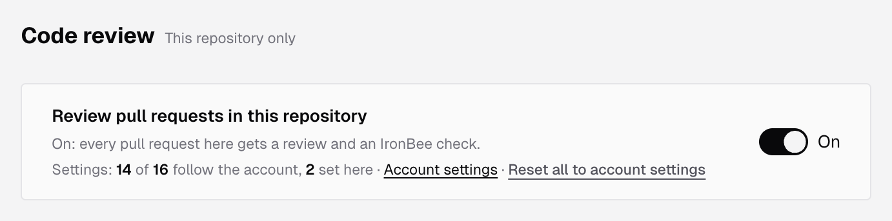
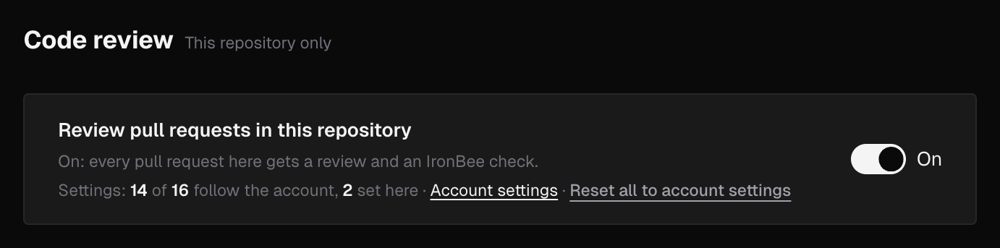
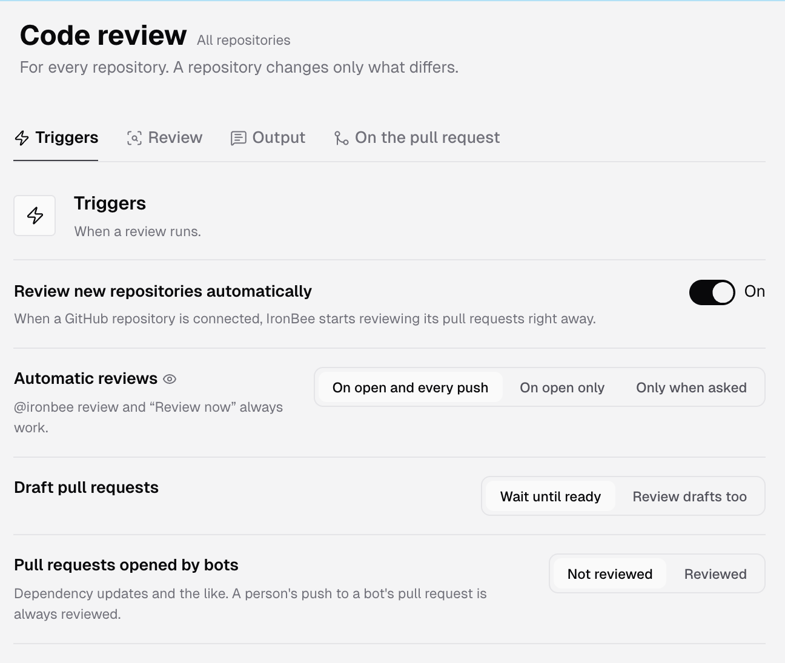
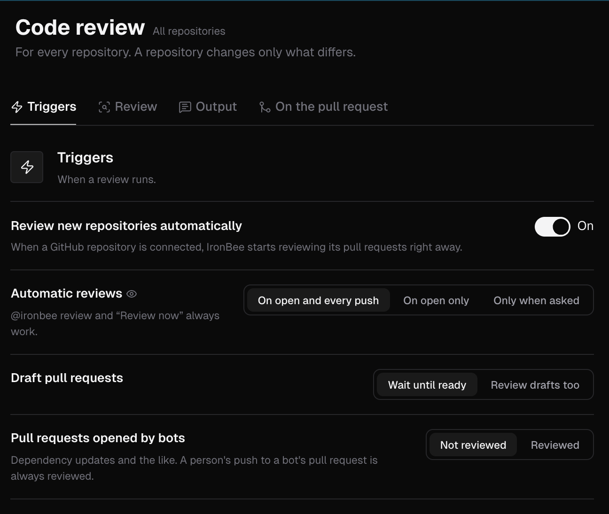

Code review settings decide when a review runs, what it looks at, what it writes and what it does on the pull request. You set them at two levels:

- **The account:** open **Settings > Code review**, or **Code review > Settings** in the sidebar. The page is marked **All repositories**, and its values are the defaults of every repository.
- **One repository:** open the project, go to its **Settings** tab and select **Code review**. The page is marked **This repository only**.

Both pages show the same form, in four sections: [Triggers](#triggers), [Review](#review), [Output](#output) and [On the pull request](#on-the-pull-request). The tabs above the form jump to each one, and mark a section that holds a refused value.

---

## How a repository inherits

A repository follows the account for every setting until you change that setting on the repository's page.

- **On a repository's page:** change a control, and the line under it reads **Set for this repository**. Click **Reset to account default** to follow the account again.
- **On the account page:** a value you set reads **Set for the account**. Click **Reset to IronBee default** to go back to IronBee's default, listed in the tables below.
- **Repositories that differ:** under a row on the account page, **1 repository differs** or **N repositories differ** counts the repositories that hold their own value of that setting. Changing the account's value doesn't change theirs.

Some settings exist at one level only:

- **Review new repositories automatically** is on the account page only.
- The on/off switch and the four lists in [Repository-only lists](#repository-only-lists) are on a repository's page only. They never follow the account.

### Example comment

Beside the form, **Example comment** shows one fixed review comment, not generated, drawn the way the settings on the page would write it. A row with an eye mark changes the example as you change it, so you can see the effect before you save.

---

## Turn review on or off for a repository

A repository's page opens with **Review pull requests in this repository**:

- **On:** every pull request in the repository gets a review and the **IronBee review** check.
- **Off:** no review and no check for the repository, and [`@ironbee-ai review`](/code-review/on-github#commands) does nothing there.

Under the switch, a line counts the settings this repository follows and the ones it sets itself, such as **Settings: 14 of 16 follow the account, 2 set here**. It links to **Account settings** and, when the repository sets something, offers **Reset all to account settings**. The switch itself isn't one of the 16 and no reset changes it.

A newly connected repository starts with review on, unless **Review new repositories automatically** is off for the account. A repository that was connected before keeps the switch it had.

---

## Triggers

When a review runs.

| Setting | Options | Default | What it does |
|---------|---------|---------|--------------|
| **Review new repositories automatically** | On, Off | On | Account page only. When a GitHub repository is connected, IronBee starts reviewing its pull requests right away |
| **Automatic reviews** | **On open and every push**, **On open only**, **Only when asked** | **On open and every push** | When a review starts by itself. Reopening a pull request and marking a draft ready count as opening it. `@ironbee-ai review` and **Review now** always work |
| **Draft pull requests** | **Wait until ready**, **Review drafts too** | **Wait until ready** | Whether a draft gets automatic reviews |
| **Pull requests opened by bots** | **Not reviewed**, **Reviewed** | **Not reviewed** | Dependency updates and the like. A person's push to a bot's pull request is reviewed either way |

On a repository's page, this section also holds [Target branches, Skip by label and Skip by title](#repository-only-lists).

---

## Review

What a review looks at, and how deeply.

| Setting | Options | Default | What it does |
|---------|---------|---------|--------------|
| **Review depth** | **Auto**, **Quick**, **Standard**, **Deep** | **Auto** | **Auto** picks the depth by the size of the change. **Quick** is faster and cheaper, with fewer findings. **Standard** is the full review, at every size. **Deep** is the most thorough review, slower and costlier |
| **Focus areas** | **Bugs and logic**, **Security**, **Docs, names and tests** | All three | Each area is its own pass over the change. **Bugs and logic** is always on |
| **Extra checks** | See the next table | None | Kinds of findings the focus areas leave out on purpose |
| **Rules and memories from the repository** | On, Off | On | Reads the team's `.ironbee/` files from the pull request's base branch. See [Repository files](/code-review/rules-and-memories#repository-files) |

Under **Review depth**, the console shows what a review at the chosen depth costs in credits, with a **See the rate card** link to [Credit usage](/console/usage#what-a-job-costs). For plans, see [Pricing](/console/pricing).

**Docs, names and tests** looks for text, names and tests that disagree with the code: messages, comments and names that say what the code doesn't do, and docs or tests the change should have updated.

**Extra checks** are all off by default:

| Check | What it reports |
|-------|-----------------|
| **Linter rules** | A violation of a rule the repository's own linter configuration enables |
| **Style and typos** | Misspellings, formatting and idiom against the surrounding code |
| **Input checks and error handling** | New code that neither checks its inputs nor handles a failure of what it calls |
| **Missing tests** | Behavior the change adds that no test exercises |
| **Duplication and dead code** | Re-implemented helpers, duplicated or unused code, repeated work |
| **Language and framework gotchas** | The classic mistakes of the language and framework, named one by one |

On a repository's page, this section also holds [Paths to ignore](#repository-only-lists).

---

## Output

What a review writes.

| Setting | Options | Default | What it does |
|---------|---------|---------|--------------|
| **Comment on findings of** | **Every severity**, **Medium and above**, **High and above** | **Every severity** | A finding below the threshold is listed in the review body with no comment of its own, and never blocks a merge |
| **Pull request summary** | On, Off | On | A walkthrough of the change for the approver |
| **Suggested fixes** | On, Off | On | A ready-to-apply fix where one is clear |
| **Diagrams** | On, Off | On | A small diagram on a finding about order, state or a path. See [the examples](/code-review/on-github#diagrams) |
| **Comment language** | English, Deutsch, Español, Français, Português (Brasil), 日本語, 한국어, 中文, Türkçe, Русский | English | The language of comments, the review body, the summary and answers. Code, names and suggested fixes stay as they are. The [code wiki](/console/code-wiki-settings#defaults) is written in it too while its **Wiki language** is **Same as the comment language** |

---

## On the pull request

Merging, replies and what the team teaches the review.

| Setting | Options | Default | What it does |
|---------|---------|---------|--------------|
| **Block merging when** | **Medium or worse open**, **High or worse open**, **Never** | **Medium or worse open** | The **IronBee review** check doesn't pass while a finding at or above that severity is open. It holds a merge only where branch protection requires that check |
| **Answer questions** | On, Off | On | A question asked in a reply under an IronBee comment gets an answer |
| **Close fixed threads** | **Resolve the thread**, **Reply only** | **Resolve the thread** | When a later review finds a finding fixed, IronBee says so in its thread. **Resolve the thread** also resolves it |
| **Learn from the team's reactions** | On, Off | On | A thumbs-down, a thread resolved without a fix or a hidden comment tells the review not to say this again |

See [Code review on GitHub](/code-review/on-github) for the check, the comments and the threads.

---

## Repository-only lists

A repository's page adds four lists to the form. Type an entry and press Enter, or click the list's add button. Entries are trimmed, an entry already in the list isn't added twice, and each entry has a remove button.

| List | Section | Add button | What an entry matches |
|------|---------|------------|-----------------------|
| **Target branches** | Triggers | **Add a branch pattern** | The branch a pull request merges into, such as `main` or `release/*`. Pull requests into other branches get no automatic review. Empty: all branches |
| **Skip by label** | Triggers | **Add a label** | A label on the pull request, such as `no-review`, in any case. A pull request with one of these labels gets no automatic review |
| **Skip by title** | Triggers | **Add a word** | A word in the pull request's title, such as `WIP`, in any case and as a whole word, so `WIP` doesn't match `Wipe`. A pull request whose title contains one gets no automatic review |
| **Paths to ignore** | Review | **Add a path pattern** | Files left out of the review, such as `gen/**` or `**/*.snap`. The review says how many files it left out |

The three trigger lists only stop automatic reviews. A person who asks for a review with `@ironbee-ai review` or **Review now** still gets one.

In a branch or path pattern, `*` matches within one path segment and `**` matches across segments.

Each list has its own input rules:

| List | Entries | Characters per entry | Rules |
|------|---------|----------------------|-------|
| **Target branches** | Up to 50 | Up to 200 | Letters, digits and `.` `_` `/` `*` `-` only |
| **Skip by label** | Up to 50 | Up to 50 | Any label name |
| **Skip by title** | Up to 20 | Up to 50 | Any word |
| **Paths to ignore** | Up to 100 | Up to 500 | A glob from the repository root, with no leading `/`, no `..` segment and at most 10 `**` |

No entry can be blank or hold control or text-direction characters. When a list is full, its input reads **The list is full**.

---

## Save your changes

The bar under the form counts what you changed, such as **2 unsaved changes**, and says when the change applies:

- **Account page:** at the next pull request of every repository that follows the account.
- **Repository page:** at the repository's next pull request event. A check already on GitHub keeps its result until the next review.

Click **Save changes** to save, or **Discard** to drop your changes. If the console refuses a value, the row says why and its section's tab is marked. If you leave the page with unsaved changes, **Leave without saving?** asks you to **Leave** or **Keep editing**.

---

## Who can change settings

Everyone in the account can see code review settings, at both levels. Only owners and admins can change them. Others see **Owners and admins change these settings; you can see them.** above a read-only form. See [Roles and permissions](/console/roles).

An archived project's page is read-only for everyone, and says **This project is archived. Unarchive it to change its code review settings.** See [Project settings](/console/project-settings).

Code review runs on GitHub repositories only. On a Vercel, Netlify or CLI project, the page says **Code review runs on GitHub repositories**, with **Install the GitHub App** and a link to **Integrations**.

---

## What's next?

<CardGroup cols={2}>
  <Card title="Rules and memories" icon="book-open" href="/code-review/rules-and-memories">
    Teach the review what your team expects, in the console or in `.ironbee/` files.
  </Card>
  <Card title="Code review on GitHub" icon="github" href="/code-review/on-github">
    The comments, the summary and the check on each pull request.
  </Card>
</CardGroup>
