**Settings > BYOM** holds your account's BYOM (Bring Your Own Model) settings: the endpoint every job of the account calls while BYOM is on, its key, the model, and the last connection test. Open **Settings** from the gear at the bottom of the sidebar, then select **BYOM**.

Every role sees the page. Only owners and admins set up BYOM and change it; everyone else [reads it](#what-other-roles-see). What BYOM is and what it changes is on [BYOM](/byom/overview).

---

## Before BYOM is set up

With no BYOM settings yet, the page shows one of three things:

| You see | When |
|---------|------|
| **Needs the Enterprise plan**, with **See the plans** | Your account's plan can't set up BYOM, whatever your role. See [Pricing](/console/pricing) |
| **BYOM is not set up** | The account is on the Enterprise plan, and you're not an owner or an admin. The account's jobs run on IronBee's model |
| **Set up BYOM** | You're an owner or an admin, on the Enterprise plan: the form |

BYOM settings made earlier keep working whatever the plan becomes, and editing, enabling, disabling and deleting them need no plan.

---

## Set up BYOM

### Pick the provider

The form opens with **Provider**: **Anthropic** (your own Anthropic API key), **OpenAI** (your own OpenAI API key) or **Other** (a server or gateway that speaks Anthropic Messages, OpenAI Chat Completions or OpenAI Responses, such as vLLM or SGLang). A preset fills in what its provider fixes, and says so in one line with the address the test will call.

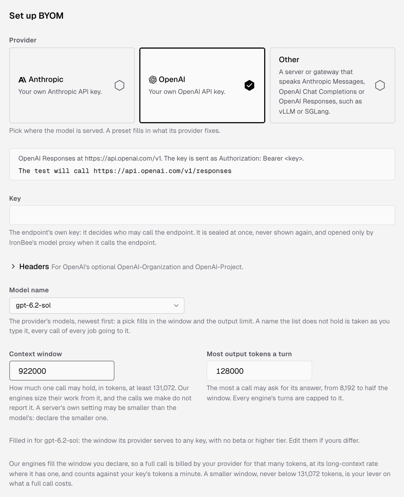
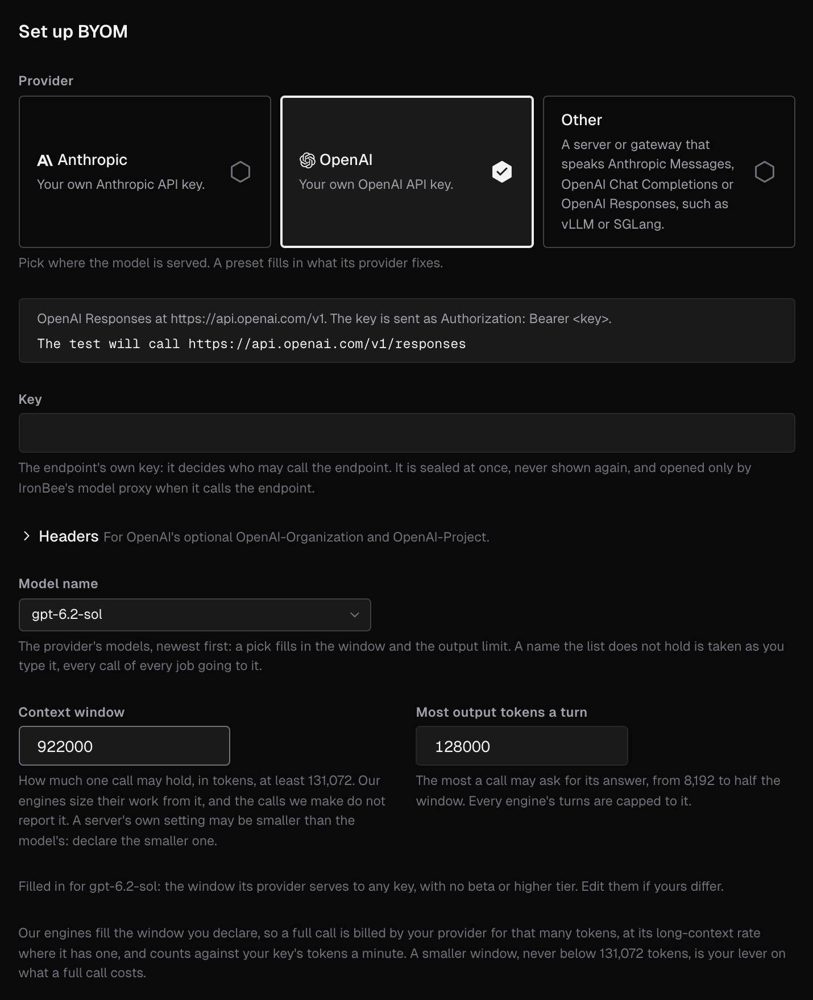

| Provider | The preset fixes | The form asks |
|----------|------------------|---------------|
| **Anthropic** | **Anthropic Messages** at `https://api.anthropic.com`, the key sent as `x-api-key` | **Key**, **Model name**, **Context window**, **Most output tokens a turn** |
| **OpenAI** | **OpenAI Responses** at `https://api.openai.com/v1`, the key sent as a Bearer token | The same, and **Headers**, folded, for OpenAI's optional `OpenAI-Organization` and `OpenAI-Project` |
| **Other** | Nothing | Every field, and shows **Our addresses** |

On a preset, **Model name** lists the provider's known models, newest first, each with its window and output limit. A pick fills in both numbers, which stay editable, and the form says **Filled in for** the model. A name the list doesn't hold is taken as you type it, and leaves the two numbers to you. The known models are listed on [Formats and models](/byom/formats-and-models#the-presets-and-the-known-models).

### The fields

**Other** shows every field. As you type the base URL, the form shows **The test will call** with the full address.

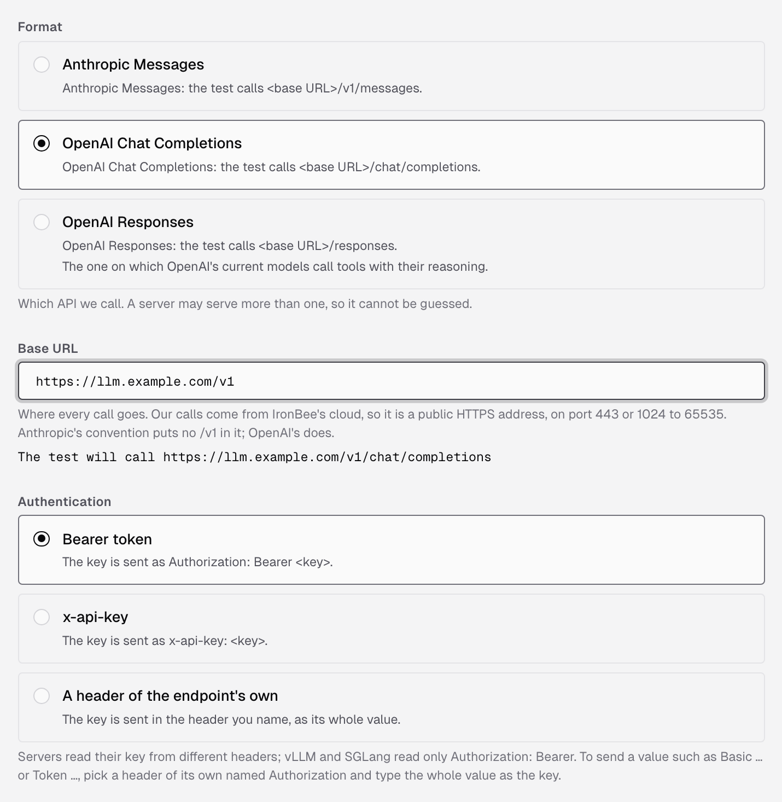
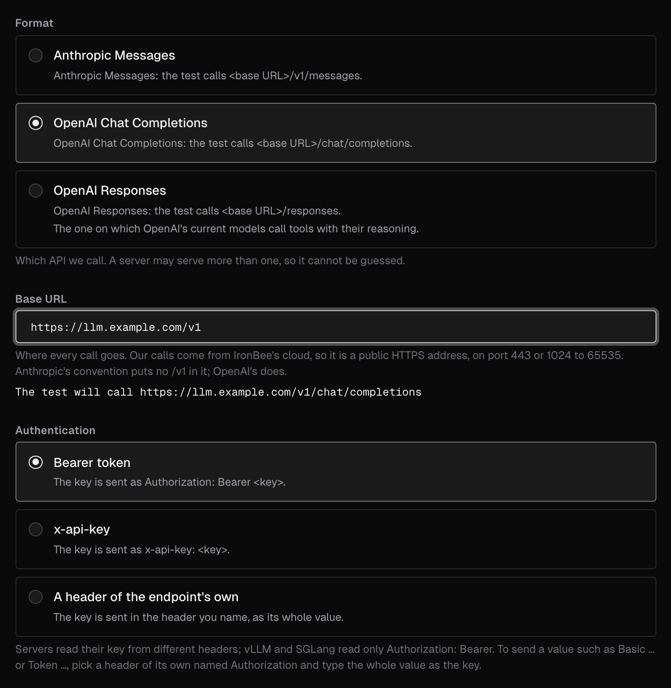

| Field | What you give | Rules |
|-------|---------------|-------|
| **Format** | **Anthropic Messages**, **OpenAI Chat Completions** or **OpenAI Responses** | Each option shows the route the test calls: `<base URL>/v1/messages`, `<base URL>/chat/completions` or `<base URL>/responses`. See [Choosing the format](/byom/formats-and-models#choosing-the-format) |
| **Base URL** | An HTTPS address, such as `https://llm.example.com` or `https://llm.example.com:8443/v1` | Port 443 or 1024 to 65535; a public address; no query, fragment, user or password. Anthropic's convention puts no `/v1` in it; OpenAI's does |
| **Authentication** | **Bearer token**, **x-api-key** or **A header of the endpoint's own**, with its **Header name** | vLLM and SGLang read only `Authorization: Bearer`. A header of the endpoint's own takes the key as its whole value: to send `Basic ...` or `Token ...`, name the header `Authorization` and type the whole value as the key |
| **Key** | The endpoint's own key | Required, up to 4,096 characters. Stored encrypted at once and never shown again |
| **Headers** (optional) | Rows of **Name**, **Value** and **Secret**, added with **Add a header** | Up to 20, for what a gateway needs beyond the key, such as a routing or a tenant header. A plain value is shown to owners and admins; a secret one is stored encrypted and never shown again. A header can't take a name the request itself sets, such as `Host`, `Content-Type`, `Authorization` or `x-api-key` |
| **CA bundle** (optional, **Other** only) | PEM certificates | For an endpoint whose certificate a private authority signed: up to 10 certificates, 64 KiB at most |
| **Model name** | The string your server expects in a request's `model` field, such as what vLLM's `--served-model-name` sets | Every call of every job goes to this model |
| **Context window** | Tokens one call may hold | From 131,072 to 2,000,000. A server's own setting may be smaller than the model's: declare the smaller one |
| **Most output tokens a turn** | The most a call may ask for its answer | From 8,192 to half the window. Every engine's turns are capped to it |

The window you declare is also your lever on what a full call costs: IronBee's engines fill it. See [The window is your lever on cost](/byom/your-endpoint#the-window-is-your-lever-on-cost).

### On your side

Under the fields, **On your side** lists:

- **Our addresses**, under **Other** only: the addresses IronBee's calls to your endpoint come from. An address rule adds to the endpoint's own authentication and doesn't replace it. See [IronBee's addresses](/byom/your-endpoint#ironbees-addresses).
- **Region**: IronBee runs its jobs, and its calls to the endpoint, in the United States (AWS us-west-2, Oregon).
- **What a model must support**, in the format you picked.

---

## Save and the connection test

Click **Save**, or **Save and enable** to turn BYOM on as well when the test passes. Saving runs the connection test first: "Running the connection test. This takes up to 90 seconds." Then the page shows the settings with the test's report open.

| The answer | What it means |
|------------|---------------|
| **Saved and enabled** | The test passed, and BYOM is on |
| **Saved**: "The connection test passed." | The test passed. On settings that are off, it adds "Enable BYOM when you are ready." |
| **Saved, not enabled**: "The connection test failed: the report says why." | New settings are saved whatever the test says, with BYOM off |
| "Nothing was saved: BYOM is enabled and the test failed, so the settings in use stay as they were. To store settings that do not pass, disable BYOM first." | While BYOM is on, a save writes only when its test passes. The report shows under the form |
| "The test could not run now, so nothing was saved." with **Run the test again**, or "The test could not be run, so nothing was saved." with **Try again** | The test didn't run. Nothing changed |
| "Too many tests in a short time. Wait a few minutes and try again." | Too many saves in a short time |

Every save takes the key and the secret headers' values again, since they're never shown back: on an edit those fields read **Required to save changes**.

### The connection test's report

The test runs on the form's values before anything is saved, from IronBee's addresses. Each step shows its outcome (**Passed**, **Warning**, **Failed** or **Not run**) and its time. A failed step shows what to do, the status your endpoint answered, and an excerpt of its error with your key and secret headers' values taken out.

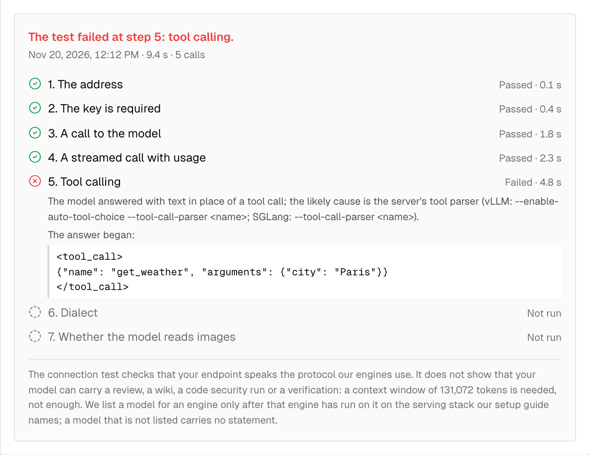
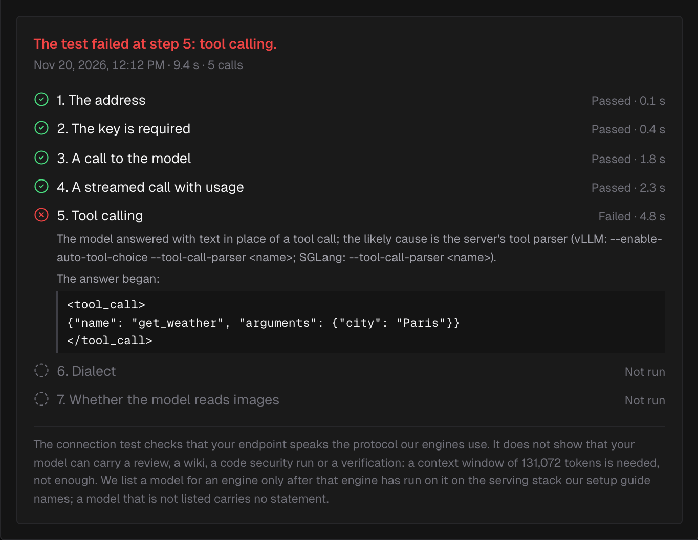

| Step | Passes when | If it fails |
|------|-------------|-------------|
| **1. The address** | The name resolves to public addresses, a TLS connection opens on the port, and the certificate is trusted | Make the endpoint reachable from the internet and allow IronBee's addresses, which the report lists; or give the CA bundle that signed its certificate |
| **2. The key is required** | Judged once step 3 has passed: the same request sent with a wrong key and with none is refused each time | The endpoint must require its key on every path. An answer that settles nothing, such as a 429, a 5xx or a timeout, asks you to run the test again |
| **3. A call to the model** | A small call answers in the format's shape | A refused key names the other header to try, and that a gateway may need a header of its own. A 404 points at the base URL's path or the model name. A rate limit, an account with no credit, a redirect and the endpoint's own errors each say so |
| **4. A streamed call with usage** | The stream arrives whole, with its input and output token counts | The endpoint must send token usage in its streams |
| **5. Tool calling** | A request with one tool and `tool_choice: auto` is answered with a valid call, and the model answers the tool's result | The report says what the endpoint did: the server's tool parser for a call written as text or a refused `tool_choice`, the chat template for a refused second turn, or the endpoint's own words |
| **6. Dialect** | On OpenAI Chat Completions, an output limit honored and a JSON schema answered with its JSON; on OpenAI Responses, an output limit honored; on all three, no reasoning in the answers' text | Each failed check is named with what to do, such as turning on the server's reasoning parser |
| **7. Whether the model reads images** | Recorded, never failing | |

- **What the test found** closes a passing report: whether the model reads images, the effort level answered cleanly, and on OpenAI Chat Completions whether the endpoint needs the model's reasoning handed back.
- A call answered 429 is sent once more after its `retry-after`, and a call refused because the endpoint's account has no credit left isn't sent again.
- Each call has 30 seconds, and the test 90 in all. The test makes at most 16 calls, 15 on OpenAI Responses, with a few more where a step needs them.

The report ends with what a passing test means: "The connection test checks that your endpoint speaks the protocol our engines use. It does not show that your model can carry a review, a wiki, a code security run or a verification: a context window of 131,072 tokens is needed, not enough."

The test can't see two things. Its calls are its own, so a gate a provider puts on a client, such as Anthropic's API refusing an older Claude Code, shows only when a verification runs. And it calls only the format's route, so a server that leaves other paths open without its key goes behind a [reverse proxy](/byom/server-recipes#a-reverse-proxy-in-front) whatever the test says.

---

## The settings

Once saved, the page shows the settings in place of the form:

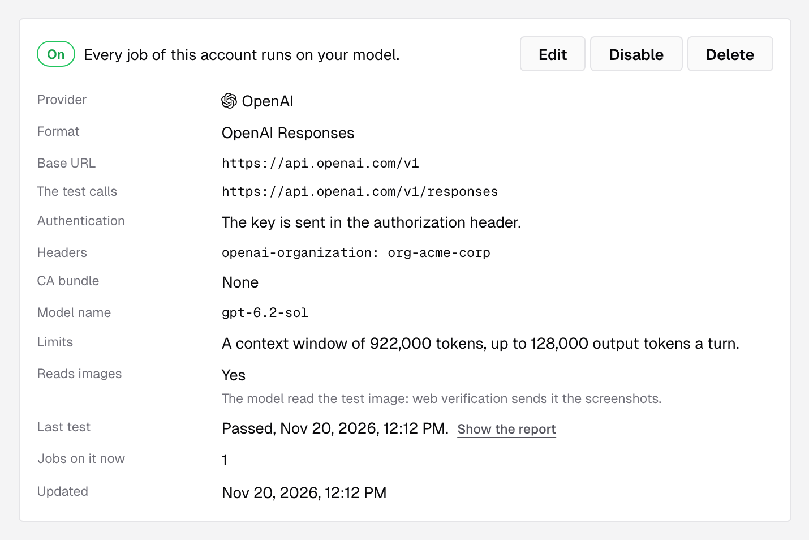
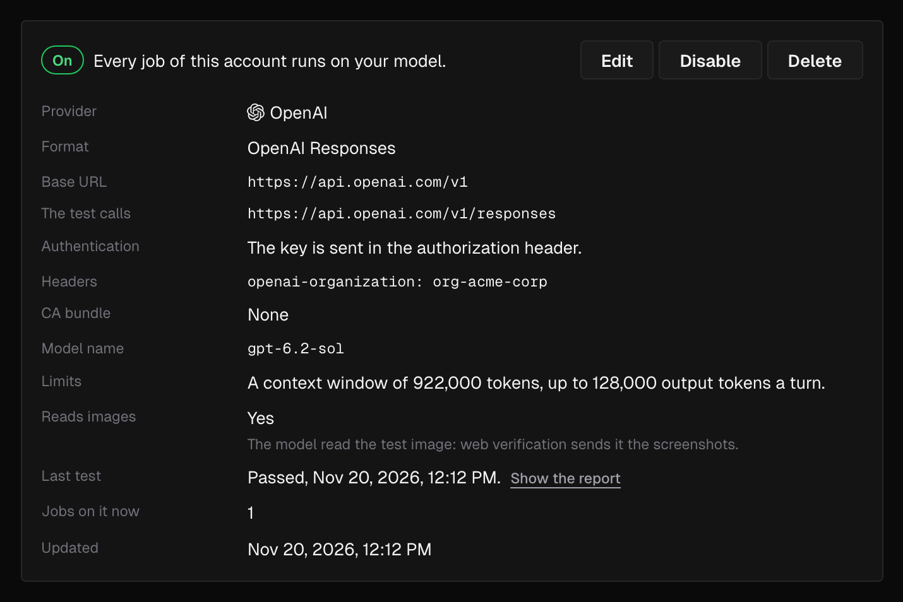

- **On** ("Every job of this account runs on your model.") or **Off** ("The account's jobs run on IronBee's model.").
- **Provider**: the preset the settings match, or **Other**.
- **Format**, **Base URL**, and **The test calls**: the full address.
- **Authentication**: the header the key is sent in.
- **Headers**: plain headers with their values, secret ones by name with **secret**.
- **CA bundle**: **Held** or **None**.
- **Model name** and **Limits**: the window and the output tokens a turn.
- **Reads images**: what the last test found. A model that doesn't still runs web verification, without its screenshots.
- **Reasoning handed back**: **Every turn** or **The current turn**, only on an endpoint the test found to need it.
- **Last test**: when it passed, or the step it failed at, with **Show the report**.
- **Jobs on it now**: the jobs running on your endpoint.
- **Updated**: when, and by whom.

### Last failure

When a job's call to your endpoint fails, the settings show **Last failure** with its time, what went wrong and what to do, until your endpoint's next success clears it:

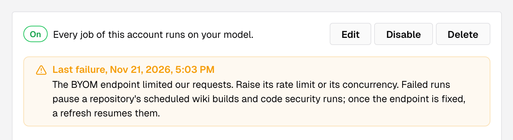
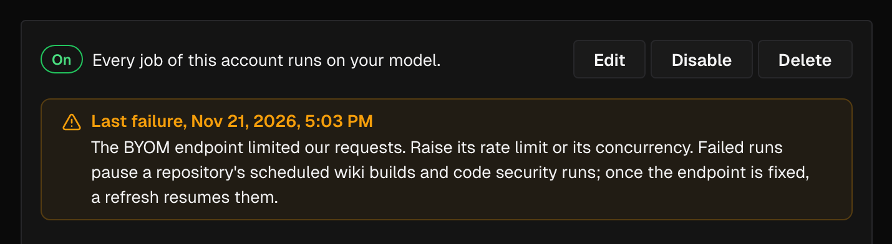

Failed runs pause a repository's scheduled wiki builds and code security scans. Once the endpoint is fixed, a run started by hand resumes them. What each failure means is on [When a job fails](/byom/when-a-job-fails#what-a-failed-job-says).

---

## Enable, disable, edit and delete

| Button | What happens |
|--------|--------------|
| **Enable** | Needs a passing last test; until then the button is off and the page says "Enabling needs a passing test. Edit and save the settings to run it again." **Enable BYOM?** names the model and the host: from the next job, every job of the account runs on it. Jobs already running finish on IronBee's model |
| **Disable** | **Disable BYOM?**: from the next job, the account's jobs run on IronBee's model again, and the settings stay saved. The dialog counts the jobs running on your endpoint now: they stop calling it within 20 seconds and fail, and none moves to IronBee's model |
| **Edit** | Opens **Edit the BYOM settings**. A save runs the test again, and takes the key and the secret headers' values again. A running job's calls go to the edited endpoint within 20 seconds |
| **Delete** | **Delete the BYOM settings?**: the settings and the key are removed and nothing is kept. Deleted settings can't be restored, only set up again. From the next job, the account's jobs run on IronBee's model, and jobs running on your endpoint fail as on a disable |

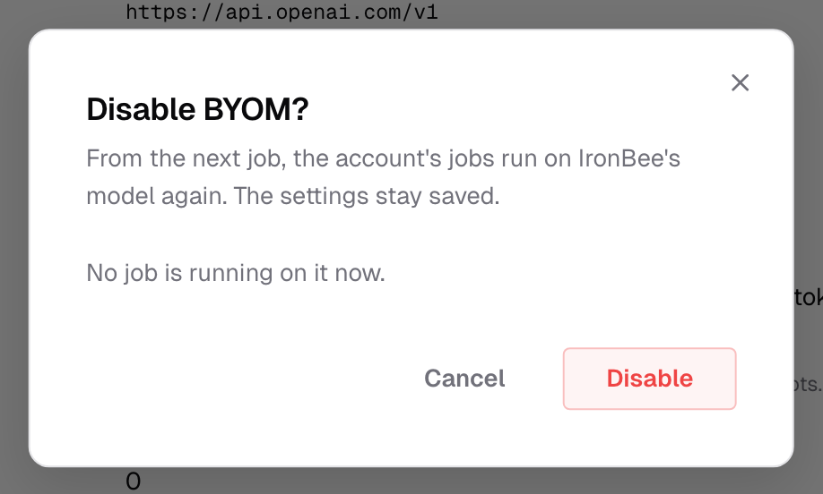
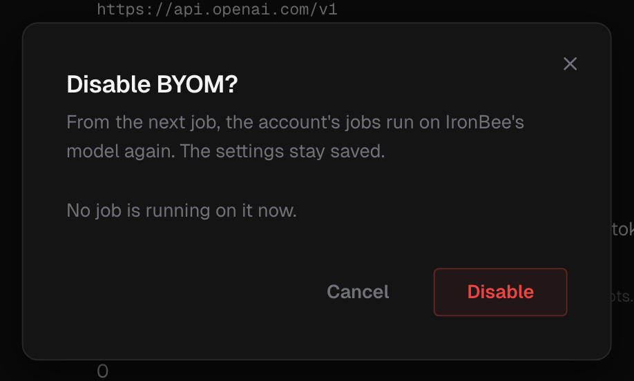

**BYOM enabled**, **BYOM disabled** and **BYOM settings deleted** confirm each change.

On a plan that can't set up BYOM, the delete dialog warns first: "This account's plan cannot set up BYOM: once these settings are deleted, BYOM can be set up again only on the Enterprise plan."

### Editing settings a preset can't hold

A preset is stored nowhere, so saved settings open as the preset whose format, base URL and authentication header they hold, as long as they hold nothing the preset hides. Anything else opens as **Other**.

A save replaces the settings whole, so an edit never offers a preset that would drop what the settings hold:

- Settings on **Other** with a CA bundle, or with an authentication header of their own, stay on **Other**: "These BYOM settings stay on Other: a preset would drop" what they hold.
- Settings on **Other** with headers alone aren't offered the **Anthropic** preset, which has no headers: "The Anthropic preset is not offered: it would drop their headers."

---

## What other roles see

Members and billing admins see the page read-only, under "Only an owner or admin of this account changes the BYOM settings.":

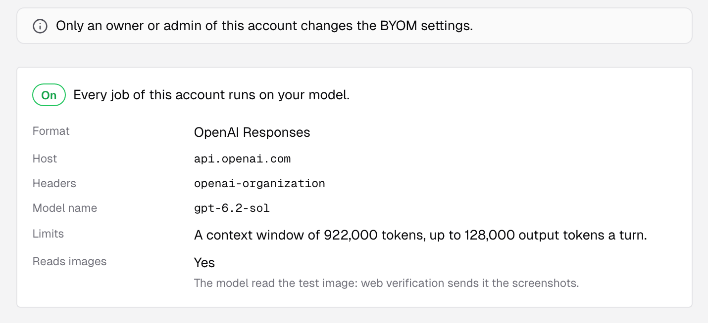
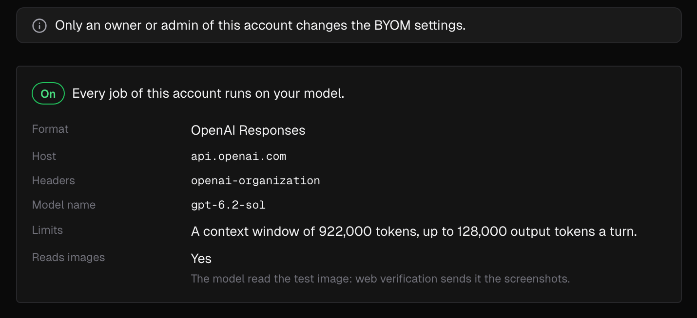

They see whether BYOM is on, its **Format**, its **Host**, the names of its **Headers**, the **Model name**, the **Limits**, whether it **Reads images**, **Reasoning handed back** where the test found it, and the **Last failure** while there is one. They don't see the provider, the base URL, the authentication header, a header's value, the CA bundle, the last test, the jobs on it now, or who updated it, and have no buttons. See [Roles and permissions](/console/roles).

---

## What's next?

<CardGroup cols={2}>
  <Card title="Prepare your endpoint" icon="server" href="/byom/your-endpoint">
    What your endpoint needs before you save.
  </Card>
  <Card title="When a job fails" icon="triangle-alert" href="/byom/when-a-job-fails">
    What a job that failed on your endpoint says.
  </Card>
</CardGroup>
