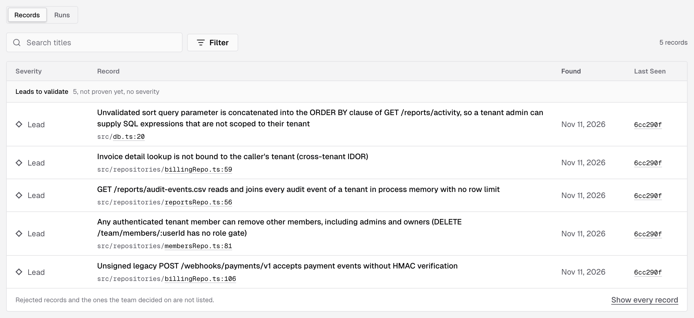
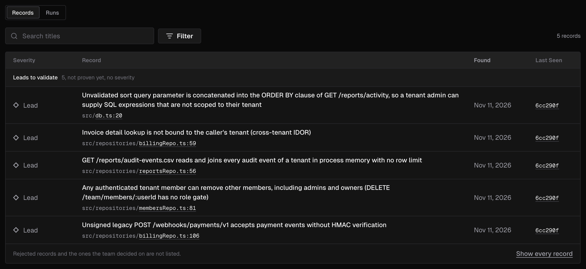
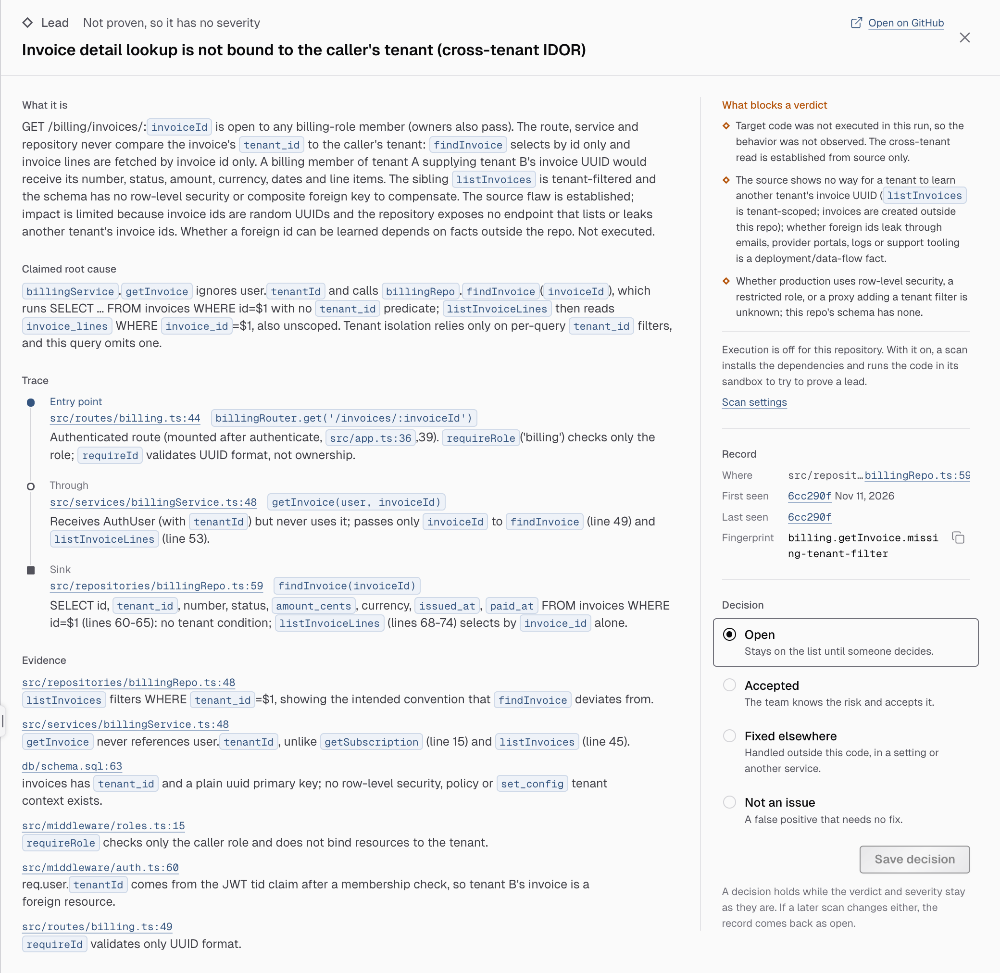
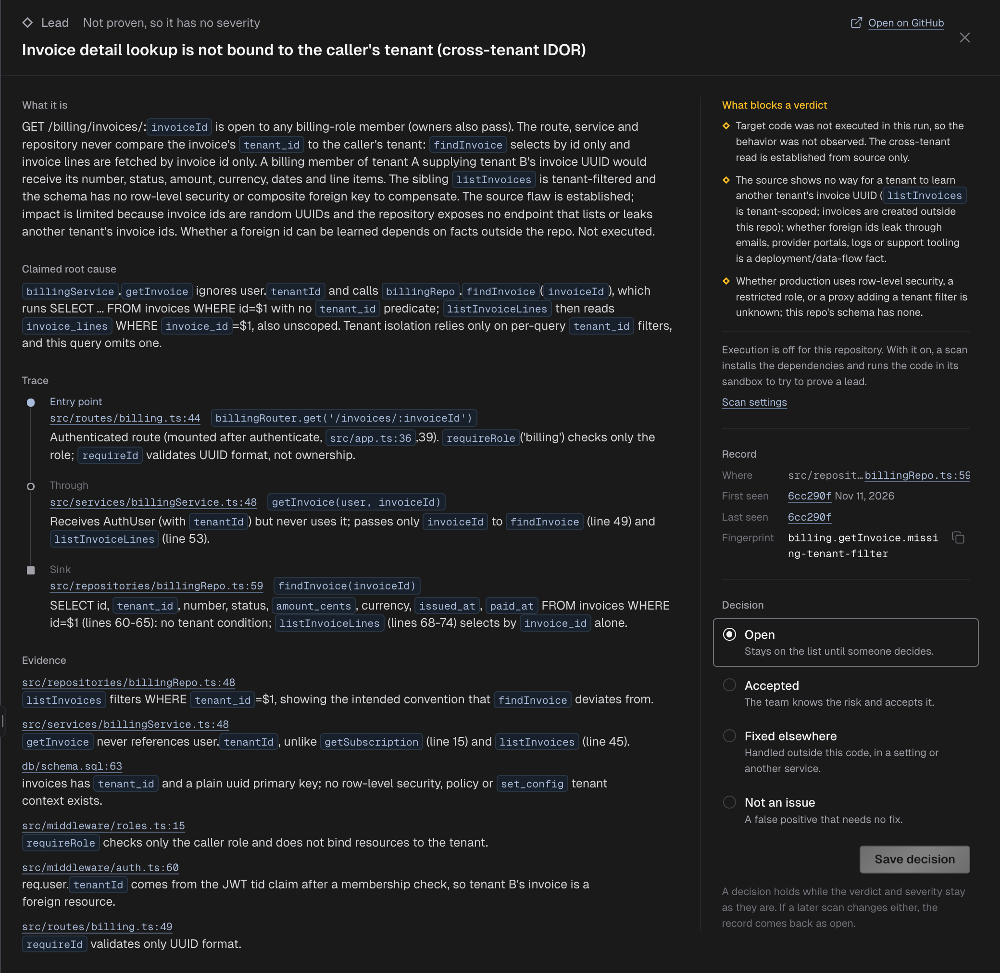
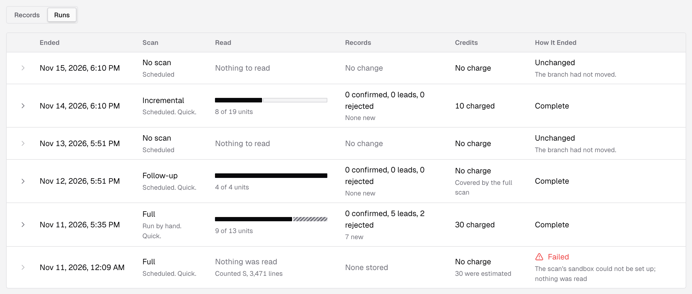
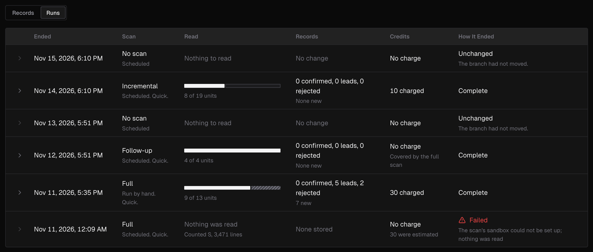

The **Records** and **Runs** tabs are on a project's [**Code security**](/console/code-security) tab, under the scan summary. **Records** lists what the scans found. **Runs** lists every scan that ran. Only owners and admins see them.

---

## Records

A record is one problem a scan found in the repository. A later scan that sees the problem again updates its record.

The list groups the records by verdict:

| Group | What's in it |
|-------|--------------|
| **Confirmed** | Reproduced by running the code. Each has a severity |
| **Leads to validate** | Not proven yet, so they have no severity |
| **Rejected** | A scan found they do not hold |

Each record shows:

| Column | What it shows |
|--------|---------------|
| **Severity** | The severity of a confirmed finding, or **Lead** for a lead to validate |
| **Record** | The record's title and, under it, the file and line it's about, or **Repository-wide** |
| **Decision** | Your team's decision. The column shows when the list includes records that were decided on |
| **Found** | When a scan first found it |
| **Last seen** | The commit of the last scan that saw it |

Click a record's title to [open it](#read-a-record). **Load more** loads the next records.

### What the list shows

The list opens on what still needs a decision: the confirmed findings and the leads to validate whose decision is **Open**. Under the list, a line says **Rejected records and the ones the team decided on are not listed.** Click **Show every record** to see them all.

To narrow the list:

- **Search titles** searches the titles of the records loaded so far. Click **Load more** to search the rest.
- **Filter** has three groups:
  - **Verdict:** **Confirmed**, **Lead to validate**, **Rejected**
  - **Severity:** **Critical**, **High**, **Medium**, **Low**, **Informational**. A severity keeps confirmed records only
  - **Decision:** **Open**, **Accepted**, **Fixed elsewhere**, **Not an issue**
- **Reset filters** goes back to the open records.

The filters, and the record you have open, are kept in the page's address, so you can share a link to a filtered list or to one record.

When the list is empty, it says why:

| The list says | What it means |
|---------------|---------------|
| **Nothing is open** | The last scan left no confirmed finding and no lead to validate |
| **No record matches these filters** | Change the filters to see more |
| **No records yet** | Records appear once a scan finishes |

---

## Read a record

A record opens in a panel on the right. At the top, it says **Confirmed finding** with its severity, or **Not proven, so it has no severity** for a lead. **Open on GitHub**, **Open on GitLab** or **Open on Bitbucket** opens the file at the scanned commit, on the record's line.

A record shows only the sections it has something to say in:

| Section | What it holds |
|---------|---------------|
| **What it is** | A description of the problem |
| **Root cause** | Why the code allows it. On a lead, it reads **Claimed root cause** |
| **Intended behaviour** | What the code should do instead |
| **Trace** | The path through the code, step by step, each step linked to its file and line: **Entry point**, **Through** and **Sink** |
| **Reproduction** | How the scan reproduced it: the **Attacker**, the **Steps**, the **Payloads** and what it **Observed** |
| **How to fix** | The way to fix it, and the fixed code of each file it touches. The fix is shown for you to apply. IronBee doesn't change the repository |
| **Evidence** | The places in the code that support the record |
| **Conditions** | What must be true for the problem to be used, such as **Authentication**, **Role**, **User interaction**, **Configuration** or **Network** |
| **How to validate it** | For a lead: how to check it yourself, **Locally** or **On a deployment** |
| **Why it does not hold** | For a rejected record: the reason |

**The record as the scan wrote it** shows the same record as data. Click **Show it as data** to open it.

Beside the sections, the panel shows:

- **Why this severity:** the **Likelihood**, the **Impact** and the **Confidence**, each with its reason.
- **What blocks a verdict:** for a lead, what kept the scan from proving it. When **Execution** is off for the repository, it says so and links to **Scan settings**: with [**Execution**](/console/code-security-settings#execution) on, a scan runs the code to try to prove a lead.
- **Record:** **Where** it is, when it was **First seen** and **Last seen**, and its **Fingerprint**, the id that stays the same from scan to scan. Click the copy button to copy it.
- **Decision:** your team's decision. See [Decide on a record](#decide-on-a-record).

If a record can't be found, the panel says **This record is no longer here**. It may belong to another repository, or the link is wrong.

---

## Decide on a record

Under **Decision**, choose what your team does with the record:

| Decision | When to use it |
|----------|----------------|
| **Open** | Nobody has decided yet. The record stays on the list |
| **Accepted** | The team knows the risk and accepts it |
| **Fixed elsewhere** | It's handled outside this code, in a setting or another service |
| **Not an issue** | A false positive that needs no fix |

Add a note if you want to say why, then click **Save decision**. **Decision saved** confirms it. The panel then shows the current decision and when it was set.

Saving a decision other than **Open** takes the record off the default list. It stays under **Filter**.

A decision holds while the record's verdict and severity stay as they are. If a later scan changes either, the record comes back as **Open**. If a scan updated the record while you had it open, the console says **The record changed since it was opened** and shows it again as it is now. Check it and choose again.

There's no decision for a problem you fixed in the code. Leave the record **Open**: a later scan that reads that code again rejects the record once the problem is gone.

Only owners and admins can decide, and not on an archived project.

---

## Runs

The **Runs** tab lists every scan of the repository once it ends, scheduled or run by hand:

| Column | What it shows |
|--------|---------------|
| **Ended** | When the scan ended |
| **Scan** | The kind: **Full**, **Incremental**, **Follow-up**, or **No scan** when the branch had not moved. Under it, what started it, **Scheduled**, **Run by hand** or **API**, and the profile |
| **Read** | How much of the repository the scan read, as units, or **Nothing to read** |
| **Records** | What the scan recorded, such as **2 confirmed, 5 leads, 1 rejected**, and how many are new |
| **Credits** | What was charged, such as **120 charged**, or **No charge** with the reason |
| **How it ended** | **Complete**, **Incomplete**, **Stopped at its time limit**, **Stopped at its spend limit**, **Stopped at its context limit**, **Nothing to read**, **Unchanged** or **Failed** |

Click **Show the details** on a run to open:

- **Units:** how many were **Read**, **Put off to a follow-up run**, **Outside this scan** and **Blocked**.
- **Reading:** the **Lines counted for the price**, the **Lines the models read**, the **Changed paths in scope** and the repository's **Size**.
- **Run:** the **Commit** the scan read and its **Profile**.

A failed run shows the reason, such as **The scan ran out of time**, **The repository's connection is gone** or **The default branch has no commit yet**. A scan that fails costs nothing.

If no scan has ended yet, the tab says **No runs yet**.

---

## What's next?

<CardGroup cols={2}>
  <Card title="Code security" icon="shield-check" href="/console/code-security">
    What a scan does, when it runs and what it costs.
  </Card>
  <Card title="Code security settings" icon="settings" href="/console/code-security-settings">
    Choose the profile, the schedule, execution and the paths a scan leaves out.
  </Card>
</CardGroup>
