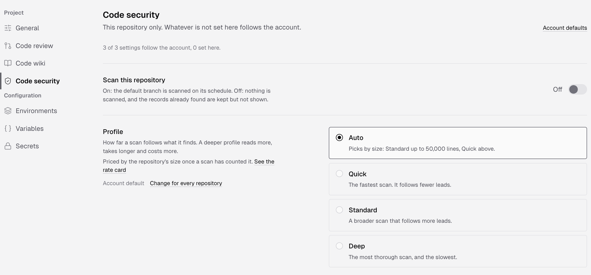
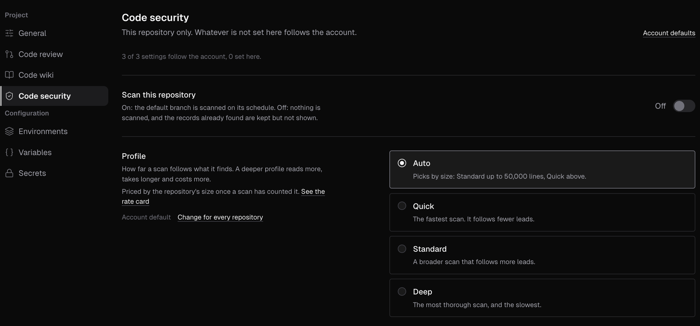

Code security settings decide which repositories are [scanned](/console/code-security), how far a scan goes, whether it may run the repository's code and how often it comes. You set them at two levels:

- **The account:** open **Settings > Code security**. Its defaults apply to every repository.
- **One repository:** open the project, go to its **Settings** tab and select **Code security**, or click **Scan settings** on the project's **Code security** tab.

A repository follows the account's defaults until it sets its own value. Only owners and admins see these pages.

---

## Account settings

The account page opens with [**Code security for this account**](#turn-code-security-off-for-the-account), then holds the defaults for every repository: **Profile**, **Execution** and **Scheduled scan**. A repository can set its own on its settings page. When repositories hold their own value of a setting, the setting counts them, such as **2 repositories set their own**.

| Setting | Options | Default |
|---------|---------|---------|
| [**Profile**](#profile) | **Auto**, **Quick**, **Standard**, **Deep** | **Auto** |
| [**Execution**](#execution) | **Off**, **On** | **Off** |
| [**Scheduled scan**](#scheduled-scan) | **Daily**, **Weekly**, **Every two weeks**, **Monthly** | **Weekly** |

No account setting turns code security on for a repository. Each repository has its own switch, and it's off until you turn it on. The account's switch can turn it off for all of them at once.

### Turn code security off for the account

**Code security for this account** is one switch over every repository of the account. It's on until an owner or an admin turns it off. A flip applies at once, apart from **Save changes**.

- **On:** IronBee scans every repository whose own switch is on.
- **Off:** no repository is scanned, and no record or run is shown, whatever each repository's switch says. The project's **Code security** tab says **Code security is off for this account**, with **Turn it on in the account's settings**, and each repository's settings page says **Code security is off for this account, so this repository is not scanned whatever its switch below says.** The [API](/code-security/api#settings) refuses the records, runs, decision and start routes with `CODE_SECURITY_DISABLED`.

Turning it off never changes a repository's own switch, stops a scan that's already running, or deletes a record or a run: a scan that was queued fails when it would start, and costs nothing. Turning it on again queues nothing by itself. Each repository is as it was, and its next scheduled scan comes when it's due.

### Profile

The profile sets how far a scan follows what it finds. A deeper profile reads more, takes longer and costs more.

| Profile | What it does |
|---------|--------------|
| **Auto** | Picks by the repository's size: **Standard** for smaller repositories, **Quick** for larger ones. It never picks **Deep**. The option says where the line is |
| **Quick** | The fastest scan. It follows fewer leads |
| **Standard** | A broader scan that follows more leads |
| **Deep** | The most thorough scan, and the slowest |

On the account page, the profiles are a table with a column for each repository size, which gives the credits of a full scan at that size. **The whole rate card** opens [Usage](/console/usage#what-a-job-costs). While your account runs its jobs on its own model with [BYOM](/byom/overview), the prices in this table and on a repository's page are BYOM prices, and a line says so. The rate card on Usage keeps its own prices, with a line that says what a job on BYOM is charged.

### Execution

**Execution** decides whether a scan may run a repository's code to prove what it finds.

- **Off:** the scan reads the code and never runs it. What it finds stays a lead to validate, with no severity.
- **On:** the scan installs the dependencies and runs the code in its sandbox. A finding it reproduces is confirmed and gets a severity. A scan with execution costs more: the option shows by how much.

With execution on, a scan:

- runs install scripts and the repository's own code, inside the sandbox only
- reaches the package registries while it installs. The code it runs has no network beyond itself
- installs Node, Python and Go at the version the repository declares. Other languages are read, not run
- is refused, free, for a checkout larger than 2 GiB. The **Code security** tab then says **Too large to scan with execution**

See [Running your code](/code-security/how-a-scan-works#running-your-code).

### Scheduled scan

**Scheduled scan** sets how often each repository's scheduled scan comes: **Daily**, **Weekly**, **Every two weeks** or **Monthly**. A period in which the default branch didn't move scans nothing and costs nothing.

---

## Repository settings

A repository's page is for that repository only. Whatever isn't set there follows the account. **Account defaults** opens the account page.

The page opens with **Scan this repository**:

- **On:** the default branch is scanned on its schedule, while [**Code security for this account**](#turn-code-security-off-for-the-account) is on.
- **Off:** nothing is scanned. The records already found are kept, and the runs within your plan's retention, but they aren't shown.

Turning the switch on starts no scan by itself, but a repository that has never been scanned is due at once: its first scheduled scan, a full scan, usually starts within minutes, once no other code security scan of your account is waiting or running and the team has credits left. You can also start one with [**Run full scan**](/console/code-security#run-a-full-scan).

Under the switch, a line counts the settings this repository follows and the ones it sets itself, such as **3 of 3 settings follow the account, 0 set here.** When the repository sets something, it offers **Reset all to account settings**.

Below it:

- **Profile**, **Execution** and **Scheduled scan**, as in [Account settings](#account-settings). A setting that follows the account reads **Account default**, with **Change for every repository** to open the account page. Change one, and it reads **Set for this repository**, with a link to reset it to the account default.
- **Paths to ignore**, which exists only on a repository's page.

Once a scan has counted the repository, each profile shows its price at this repository's size, in credits: a full scan, then a period with changes. Before that, the page says the price depends on the repository's size, with **See the rate card**.

### Paths to ignore

**Paths to ignore** are files left out of every scan and of the repository's size, which a scan's price is counted from. Type a pattern such as `vendor/**` or `**/*.min.js`, then press Enter or click **Add a pattern**.

A pattern is a glob from the repository root, with no leading `/` and no `..` segment: `*` matches within one path segment and `**` matches across segments. The list takes up to 100 patterns, of up to 500 characters each, with at most 10 `**` in one pattern.

Changing the list makes the next scan a full scan. The page says so, with the full scan's price when the repository's size is known.

---

## Save your changes

Click **Save changes** to save, or **Discard** to drop your changes. **Code security settings saved** confirms it. If the console refuses a value, it says **Some settings were refused**.

A change applies at a repository's next scan. A scan already running keeps the settings it started with.

---

## Who can change settings

Only owners and admins see code security settings, at both levels, and only they change them. A member or a billing admin who opens a settings page's address sees **Only owners and admins see the code security settings.** See [Roles and permissions](/console/roles).

An archived project's page is read-only, and says **This project is archived. Unarchive it to change its code security settings.** See [Project settings](/console/project-settings).

Code security scans GitHub, GitLab and Bitbucket repositories only. On a Vercel, Netlify or CLI project, the page says **Code security scans GitHub, GitLab and Bitbucket repositories**.

---

## What's next?

<CardGroup cols={2}>
  <Card title="Code security" icon="shield-check" href="/console/code-security">
    What a scan does, when it runs and what it costs.
  </Card>
  <Card title="Usage" icon="gauge" href="/console/usage">
    The team's credits this month and the rate card.
  </Card>
</CardGroup>
