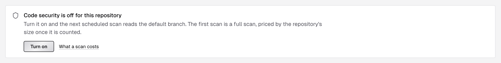
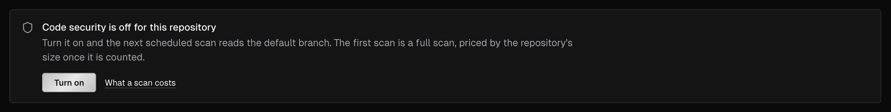
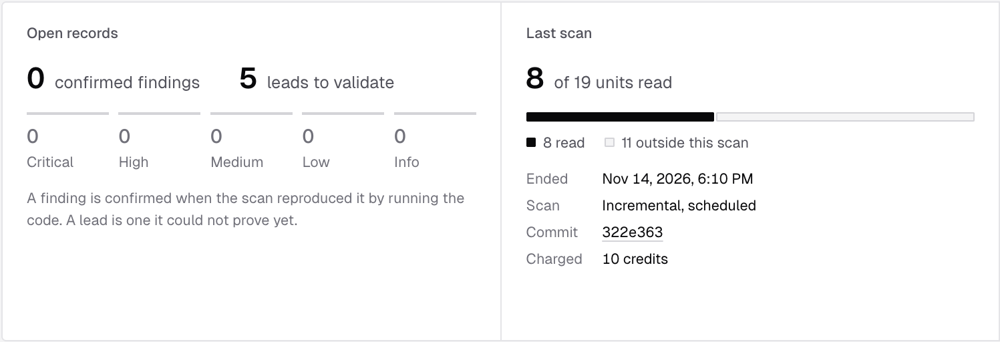
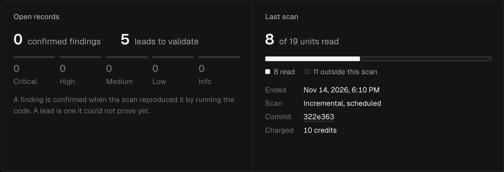

IronBee scans the default branch of a GitHub repository the [IronBee GitHub App](/integrations/github) covers, or of a repository you picked in a [connected GitLab group](/integrations/gitlab) or [Bitbucket workspace](/integrations/bitbucket), for security problems. Each thing a scan finds is kept as a record, with where it is in the code, how it could be used and how to fix it. Your team then decides what to do with each record.

Code security is off until an owner or an admin turns it on for a repository. A scan uses [credits](#credits). Only owners and admins see code security: the tab, its records and its settings.

The scans are on each project's **Code security** tab, after **Code wiki**. To choose how far a scan goes and how often it runs, see [Code security settings](/console/code-security-settings).

---

## What a scan finds

A scan reads the code and writes a record for each problem it finds. Every record has a verdict:

| Verdict | What it means |
|---------|---------------|
| **Confirmed** | The scan reproduced the problem by running the code. Only a confirmed finding has a severity: **Critical**, **High**, **Medium**, **Low** or **Informational** |
| **Lead to validate** | The scan could not prove it yet, so it has no severity. The record says what blocks a verdict and how to validate it yourself |
| **Rejected** | A scan found that it does not hold |

A scan can confirm a finding only when it may run the repository's code. That's the [**Execution**](/console/code-security-settings#execution) setting, and it's off by default. With **Execution** off, a scan reads the code and never runs it, so everything it finds stays a lead to validate.

Code security works in the console only. It posts no comment, check or status on a pull request or merge request, and it changes nothing in the repository.

To read the records and decide on them, see [Security records and runs](/console/code-security-records).

---

## Turn it on

Open the project's **Code security** tab. While it's off, the tab says **Code security is off for this repository**. Click **Turn on**. You can also turn on [**Scan this repository**](/console/code-security-settings#repository-settings) in the project's settings.

Turning it on starts no scan by itself. The next scheduled scan reads the default branch, or you can start one now with [**Run full scan**](#run-a-full-scan). Connecting a repository or pushing to it doesn't start a scan either.

---

## When a scan runs

- **On a schedule.** [**Scheduled scan**](/console/code-security-settings#scheduled-scan) sets how often a scan comes: **Daily**, **Weekly**, **Every two weeks** or **Monthly**. A period in which the default branch didn't move scans nothing and costs nothing.
- **By hand.** **Run full scan** starts one now. See [Run a full scan](#run-a-full-scan).

There are three kinds of scan:

| Kind | What it reads |
|------|---------------|
| **Full** | The whole default branch. The first scan of a repository is a full scan, and so is one you run by hand, or the next one after its [**Paths to ignore**](/console/code-security-settings#paths-to-ignore) changed |
| **Incremental** | What changed since the last scan. A scheduled scan after the first one is incremental |
| **Follow-up** | What a scan had to put off. It starts after that scan, on the same commit, and is free |

A scan takes up to two hours. One scan runs at a time in your account, so a second one waits its turn.

---

## Where a scan stands

Until a scan has finished and its records are ready, a band at the top of the tab says where things stand:

| The tab says | What it means |
|--------------|---------------|
| **Code security is off for this repository** | Nothing is scanned. An owner or an admin can click **Turn on**. **What a scan costs** opens the rate card on [Usage](/console/usage#what-a-job-costs) |
| **The first scan has not run yet** | It comes at the next scheduled time, or now with **Run full scan** |
| **A scan is waiting to start** | It starts within a few minutes, or at the time the band shows |
| **A scan is getting ready** | The repository is being counted. The scan's price shows once it's counted, and nothing is charged before that |
| **A scan is running** | The result shows on the tab when the scan ends |
| **The last scan did not have enough credits** | The scan didn't start, and nothing was charged. The next scheduled scan tries again when the credits reset. **Usage and credits** opens [Usage](/console/usage) |
| **This repository is larger than the rate card covers** | A scan at this size needs a contract with IronBee. Nothing was charged. **Edit paths to ignore** opens the repository's settings, because ignored paths are left out of the count |
| **Too large to scan with execution** | The checkout is too large to scan with **Execution** on. Nothing was charged. **Open scan settings** opens the repository's settings, where you can turn **Execution** off |
| **The last scan failed** | The band gives the reason. Nothing was charged, and the records below are from the last scan that finished |

A band for a full scan says so, such as **A full scan is running**.

While a scan waits or runs, the band follows it under **Where the scan stands**: **Waiting to start**, **Preparing**, then **Scanning the code**. It also shows the **Scan** kind, the **Profile**, whether **Execution** is on, the repository's **Size** and the **Credits** estimated for the scan.

When the scan ends, the console tells you what it recorded and what was charged, such as **The scan finished**. **No scan was needed** means the branch had not moved since the last scan.

---

## The scan summary

Under the band, three cards sum up the repository:

- **Open records:** how many confirmed findings and leads to validate are open, and the confirmed findings by severity.
- **Last scan:** how much of the repository the scan read, as units. The bar splits them into read, put off, outside this scan and blocked. Units put off are read by a follow-up run, free. Below the bar: **Ended**, the **Scan** kind and what started it, the **Commit** it read, and the credits **Charged**.
- **Next scan:** what the next scan costs **If the code changed** and **If nothing changed**, and what **A full scan, run by hand** costs, with the **Schedule**, the **Profile** and the repository's **Size**. **Rate card** opens [Usage](/console/usage#what-a-job-costs). Before the first scan, the card says its price is counted before anything is read.

**Scan settings**, at the end of the tab row, opens the repository's [code security settings](/console/code-security-settings#repository-settings).

Below the cards, the **Records** and **Runs** tabs list what the scans found and every scan that ran. See [Security records and runs](/console/code-security-records).

---

## Run a full scan

Click **Run full scan** on the **Next scan** card to scan the whole default branch now, whatever changed.

A dialog asks **Run a full scan of** the project, and shows what the scan costs before you confirm:

- the scan's price at the repository's size and profile, and what **Execution** adds when it's on
- **This scan**, the total, and **Left this month, after it**

Before a repository's first scan, its size isn't known yet. The dialog then shows a table of the sizes with the price of a full scan at each, and the button reads **Count and scan**. The scan counts the repository first. If the counted price is higher than the credits left, the scan is refused and nothing is charged.

Click the run button, which names the credits, to start. **Full scan queued** confirms it. The scan starts within a few minutes and the tab follows it.

You can run a full scan of a repository by hand once an hour. The button is unavailable, and says why when you hover over it, when:

- code security is off for the repository
- a scan is already waiting or running
- the project is archived
- no credits are left this month
- you ran one recently: **Run recently, again at** a time

---

## Credits

A scan uses credits from the same monthly pool as code review and verification. Its price depends on the repository's size, counted in lines outside the paths to ignore, on the [**Profile**](/console/code-security-settings#profile) and on [**Execution**](/console/code-security-settings#execution). A full scan costs more than a period with changes.

- The price is counted at the start of the scan, before anything is read.
- A scan is charged when it finishes. A scan that fails, or is refused, costs nothing.
- A period in which nothing changed costs nothing.
- A follow-up run, which only finishes an earlier scan, is never charged.
- A scan the team's credits can't cover is refused, free.

The prices are on the rate card on [Usage](/console/usage#what-a-job-costs).

---

## When there's no code security to show

| The tab says | What it means |
|--------------|---------------|
| **Code security scans GitHub, GitLab and Bitbucket repositories** | A Vercel, Netlify or CLI project. Connect its repository through the GitHub App, a GitLab group or a Bitbucket workspace to scan it |
| **No code security for this project** | The repository isn't connected through the GitHub App, a GitLab group or a Bitbucket workspace, or the project is archived |
| **Only owners and admins see code security** | You opened the tab's address as a member or a billing admin. Ask an owner or an admin for access |

When code security is turned off for a repository, its records and runs are kept but not shown. Turn it on again to see them.

---

## Who can see and do what

| Action | Owner | Admin | Member | Billing Admin |
|--------|:-----:|:-----:|:------:|:-------------:|
| See the **Code security** tab, its records and its runs | Yes | Yes | No | No |
| Turn code security on, and **Run full scan** | Yes | Yes | No | No |
| Set a [decision](/console/code-security-records#decide-on-a-record) on a record | Yes | Yes | No | No |
| See and change [Code security settings](/console/code-security-settings) | Yes | Yes | No | No |

Members and billing admins don't see the **Code security** tab or its settings pages. See [Roles and permissions](/console/roles).

---

## What's next?

<CardGroup cols={2}>
  <Card title="Security records and runs" icon="shield-alert" href="/console/code-security-records">
    Read a record, decide on it, and see every scan that ran.
  </Card>
  <Card title="Code security settings" icon="settings" href="/console/code-security-settings">
    Choose the profile, the schedule, execution and the paths a scan leaves out.
  </Card>
</CardGroup>
