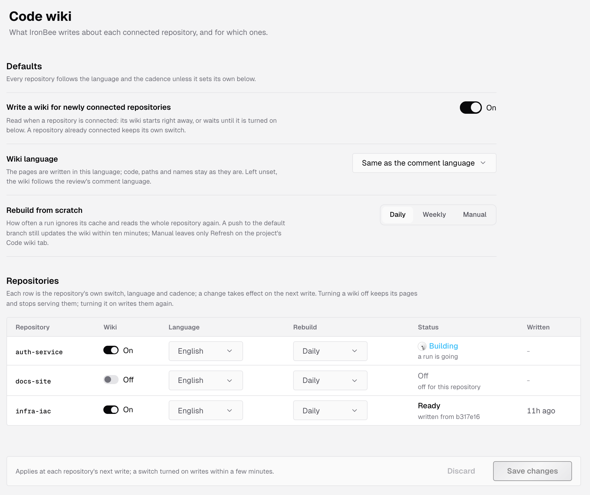
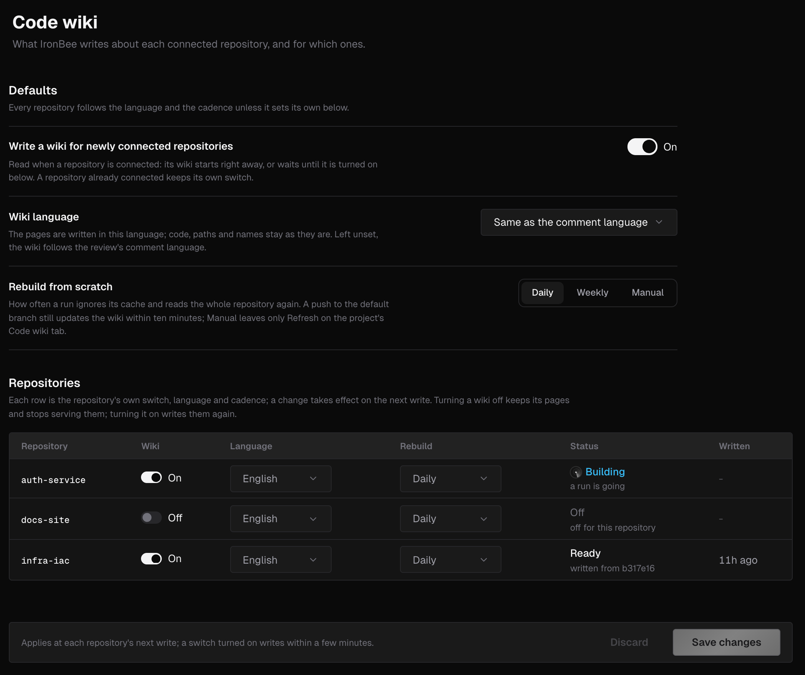
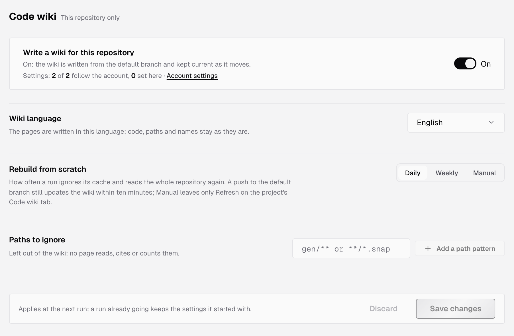
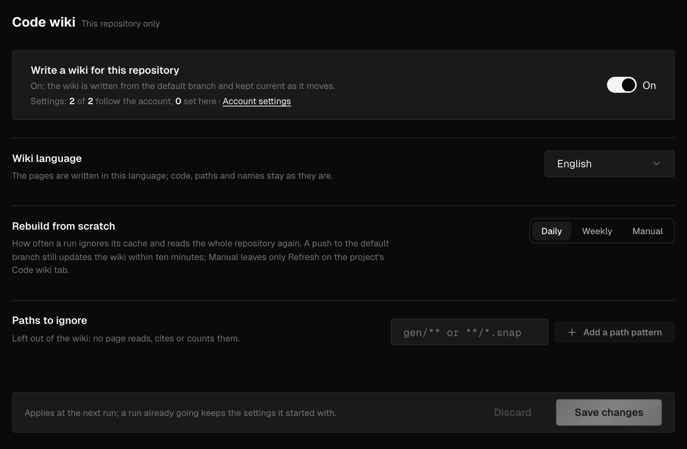

Code wiki settings decide which repositories get a [code wiki](/console/code-wiki), the language its pages are written in and how often it's rebuilt from scratch. You set them at two levels:

- **The account:** open **Settings > Code wiki**. Its defaults apply to every repository, and its **Repositories** table holds each repository's own values.
- **One repository:** open the project, go to its **Settings** tab and select **Code wiki**. The page is marked **This repository only**.

A repository follows the account's defaults until it sets its own value, at either level.

---

## Account settings

The account page opens with **Defaults**, then the **Repositories** table.

### Defaults

| Setting | Options | Default | What it does |
|---------|---------|---------|--------------|
| **Write a wiki for newly connected repositories** | On, Off | On | When a repository is connected, its wiki starts right away. Off: it waits until you turn it on for that repository. A repository already connected keeps its own switch |
| **Wiki language** | **Same as the comment language**, English, Deutsch, Español, Français, Português (Brasil), 日本語, 한국어, 中文, Türkçe, Русский | **Same as the comment language** | The language the pages are written in. Code, paths and names stay as they are. **Same as the comment language** follows the code review's [**Comment language**](/code-review/settings#output) |
| **Rebuild from scratch** | **Daily**, **Weekly**, **Manual** | **Daily** | How often a run ignores what it read before and reads the whole repository again. A push to the default branch still updates the wiki within about ten minutes. **Manual** has no scheduled rebuild |

When repositories hold their own values, the section counts them, such as **2 repositories set their own**.

### Repositories

The **Repositories** table lists every connected GitHub, GitLab and Bitbucket repository whose project isn't archived. Each row holds the repository's own settings:

| Column | What it shows |
|--------|---------------|
| **Repository** | The repository's name |
| **Wiki** | The repository's switch, **On** or **Off** |
| **Language** | The repository's wiki language |
| **Rebuild** | The repository's **Rebuild from scratch** cadence |
| **Status** | Where the wiki stands, with a detail under it |
| **Written** | When the wiki was last written |

A row that sets its own value shows **Reset**, which brings it back to the account's defaults.

The **Status** column reads:

| Status | Detail, for example |
|--------|---------------------|
| **Ready** | "written from b317e16" |
| **Building** | "a run is going", or "waiting to start, at" a time |
| **Failed** | "the last run could not finish" |
| **Not written yet** | "the first build starts within a few minutes" |
| **Off** | "off for this repository", with how many pages are kept |

A change takes effect on the repository's next write. Turning a wiki off keeps its pages but stops showing them. Turning it on writes them again within a few minutes. Changing the language or the cadence starts no run of its own.

If no repository is connected yet, the table reads **No repository connected**: "A wiki is written for repositories connected through the GitHub App, a GitLab group or a Bitbucket workspace." See [GitHub App](/integrations/github), [GitLab](/integrations/gitlab) and [Bitbucket](/integrations/bitbucket).

---

## Repository settings

A repository's page opens with **Write a wiki for this repository**:

- **On:** the wiki is written from the default branch and kept current as it moves.
- **Off:** nothing new is written. The pages already written are kept, not shown.

Under the switch, a line counts the settings this repository follows and the ones it sets itself, such as **Settings: 2 of 2 follow the account, 0 set here**. It links to **Account settings** and, when the repository sets something, offers **Reset all to account settings**.

Below the switch:

- **Wiki language** and **Rebuild from scratch**, as in [Defaults](#defaults). Change one, and the line under it reads **Set for this repository**. Click **Reset to account default** to follow the account again.
- **Paths to ignore:** files left out of the wiki. No page reads, cites or counts them. Type a pattern such as `gen/**` or `**/*.snap`, then press Enter or click **Add a path pattern**. This list exists only on a repository's page.

### Paths to ignore

A pattern is a glob from the repository root: `*` matches within one path segment and `**` matches across segments. The list takes:

- up to 100 patterns, of up to 500 characters each
- no leading `/` and no `..` segment
- at most 10 `**` in one pattern
- no blank pattern, and no control or text-direction characters

A pattern already in the list isn't added twice. When the list is full, its input reads **The list is full**.

---

## Save your changes

The bar under the form counts what you changed, such as **2 unsaved changes**, and says when the change applies:

- **Account page:** at each repository's next write. A switch turned on writes within a few minutes.
- **Repository page:** at the next run. A run already going keeps the settings it started with.

Click **Save changes** to save, or **Discard** to drop your changes. If the console refuses a value, it says **Some settings were refused**, and the changes it accepted stay saved. If you leave the page with unsaved changes, **Leave without saving?** asks you to **Leave** or **Keep editing**.

---

## Who can change settings

Everyone in the account can see code wiki settings, at both levels. Only owners and admins can change them. Others see **Owners and admins change these settings; you can see them.** above a read-only form. See [Roles and permissions](/console/roles).

An archived project's page is read-only for everyone, and says **This project is archived. Unarchive it to change its code wiki settings.** See [Project settings](/console/project-settings).

The code wiki is written for GitHub, GitLab and Bitbucket repositories only. On a Vercel, Netlify or CLI project, the page says **The wiki is written for GitHub, GitLab and Bitbucket repositories**, with **Open integrations**.

---

## What's next?

<CardGroup cols={2}>
  <Card title="Code wiki" icon="book-open" href="/console/code-wiki">
    The pages IronBee writes and how they stay current.
  </Card>
  <Card title="Code review settings" icon="git-pull-request" href="/code-review/settings">
    When IronBee reviews a pull request, and what it writes.
  </Card>
</CardGroup>
