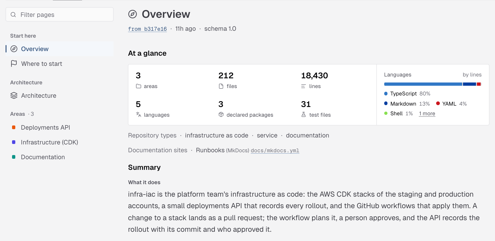
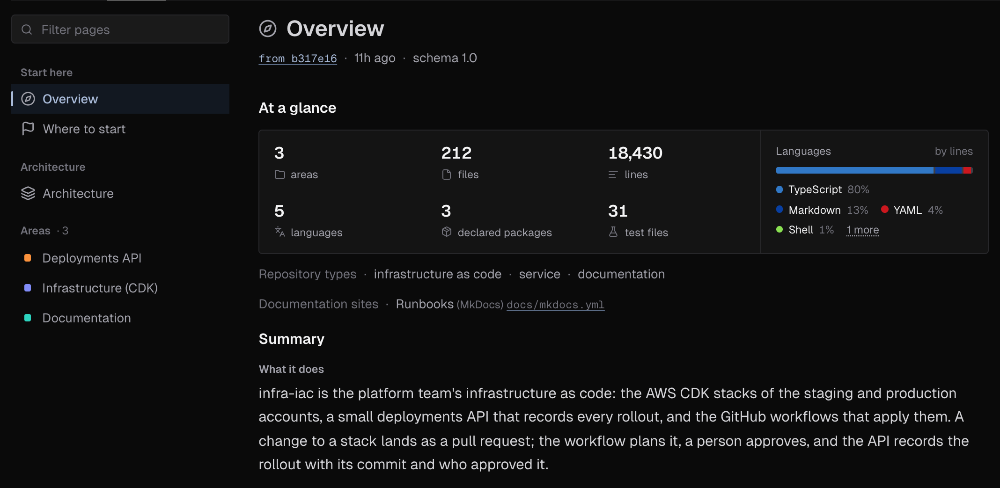
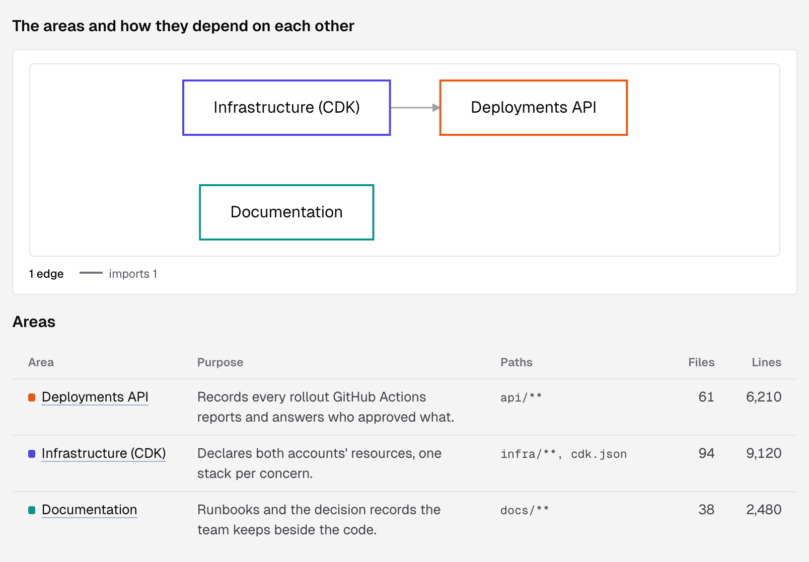
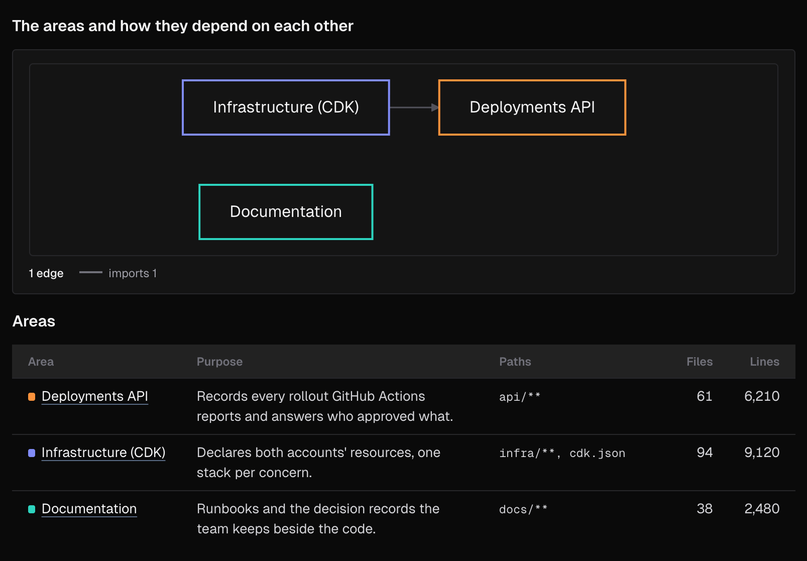
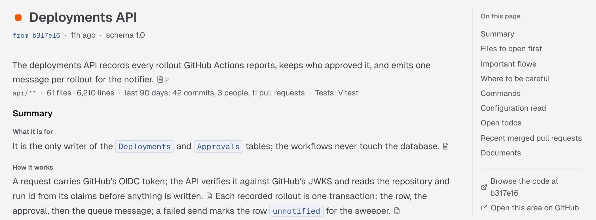
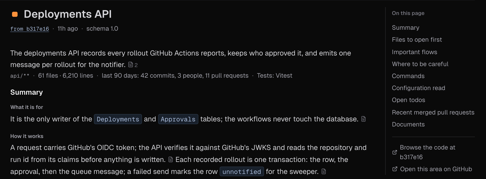

IronBee writes a wiki of each GitHub repository the [IronBee GitHub App](/integrations/github) covers, and of each repository you pick in a [connected GitLab group](/integrations/gitlab). It reads the repository's default branch and writes pages that explain the code: what the repository does, where to start, how its parts depend on each other, and one page for each area of the code. As pull requests or merge requests merge, the wiki is written again. Writing the wiki uses no credits.

The wiki is on each project's **Code wiki** tab, after **Code review**. The project's card on the [Projects](/console/projects) page shows how many pages it has and when it was written. To choose which repositories get a wiki and in which language, see [Code wiki settings](/console/code-wiki-settings).

---

## When the wiki is written

- **When a repository is connected.** Its first wiki starts within a few minutes, unless **Write a wiki for newly connected repositories** is off. Until it's ready, the tab reads **Writing the first wiki**: "A repository takes 5 to 15 minutes to read. This page updates by itself."
- **When the default branch moves.** A push to the default branch, such as a merged pull request or merge request, updates the wiki about ten minutes later. Pushes that land close together are written in one update.
- **On a schedule.** **Rebuild from scratch** sets how often a run ignores what it read before and reads the whole repository again: **Daily**, **Weekly** or **Manual**, with no scheduled rebuild. A scheduled rebuild is skipped when nothing changed since the last one.
- **When you click Refresh.** See [Refresh the wiki](#refresh-the-wiki).

While the wiki is written again, the pages you're reading stay up, under a band that says **Writing the pages again** and which commit they're from. When several repositories in your account are written at the same time, a run can wait its turn: the band reads **Waiting to start**, with a time.

Each page shows the commit it was written from and when, such as **from b317e16 · 11h ago**, and the language when it isn't English. Click the commit to open it on GitHub or GitLab.

---

## The pages

The page list on the left groups the pages under **Start here**, **Architecture** and **Areas**. Type in **Filter pages** to narrow it. On a narrow screen, the list becomes a menu at the top that shows the current page's title.

A page shows only the sections it has something to say in.

### Overview

What the repository is and what it's made of:

- **At a glance:** the number of areas, files, lines, languages, declared packages and test files, and a bar of the languages by lines.
- **Repository types**, such as service or infrastructure as code, and any **Documentation sites** the repository builds.
- **Summary:** **What it does**, **Main parts**, **Data in and out**, **Running and deploying**, **Building and releasing** and **What is notable**.
- **Top-level directories**, **Languages**, **Stack**, **Commands** and **Recent changes**.

### Where to start

For someone new to the repository:

- **Reading order:** the pages to read first, each with why.
- **Prerequisites:** the tools and versions you need, and the CI the repository runs.
- **Conventions:** the rules the code follows, such as where a kind of file lives or what a handler must never do.
- **Every page:** links to all the wiki's pages.

### Architecture

How the repository's areas fit together:

- **The areas and how they depend on each other:** a diagram of the areas, with an edge for each dependency, such as imports or HTTP calls. On a large repository, it draws the strongest edges of each kind and says how many it left out.
- **Areas:** every area with its purpose, its paths and its size in files and lines.
- **Areas at a glance:** how many commands and configuration files each area has.
- **Flows:** the paths that cross areas, step by step, each step linked to the code it runs.

### Areas

An area is one part of the repository, such as a service, an app, the infrastructure or the docs. Each area has its own page under **Areas**, and keeps the same color on every page.

- **Under the title:** what the area does, its paths, its size, its activity in the last 90 days, and its test framework.
- **Summary:** **What it is for**, **How it works**, **How it fits in** and **Where things are**.
- **Files to open first**, each with why.
- **Important flows**, drawn step by step.
- **Where to be careful:** what's easy to break, and why.
- **Commands**, **Configuration read**, **API schemas**, **Open todos**, **Recent merged pull requests** and **Documents**.

The areas are decided again on every run. If an area you had open is gone, the tab says **This page is no longer in the wiki**; pick a page from the list.

---

## Sources

The wiki says where each claim comes from. A small file mark after a sentence holds its sources, with a count when there's more than one. Hover over it, or tap it, to see each file and its lines, such as `L12–20`, at the commit the wiki was written from. Click a source to open it on GitHub or GitLab.

**On this page**, on the right, lists the page's sections. Under it, **Browse the code at** opens the repository at that commit, and on an area page, **Open this area on GitHub** or **Open this area on GitLab** opens the area's folder.

---

## Refresh the wiki

Click **Refresh**, at the top right of the tab, to write the wiki again from the default branch now. **Refresh queued** confirms it; the run starts within a few minutes and the tab follows it.

You can refresh a repository's wiki once an hour. Within the hour, IronBee says **Refreshed less than an hour ago, again at** a time. The button is unavailable while a run is already going, or while the wiki is off for the repository.

---

## When there's no wiki to show

| The tab says | What it means |
|--------------|---------------|
| **Writing the first wiki** | The first wiki is being written. The tab updates by itself |
| **No wiki yet** | The first run starts within a few minutes of connecting the repository. Click **Refresh** to ask for it now |
| **No wiki yet: the first run failed** | Click **Refresh** to try again |
| **The repository wiki is off** | The wiki is turned off for this repository. Its pages are kept but not shown. **Turn on in Settings** opens [Code wiki settings](/console/code-wiki-settings#repositories) |
| **No wiki for this project** | The repository isn't connected through the GitHub App or a GitLab group, or the project is archived |
| **The wiki is written for GitHub and GitLab repositories** | A Vercel, Netlify or CLI project. **Open integrations** shows how to connect its repository through the GitHub App or a GitLab group |

If a later run fails, the tab keeps showing the pages from the last run that finished, under **The last run could not finish**. The next push to the default branch, or **Refresh**, starts a new run.

---

## Who can see and do what

| Action | Owner | Admin | Member | Billing Admin |
|--------|:-----:|:-----:|:------:|:-------------:|
| Read the wiki | Yes | Yes | Yes | Yes |
| **Refresh** | Yes | Yes | Yes | No |
| Change [Code wiki settings](/console/code-wiki-settings) | Yes | Yes | No | No |

See [Roles and permissions](/console/roles).

---

## What's next?

<CardGroup cols={2}>
  <Card title="Code wiki settings" icon="settings" href="/console/code-wiki-settings">
    Choose which repositories get a wiki, its language and how often it's rebuilt.
  </Card>
  <Card title="Code review" icon="git-pull-request" href="/code-review/overview">
    Reviews of every pull request and merge request in the same repositories.
  </Card>
</CardGroup>
