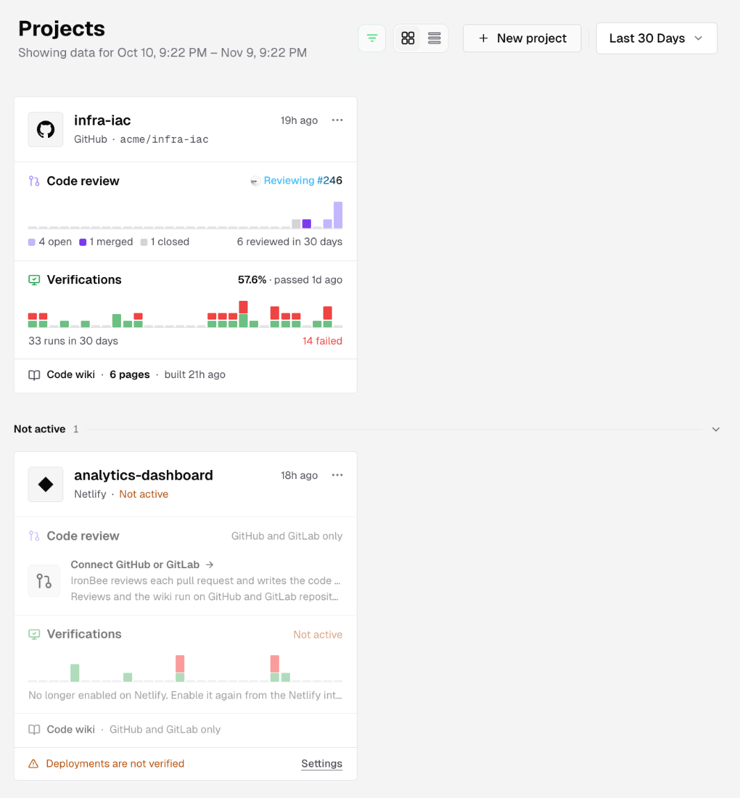
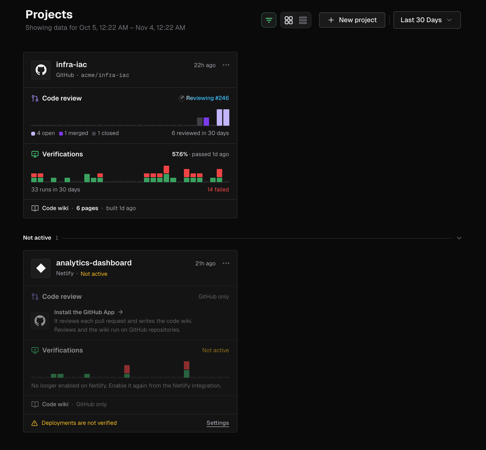
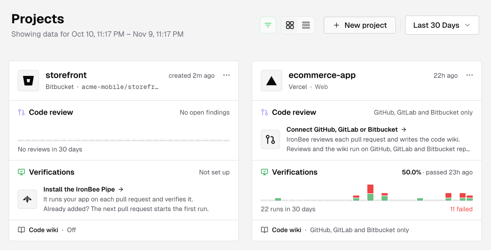
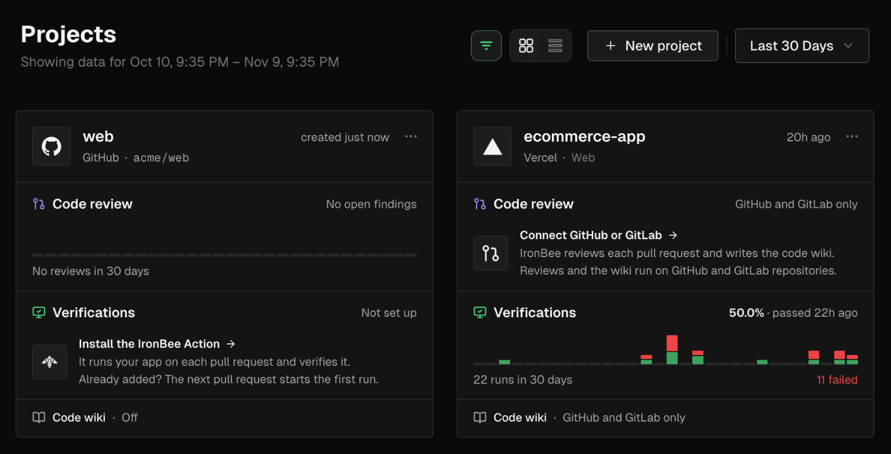
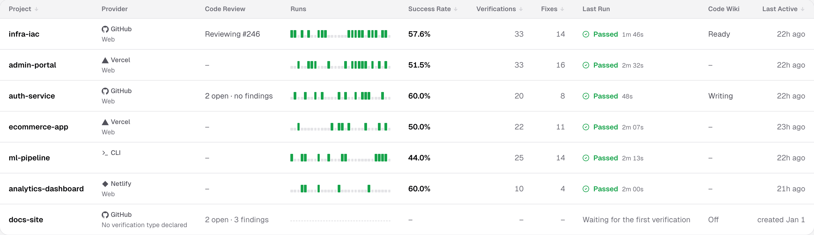
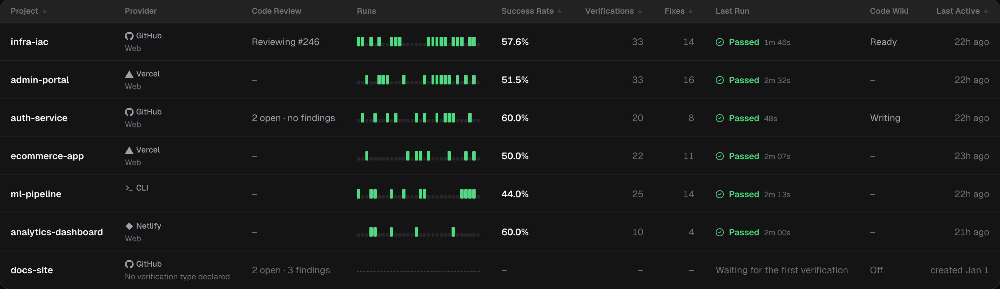
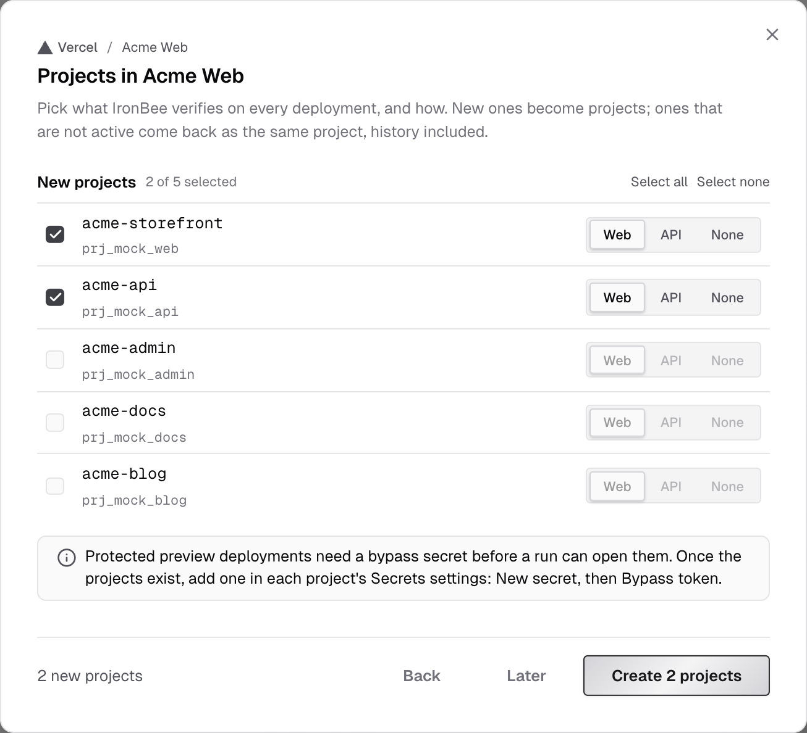
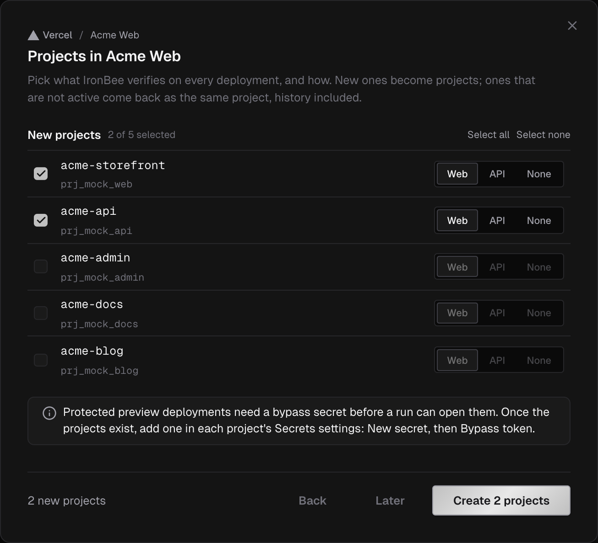

**Projects** is the console's home page. It lists every project in your account with its code reviews, its verification runs and its code wiki.

A project is one of:

- a **GitHub** repository. Installing the [IronBee GitHub App](/integrations/github) makes every repository it covers a project
- a **GitLab** repository. In a [connected GitLab group](/integrations/gitlab), each repository you pick becomes a project, named by its path after the group with `/` as `-`: `acme/platform/backend` is `platform-backend`
- a **Vercel** project or a **Netlify** site that an owner or admin enabled from [Integrations](/integrations/overview)
- a **CLI** project: the name your IronBee CLI reports under. A CLI checkout of a github.com or gitlab.com repository reports to that repository's GitHub or GitLab project instead

Click a project to open its **Code review** tab. Its other tabs are [Code wiki](/console/code-wiki), [Verifications](/console/verifications), [Scenarios](/console/scenarios) and [Settings](/console/project-settings).

---

## Not active projects

A project that's no longer enabled on its provider is listed last, under the **Not active** band. Its card says **Deployments are not verified** and has a **Settings** button.

- For a Vercel project, a Netlify site or a GitLab repository, enable it again from the provider's integration.
- For a GitHub repository, enable it again from the GitHub integration, or add the repository back to the App on GitHub if it left the App's repositories.

Archived projects aren't listed here. Owners and admins find them under **Settings > Archived projects**. See [Project settings](/console/project-settings#archive-a-project).

---

## Date range

The date filter in the page header sets the window every number on the page covers. The subtitle shows it as **Showing data for** a date range.

- Pick **Last 24 Hours**, **Last 7 Days**, **Last 30 Days** or **Last 90 Days**.
- Or pick a **Custom Range** with a **From** and **To** time down to the hour.

---

## Card view

Each project card shows:

- **The header**: the provider's logo, the project's name and where it lives. A GitHub or GitLab project shows its repository, such as **GitHub · acme/shop** or **GitLab · acme/platform/backend**. A Vercel or Netlify project shows its verification type, such as **Vercel · Web**. On the right, the card shows when the project was last active, when it was created if it hasn't run yet, or **nothing in this window**. The menu offers **Project settings** and, for a GitHub or GitLab project, **Open on GitHub** or **Open on GitLab**.
- **Code review**: the open findings, with critical and high named, such as **1 critical · 1 high open**, or **No open findings**. While a review runs, the row says **Reviewing #N**. The bars below count the pull requests reviewed in each slice of the window, by their state now: open, merged and closed. Click the row to open the project's pull requests, or click a bar to open the pull requests of that slice.
- **Verifications**: the pass rate and the latest result, such as **92% · passed 2h ago**, or **Running** with the run's name while a run is in progress. The bars below count the runs in each slice of the window, with how many failed. Click the row to open the project's verifications, or click a bar to open that run or the runs in that slice.
- **Code wiki**: how many pages the [wiki](/console/code-wiki) has and when it was built, such as **38 pages · built 3h ago**, or where it stands: **Writing the first version**, **Refreshing**, **Not built yet**, **The first version failed** or **Off**. When a later rebuild failed, the line adds **refresh failed** after the page count.

Some rows say why there's nothing to show yet:

| Row | It says | What it means |
|-----|---------|---------------|
| **Code review** | **Off**, with **Turn on** for owners and admins | Code review is turned off for this repository |
| **Code review**, **Code wiki** | **GitHub and GitLab only**, with **Connect GitHub or GitLab** | Code review and the code wiki run on GitHub and GitLab repositories. Vercel, Netlify and CLI projects don't have them |
| **Code review** | **Not connected**, with **Install the GitHub App** or **Connect its GitLab group** | The repository isn't covered by the IronBee GitHub App, or its GitLab group isn't connected |
| **Code wiki** | **Needs the GitHub App**, or **Not connected** on a GitLab project | The same: the repository isn't covered by the GitHub App, or its GitLab group isn't connected |
| **Verifications** | **Not set up**, with **Install the IronBee Action** or **Install the IronBee Component** | A GitHub or GitLab repository that hasn't run a verification yet. If you've already added the GitHub Action or the GitLab component, the next pull request or merge request starts the first run |
| **Verifications** | **No runs yet** | A Vercel, Netlify or CLI project that hasn't run yet. The card says what starts its first run, such as **The next Vercel deployment starts a web verification of shop-web.** |

---

## List view

Switch to the list with the toolbar's view toggle.

The list has these columns:

| Column | What it shows |
|--------|---------------|
| **Project** | The project name |
| **Provider** | GitHub, GitLab, Vercel, Netlify or CLI, with the verification type below it |
| **Code Review** | Open pull requests and their critical and high findings, such as **3 open · 1 high**, or **Reviewing #N**, **No open pull requests** or **Off** |
| **Runs** | The run strip: the window laid out as a time axis. Click a slot to open its runs |
| **Success Rate** | The share of verifications that passed |
| **Verifications**, **Fixes** | Counts in the window |
| **Last Run** | The latest run's result, name and duration. Click it to open the run |
| **Code Wiki** | **Ready**, **Writing**, **Refreshing**, **Failed**, **Refresh failed**, **Not built yet** or **Off** |
| **Last Active** | When the project was last active |

Click **Project**, **Success Rate**, **Verifications**, **Fixes** or **Last Active** to sort. In card view, the sort menu offers **Project Name**, **Success Rate**, **Verifications**, **Fixes** and **Last Activity**.

The view you pick lasts until you reload the page. To change the default view, open **Settings > Visual** and set **Default View**. On a phone, projects always show as cards.

---

## Quick search

Press `⌘K` (or `Ctrl+K`), or click **Search projects or anything...** in the top bar.
- Type at least 3 characters to find a project by name. Picking one opens its **Code review** tab.
- With an empty query, the palette shows your **Recent** projects and the **Go to Projects** shortcut.

For queries across sessions, verifications, fixes and more, use [Search](/console/search).

---

## Create a project

GitHub and GitLab repositories don't need this step. Installing the [IronBee GitHub App](/integrations/github) makes every repository it covers a project, and in a [connected GitLab group](/integrations/gitlab#repositories-and-projects), each repository you pick becomes one. If you've connected a GitLab group but picked no repository yet, the empty **Projects** page says so and offers **Pick repositories**, which opens **Integrations > GitLab**.

To add a Vercel project or a Netlify site, an owner or admin clicks **New project** in the page header:

1. Under **Where does it deploy?**, pick a connected Vercel team or Netlify team. Click **Continue**.
2. Select what to verify. **New projects** lists what isn't a project yet. **Enable again** lists **Not active** projects, which come back with their history and settings.
3. Set each project's verification type: **Web**, **API** or **None**. **None** starts nothing on a deployment until you set a type in the project's settings.
4. Click **Create N projects**, **Enable N projects**, or **Create N, enable N** when you picked both.

For Vercel, the dialog reminds you that protected preview deployments need a **Bypass token** secret. Add it in the new project's [Secrets](/console/secrets) once the project exists.

Projects from the CLI are created automatically the first time the CLI reports under a new name.

---

## What's next?

<CardGroup cols={2}>
  <Card title="Verifications" icon="list-checks" href="/console/verifications">
    Every verification run of a project.
  </Card>
  <Card title="Project settings" icon="settings" href="/console/project-settings">
    Verification type, environments, variables, secrets and archiving.
  </Card>
</CardGroup>
