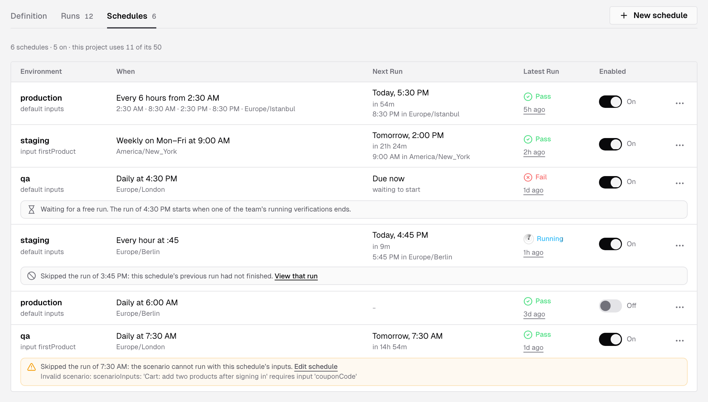
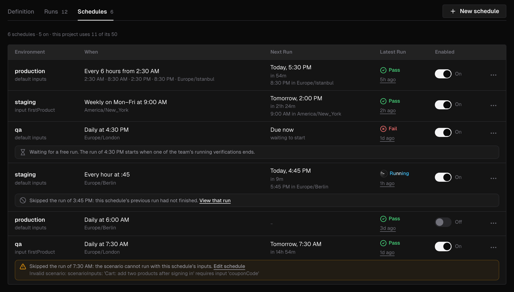
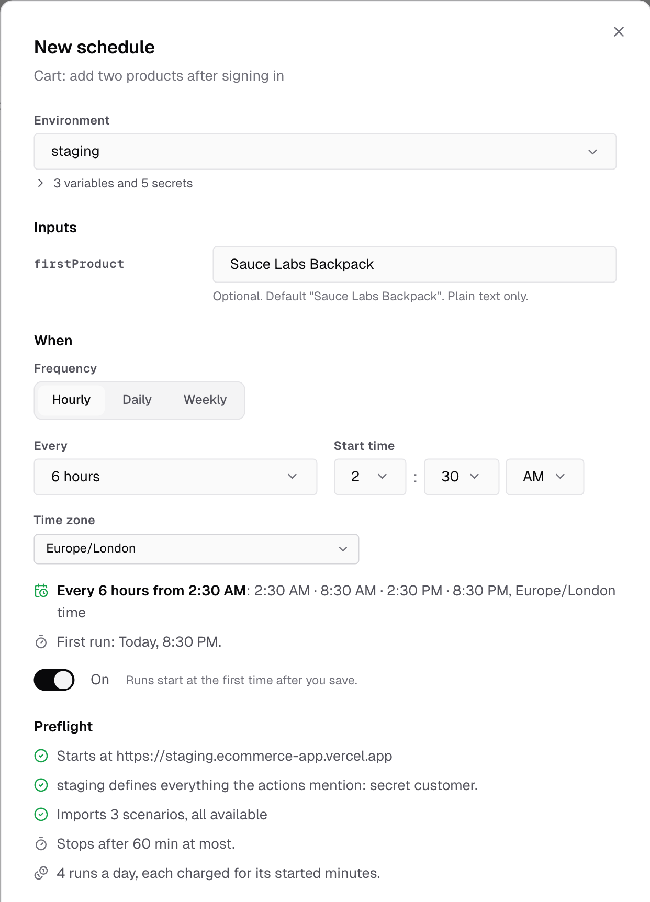
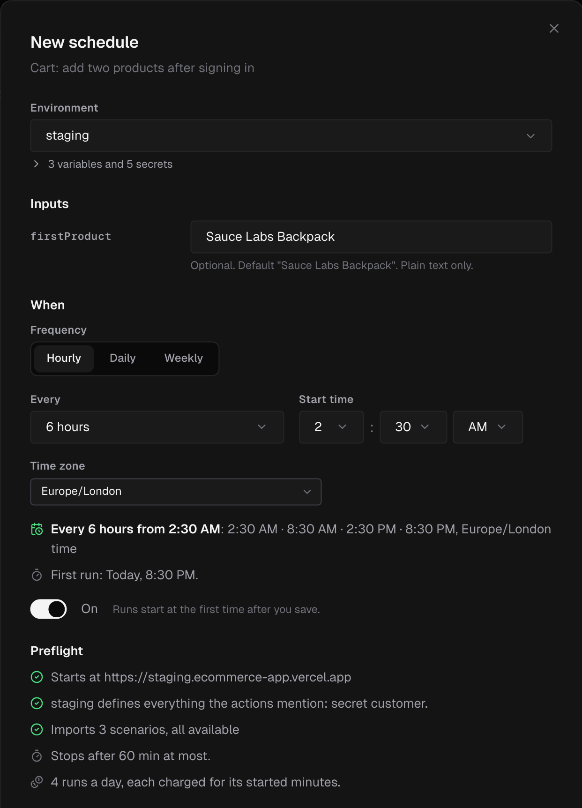
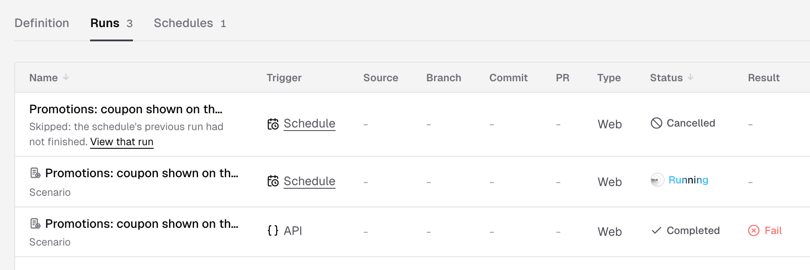
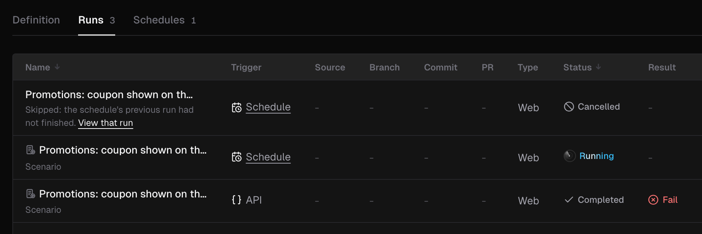

A schedule runs a [scenario](/console/scenarios) by itself, on a timer: against one of the project's [environments](/console/environments), with the input values you set, hourly, daily or weekly on the clock of the time zone you pick. A scenario can have several schedules, for example one that checks `staging` every hour and one that checks `production` every morning.

Each time a schedule comes due, IronBee starts an ordinary scenario run, as **Run scenario** would. The run appears in the project's [Verifications](/console/verifications) and on the scenario's **Runs** tab with the **Schedule** trigger, and it's charged like any other run.

---

## The Schedules tab

Open a scenario and click its **Schedules** tab, after **Definition** and **Runs**. The number next to the tab is how many schedules the scenario has.

The line above the list counts the scenario's schedules, how many of them are on, and how many of the project's 50 are in use, such as **6 schedules · 5 on · this project uses 11 of its 50**.

| Column | What it shows |
|--------|---------------|
| **Environment** | The environment the schedule runs against, and its inputs: **default inputs** when it sets none, or the names of the inputs it sets |
| **When** | When it runs, as a sentence on the schedule's own clock, such as **Every 6 hours from 2:30 AM**, **Daily at 6:00 AM** or **Every hour at :45**, with its time zone. An hourly schedule that runs every 6, 8 or 12 hours also lists the day's run times |
| **Next Run** | The next run in your own time, such as **Today, 5:30 PM**, with how long until it starts. When the schedule's time zone isn't yours, the time on the schedule's clock too. **Due now** with **waiting to start** when the time has come and the run hasn't started yet. A dash when the schedule is off |
| **Latest Run** | The result of the schedule's latest run, or its status while it's going or when it ended without a verdict, and how long ago it ran. Click the time to open the run. **No runs yet** before the first one |
| **Enabled** | The switch that turns the schedule **On** or **Off** |

Times follow the **Time Format** in [Settings](/console/settings). The **...** menu on a row offers **Edit** and **Delete**. When a schedule's latest time didn't start a run, a line under it says why. See [Notices](#notices).

The tab refreshes itself while it's open, so you see a due run start and a run end.

---

## Create a schedule

1. On the scenario's **Schedules** tab, click **New schedule**. It sits at the end of the tab row, or in the middle of the tab while the scenario has no schedules (**No schedules yet**).
2. Pick the **Environment**, as in [Run scenario](/console/scenario-runs#start-a-run). The form opens on the first environment with a URL. Each run starts at the environment's **URL** property and uses its variables and secrets. The line under the picker sums them up; click it to see them.
3. Fill in the **Inputs**, if the scenario has any. They work as in **Run scenario**: plain text, required ones first, and an optional one left empty uses its default. Every run of the schedule uses these values. An optional input left at its default isn't saved with the schedule, so each run uses the scenario's default as it is then.
4. Under **When**, pick the **Frequency** and its fields, the **Start time** and the **Time zone**. See [Timing](#timing).
5. Leave the switch **On**, and runs start at the first time after you save. Turn it **Off** to save the schedule without running it, and turn it on later from the list.
6. Read the [Preflight](#preflight), then click **Create schedule**.

### Timing

| Frequency | Its own field | When it runs |
|-----------|---------------|--------------|
| **Hourly** | **Every**: 1, 2, 3, 4, 6, 8 or 12 hours | Every hour, or every few hours from the start time |
| **Daily** | None | Once a day, at the start time |
| **Weekly** | **Days**: one or more days of the week. **Weekdays** picks Monday to Friday | At the start time, on each day picked |

- The **Start time** is an hour and a minute of 00, 15, 30 or 45. On the 12-hour **Time Format**, it has AM and PM.
- The **Time zone** starts on your browser's. Pick another one to run on that zone's clock. Search the list by name, such as `Europe/Berlin`.
- For **Hourly**, the start time sets the times of the day. Every 6 hours from 2:30 AM runs at 2:30 AM, 8:30 AM, 2:30 PM and 8:30 PM. After you save, the start time shows as the day's first run: pick 2:30 PM with 6 hours, and the form says it will show as "from 2:30 AM". The run times are the same.
- With **1 hour**, only the minute counts. The form says so, for example **With every hour, only the minute counts: runs at :30 of each hour.**
- **Weekly** needs at least one day. Until then the form says **Pick at least one day.** A weekly schedule on all seven days reads **Every day at 9:00 AM**, for example.

Under the fields, the form shows the schedule as it will run: its sentence, the day's run times for an hourly one, and its time zone. Then **First run:** gives the first time it will run after you save, in your own time, with the time on the schedule's clock when its zone isn't yours. With the switch off, it reads **First run once it is on:**.

### Preflight

The **Preflight** is the one in **Run scenario**: where each run starts, whether the environment defines every secret, variable and property the actions read, whether the scenarios it imports are all available, and how long a run usually takes. See [Start a run](/console/scenario-runs#start-a-run).

It adds one line, what the schedule adds up to:
- an estimate of the credits a run usually costs, from the scenario's recent successful runs, and what that comes to in a day for **Hourly** and **Daily**, or in a week for **Weekly**. On [BYOM](/byom/overview), the estimate is at the BYOM rate.
- before the scenario has a successful run, the number of runs a day or a week, each charged for its started minutes.

A problem the preflight finds, such as a secret the environment doesn't have, doesn't stop the save. If it's still there when a run starts, that run stops before its first action and costs no credits.

### When a save is refused

**Create schedule** stays disabled until the environment has a URL to start from, every scenario it imports exists, and a weekly schedule has a day. It's also disabled, with a note at the top of the form, when the project no longer runs the scenario's type.

When you save, IronBee checks the schedule the way it checks a run started now: the environment's URL is a public address that a cloud run can reach and is inside the environment's own domains, and the inputs fit the scenario. If something doesn't, the form says why: under the **Environment**, the **Inputs** or the **When** section when the problem is there, or above the buttons when it concerns the whole schedule, such as the project's limit (**This project already has 50 schedules, the most it can hold. Delete one to add another.**), a scenario it imports that's gone, the scenario's type, or an archived project. The team's credits aren't checked: you can save a schedule while they're used up.

---

## Edit, turn off or delete a schedule

- **Edit**, in the row's **...** menu, opens the same form as **Edit schedule**. Change what you need and click **Save schedule**. After a save, its notice is cleared, and a schedule that's on runs from the first time after the save. A schedule stays on or off unless you move the switch in the form. It can't be moved to another scenario.
- The switch in **Enabled** turns a schedule on or off at once, with **Schedule turned on** or **Schedule turned off**. A schedule that's off keeps its settings and doesn't run. Turned back on, it runs from its next time; the times that passed while it was off aren't run. Turning a schedule off is never refused, but turning it on is checked the way a save is: if it's refused, the switch goes back and **Couldn't change the schedule** says why. See [When a save is refused](#when-a-save-is-refused).
- **Delete**, in the row's **...** menu, asks you to confirm with **Delete schedule**: **The scenario stops running on this timer. Its past runs stay in Verifications.** Deleting can't be undone.

Deleting a scenario or an environment deletes its schedules too, and the delete dialog says so first, such as **Its 2 schedules are deleted with it.** for a scenario, or **2 schedules deleted** for an environment. See [Duplicate or delete a scenario](/console/scenarios#duplicate-or-delete-a-scenario) and [Delete an environment](/console/environments#delete-an-environment). A copy made with **Duplicate** has no schedules.

---

## How scheduled runs work

- **A scheduled run is a scenario run.** It runs the scenario as it's saved at that moment, against the environment's URL, variables and secrets as they are then. Its run page, live view and evidence are those of any [scenario run](/console/scenario-runs#the-run-page), and it stops after 60 minutes at most.
- **Each run is charged like any other run**, for each started minute, up to its time limit. A schedule keeps running whatever its runs conclude, so a scenario that keeps failing keeps being charged until you turn its schedule off. See [What uses credits](/console/usage#verification).
- **A schedule runs one run at a time.** If a time comes while the schedule's previous run is still going, that time is skipped. The skipped time is listed among the scenario's runs as **Cancelled**, with `0` credits and a link to the run that was still going. The next time runs as usual.
- **When the team's runs are all in use**, because the team already has as many verification runs going at once as its plan allows, the run waits. It starts within a few minutes after one of the team's running verifications ends. The tab shows it as **Due now**, with **Waiting for a free run.** If the schedule's next time comes before it starts, the waiting run is dropped and the next time takes its place.
- **When the team's credits are used up**, each time is skipped, and the tab says **Waiting for credits**. The first time after the credits reset, or after the team gets more, runs. See [When credits run out](/console/usage#when-credits-run-out).
- **Missed times aren't made up.** A schedule never runs a series of missed times one after another. If times pass without a run, for example while IronBee couldn't start runs, the schedule runs once, for the latest of them. Times that pass while a schedule is off, or while its project is archived, aren't run at all.
- **Daylight saving.** Every time is on the clock of the schedule's time zone. On the day its clocks change, each time still runs once: a time the clocks skip runs when they jump forward, and a time that happens twice runs the first time. A schedule that runs every hour runs once in each real hour. In a few time zones whose clocks change at unusual hours, one run can be lost on the day of the change.
- **A schedule sends no notifications.** It sends no email or message when a run fails, and its runs report to no pull request or provider. Follow them on the scenario's **Schedules** and **Runs** tabs, or in the project's [Verifications](/console/verifications).

---

## Notices

When a schedule's latest time didn't start a run, a line under the schedule says why. It gives that time in your own time, with its date when it wasn't today, and most notices link to where you fix the cause. The line goes away once a later time starts a run, or when you save the schedule or turn it off.

| Notice | What happened | What to do |
|--------|---------------|------------|
| **Waiting for a free run. The run of 12:45 PM starts when one of the team's running verifications ends.** | The team already has as many verifications running as its plan allows | Nothing. The run starts within a few minutes after one of them ends, unless the schedule's next time comes first |
| **Skipped the run of 2:45 PM: this schedule's previous run had not finished.**, with **View that run** | The schedule's previous run was still going | Nothing, if it happens now and then. If runs often take longer than the time between two runs, pick a longer interval |
| **Waiting for credits. The run of 2:00 PM was skipped. The team's credits reset on Dec 10, 2026.** | The team's credits were used up | Wait for the reset, or get more credits. The line offers what the console's out-of-credits banner offers: **Add credits** when you can [buy credits](/console/usage#buy-credits), as an owner or billing admin on Free or Team, which opens the **Add credits** dialog on the Usage page. Then the link or sentence from [Get more credits](/console/usage#get-more-credits) for your role and plan, when there is one |
| **Skipped the run of 7:30 AM: the scenario cannot run with this schedule's inputs.**, with the reasons under it and **Edit schedule** | The scenario changed after the schedule was saved, and the schedule's inputs no longer fit it: for example, the scenario gained a required input | Edit the schedule's inputs, or change the scenario back |
| **Skipped the run of 7:30 AM: the scenario imports one that no longer exists.**, with the reason under it and **Open the definition** | A scenario it imports is no longer available | Fix the import in the [editor](/console/scenario-editor) |
| **Skipped the run of 7:30 AM: this project no longer runs Web verifications.**, with **Open project settings** | The project's [verification type](/console/project-settings#verification-type) no longer includes the scenario's type | Add the type back, or delete the schedule |
| **Skipped the run of 7:30 AM: staging has no URL to start from.**, with **Open staging** | The environment has no **URL** property | Add the URL to the environment |
| **Skipped the run of 7:30 AM: staging's URL is not a public address a cloud run can reach.**, with **Open staging** | The environment's URL is a local or private address | Change it to a public address |
| **Skipped the run of 7:30 AM: staging's URL is outside its own domains.**, with **Open staging** | The environment has a **Domain** property its URL is outside | Change the URL or the domains. See [Domains](/console/environments#domains) |
| **Skipped the run of 7:30 AM: one of staging's domains no longer reads as one.**, with **Open staging** | A **Domain** property of the environment isn't a valid domain | Fix the domain |
| **Skipped the run of 7:30 AM: the project is archived.** | The project was archived | [Unarchive](/console/project-settings#unarchive-a-project) the project. The schedule runs from its next time |
| **Skipped the run of 7:30 AM: the account is disabled.** | The account was disabled at that time | Nothing. The schedule runs from its next time |

Another reason reads **Skipped the run of 7:30 AM.**, with the reason under it.

---

## Limits

| What | Limit |
|------|-------|
| Schedules in a project, on or off | 50 |
| Time between two runs | 1 hour at least |
| Start time | On the quarter hour: 00, 15, 30 or 45 |
| Time limit of a run | 60 minutes |

Once a project has 50 schedules, **New schedule** is turned off. Hover it to see **This project has 50 schedules, the most it can hold.** Delete one to add another.

---

## Who can manage schedules

| Role | What they can do |
|------|------------------|
| Owner, Admin, Member | Create, edit, turn on and off, and delete schedules |
| Billing Admin | See schedules, read-only |

A Billing Admin sees the **Schedules** tab without **New schedule** or the **...** menus, and can't move the switches. The page says **Only owners, admins and members can change scenarios.**

On an archived project, schedules are kept, read-only for everyone, and don't run. The tab says **This project is archived. Its schedules are kept and do not run. Unarchive the project to run them again.** See [Roles](/console/roles).

---

## Scheduled runs in the run lists

A run that a schedule started shows the **Schedule** trigger, in the project's [Verifications](/console/verifications) and on the scenario's **Runs** tab. Click the trigger to open its schedule on the **Schedules** tab.

A time skipped because the schedule's previous run hadn't finished is listed too, with the status **Cancelled** and `0` credits. Under its name it says **Skipped: the schedule's previous run had not finished.**, with **View that run** to open the run that was still going.

On a run's page, **Schedule** in the strip under the title opens its schedule as well, and on a skipped time, **Previous run** opens the run that was still going. Once a scenario is deleted, its schedules go with it, and its runs no longer link to them. See [Scenario runs in Verifications](/console/scenario-runs#scenario-runs-in-verifications).

---

## What's next?

<CardGroup cols={2}>
  <Card title="Run a scenario" icon="play" href="/console/scenario-runs">
    Pick an environment, pass inputs and read the run.
  </Card>
  <Card title="Credit usage" icon="coins" href="/console/usage">
    What a run costs, and what happens when the credits run out.
  </Card>
</CardGroup>
