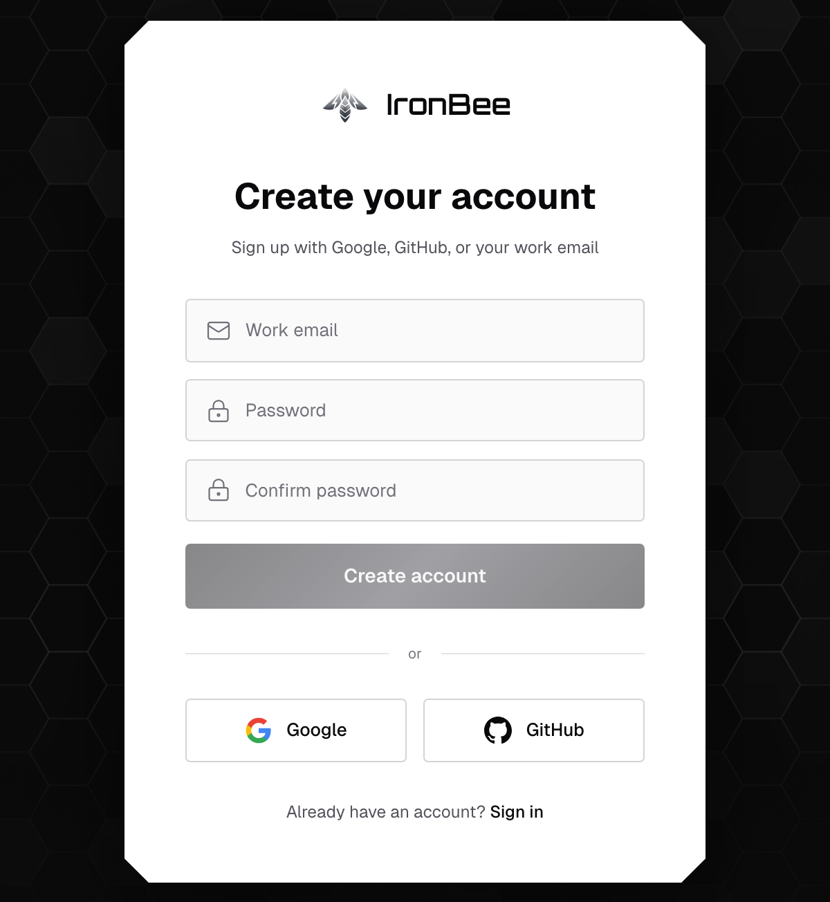
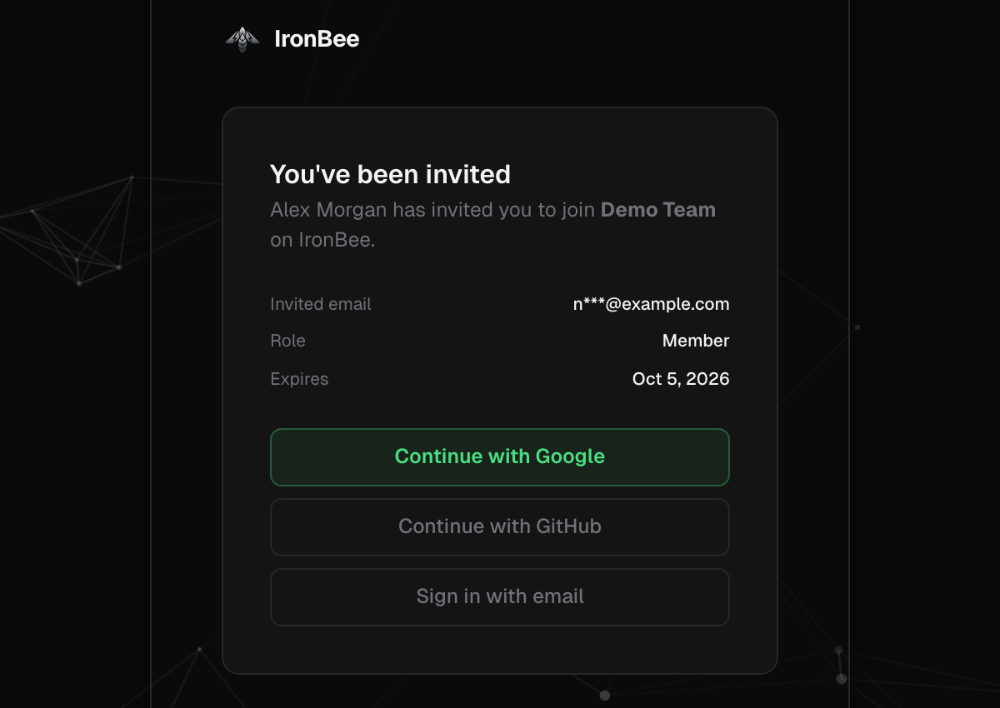
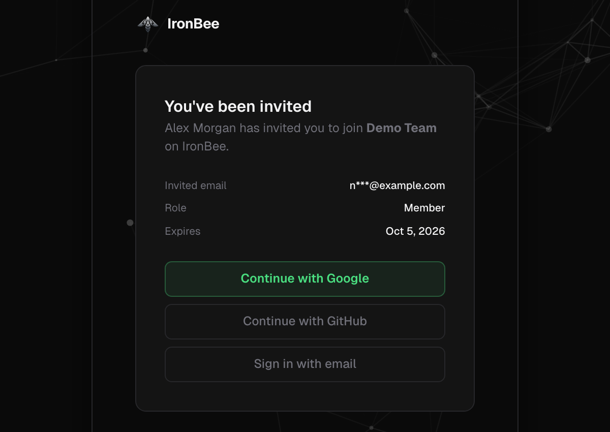
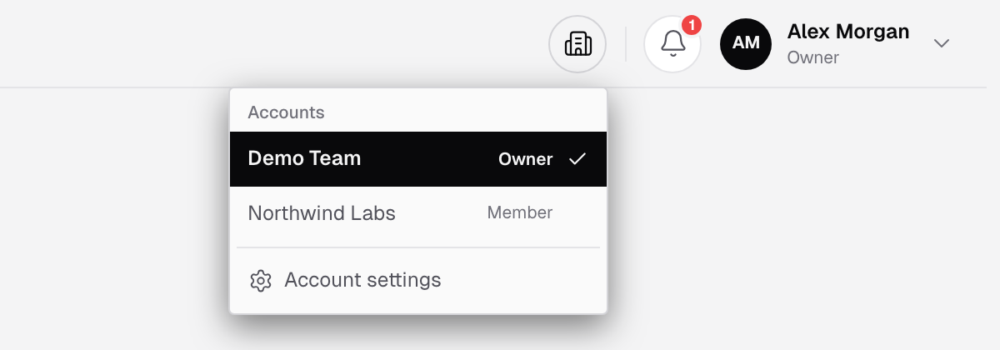
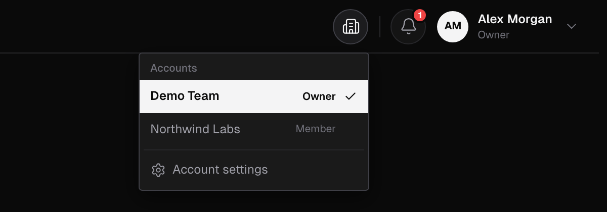
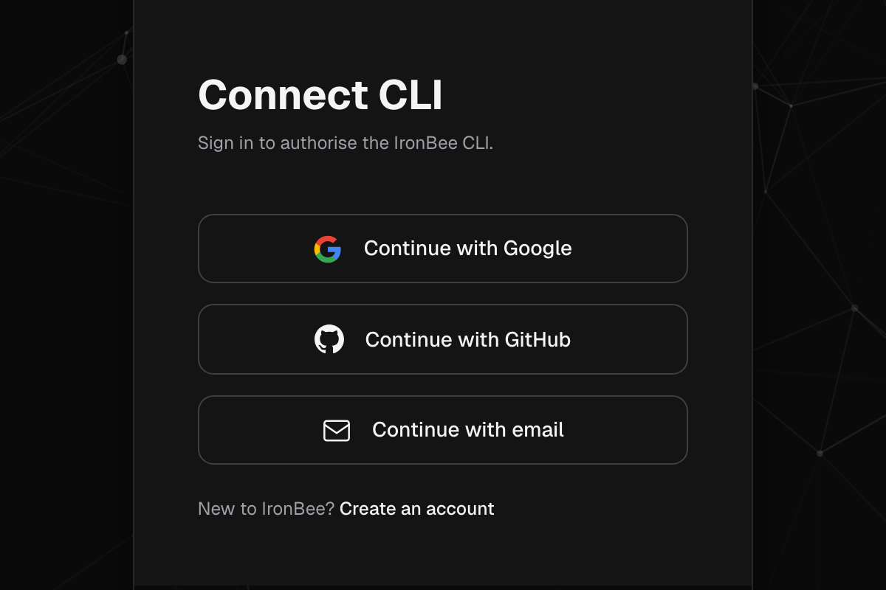
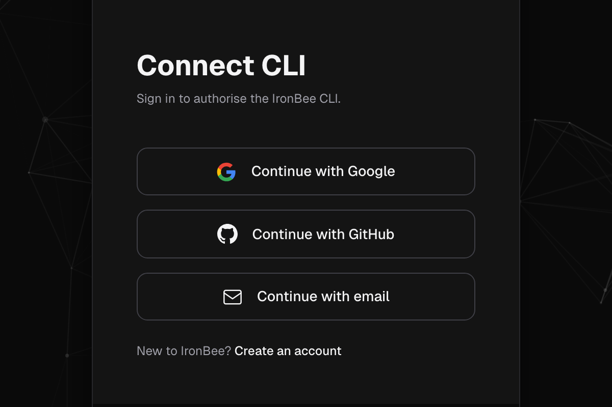

The IronBee Console is at [console.ironbee.ai](https://console.ironbee.ai). You sign in with Google, GitHub or your work email. GitLab isn't a sign-in option: once you're signed in, you [connect a GitLab group](/integrations/gitlab) to your account.

---

## Create your account

On **Create your account**, sign up with Google, GitHub, or your work email.

- **Google** or **GitHub**: continue with that account.
- **Work email**: enter your **Work email** and a **Password**, type the password again in **Confirm password**, and click **Create account**.
  - The password needs at least 8 characters, with an uppercase letter, a lowercase letter, a digit and a symbol.
  - IronBee sends a verification code to your email. Enter it and click **Verify email**.

If you sign in with Google or GitHub using the same email address as an existing account, you reach the same IronBee user.

---

## Your first sign-in

When you sign up on your own, you become the owner of a new IronBee account:

1. **Name your account**, for example your company's name, and click **Continue**.
2. The console opens **Set up IronBee**. In three steps, you install the IronBee GitHub App or connect a GitLab group, pick the repositories IronBee reviews, and run a first review on an open pull request or merge request. See the [Quickstart](/getting-started/quickstart#step-2-connect-your-repositories). Click **Set up later** to skip it.

While setup is unfinished, owners and admins can come back to it from the **Setup** checklist in the top bar, through **Connect a provider** or **Resume setup**. To connect Vercel or Netlify, add the GitHub Action or the GitLab component, or set up the CLI, they open **Settings > Getting started**.

---

## Join a team

When a teammate [invites you](/console/team#invite-a-teammate), you get an email with a link:

1. The link opens **You've been invited**, with the account, your role and when the invitation expires.
2. If you're signed in, click **Accept invitation**. Otherwise click **Continue with Google**, **Continue with GitHub** or **Sign in with email**, using the email address the invitation was sent to.
3. **You're in!** confirms it. The console switches to the team's account.

Signing up through the invitation link joins the team without creating an account of your own. If you signed up another way, a banner tells you about the pending invitation.

---

## Switch accounts

If you belong to more than one account, the top bar shows an account button with a building icon, next to the notifications bell. Click it to see your **Accounts** and your role in each. Pick another account to switch to it, or open **Account settings**.

---

## Sign in the CLI

`ironbee login` opens **Connect CLI** in your browser:
1. If you aren't signed in, click **Continue with Google**, **Continue with GitHub** or **Continue with email**. New to IronBee? Click **Create an account**.
2. Once you're signed in, the console authorizes the CLI for your current account on its own. There's nothing else to click.

The CLI then holds a personal [OAuth token](/console/access-tokens) for that account. If the authorization fails, the page shows the error and an **Authorize** button to try again. See [CLI authentication](/cli/guides/authentication).

---

## Related pages

<CardGroup cols={2}>
  <Card title="Team" icon="users" href="/console/team">
    Invite teammates and manage their roles.
  </Card>
  <Card title="Roles and permissions" icon="shield" href="/console/roles">
    What each role can do.
  </Card>
</CardGroup>
