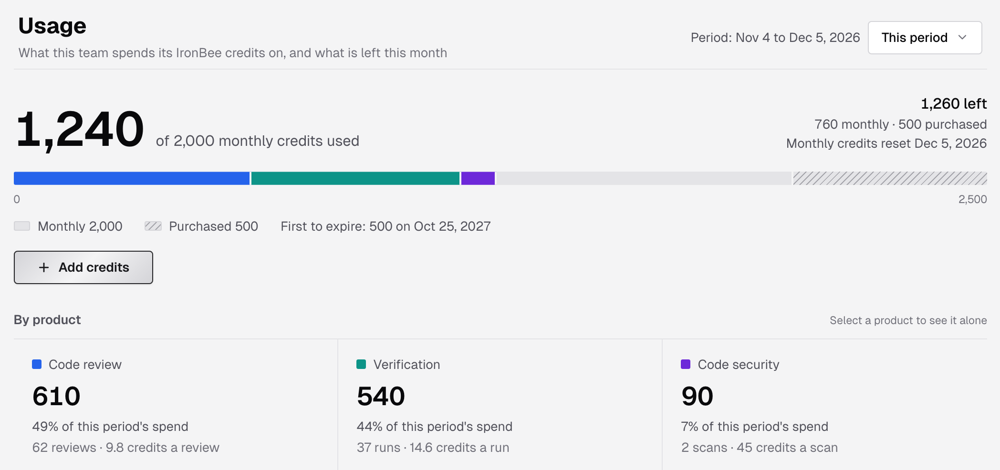
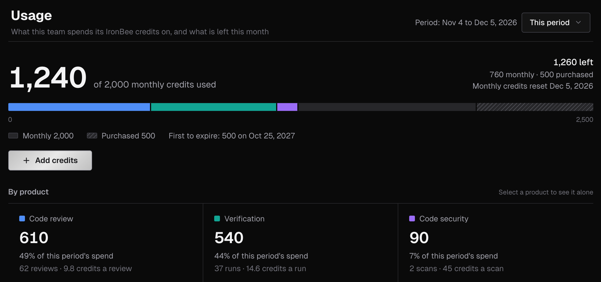
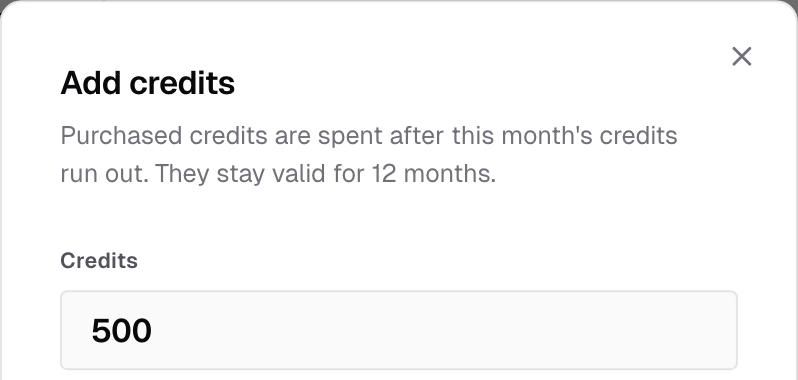
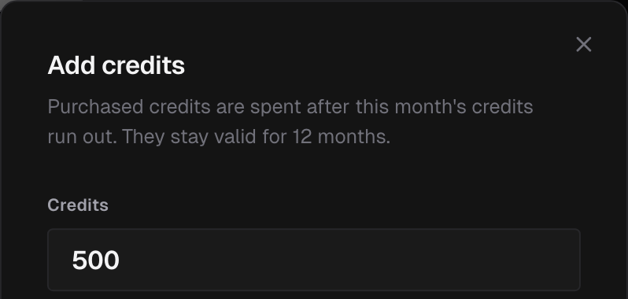
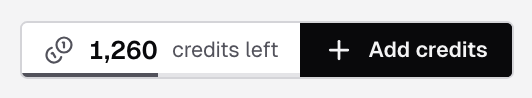
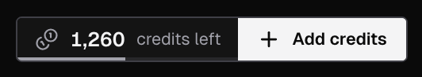
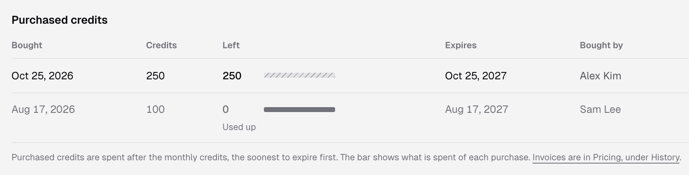
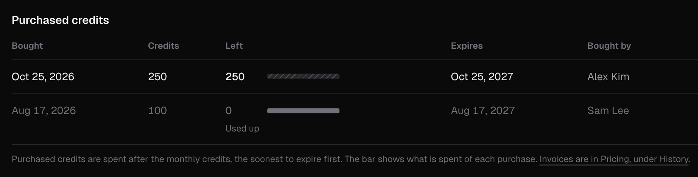

Code reviews, verification runs and code security scans on IronBee spend one pool of credits, shared by the whole team. Your plan sets how many credits the team gets each month, and on Free and Team, owners and billing admins can also buy credits beside them. See [Pricing](/console/pricing).

The **Usage** page shows the credits this period, where they went by product, day, project and run, the credits the team bought, and what each job costs. Everyone in the account can open it: open **Settings**, then **Workspace > Usage**, or click the credits in the top bar.

---

## The period and the date filter

The monthly credits reset once a month, on your account's own date, which isn't always the first of the month. The page calls the month between two resets the period, and the header shows its dates, such as "Period: Nov 16 to Dec 16, 2026".

The date filter next to it starts on **This period**. To look at other days, pick **Last 7 Days**, **Last 30 Days**, **Last 90 Days** or **Custom Range**:
- **By product**, the chart, **By project** and **Charges** then show those days. The credits at the top always show this period.
- A custom range spans up to 90 days, or fewer when your plan keeps data for fewer. A preset longer than your plan keeps data isn't offered.
- Click **This period** to come back.

The choice is kept in the page's address, so a link to it opens the same days. It doesn't change the date filter on the console's other pages. Days start and end in your browser's time zone.

---

## Credits this period

The top of the page shows:
- the credits used this period, and the month's allowance they count against
- on the right, how many are left, or **No credits left**, and **Resets** with the date
- a bar that fills as the team spends, split by product in the colors of **Code review**, **Verification** and **Code security**

When the team has used 80% of its credits, a warning under the bar says what share is used. When they're all used, it says that new reviews and verifications are refused until the credits reset, with the date.

On a plan with unlimited credits, the top shows the credits used and **Unlimited**, and the bar only shows the split by product.

A run that has already started is never stopped for credits, so the credits used can end up above what the team had.

### With purchased credits

When the team holds [purchased credits](#buy-credits), the bar has a second, hatched part for them after the monthly part. The rest of the top changes with it:
- The number is counted against the monthly credits alone: "of", the allowance, then "monthly credits used". Once purchased credits are being spent, the words after it read "credits used:" and split the number into monthly and purchased.
- What's left counts both kinds, and a line under it splits them into monthly and purchased. The reset date reads **Monthly credits reset**, because purchased credits don't reset.
- A legend under the bar names **Monthly** with the allowance, **Purchased** with the purchased credits and how many this month spent, and **First to expire:** with the credits and the date of the purchase that expires first.
- Once the monthly credits are used up, a line says "This month's credits are used up. Runs now spend the purchased credits."
- When the purchased credits are used up too, it says so: new reviews and verifications are refused until the monthly credits reset, with the date.

The 80% warning counts the purchased credits: it appears when 80% of the monthly and purchased credits together are used.

---

## Get more credits

Under the bar, the page shows what you can do to get more credits. It depends on your role and your plan:

| You are | The page shows |
|---------|----------------|
| An owner or billing admin, on Free or Team | **Add credits**, which opens the [Add credits](#buy-credits) dialog. While the team holds no purchased credits and has spent none this period, a line beside it says how purchased credits are spent and how long they stay valid |
| An owner or billing admin, on a plan with seats | A link that starts with **Add seats** and says what each seat adds. It opens **Change seats** on [Pricing](/console/pricing#change-seats) |
| An owner or billing admin, on a plan you can upgrade | **Upgrade to Team**, which opens [Pricing](/console/pricing#upgrade-to-team) |
| An owner or billing admin, with a payment past due | **Pay the open invoice**, which opens [Pricing](/console/pricing#billing-details-and-payments). While the payment is past due, the allowance is lower |
| An owner or billing admin, on any other plan | "Ask IronBee to change this team's allowance." Email [support@ironbee.ai](mailto:support@ironbee.ai) |
| An admin or member, with a payment past due | "An owner or a billing admin can pay the open invoice." |
| An admin or member, on a plan with seats | "An owner or a billing admin can add credits or seats." |
| An admin or member, on a plan that can be upgraded | "An owner or a billing admin can add credits or upgrade to Team." |

An owner or billing admin on Free or Team sees **Add credits** next to the link for seats, the upgrade or the open invoice. When there's nothing to offer, for example on a plan with unlimited credits, the page shows nothing here.

---

## Buy credits

Owners and billing admins can buy credits on Free and Team. They sit beside the plan's monthly credits, and every product spends them the same way. An account whose credits IronBee sets by contract, and one with unlimited credits, has no **Add credits**.

**Add credits** appears under the bar on this page, in the top bar, on the credit banners, and on [Pricing](/console/pricing#add-credits). Each opens the same dialog; a banner's opens it on this page:

1. Click **Add credits**.
2. Under **Credits**, type the number of credits, or pick one of the common amounts under the field. The line under the field gives the smallest and the largest purchase and the price of a credit, which are on [Pricing](/console/pricing#buy-credits). For a number outside them, it says so and the button stays disabled. For more than the largest purchase, email [support@ironbee.ai](mailto:support@ironbee.ai).
3. Check the summary: the credits times the price of one, with the total, **Valid until** with the last day the credits can be spent, and **Credits left after this purchase**. For a large amount, the dialog adds that your bank may ask you to confirm the payment.
4. Click **Continue to payment**, and pay on Stripe Checkout. You pay once; it isn't a subscription.

After you pay, you return to **Usage**:
- **Adding your credits** shows while the credits are added. This usually takes a few seconds, and a message with the credits added and the date they're valid until confirms it.
- If it takes longer, **Payment received** says that adding the credits can take a minute, and asks you to refresh shortly. A payment method that takes days to clear adds the credits once the payment succeeds; if it fails, nothing is added.

If you leave the checkout without paying, **Purchase cancelled** says that nothing was charged.

Each purchase has an invoice on the **History** tab of [Pricing](/console/pricing#history).

If your role or the account's credits changed after you opened it, **Continue to payment** closes the dialog and says **Credits can no longer be bought here**.

### How purchased credits are spent

- Purchased credits are spent only after the month's credits are used up, the purchase that expires soonest first.
- They don't reset with the monthly credits. Each purchase stays valid for 12 months from the day you buy it, and what's left of it then expires.
- Credits already spent are never taken back, even after a refund.

For owners and billing admins, the bell in the top bar says when purchased credits expire within the next 30 days, with the credits and the date.

---

## Credits in the top bar

The top bar shows everyone what's left of the team's credits: the number and **credits left**, over a thin line of what this period has used. What's left counts purchased credits. Click it to open **Usage**.

- At 80%, the number and the line turn amber.
- When nothing is left, it reads **No credits left**, in red.
- On a plan with unlimited credits, it reads **Unlimited credits**.

For owners and billing admins who can [buy credits](#buy-credits), **Add credits** sits at its end.

---

## By product

**By product** puts **Code review**, **Verification** and **Code security** side by side. Each shows:
- its credits
- its share of this period's spend, as a percentage, or **Nothing spent yet**
- how many reviews, runs or scans were charged, and what one cost on average

Select a product to see it alone in the chart, **By project** and **Charges**. Select it again to show all of them.

With another date range picked, the title shows its dates, and the shares are of those days' spend.

---

## Credits by day

The chart shows the credits spent each day, stacked by product, with today marked **Today**. Two switches change it:
- **Daily**: **Credits by day**, one bar for each day.
- **Cumulative**: the running total, **Credits used so far**, or **Running total of credits** for days that ended before today. Draw it as **Bars** or **Line**. For this period, a line marks the month's allowance, **Allowance** with its credits.

Point at a day to read its credits by product and **Day total**, or **Used so far** in the cumulative view. With the keyboard, focus the chart and use the left and right arrow keys.

---

## By project

**By project** ranks the projects by the credits they used. Each project's bar is split by product, with the credits of each under it.

- Click a project's name to open its pull requests under **Code review**. An archived project is marked **(archived)**, and its name opens nothing.
- **Runs no longer kept** holds the credits of runs that are past your plan's retention, which no project holds any more.
- After the first six rows, a link such as **Show 4 more** lists the rest, and **Show fewer** hides them again.

---

## Charges

**Charges** lists the charged runs, **Recent** or **Largest** first. Each row shows:
- what was charged: the pull request's number and title, **Local review** for an [`ironbee review`](/cli/guides/code-review) of a local branch, the verification run's name, or **Full scan** or **Incremental scan** for code security
- the product, the project and when it was charged, with "half price: cancelled part-way" for a review cancelled after it started
- **BYOM**, for a run on your account's own model through [BYOM](/byom/overview)
- the credits

Click a row's title to open the pull request, the verification run, or, for owners and admins, the project's code security **Runs** tab. A run past your plan's retention keeps its row, without a link, and **run no longer kept** in place of its project.

The list shows the first runs and how many there are in all, such as "Showing 8 of 132 charged runs." Runs that cost nothing are not listed.

---

## Purchased credits

Once the team has bought credits, **Purchased credits** lists the purchases, newest first. Everyone in the account sees it. Each purchase shows:
- **Bought**: the date
- **Credits**: how many were bought
- **Left**: how many are left, with a bar of what's spent
- **Expires**: the date the purchase expires
- **Bought by**: who bought it, or **A former member** when they've left the account
- **Paid**: the amount

A note under **Left** says when a purchase is set apart:

| Note | What it means |
|------|---------------|
| **Used up** | Its credits are all spent |
| **Expired with** and the credits left, such as **Expired with 120 left** | It expired before its credits were all spent |
| **Refunded** | The payment was refunded in full, and what was left of the purchase is gone |
| The credits refunded, such as **40 credits refunded** | Part of the payment was refunded, and the purchase lost the same share of its credits |
| **On hold: the payment is disputed** | The payment is disputed. What's left can't be spent until the dispute closes |
| **Taken back: the dispute was lost** | The dispute closed against the payment, and what was left is gone |

When a dispute closes in your favor, the credits on hold can be spent again. While a purchase is on hold, owners and billing admins also see **A credit purchase is on hold: its payment is disputed** in the bell.

For owners and billing admins, the line under the list links to the invoices: **Invoices are in Pricing, under History**.

---

## What a job costs

**What a job costs** is the rate card. Closed, it shows one line with the range of each product's prices. Click it to open it, then pick **All**, **Code review**, **Verification** or **Code security**:

- **Code review:** "A review is priced by the size of what it reads and the depth chosen." A table has one row for each size, from **S** to **3XL**. **Lines read** gives the range of reviewable lines each size covers, and **Quick**, **Standard** and **Deep** give the credits a review of that size costs at each depth.
- **Verification:** a sentence with the credits for each started minute of a run, and a table that works out a few runs: **A run that takes**, **Started minutes** and **Credits**.
- **Code security:** a table with one row for each repository size. **Repository lines** gives the lines each size covers, and **Quick**, **Standard** and **Deep** give two prices at each profile: a full scan, then a period with changes. A size the card doesn't price reads **by contract**.
- **Free:** a line under the tables that lists the work that costs nothing.

The rate card always shows the current rates. The plans and their monthly credits are on [Pricing](/console/pricing).

While your account runs its jobs on its own model with [BYOM](/byom/overview), a line under the title says "A job on BYOM is charged this card's credits times 0.5, rounded up to a whole credit." The card itself keeps its prices. See [Jobs on BYOM](#jobs-on-byom).

---

## What uses credits

### Code review

A code review is priced before it starts, by the reviewable lines it reads and the [depth](/code-review/settings) it runs at:
- A review that finishes is charged its price.
- A review cancelled after it started is charged half its price.
- A review that fails, or has nothing new to read, is free.

What starts a review and the work that's free are on [Code review on GitHub pull requests](/code-review/on-github#credits). They're the same on [GitLab merge requests](/code-review/on-gitlab#credits-and-when-a-review-doesnt-run) and [Bitbucket pull requests](/code-review/on-bitbucket#credits-and-when-a-review-doesnt-run).

### Code security

A [code security](/console/code-security) scan is priced at its start, before it reads anything, by the repository's size and the scan's [profile](/console/code-security-settings#profile). The size is the repository's lines outside the [paths to ignore](/console/code-security-settings#paths-to-ignore). A scan with [execution](/console/code-security-settings#execution) on costs more.
- A full scan costs the first price on the rate card. A scheduled scan of a period with changes costs the second.
- A scan is charged when it finishes.
- A scan that fails, or is refused, is free.
- A period in which the default branch didn't move is free.
- A follow-up run, which only finishes an earlier scan, is free.

A repository larger than the rate card covers is scanned by contract with IronBee.

### Verification

Every verification run on IronBee uses credits, whatever started it: Vercel, Netlify, the [GitHub Action](/github-action/get-started/getting-started), the [GitLab component](/gitlab-component/get-started/getting-started), the [Bitbucket Pipe](/bitbucket-pipe/get-started/getting-started), [`ironbee verify`](/cli/guides/verification-jobs), **Run instant verification**, or a [scenario run](/console/scenario-runs).

A run is charged for each started minute, up to a cap set by its time limit. Once the run has started, it's charged for its minutes however it ends: passed, failed or cancelled.

A run isn't charged when:
- it never started: it was refused before it started, or cancelled while it was queued
- it failed for a reason on IronBee's side before the agent started working
- on [BYOM](/byom/overview), it failed with `byom_unavailable`: your endpoint never answered. A run that fails with `byom_failed` is charged its minutes

### Jobs on BYOM

A job that starts while [BYOM](/byom/overview) is enabled for your account runs on your own model, and is charged the rate card's credits times 0.5, rounded up to a whole credit. A job already running when BYOM is enabled finishes on IronBee's model, at the rate card's price.

- **Code review:** the review's price times 0.5, rounded up. A review cancelled after it started is charged half of that.
- **Code security:** the scan's price, with what **Execution** adds, times 0.5, rounded up.
- **Verification:** the price of the run's started minutes times 0.5, rounded up once for the whole run, and never less than one started minute's price on the rate card. Its cap is the cap at the same rate.

What's free stays free, and the prices the console shows for the next review or scan are BYOM prices while BYOM is enabled. A BYOM job that fails is charged as any failed job of its product is. Why one fails, a job running when BYOM is disabled included, is on [When a job fails](/byom/when-a-job-fails).

### Free work

These use no credits:
- answers to questions, conversation replies, harvests after a merge, rechecks and retractions in code review
- the [code wiki](/console/code-wiki)
- verification cycles that your AI coding agent reports through the [IronBee CLI](/cli/concepts/how-it-works)

Each run shows what it used in the **Credits** column of [Verifications](/console/verifications#credits) and on its [verification detail](/console/verification-detail#header) page, and every charged run is in [Charges](#charges).

---

## When credits run out

When the credits are all used, purchased credits included, IronBee refuses new code reviews, new verification runs and new code security scans until the credits reset or the team gets more. Runs that already started finish.

### Across the console

A banner at the top of every console page warns the whole team:

| Banner | When |
|--------|------|
| A warning with the share of the credits the team has used | 80% or more of the credits, purchased ones included, are used. You can close it; it comes back in a new browser session while it still applies |
| **This team has used all of its IronBee credits for this month.** New reviews and verifications are refused until the credits reset, with the date | No credits are left |

On both banners, an owner or billing admin who can buy credits gets **Add credits**, which opens this page with the [Add credits](#buy-credits) dialog. The banner for no credits left also shows the link or sentence from [Get more credits](#get-more-credits); so does the 80% warning, when **Add credits** isn't there.

The console shows one banner at a time: a session limit or a payment that's past due comes first, then running out of credits, then more people than seats, then the 80% warning. See [Banners across the console](/console/pricing#banners-across-the-console).

For owners and billing admins, the bell in the top bar also shows **IronBee credits: 80% used this month** or **IronBee credits: all used this month**, with **Open the usage page** under it. Click it to come here. The bell marks it unread again when the credits run out, and in the next month.

### Starting runs

- **Run instant verification**, **Run scenario** and **Run again** are disabled. Hover one to see why: "This team's IronBee credits for this month are used up; they reset on" and the date.
- If a run dialog is open, the same sentence shows at the top and its run button stays disabled.
- A run created before the credits ran out, but not started yet, is refused when it would start, and uses no credits. In the list its status is **Failed**, or **Run error** for a scenario run, whose page says **Stopped before it started**. **Run details** on its [verification detail](/console/verification-detail#header) page gives the reason under **Refused**.
- A deployment from Vercel or Netlify isn't verified, and no run appears in the list. Its GitHub or Vercel check closes as neutral, and says **IronBee did not run this verification · out of credits this month**. On GitLab, the pipeline status with that description is passed, where IronBee writes one: on a project with **Pipelines must succeed** and **Block merges** off, it writes none. On Bitbucket, the build status with that description is successful.
- A scheduled code security scan doesn't start. The project's **Code security** tab says **The last scan did not have enough credits**. Once the credits reset or the team gets more, the next scheduled scan starts when it's due. **Run full scan** is unavailable, with **No credits left this month**. See [Where a scan stands](/console/code-security#where-a-scan-stands).
- `ironbee verify` and `ironbee review` stop with an error. See [When credits run out](/cli/guides/credits#when-credits-run-out) in the CLI docs.

For code review, see [When credits run out](/code-review/on-github#when-credits-run-out), and for GitLab merge requests and Bitbucket pull requests, Credits and when a review doesn't run on [GitLab](/code-review/on-gitlab#credits-and-when-a-review-doesnt-run) and [Bitbucket](/code-review/on-bitbucket#credits-and-when-a-review-doesnt-run).

---

## If the page can't load

While the credits load, the page shows placeholders. If they can't be loaded, it says **Couldn't load the credits**, explains why, and offers **Try again**. The day by day breakdown and **Charges** load on their own. When one can't load, it says **Couldn't load the day by day breakdown** or **Couldn't load the charges**, with **Try again**.

---

## Related pages

<CardGroup cols={2}>
  <Card title="Pricing" icon="credit-card" href="/console/pricing">
    The plans, their monthly credits, and how to change seats.
  </Card>
  <Card title="Verifications" icon="list-checks" href="/console/verifications">
    Every run of a project, with the credits it used.
  </Card>
  <Card title="Credits in the CLI" icon="coins" href="/cli/guides/credits">
    Check the balance with `ironbee credits`, and the credits of each review and verification.
  </Card>
  <Card title="Code review" icon="git-pull-request" href="/code-review/overview">
    How IronBee reviews pull requests and merge requests, and what a review costs.
  </Card>
  <Card title="Code security" icon="shield-check" href="/console/code-security">
    Scheduled security scans of a repository's default branch, and what a scan costs.
  </Card>
</CardGroup>
