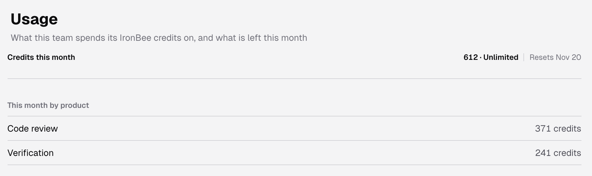
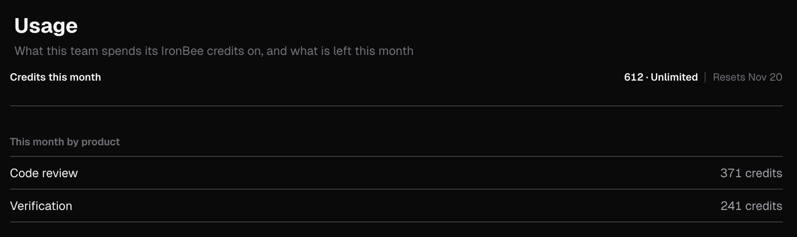

Code reviews and verification runs on IronBee spend one pool of credits, shared by the whole team. Your plan sets how many credits the team gets each month; see [Pricing](/console/pricing).

The **Usage** page shows the credits this month, what each product used, and what each job costs. Everyone in the account can open it: open **Settings**, then **Workspace > Usage**.

---

## Credits this month

The meter at the top shows:
- the credits used and the month's allowance, and how many are left. At zero it reads **No credits left**
- **Resets** and the date the credits reset
- a bar that fills as the team spends

The credits reset once a month, on the date the meter shows. It isn't always the first of the month.

When the team has used 80% of its credits, the meter turns to a warning that says what share of the month's credits is used. When they're all used, it says that new reviews and verifications are refused until the credits reset, with the date.

On a plan with unlimited credits, the meter shows the credits used and **Unlimited**, without a bar.

A run that has already started is never stopped for credits, so the credits used can end up above the allowance.

---

## This month by product

**This month by product** splits the month's credits between **Code review** and **Verification**.

---

## What a job costs

**What a job costs** is the rate card. A sentence at the top says how each product is priced: "A code review is priced by the size of what it reads and the depth chosen. A verification is priced by its started minutes."

- **Code review:** a table with one row for each size, from **S** to **3XL**. **Lines read** gives the range of reviewable lines each size covers, and **Quick**, **Standard** and **Deep** give the credits a review of that size costs at each depth.
- **Verification:** a line with the credits for each started minute of a run.
- **Free:** a line that lists the work that costs nothing.

The rate card always shows the current rates. The plans and their monthly credits are on [Pricing](/console/pricing).

---

## What uses credits

### Code review

A code review is priced before it starts, by the reviewable lines it reads and the [depth](/code-review/settings) it runs at:
- A review that finishes is charged its price.
- A review cancelled after it started is charged half its price.
- A review that fails, or has nothing new to read, is free.

What starts a review and the work that's free are on [Code review on the pull request](/code-review/on-github#credits).

### Verification

Every verification run on IronBee uses credits, whatever started it: Vercel, Netlify, the [GitHub Action](/github-action/get-started/getting-started), [`ironbee verify`](/cli/guides/verification-jobs), **Run instant verification**, or a [scenario run](/console/scenario-runs).

A run is charged for each started minute, up to a cap set by its time limit. Once the run has started, it's charged for its minutes however it ends: passed, failed or cancelled.

A run isn't charged when:
- it never started: it was refused before it started, or cancelled while it was queued
- it failed for a reason on IronBee's side before the agent started working

### Free work

These use no credits:
- answers to questions, conversation replies, harvests after a merge, rechecks and retractions in code review
- code analysis and the [code wiki](/console/code-wiki)
- verification cycles that your AI coding agent reports through the [IronBee CLI](/cli/concepts/how-it-works)

Each run shows what it used in the **Credits** column of [Verifications](/console/verifications#credits) and on its [verification detail](/console/verification-detail#header) page.

---

## When credits run out

When the credits are all used, IronBee refuses new code reviews and new verification runs until the credits reset or the team gets more. Runs that already started finish.

### Across the console

A banner at the top of every console page warns the whole team:

| Banner | When |
|--------|------|
| A warning with the share of the month's credits the team has used | 80% or more of the month's credits are used. You can close it; it comes back in a new browser session while it still applies |
| **This team has used all of its IronBee credits for this month.** New reviews and verifications are refused until the credits reset, with the date | No credits are left |

The console shows one banner at a time: a session limit or a payment that's past due comes first, then running out of credits, then more people than seats, then the 80% warning. See [Banners across the console](/console/pricing#banners-across-the-console).

For owners and billing admins, the bell in the top bar also shows **IronBee credits: 80% used this month** or **IronBee credits: all used this month**, with **Open the usage page** under it. Click it to come here. The bell marks it unread again when the credits run out, and in the next month.

### Starting runs

- **Run instant verification**, **Run scenario** and **Run again** are disabled. Hover one to see why: "This team's IronBee credits for this month are used up; they reset on" and the date.
- If a run dialog is open, the same sentence shows at the top and its run button stays disabled.
- A run created before the credits ran out, but not started yet, is refused when it would start, and uses no credits. In the list its status is **Failed**, or **Run error** for a scenario run, whose page says **Stopped before it started**. **Run details** on its [verification detail](/console/verification-detail#header) page gives the reason under **Refused**.
- A deployment from Vercel or Netlify isn't verified, and no run appears in the list. Its GitHub or Vercel check closes as neutral and says **IronBee did not run this verification · out of credits this month**.
- `ironbee verify` and `ironbee review` stop with an error. See [When credits run out](/cli/guides/credits#when-credits-run-out) in the CLI docs.

For code review, see [When credits run out](/code-review/on-github#when-credits-run-out).

---

## Get more credits

Below the rate card, the page shows what you can do to get more credits. It depends on your role and your plan:

| You are | The page shows |
|---------|----------------|
| An owner or billing admin, on a plan with seats | A link that starts with **Add seats** and says what each seat adds. It opens **Change seats** on [Pricing](/console/pricing#change-seats) |
| An owner or billing admin, on a plan you can upgrade | A button that opens [Pricing](/console/pricing#upgrade-to-team) to upgrade |
| An owner or billing admin, with a payment past due | **Pay the open invoice**, which opens [Pricing](/console/pricing#billing-details-and-payments). While the payment is past due, the allowance is lower |
| An owner or billing admin, on any other plan | "Ask IronBee to change this team's allowance." Email [support@ironbee.ai](mailto:support@ironbee.ai) |
| An admin or member, with a payment past due | "An owner or a billing admin can pay the open invoice." |
| An admin or member, when seats or an upgrade would add credits | "An owner or a billing admin can add credits." |

The same link or sentence appears on the credit banners. When there's nothing to offer, for example on a plan with unlimited credits, the page shows nothing here.

---

## If the page can't load

While the credits load, the page shows placeholders. If they can't be loaded, it says **Couldn't load the credits**, explains why, and offers **Try again**.

---

## Related pages

<CardGroup cols={2}>
  <Card title="Pricing" icon="credit-card" href="/console/pricing">
    The plans, their monthly credits, and how to change seats.
  </Card>
  <Card title="Verifications" icon="list-checks" href="/console/verifications">
    Every run of a project, with the credits it used.
  </Card>
  <Card title="Credits in the CLI" icon="coins" href="/cli/guides/credits">
    Check the balance with `ironbee credits`, and the credits of each review and verification.
  </Card>
  <Card title="Code review" icon="git-pull-request" href="/code-review/overview">
    How IronBee reviews pull requests, and what a review costs.
  </Card>
</CardGroup>
