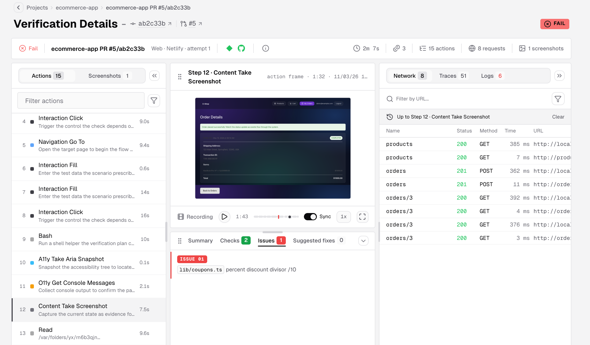
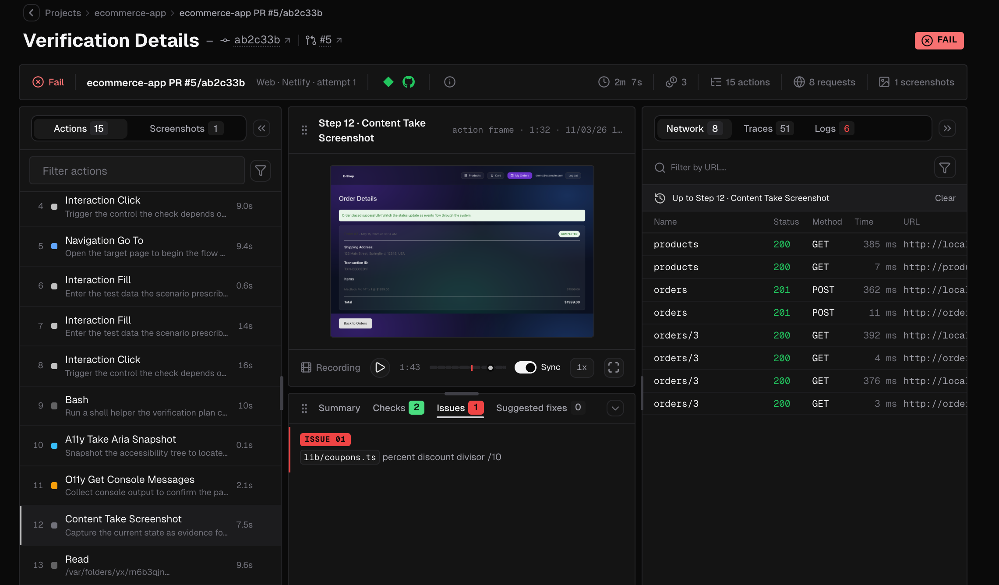
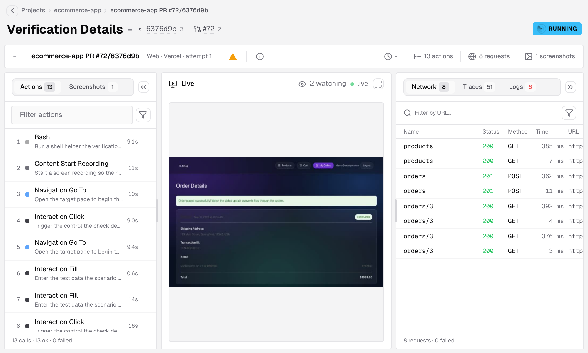
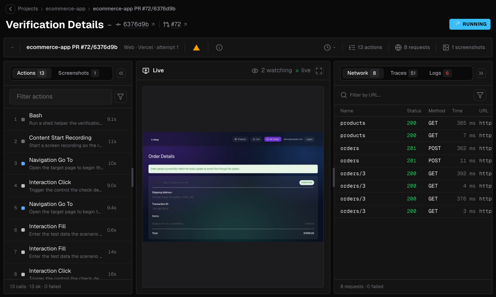
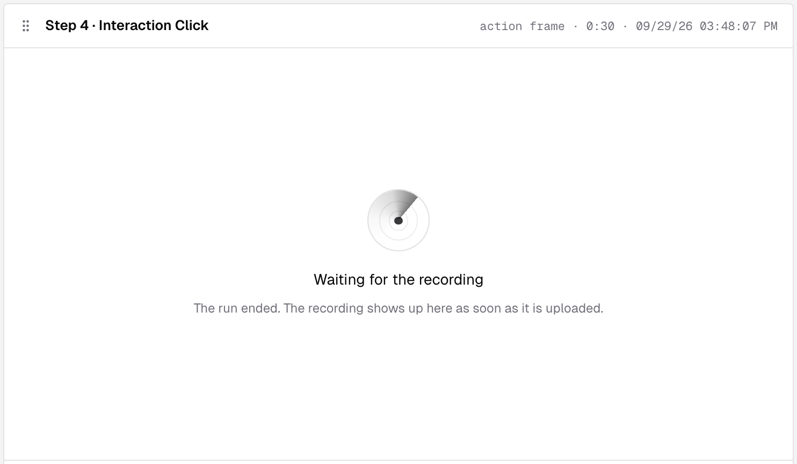
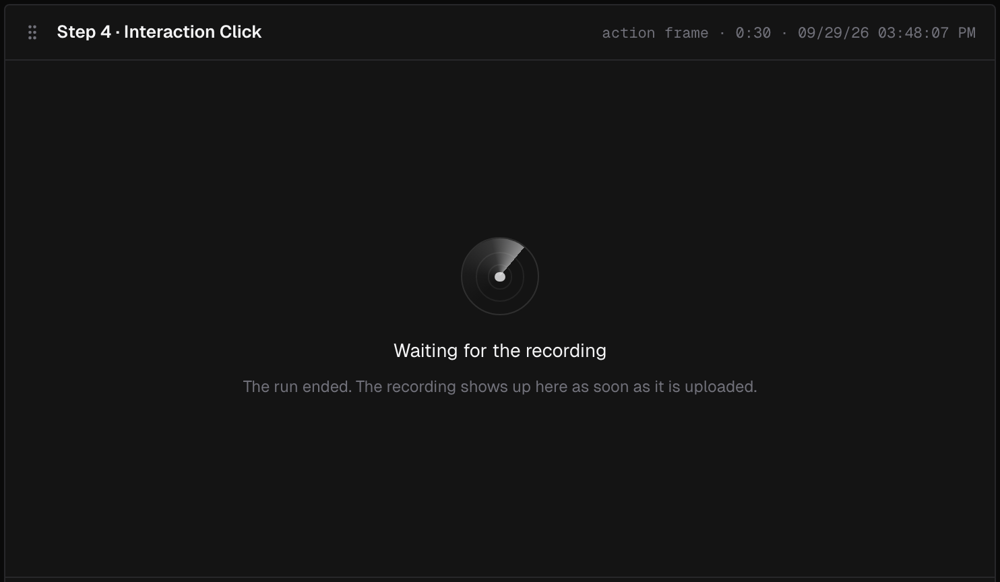

Every verification run has a **Verification Details** page. Open it by clicking a row in a project's [Verifications](/console/verifications) list, by following the link in a GitHub check, a GitLab pipeline status, a Bitbucket build status, a Vercel check, a Netlify deploy card or the GitHub Action's report, or with the **Open in IronBee** button on the run's comment on a pull request or merge request. The same button on an inline comment opens the page on that comment's [finding](#findings).

The page brings together everything the run did:
- what it saw, in the recording and screenshots
- what it did, in the actions
- what went over the network, in the requests, traces and logs
- what it concluded, in the result

---

## Header

The breadcrumbs lead back to the project. Next to the title, runs tied to a GitHub, GitLab or Bitbucket repository link to the commit and the pull request or merge request. On the right, a badge shows the result, or the status while the run has no result yet.

The strip below the title summarizes the run:

- The result, the run's name, and its type, trigger and attempt, for example **Web · Vercel · attempt 1**.
- The [callbacks](/console/verifications#callbacks) that report the result back to Vercel, GitHub, GitLab, Bitbucket or Netlify.
- **Run details**, the info icon, which opens the run's facts: its name and id, project, trigger, type, attempts, duration, credits, why it ended, when it was created, started and ended, any error, and the delivery of each callback.
- The duration, the credits, and how many actions, requests and screenshots the run recorded.

The credits read as in the [Credits column](/console/verifications#credits) of the list: the credits the run used once it ended, or `≤` and the most it can use while it runs. When the run wasn't charged, **Run details** adds the reason after the number, such as "not charged: the run never started".

A run refused because the team's credits for the month were used up shows **Refused** in **Run details**, with the date the credits reset, instead of an error. See [When credits run out](/console/usage#when-credits-run-out).

---

## Watch a run live

While a run on IronBee is in progress, the page shows it live: the browser view, every action as it executes, and the network requests behind it. The stage goes through **Authorizing**, **Connecting to the run** and **Waiting for the first frame** before the stream starts.

The live view is for watching. Anyone in the account can open it, and the stage shows how many people are watching. When the run ends, the page switches to the recording as soon as it's uploaded. See [The recording](#the-recording).

Verification cycles from the CLI aren't streamed. Their page updates as the cycle reports, and the recording arrives when the cycle finishes.

---

## The recording

After a run, the recording replays what the run saw:
- Play, and scrub with a preview on hover.
- Change the speed: the smart speed moves quickly through idle stretches.
- Go fullscreen.
- Keep the actions, the network and the logs synced to the playback position.

The recording is uploaded when the run ends, so it can take a moment to appear. Until it does, the play control is disabled, and a step without a screenshot of its own shows why on the stage:

| The stage says | When |
|----------------|------|
| **Waiting for the recording**, **It arrives when the run finishes.** | A CLI verification cycle is still running |
| **Waiting for the recording**, **The run ended. The recording shows up here as soon as it is uploaded.** | A run has just ended. The page checks again on its own, so there's no need to reload |
| **No recording was captured for this run; open a nearby screenshot.** | No recording arrived within two minutes of the end. The play control's tooltip says **This run captured no recording** |

API runs call your endpoints over HTTP, so they have no recording or screenshots. Their actions show each request with its status and timing.

---

## Actions and screenshots

The left panel lists what the run did:

- **Actions** is every step, in order. Filter the list, or turn on **Only IronBee tools** to hide everything else. Hover a step and click **Show details** to see the tool call and its result. **Copy raw event** copies it.
- **Screenshots** shows every screenshot the run took.

Selecting a step moves the recording, the network and the logs to that moment.

A [scenario](/console/scenarios) run opens on **Steps** instead, which lists the scenario's actions with their status. Its **Actions** list is called **Tool calls**. A band under the header gives the run's outcome, and the result panel adds an **Action** tab for the selected action. See [Run a scenario](/console/scenario-runs#the-run-page).

---

## The result

The result panel shows the verdict of the run:

| Tab | What it shows |
|-----|---------------|
| **Summary** | What the run verified and what it concluded. A verdict without one says "This verdict carries no summary. Its checks and issues are in the other tabs." |
| **Checks** | Each check the run made, and its outcome |
| **Findings** | Each problem the run found, worst first, with its suggested fix. See [Findings](#findings) |
| **Issues** | Each problem found, with where it happened and the evidence behind it |
| **Suggested fixes** | The changes the run suggests for the issues. They are suggestions, not applied fixes |

When the verdict lists findings, the tabs are **Summary**, **Checks** and **Findings**, and a link to **Issues** or **Suggested fixes** opens **Findings**. The count on **Findings** takes the color of the worst finding's severity. Otherwise, as on a passing run, an older run or a CLI verification cycle, the tabs are **Summary**, **Checks**, **Issues** and **Suggested fixes**.

You can resize the panel, collapse it, or swap it with the recording.

### Findings

**Findings** lists what the run found, worst first. Each row shows:

- **The severity**: **Critical**, **High**, **Medium** or **Low**.
- **The category**: **Correctness**, **Security**, or **Docs, names and tests**, the same categories as [code review](/code-review/pull-requests#a-findings-row).
- **The file and line**, such as `src/cart.ts:42`.
- **The title**: what goes wrong.

When IronBee published the run on the pull request, **Summary on GitHub** at the top of the list opens the run's comment, and **Open thread on GitHub** beside a finding opens its inline comment. A finding whose line isn't in the pull request's diff has no inline comment, so it has no link. On GitLab, the links read **Summary on GitLab** and **Open thread on GitLab**, and on Bitbucket **Summary on Bitbucket** and **Open thread on Bitbucket**. See [What appears on the pull request](/integrations/github#what-appears-on-the-pull-request), [What appears on the merge request](/integrations/gitlab#what-appears-on-the-merge-request) and [Bitbucket](/integrations/bitbucket#what-appears-on-the-pull-request).

Click a row to open the finding in a dialog. Its first line gives the severity, the category, and the file and line, linked to the file at the verified commit, followed by the commit, such as **at a1b2c3d**. **Open thread on GitHub** opens the finding's inline comment. Under it, the finding's title is the dialog's title.

The sections follow in this order. A section with nothing to show is left out.

1. **Happens when**, **Then**, **Seen** and **Impact**: what triggers the problem, what happens next, what the run saw, and what it costs.
2. The diff: for a run tied to a pull request, the part of the pull request's diff that holds the finding's line, with the lines the run quoted marked.
3. **Suggested fix**, open by default: a note on what to change, and the code to put in. When the code replaces lines around the finding, the heading says which, such as **replaces lines 12–14**, and if the pull request's diff holds those lines, the code shows as a diff against them. Otherwise the code shows on its own under the file's path, or under **The code to put in** when the finding names no file.
4. **Where this rests**: other places in the code the finding relies on, each linked to the file at the verified commit.

The footer shows where the finding stands in the list, such as **3 of 5**, and the buttons **Previous** and **Next**. **Next** names the next finding's file and line, such as **Next: src/cart.ts:42**. Press `←` and `→` to move, and `Esc` to close.

---

## Network, traces and logs

The right panel inspects what went over the wire:

- **Network** lists every request the run made.
  - Open a request to see its **General**, **Request**, **Response** and **Others** details.
  - Bodies show as **Preview** or **Raw**.
- **Traces** shows the run's spans as a tree, with a bar for each span's timing. Search the spans, and open a span to see its details. The footer counts the spans and the errors among them.
- **Logs** lists the log records the run collected.

All three follow the playback: they show what happened up to the selected step or the current playback position.

---

## Keyboard shortcuts

| Key | Action |
|-----|--------|
| `[` and `]` | Show or hide the side panels |
| Left and right arrows | Move to the previous or next step |
| `Esc` | Leave the current view |

---

## Share a view

The page's URL keeps the selected tab, panel, step and screenshot, and the [finding](#findings) open in the dialog. Copy it to point a teammate at the exact moment you are looking at.

---

## What's next?

<CardGroup cols={2}>
  <Card title="Verifications" icon="list-checks" href="/console/verifications">
    Every run of a project, with its trigger, status and result.
  </Card>
  <Card title="Scenarios" icon="file-play" href="/console/scenarios">
    Flows written in plain words, run against an environment one action at a time.
  </Card>
</CardGroup>
