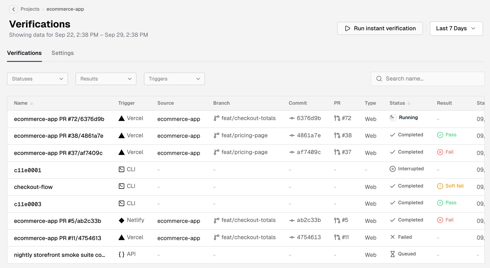
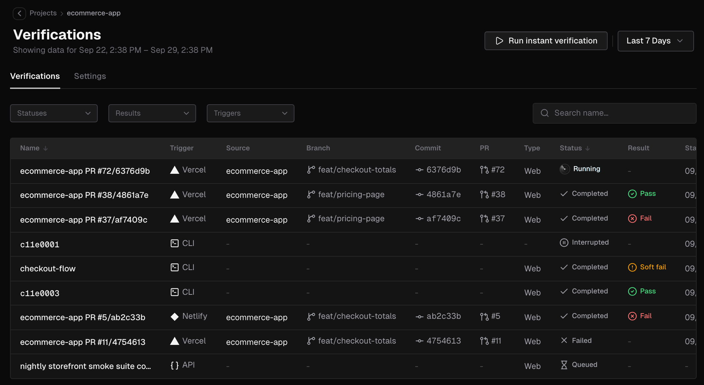
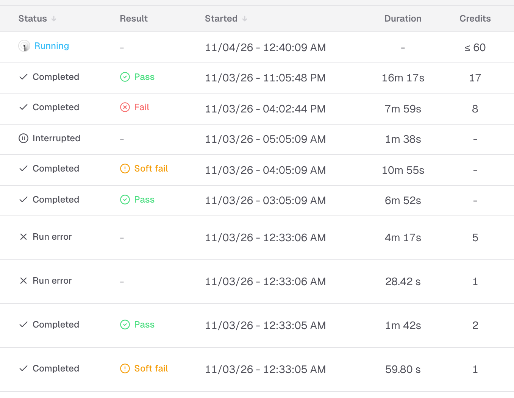
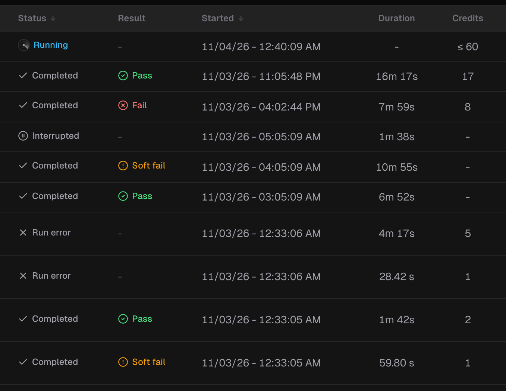
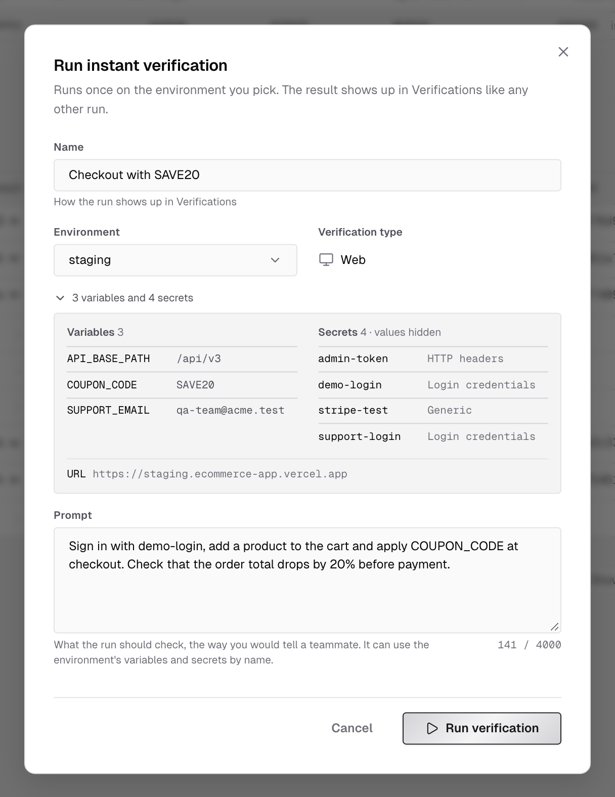
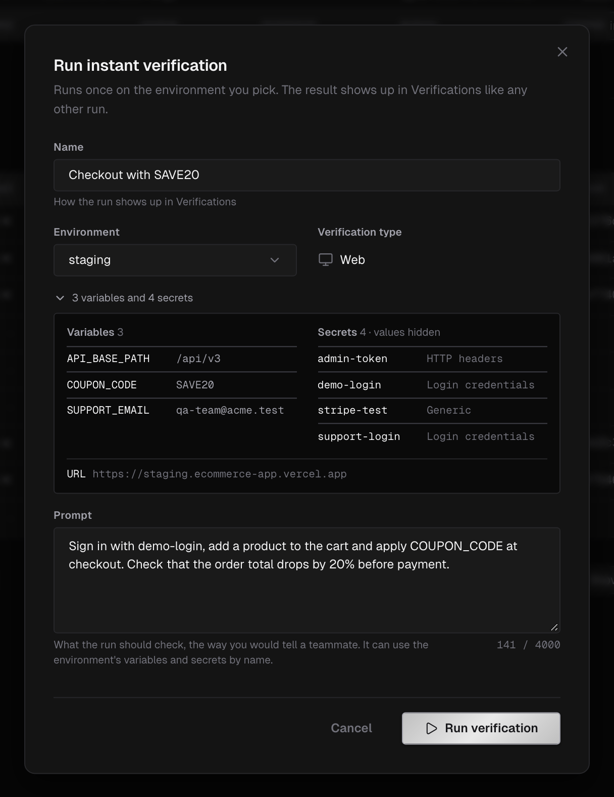

A project's **Verifications** tab lists every verification run of the project:

- **Runs on IronBee's infrastructure.** These are started by Vercel, Netlify, the [GitHub Action](/github-action/get-started/getting-started), the [GitLab component](/gitlab-component/get-started/getting-started), [`ironbee verify`](/cli/guides/verification-jobs), or **Run instant verification** in the console.
- **Verification cycles from the [IronBee CLI](/cli/concepts/how-it-works).** These are reported by your AI coding agent while it works.

Open **Projects**, click a project, and select its **Verifications** tab; a project opens on **Code review**. The card's **Verifications** row also opens it. Click a row to open the run's [verification detail](/console/verification-detail) page.

---

## Filter and search

- The date range at the top of the page shows runs started in that window. Pick **Last 24 Hours**, **Last 7 Days**, **Last 30 Days**, **Last 90 Days**, or a **Custom Range** down to the hour.
- **Statuses**, **Results** and **Triggers** narrow the list. **Search name…** matches run names from 3 characters.
- **Clear filters** resets them.

---

## Columns

| Column | What it shows |
|--------|---------------|
| **Name** | The run's name. Deployment runs are named after their pull request, or their branch and commit. A CLI cycle without a name shows a short id. A [scenario](/console/scenarios) run is named after its scenario, with a **Scenario** mark under it |
| **Trigger** | What started the run: **Vercel**, **Netlify**, **GitHub Actions**, **GitLab CI**, **API**, **Console** or **CLI** |
| **Source**, **Branch**, **Commit**, **PR** | The repository, branch, commit and pull request the run verified, for runs tied to a GitHub or GitLab repository. A run bound to a pull request alone shows the pull request's branch and the commit it checked out. A CLI cycle shows what its session reported about the repository |
| **Type** | **Web** or **API**. For CLI cycles: browser verification shows **Web**, backend shows **API**, other platforms show `-` |
| **Status** | Where the run is |
| **Result** | The verdict |
| **Started**, **Duration** | When the run started and how long it took |
| **Credits** | The credits the run used, or the most it can use while it runs. See [Credits](#credits) |
| **Callbacks** | Whether the result was delivered back to Vercel, GitHub, GitLab or Netlify |

You can sort by **Name**, **Status** and **Started**. The newest runs come first. Times follow the **Time Format** in [Settings](/console/settings).

---

## Status

| Status | Meaning |
|--------|---------|
| Created | The run was created |
| Queued | The run is waiting to start |
| Starting | The run's environment is being prepared |
| Running | The agent is verifying. A run on IronBee can be watched live |
| Completed | The run ended with a verdict |
| Failed | The run ended without a verdict, because of an error or a timeout. A scenario run shows **Run error** instead |
| Cancelled | The run was stopped before it finished |
| Interrupted | CLI only: the cycle closed without a verdict |
| Unknown | CLI only: the cycle never reported an end |

---

## Result

| Result | Meaning |
|--------|---------|
| Pass | The change works as intended |
| Fail | The verification found issues |
| Not applicable | The change left nothing to verify. The run gives the reason |
| Soft fail | A [scenario](/console/scenario-runs#the-outcome) ran to the end, but one of its soft asserts failed. It isn't a clean pass |
| Unknown | No verdict was recorded |

---

## Callbacks

A run reports its result back to where it came from and to the repository it verified:

- A run started by Vercel or Netlify reports to the provider.
- A run bound to a commit or a pull request of a repository that the [GitHub App](/integrations/github) or a [connected GitLab group](/integrations/gitlab) covers also reports to GitHub or GitLab: a check, or a pipeline status where IronBee writes one ([Merges](/code-review/on-gitlab#merges)), on the commit, and the findings and a summary on the pull request or merge request. That covers Vercel and Netlify runs, and runs on IronBee from the GitHub Action, the GitLab component, `ironbee verify` and the API. See [What appears on the pull request](/integrations/github#what-appears-on-the-pull-request).
- A run started with **Run instant verification**, a scenario run, and a run without the repository (`--no-repo`, `ironbee_bind_repository: false`) report nowhere.

The **Callbacks** column shows one entry per destination (**Vercel**, **GitHub**, **GitLab** or **Netlify**):

| State | Meaning |
|-------|---------|
| Created | The report is prepared |
| Queued | The report is waiting to be sent |
| Delivered | The provider received the result |
| Failed | The result couldn't be delivered |

---

## Credits

Every verification run on IronBee uses credits by the minutes it runs. The **Credits** column shows:

| The cell shows | When |
|----------------|------|
| `-` | The run hasn't started yet, or it's a verification cycle from the CLI, which uses no credits |
| `≤` and a number | The run is in progress. The number is the most it can use, set by its time limit |
| A number | The run ended. It's the credits the run used |

A run that ended without being charged shows `0`. Hover it to see why: "not charged: the run never started", or "not charged: IronBee's own failure" when something on IronBee's side failed before the agent started working.

What a run costs, and the team's credits this month, are on [Credit usage](/console/usage).

---

## Run instant verification

Owners, admins and members can start a one-off verification of a deployed environment from the console. Billing admins don't see the button.

1. On the project's **Verifications** tab, click **Run instant verification**.
2. Type a name in the **Name** field, which reads **Enter an instant verification name** while it's empty. This is how the run shows up in the list.
3. Pick the **Environment** to run against. The dialog opens on the first environment, in the order of **Settings > Environments**, that has a URL. The run starts at the environment's **URL** property.
   - If the environment has no URL, the dialog says **No URL to start from.** with an **Add one** link to its settings. A **Domain** property alone isn't enough.
   - Below the picker, a line sums up what the run is given, for example **3 variables and 4 secrets**, or **No variables or secrets**. These are the project-wide variables and secrets plus the environment's own. The environment's own one wins when both share a name.
   - Click the line to expand it: **Variables** with their values, **Secrets** by name and type with the values hidden, and the environment's **URL**, **OpenAPI** and **Domains** properties that are set.
4. **Verification type** is always **Web**.
5. Write the **Prompt**: what the run should check, the way you'd tell a teammate. It can use the environment's variables and secrets by name. The counter below the prompt shows its length.
6. Click **Run verification**. The dialog closes and the run opens on its verification detail page, where you can follow it live. If the run can't start, the dialog stays open and says why.

**Run verification** stays disabled until the run has a name, a prompt that isn't empty or over the length the counter allows, and an environment with a URL. The note next to it says how the run uses credits: for each started minute of the run. See [What uses credits](/console/usage#verification).

The run appears in the list with the **Console** trigger.

<Note>
  - The button is disabled on an archived project, and on an API project: API verifications can't be started from the console yet. Hover it to see the reason.
  - The button is also disabled when the team's credits for this month are used up. Hover it to see the date they reset. See [When credits run out](/console/usage#when-credits-run-out).
  - The environment needs a URL that a cloud run can reach. A local or private address is refused.
  - If the project has no environments yet, the dialog says so and links to them with **Open environments**. Add one with the URL to verify. See [Environments](/console/environments).
</Note>

<Tip>
  An instant verification runs once. To run the same flow again and again, step by step, write it as a [scenario](/console/scenarios).
</Tip>

---

## CLI verification cycles

When your AI coding agent verifies a change with the IronBee CLI, each verification cycle appears in the list with the **CLI** trigger. Its detail page shows the recording, the actions and the verdict of that cycle. The recording arrives when the cycle finishes; see [The recording](/console/verification-detail#the-recording).

How the CLI verifies, the platforms it uses and the retry behavior are covered in the [CLI docs](/cli/concepts/how-it-works).

---

## What's next?

<CardGroup cols={2}>
  <Card title="Verification detail" icon="clipboard-check" href="/console/verification-detail">
    Read a run: the recording, the actions, the network and the result.
  </Card>
  <Card title="Environments" icon="server" href="/console/environments">
    The deployments a project is verified against.
  </Card>
</CardGroup>
