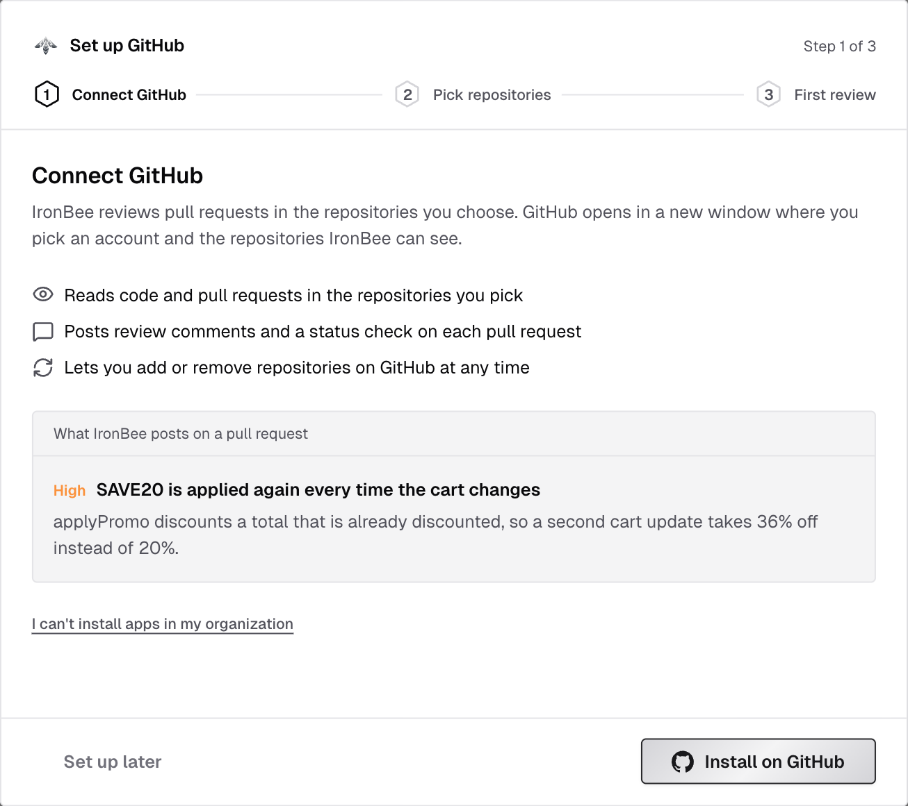
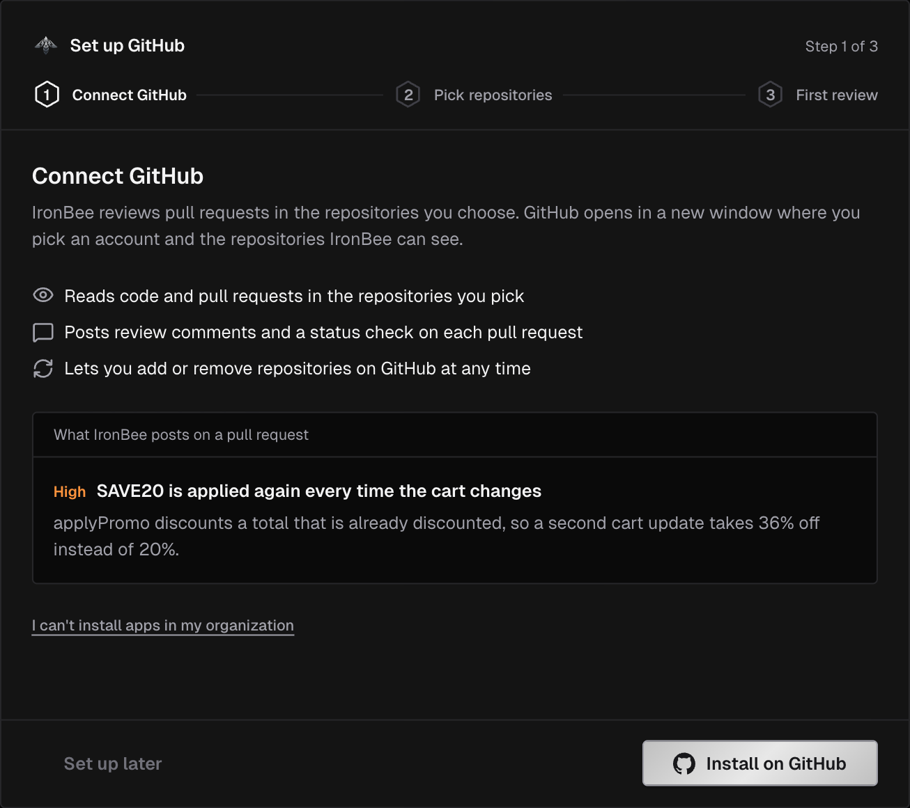
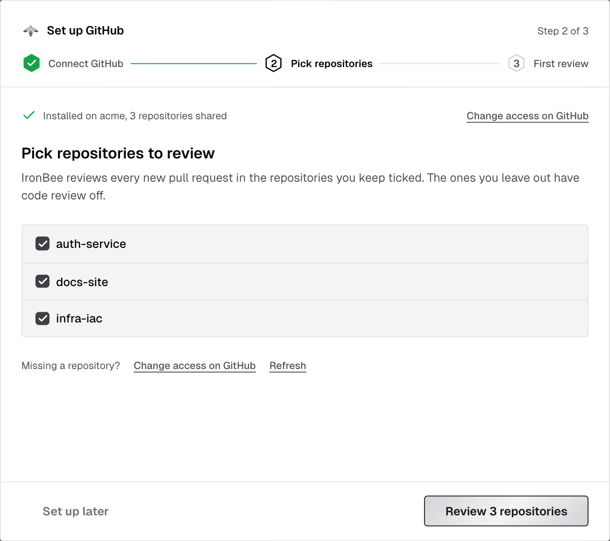
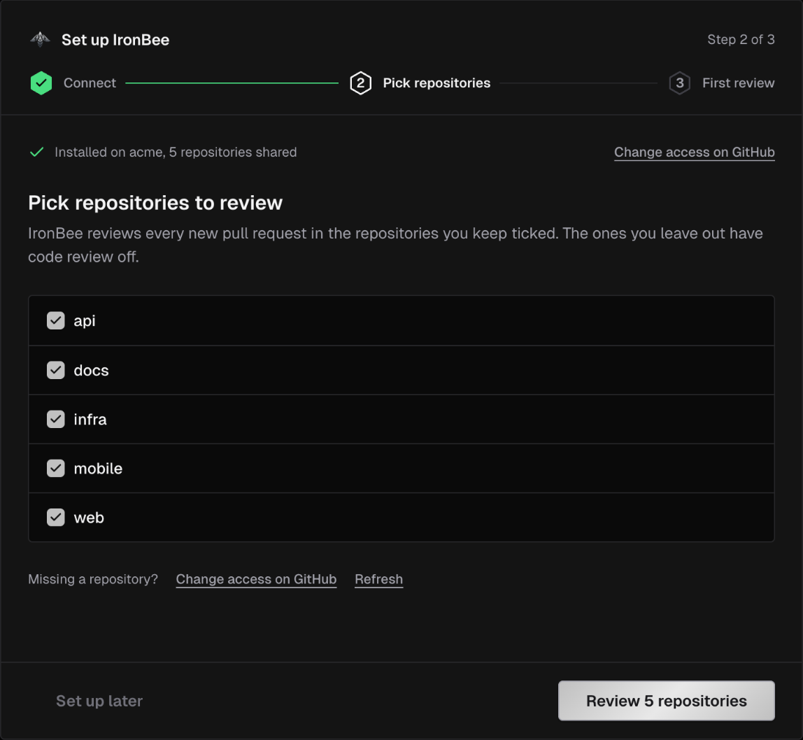
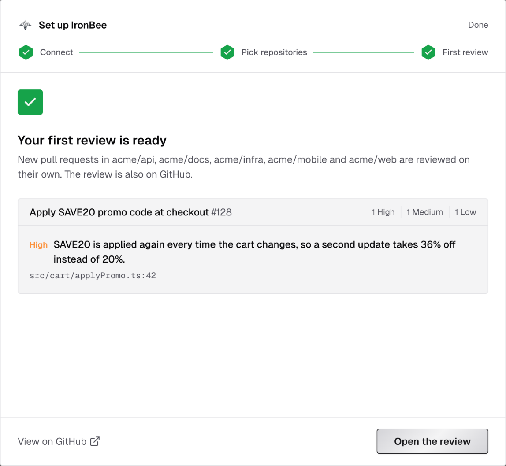
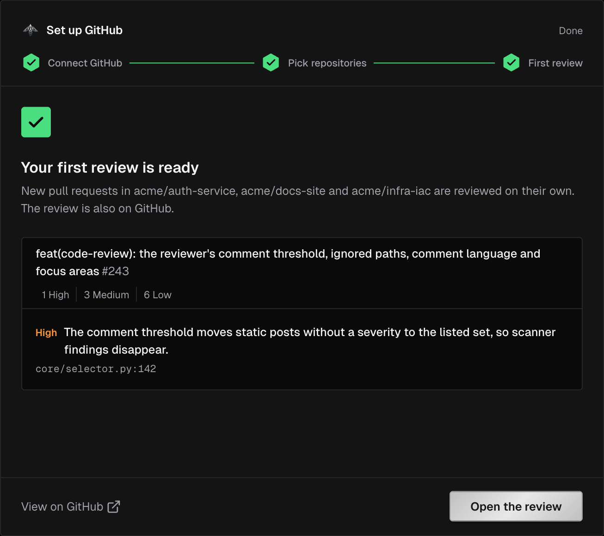
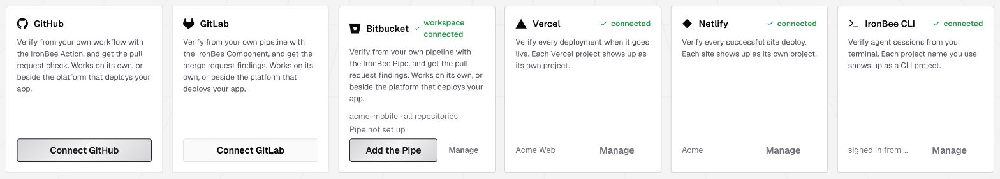
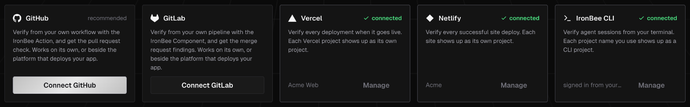

## Step 1: Create your account

Go to [console.ironbee.ai](https://console.ironbee.ai) and sign up with Google, GitHub, or your work email. The first time you sign in, **Name your account**, for example after your company, and click **Continue**. See [Sign in and team access](/console/sign-in).

---

## Step 2: Connect your repositories

When you create a new account, the console opens **Set up IronBee**. It has three steps: **Connect**, **Pick repositories** and **First review**. The first one, **Connect your repositories**, offers two cards: **GitHub** and **GitLab**.




<Steps>
  <Step title="Connect">
    **GitHub:** click **Install on GitHub**. GitHub opens in a new window, where you pick the organization or account and the repositories IronBee can see. The step reads **Finish on GitHub** and moves on by itself once the App is installed.
    - If the window doesn't open, or you'd rather stay in one tab, click **Continue in this tab instead**. GitHub brings you back to this step.
    - If you can't install apps in your organization, pick the organization anyway. GitHub sends a request to its owners, and the step shows **Request sent to your organization owners**. It moves on by itself when one of them approves. Meanwhile, **Copy link** copies the install link to send to an owner, and **Open GitHub** lets you install on an account you own instead.

    **GitLab:** you need the Owner role on a top-level group on gitlab.com. Click **Connect GitLab**, authorize IronBee on GitLab, and pick the group. IronBee creates a service account in the group to work through, and brings you back to the next step. See [GitLab](/integrations/gitlab).
  </Step>
  <Step title="Pick repositories">
    **GitHub:** every repository you shared with the App is already an IronBee project. Under **Pick repositories to review**, keep ticked the repositories whose pull requests IronBee should review. The ones you leave out have code review off. Click **Review N repositories**. Missing a repository? Click **Change access on GitHub**, share it with the App, then click **Refresh**.

    **GitLab:** a group makes no repository a project until you pick. Choose **All repositories**, which includes the ones added to the group later, or **Only selected repositories**, and tick them. Each repository you pick becomes a project, and IronBee reviews every new merge request in it. Click **Review N repositories**. Missing a repository? Click **Sync now**.

    
    
  </Step>
  <Step title="First review">
    Under **Pick a pull request for your first review**, or **Pick a merge request for your first review** on GitLab, pick an open one and click **Review #N**. Drafts are marked **Draft, skipped**.

    The step follows the review: **Queued**, **Starting the reviewer**, **Reading the changes**, **Posting the review on GitHub** (or **on GitLab**). You can **Close** it at any time; the review keeps going and shows up on the pull request. When **Your first review is ready**, click **Open the review** to read it in the console, or **View on GitHub** (**View on GitLab**).

    No open pull request yet? Click **Finish setup**. IronBee reviews the next one on its own.

    
    
  </Step>
</Steps>

A review uses credits, by the size of the change. The step shows how many your account has left this month. See [Pricing](/console/pricing).

**Set up later** closes the wizard on any step. To come back, owners and admins open **Setup** in the top bar and click **Connect a provider**.

Each repository's [code wiki](/console/code-wiki) starts at the same time, unless it's turned off in [Code wiki settings](/console/code-wiki-settings). See [Code review of pull requests](/code-review/overview), [GitHub App](/integrations/github) and [GitLab](/integrations/gitlab).

---

## Step 3: Add verification

Code review needs only the GitHub App or the GitLab connection. To also verify your changes, owners and admins open **Settings > Getting started**. It offers five ways in, and you can connect more than one.




<Tabs>
  <Tab title="GitHub Action">
    Verify every push and pull request with the IronBee Action.

    1. On the **GitHub** card, click **Add the Action**. If the App isn't installed yet, click **Connect GitHub** and install it first.
    2. In the **IronBee Action** step, pick:
       - the **Repository**
       - **Where it runs**: **On IronBee** or **On your GitHub runner**
       - **On a finding**: **Report it** or **Fix it too**
    3. Fill in how your app starts, and add the repository secrets the console lists: `IRONBEE_API_KEY`, plus `ANTHROPIC_API_KEY` or `CLAUDE_CODE_OAUTH_TOKEN` when your answers need one. Then click **Create the file on GitHub**.
    4. Committing the file is a push, and that push starts your first verification run.

    On **Projects**, a GitHub project's card also offers **Install the IronBee Action** until its first run, and opens the same steps for that repository. See [GitHub Action: Getting started](/github-action/get-started/getting-started).
  </Tab>
  <Tab title="GitLab component">
    Verify every merge request and push with the IronBee Component.

    1. On the **GitLab** card, click **Add the Component**. If no group is connected yet, click **Connect GitLab** and connect one first.
    2. In the **IronBee Component** step, pick:
       - the **Repository**
       - **Where it runs**: **On IronBee** or **On your GitLab runner**
       - **On a finding**: **Report it** or **Fix it too**
    3. Fill in how your app starts, and add the CI/CD variables the console lists: `IRONBEE_API_KEY` and `GITLAB_TOKEN`, plus `ANTHROPIC_API_KEY` or `CLAUDE_CODE_OAUTH_TOKEN` when your answers need one. Then click **Copy and open the pipeline editor**, paste the file and commit it.
    4. Committing the file is a push, and that push starts your first verification run.

    On **Projects**, a GitLab project's card also offers **Install the IronBee Component** until its first run. See [GitLab component: Getting started](/gitlab-component/get-started/getting-started).
  </Tab>
  <Tab title="Vercel">
    Verify the preview deployments of your Vercel projects.

    1. Click **Connect Vercel**, and add the IronBee integration on your Vercel team. Choose the projects it can see.
    2. Back in IronBee, connect the installation to your account. The project list opens: keep the projects to verify checked, and pick each one's verification type, **Web**, **API** or **None**.
    3. If your previews are protected, add a **Bypass token** secret. See [Preview access](/integrations/vercel#preview-access).
    4. The next preview deployment starts your first verification run.

    With the GitHub App installed too, or the GitLab connection, runs verify each pull request's changes and report on it. See [Vercel](/integrations/vercel).
  </Tab>
  <Tab title="Netlify">
    Verify the deploy previews and branch deploys of your Netlify sites.

    1. Click **Connect Netlify**, and install the IronBee extension on your Netlify team.
    2. From the extension, click **Connect to IronBee** and connect the team to your IronBee account.
    3. Open IronBee from a site's menu on Netlify and click **Turn on verification**.
    4. The next deploy preview starts your first verification run.

    With the GitHub App installed too, or the GitLab connection, runs verify each pull request's changes and report on it. See [Netlify](/integrations/netlify).
  </Tab>
  <Tab title="CLI">
    Let your AI coding agent verify its own changes. You need Node.js 22 or later, and Claude Code, Cursor or Codex. On **Settings > Getting started**, **Set up the CLI** shows the same three steps and detects your sign-in.

    ```bash
    npm install -g @ironbee-ai/cli
    ironbee login
    cd your-project
    ironbee install
    ```

    - `ironbee login` opens your browser to authorize the CLI, and stores a personal OAuth token in `~/.ironbee/config.json`. The token shows up on the [OAuth Tokens page](/console/access-tokens), where you can revoke it.
    - `ironbee install` detects your AI client and asks a few questions: the verification mode (**assist**, the default, **enforce** or **monitor**) and the platforms to verify (the browser by default).
    - Restart your AI client afterwards. On Cursor, also turn on the `ironbee-devtools` server. See [Cursor setup](/cli/clients/cursor#activate-the-mcp-server).

    Then give your agent a task. In assist mode, run `/ironbee-verify` (`$ironbee-verify` on Codex) when the change is ready. In enforce mode, the agent verifies before it can finish. See [CLI: Getting started](/cli/get-started/getting-started).
  </Tab>
</Tabs>

---

## Step 4: See your results

Open **Projects** in the console. A GitHub repository is listed as soon as the App covers it, a GitLab repository once you pick it, a Vercel project or Netlify site once you enable it, and a CLI project when its first data arrives. Click a project to open its **Code review** tab, then its [Verifications](/console/verifications) tab:
- While a run is in progress, you can watch it live.
- Afterwards, its [detail page](/console/verification-detail) shows the recording, the actions, the network requests and the result.

The **Setup** checklist in the top bar tracks your progress: **Connect a provider**, **Your first project appears**, **A deployment or session arrives** and **Invite a teammate**. Owners and admins see it until every item is done, and **Hide until tomorrow** hides it for a day.

<Accordion title="Running in CI without the GitHub Action or the GitLab component?">
  Use the account API key instead of `ironbee login`. Owners and admins find it in the console under **Settings > Account**. Supply it through the environment:

  ```bash
  export IRONBEE_SERVICE_API_KEY=<your-account-api-key>
  ```

  See [Authentication](/cli/guides/authentication) for when to use each credential.
</Accordion>

---

## What's next?

<CardGroup cols={2}>
  <Card title="How integrations work" icon="plug" href="/integrations/overview">
    Projects, verification types, environments and where results land.
  </Card>
  <Card title="Key concepts" icon="book-open" href="/getting-started/key-concepts">
    The terms used across the console and the docs.
  </Card>
  <Card title="Environments and secrets" icon="lock" href="/console/secrets">
    Give runs the credentials to sign in to your app.
  </Card>
  <Card title="CLI configuration" icon="settings" href="/cli/configuration/configuration">
    Verify patterns, retry limits and devtools settings.
  </Card>
</CardGroup>
