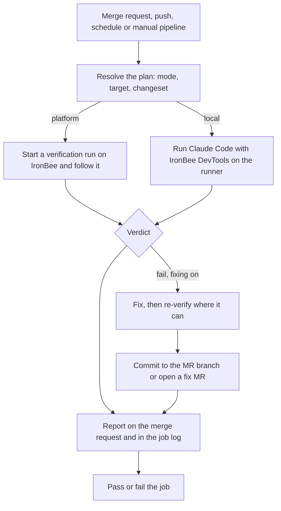

Every run of the IronBee GitLab component follows the same path:
1. It resolves a plan and verifies the change.
2. When fixing is on, it fixes what failed and commits the fix.
3. It reports on the merge request and passes or fails the job.

Only the verification step differs between the two [modes](/gitlab-component/concepts/verification-modes): on IronBee (platform mode) or on your GitLab runner (local mode). The component runs the same steps as the [GitHub Action](/github-action/concepts/how-it-works), in the same order.

---

## The run, step by step

<Steps>
  <Step title="Plan">
    The component decides the mode, the target and the changeset, and logs them together with the reason for the mode and the minimum `timeout:` the job needs. It stops here, before installing anything, when the run can't work: no target, a merge request from a fork, or an invalid input value.
  </Step>
  <Step title="Verify">
    **On IronBee:** the component installs the IronBee CLI and runs `ironbee verify run web`. That starts a verification run on IronBee and follows it until it ends.
    - For an app that runs on the runner, the component installs, builds and starts it first, and IronBee reaches it through a reverse tunnel.
    - The recording, screenshots and logs are kept in the IronBee Console.

    **On your runner:** the component installs Chromium, IronBee DevTools and Claude Code, writes `.ironbee/config.json` and runs `ironbee install --client claude`. Claude Code then verifies the change through IronBee DevTools. The evidence goes to the job's artifacts and to IronBee.
  </Step>
  <Step title="Fix">
    This step runs when the verification fails, fixing is on (`verification_apply_fix`) and an Anthropic credential is set.
    - **On IronBee:** a Claude Code run on your runner edits the files to fix the reported issues. For an app that runs on the runner, the component then restarts it and runs a second verification. A deployed URL isn't re-verified, because the deployment still serves the code that was deployed.
    - **On your runner:** the agent fixes and re-verifies in the same session. With fixing off, it reports what it finds and changes no file.
  </Step>
  <Step title="Commit">
    The component commits and pushes the fix itself, with the [GitLab token](/gitlab-component/get-started/getting-started#the-gitlab-token); the agent only edits files. Only the files the fix changed are committed.
    - On a merge request, the fix goes to the merge request's source branch.
    - Otherwise it goes to a new `ironbee/fix-<sha7>-<pipeline_id>` branch with a merge request.
    - A fix whose re-verification fails is not pushed.

    Fix commits end in `[skip ci]` and are pushed with `-o ci.skip`, so a fix doesn't start a pipeline that verifies it again.
  </Step>
  <Step title="Report">
    The report is posted as a merge request note, updated in place on later runs. It links to the run in the IronBee Console. When IronBee publishes the run on the merge request itself, the component posts no note. GitLab has no job summary, so the report is also printed in a collapsed **IronBee Verification Report** section of the job log and saved as `report.md` in the job's artifacts.
  </Step>
  <Step title="Pass or fail">
    The last step fails the job when the verification fails or ends without a verdict.
  </Step>
</Steps>

---

## What gets verified

The component binds each run to the change behind the pipeline, so the verification looks at what changed rather than at the whole repository.

| Pipeline source | What gets verified |
|-----------------|--------------------|
| `merge_request_event` | The whole merge request |
| `push` | Every commit in the push, from the push's `before` commit (`CI_COMMIT_BEFORE_SHA`), or the commit against its parent when that base isn't usable |
| `schedule`, `web`, `api`, `trigger` | On IronBee: the commit against its parent. On your runner: the whole application |

To verify the application without the repository, for example a private project whose group isn't connected to IronBee, set `ironbee_bind_repository: 'false'`.

---

## Where results appear

- **On the merge request:** the component's report note, with a link to the run in the console. When the project's [GitLab group is connected](/integrations/gitlab), IronBee publishes a run on IronBee itself instead: a pipeline status on the verified commit and, on a merge request, inline comments and a summary note. The component then leaves its note out.
- **In the pipeline:** the report in the job log, the job's pass or fail result, and the job's artifacts. The `IRONBEE_VERDICT`, `IRONBEE_MODE`, `IRONBEE_JOB_ID`, `IRONBEE_JOB_URL`, `IRONBEE_ARTIFACTS_URL` and `IRONBEE_PLATFORM_PUBLISHES` [outputs](/gitlab-component/configuration/configuration#outputs) are available to later jobs.
- **In the IronBee Console:** runs on IronBee appear on the project's **Verifications** tab with the trigger **GitLab CI**. The project is the GitLab project unless you set `ironbee_project`. See [Verifications](/console/verifications).

---

## What's next?

<CardGroup cols={2}>
  <Card title="Platform and local verification" icon="split" href="/gitlab-component/concepts/verification-modes">
    Choose where the verification runs.
  </Card>
  <Card title="Running in GitLab CI/CD" icon="git-branch" href="/gitlab-component/guides/running-in-ci">
    Pipeline sources, fix behavior and the report.
  </Card>
</CardGroup>
