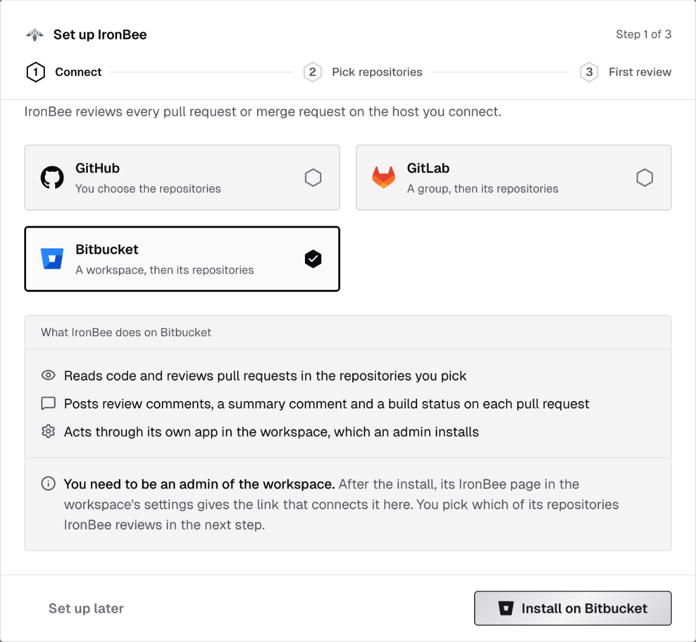
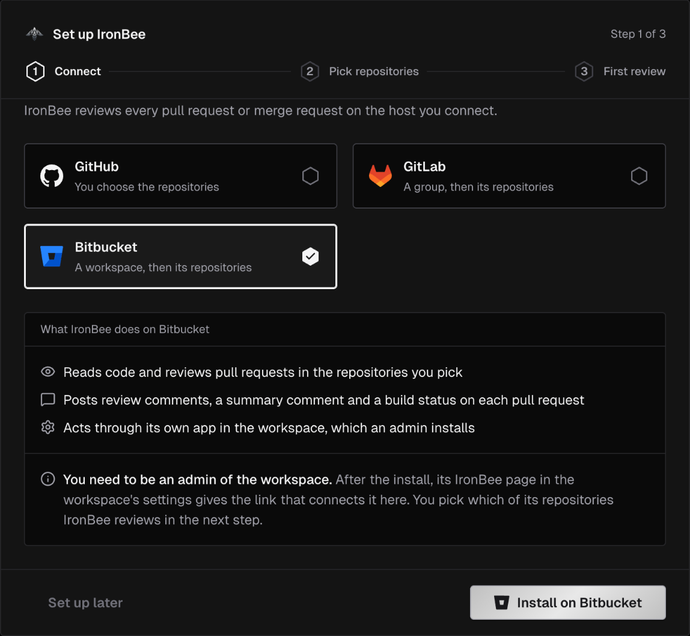
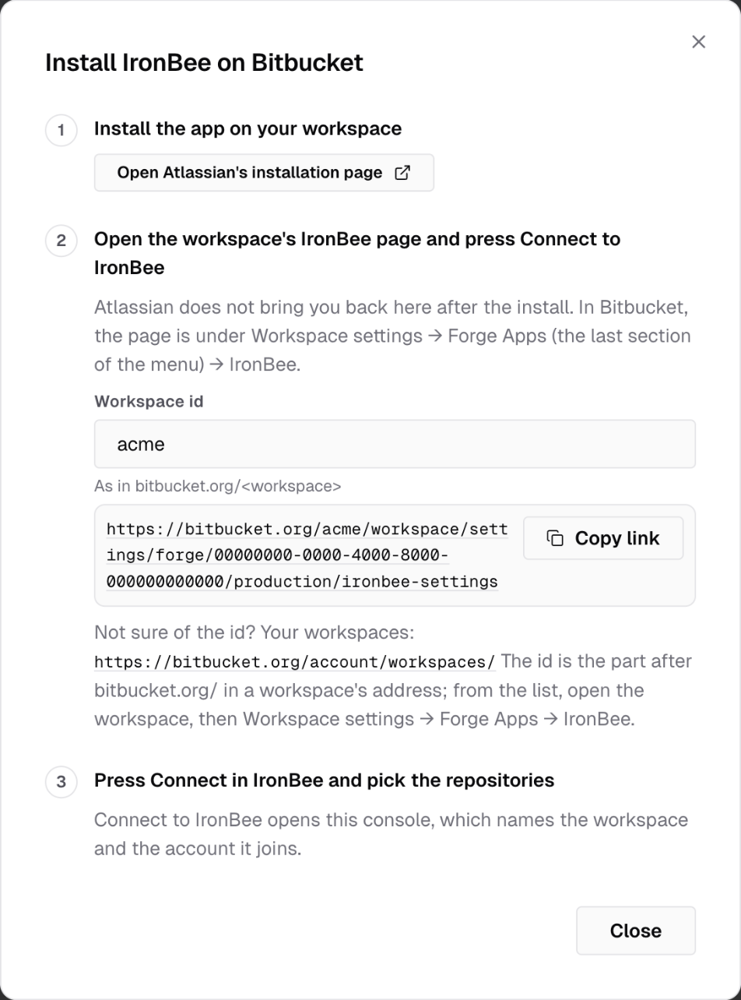
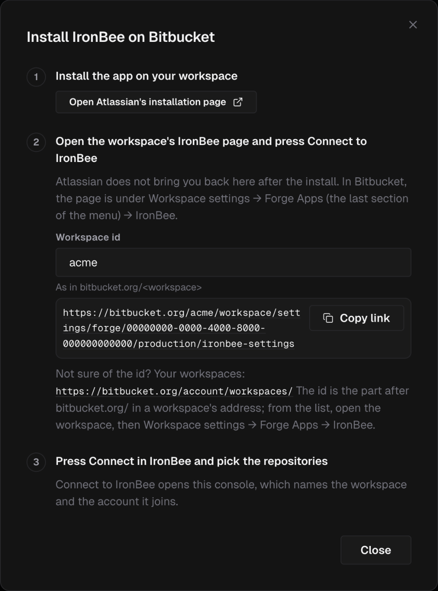
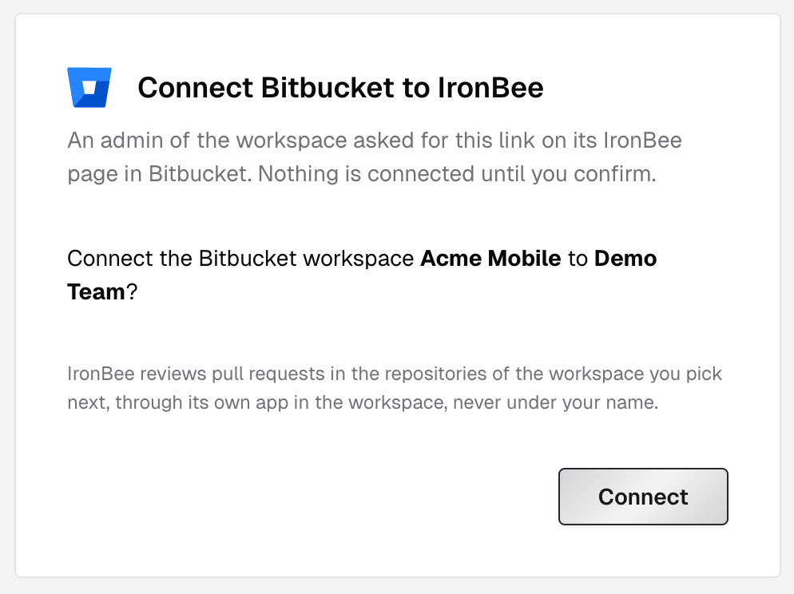
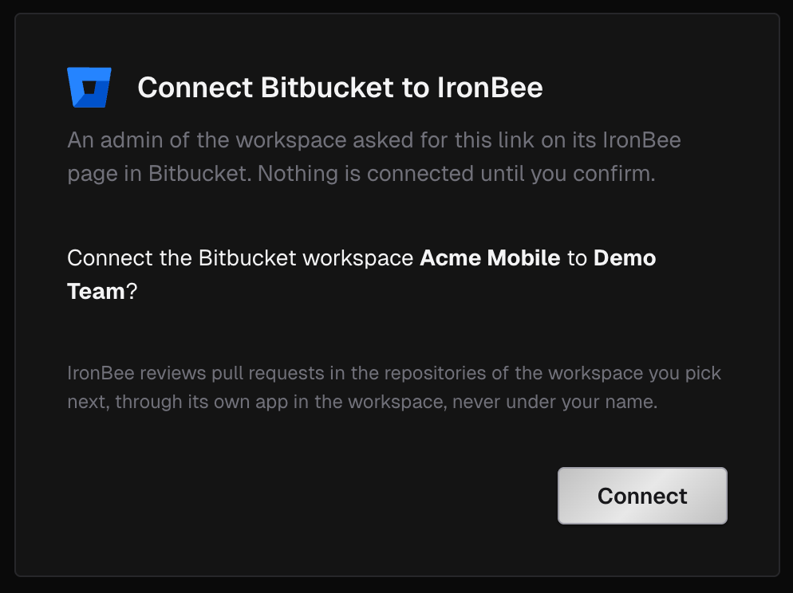
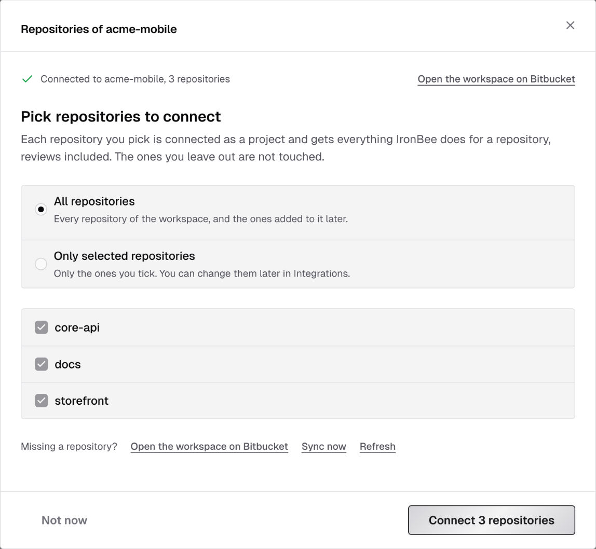
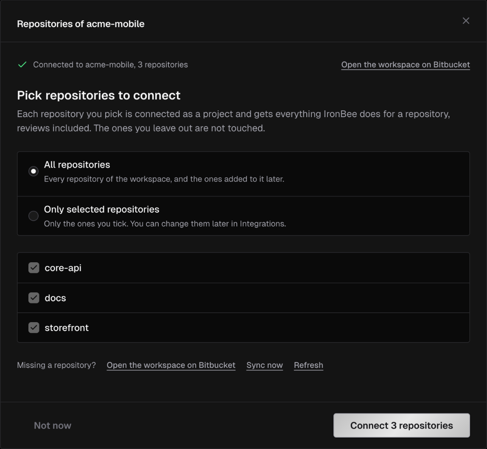
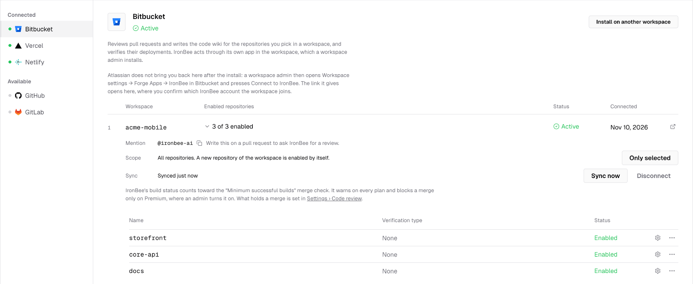
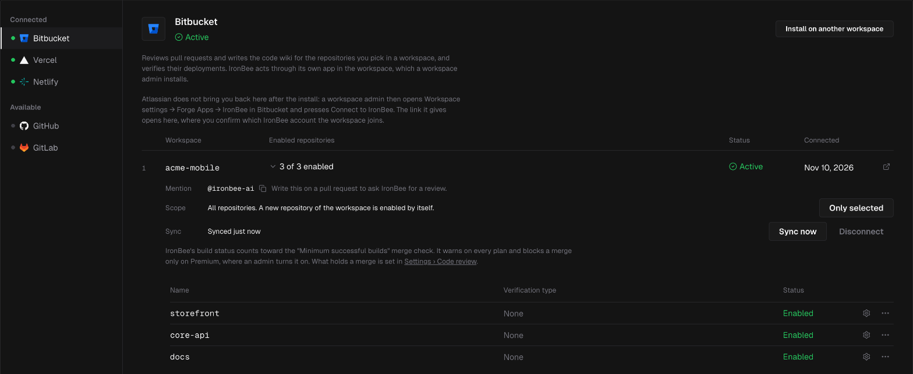

The Bitbucket connection links a workspace on bitbucket.org to your IronBee account. IronBee works in the workspace through its own app, which a workspace admin installs, and never under your name. The connection gives IronBee:

- **Code review.** IronBee reviews the pull requests of the repositories you pick, comments on what it finds, keeps a summary comment and sets the **IronBee review** build status. See [Code review on Bitbucket pull requests](/code-review/on-bitbucket).
- **Code wiki.** IronBee writes a wiki of each repository you pick, from its default branch, and keeps it current as pull requests merge. See [Code wiki of a repository](/console/code-wiki).
- **Repository access.** A verification run checks out the commit it verifies. For a run from the Bitbucket Pipe or `ironbee verify`, a private repository needs the connection for that; a public one doesn't. A Vercel or Netlify deployment of a repository whose workspace isn't connected is verified on its URL alone, with nothing posted on Bitbucket. So is one whose commit the repository doesn't hold.
- **Results on the pull request.** A verification run with a verdict posts a build status, inline comments on its findings and a summary comment on the pull request. See [What appears on the pull request](#what-appears-on-the-pull-request).

The [IronBee Bitbucket Pipe](/bitbucket-pipe/get-started/getting-started) and [`ironbee verify`](/cli/guides/verification-jobs) use the same connection to check out private repositories.

<Note>
  Only Bitbucket Cloud, on bitbucket.org, is supported. Bitbucket Data Center and Server aren't supported, and neither is a personal workspace: Atlassian installs IronBee's app on shared workspaces only. Bitbucket isn't a way to sign in to IronBee: you connect a workspace from an IronBee account you're signed in to.
</Note>

---

## Connect a workspace

You need:
- the **owner** or **admin** role in IronBee
- to be an admin of the workspace on Bitbucket, who can install apps and open the workspace's settings

IronBee is an app on Atlassian's Forge platform. Connecting takes two parts: an admin installs the app on the workspace, then connects the workspace to your IronBee account from the app's page in the workspace's settings. Atlassian doesn't bring you back to IronBee after the install, so the second part starts in Bitbucket.

Start from one of three places:
- **Integrations** in the sidebar: select **Bitbucket** and click **Install on Bitbucket**, or **Install on another workspace** once one is connected.
- The **Set up IronBee** wizard that opens on a new account: on **Connect your repositories**, pick the **Bitbucket** card and click **Install on Bitbucket**. See the [Quickstart](/getting-started/quickstart).
- **Settings > Getting started**: the **Bitbucket** card's **Connect Bitbucket**, then **Install on Bitbucket**.

Each opens **Install IronBee on Bitbucket**, which walks through the steps below:

<Steps>
  <Step title="Install the app on your workspace">
    Click **Open Atlassian's installation page**. Atlassian's page opens in a new tab. Pick the workspace and install IronBee on it.
  </Step>
  <Step title="Connect to IronBee from the workspace's IronBee page">
    In Bitbucket, open **Workspace settings**, then **Forge Apps**, the last section of the menu, then **IronBee**. In the dialog, type the **Workspace id**, the part after `bitbucket.org/` in the workspace's address, and **Copy link** gives the page's direct address. Not sure of the id? The dialog links your list of workspaces.

    On the IronBee page, click **Connect to IronBee**, then **Finish connecting in IronBee**. The link works once, for ten minutes.
  </Step>
  <Step title="Confirm in IronBee">
    The link opens **Connect Bitbucket to IronBee** in the console, for the IronBee account you're working in: "Connect the Bitbucket workspace **name** to **account**?" Click **Connect**. Nothing is connected until you do.

    
    
  </Step>
  <Step title="Pick the repositories">
    A new workspace makes no repository a project until you pick. Once the first sync has read the workspace, the console opens **Repositories of** your workspace. Choose **All repositories** or **Only selected repositories**, tick the ones to cover, and click **Connect N repositories**. **Not now** leaves the workspace with nothing enabled; pick later from **Integrations > Bitbucket**. In the setup wizard, the same choice is the **Pick repositories** step.

    
    
  </Step>
</Steps>

In the setup wizard, the step waits on **Finish on Bitbucket** and moves on by itself once the workspace connects; **Show the install steps again** reopens the dialog. On **Settings > Getting started**, the steps wait, **Listening for the connection and its repositories**, and **Install on Bitbucket** reopens the dialog.

The IronBee page in the workspace's settings says whether the workspace is connected, and to which IronBee account.

### If the connect fails

| Message | What it means |
|---------|---------------|
| **This link is no longer valid** | A link from the IronBee page lasts 10 minutes and connects once. Click **Connect to IronBee** on the workspace's IronBee page again for a new one |
| **Your role cannot connect a workspace here** | Connecting takes the owner or admin role on the IronBee account you're working in. Switch to an account where you have it, or ask one of its owners, then open the link again |
| **Your IronBee sign-in was lost** | The connect can't finish without it, and nothing was connected. Sign in again, then open the link again |
| **This workspace belongs to another IronBee account** | A workspace connects to one account at a time. An owner or admin of that account can disconnect it, and then a new link connects it here |
| **Could not complete the connection** | Click **Connect to IronBee** on the workspace's IronBee page again. If it keeps failing, try again in a few minutes |

Each message has **Open the Bitbucket integration**. On the IronBee page itself, "Connecting a workspace requires an owner of it" means you aren't an admin of the workspace.

---

## Repositories and projects

**Integrations > Bitbucket** lists each connected workspace with its **Workspace**, **Enabled repositories**, **Status** (**Active** or **Suspended**) and when it was **Connected**. **Open on Bitbucket** opens the workspace. Expand a workspace to see its repositories.

The workspace's **Scope** decides which repositories are projects:
- **All repositories**: every repository of the workspace, and the ones added to it later. A new repository is enabled by itself within a few minutes.
- **Only selected repositories**: only the ones you enable. A new repository waits until you enable it.

**Enable all** and **Only selected** switch between the two. **Only selected** keeps what's already enabled.

Each repository's row shows its **Verification type** and its **Status**. The row's actions menu holds **Enable**, **Edit type** (**Web**, **API** or **None**) and **Disable**.

For each new project:
- Code review starts, unless **Review new repositories automatically** is off. See [Code review settings](/code-review/settings).
- The [code wiki](/console/code-wiki) starts, unless **Write a wiki for newly connected repositories** is off.
- The verification type is **None**. Runs from the Bitbucket Pipe and from `ironbee verify` in that repository report to the project and name their own type.
- Pull requests that were already open are listed in the console as **Not reviewed**. They're reviewed when someone asks, or on their next push.

**Project names.** A project is named by the repository's slug: `acme/shop` is `shop`. A repository renamed on Bitbucket keeps its IronBee name.

A repository that can't be added because another project of the account already has its name reads **Name taken by another project** in the pick step, and **Not a project yet: another project of this account has this name** under **Integrations > Bitbucket**. Rename or archive that project, then enable the repository again.

<Note>
  The pick decides what IronBee reviews and writes a wiki for. It doesn't limit what IronBee can read or verify: a run from the Bitbucket Pipe or `ironbee verify` in any repository of the connected workspace can check out its code and posts on its pull requests.
</Note>

---

## What IronBee creates in the workspace

IronBee installs as an app in the workspace, and everything it writes on Bitbucket appears as that app's own user. The app uses no seat, and you create no token for it. It needs no webhooks: Bitbucket sends the app the workspace's pull request, comment, push and repository events itself. IronBee creates no tasks and no Code Insights reports.

When an admin installs the app, Atlassian asks to let it read the workspace's repositories, projects, pull requests and users, and to write on pull requests. The app gets no write access to your code: fixes are pushed by the [Bitbucket Pipe](/bitbucket-pipe/get-started/getting-started), with the step's own token.

---

## Mention IronBee

Each workspace's row shows IronBee's **Mention**, `@ironbee-ai`, the same mention as on GitHub, with a copy button. Write it on a pull request to ask for a review. The commands are the same as on GitHub; see [Commands](/code-review/on-bitbucket#commands).

---

## What appears on the pull request

For code review, see [Code review on Bitbucket pull requests](/code-review/on-bitbucket).

A verification run with a verdict, from the Bitbucket Pipe on IronBee, `ironbee verify` or a Vercel or Netlify deployment of a repository in the workspace, posts on the pull request through the connection:
- the **IronBee Verification** build status, or **IronBee Verification · API** for an API run, on the verified commit
- an inline comment on each finding whose line is in the pull request's diff, with a suggested fix when there is one, and a comment that counts them, such as "IronBee verification · 2 inline findings"
- one summary comment per verification type, edited in place on later runs

When IronBee posts the run itself, the Bitbucket Pipe leaves its own report comment out. See [The report](/bitbucket-pipe/guides/running-in-pipelines#the-report).

A cancelled run, or one with no verdict, gets the build status only. So does a run bound to a commit that ended after a newer push to the pull request, and a run on a commit no open pull request names, such as a push to the main branch. A run bound to the pull request itself, as in the pipe's pull request pipelines, posts on the commit it checked out, and on the pull request while that commit is still its head; cancelled or without a verdict, it posts nothing.

### Merges

IronBee's build statuses count toward Bitbucket's merge check on successful builds for the last commit. Bitbucket warns about it on every plan, and holds the merge only on a Premium plan, where an admin turns the merge check on. IronBee always writes its statuses on Bitbucket: the **Block merges** code review setting is GitLab's alone. What a review's result does is set by **Block merging when**. See [Merges](/code-review/on-bitbucket#merges).

---

## Managing the connection

The workspace's row also shows when it last synced. IronBee syncs each workspace every few minutes: it finds new, renamed and removed repositories, and enables new ones under **All repositories**. **Sync now** starts a sync right away. Only owners and admins can sync, change the scope, enable or disable repositories, and disconnect.

**Suspended.** When Bitbucket stops letting IronBee's app into the workspace, the row reads **This connection is suspended**, with the reason, such as "Bitbucket has sent IronBee no token for a while, so the app may have been uninstalled." Nothing is reviewed or verified until it's connected again: click **Open the workspace's IronBee page**, and press **Connect to IronBee** there. The repository pick stays as it was.

**Disconnect.** Click **Disconnect** on the workspace's row. The workspace's repositories stop being reviewed and verified; their projects stay in IronBee with their history. The app stays installed on Bitbucket: the dialog links the workspace's installed apps, where an admin can remove it. To connect again, open the workspace's IronBee page and press **Connect to IronBee**.

---

## Troubleshooting

| Symptom | Likely cause |
|---------|--------------|
| Bitbucket doesn't come back to IronBee after the install | Expected. Open **Workspace settings > Forge Apps > IronBee** in Bitbucket and click **Connect to IronBee** |
| "Connecting a workspace requires an owner of it" on the IronBee page | You aren't an admin of the workspace on Bitbucket |
| A run fails with "repo checkout failed", or the pipe's report says the run couldn't read the repository | The repository is private and its workspace isn't connected. Connect the workspace, or verify without the repository: `IRONBEE_BIND_REPOSITORY: "false"` in the pipe, `--no-repo` with `ironbee verify` |
| Mentioning `@ironbee` does nothing | The mention is `@ironbee-ai`, as on GitHub |
| A repository is missing from the list | It was created moments ago. Click **Sync now** |
| The connection reads **Suspended** | The app was uninstalled, or Bitbucket no longer lets it into the workspace. Open the workspace's IronBee page and press **Connect to IronBee** |
| A pull request from a fork in another workspace gets no review | IronBee reviews pull requests from repositories of the connected workspace only |
| Merges aren't held by IronBee | The workspace's plan isn't Premium, or the merge check on successful builds isn't turned on |

---

## What's next?

<CardGroup cols={2}>
  <Card title="Code review on Bitbucket" icon="git-pull-request" href="/code-review/on-bitbucket">
    What IronBee posts on a pull request, the build status and the commands.
  </Card>
  <Card title="Bitbucket Pipe" icon="/images/icons/bitbucket.svg" href="/bitbucket-pipe/get-started/getting-started">
    Verify every pull request and push from your own pipeline.
  </Card>
  <Card title="Vercel" icon="/images/icons/vercel.svg" href="/integrations/vercel">
    Verify preview deployments as a Vercel deployment check.
  </Card>
  <Card title="Netlify" icon="/images/icons/netlify.svg" href="/integrations/netlify">
    Verify deploy previews, with the result on the deploy page.
  </Card>
</CardGroup>
