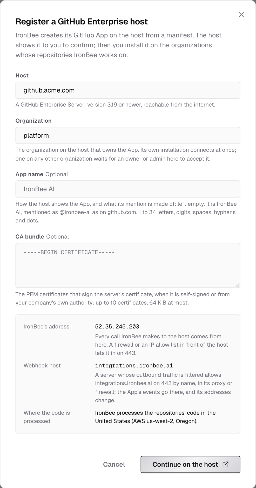
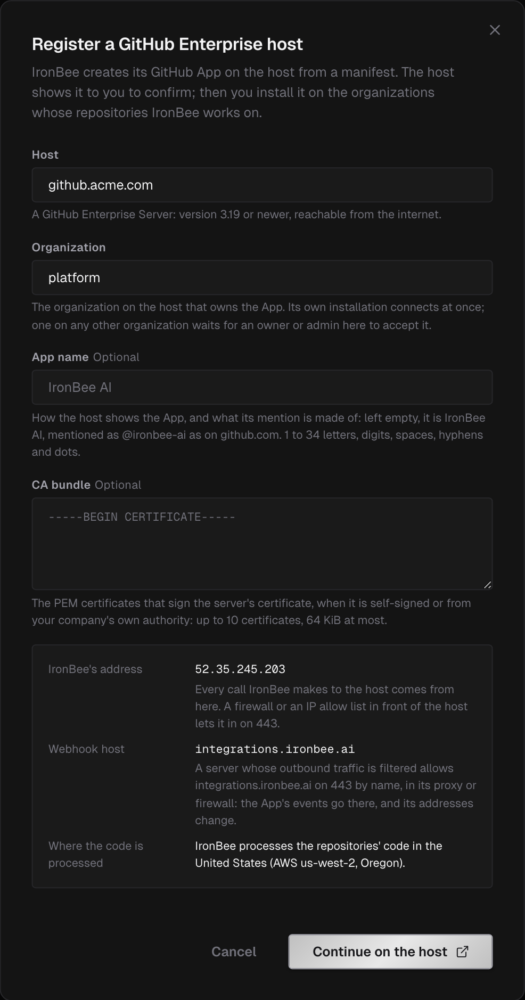
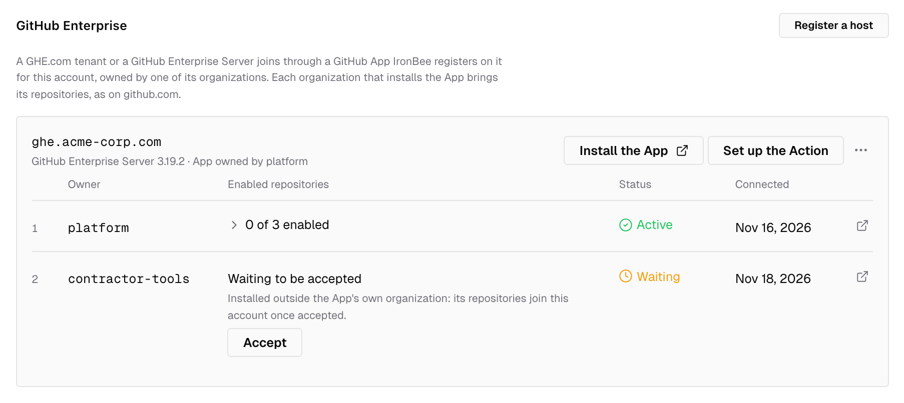
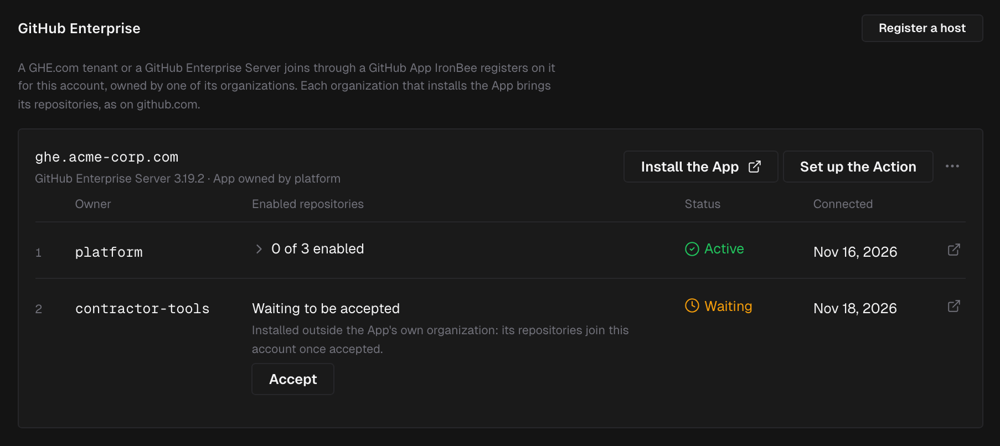

IronBee works on GitHub Enterprise as it does on github.com: code review, the code wiki, code security, and the checks and comments of verification runs. What you set up depends on where your repositories are:

| Where your repositories are | What you set up |
|---|---|
| github.com, in an organization of a GitHub Enterprise Cloud enterprise | The [IronBee GitHub App](/integrations/github), as on any organization. Add IronBee's address where a policy of yours filters by address. See [Enterprise Cloud organizations](#enterprise-cloud-organizations) |
| A GHE.com tenant, `<name>.ghe.com` (GitHub Enterprise Cloud with data residency) | Register the tenant in the console. IronBee creates its own App on the tenant, owned by one of your organizations. See [Register a tenant or a server](#register-a-tenant-or-a-server) |
| A GitHub Enterprise Server of your own | Register the server in the console. IronBee creates its own App on the server, and reaches the server over the internet. See [Register a tenant or a server](#register-a-tenant-or-a-server) |

To review pull requests in your own GitHub Actions instead, with your own model, use the [self-hosted runner](/code-review/self-hosted-runner/github). IronBee then never calls your host, so nothing on this page is needed, and it also serves a server IronBee can't reach from the internet.

---

## The address IronBee calls from

Every call IronBee makes to GitHub comes from one IPv4 address, `52.35.245.203`: code review, the code wiki, code security, the checks and comments of verification runs, git over HTTPS, and signing in to IronBee with GitHub. Add it wherever a policy of yours filters by address: an IP allow list, an identity provider's conditional access policy, or a firewall in front of your server. Name the entry IronBee.

The registration form in the console shows the same address, under **IronBee's address**.

---

## Enterprise Cloud organizations

When your organizations are on github.com, in a GitHub Enterprise Cloud enterprise, you install the same [IronBee GitHub App](/integrations/github) as anyone else, from the console. There is nothing to register, and no IronBee plan is asked for. What can stop IronBee is a policy of your own.

### IP allow lists

If your organization or your enterprise keeps an IP allow list, GitHub refuses IronBee's calls until IronBee's address is on it, and nothing is reviewed or analyzed. On each allow list that covers the organizations IronBee works on, do one of these:

- **Import IronBee's address.** In the organization's or the enterprise's settings, under **Authentication security**, turn on **Enable IP allow list configuration for installed GitHub Apps** and save. GitHub adds the address the IronBee App declares.
- **Add it yourself.** Add an entry for `52.35.245.203`, named IronBee.

### Conditional access policies

Under Enterprise Managed Users with an identity provider's conditional access policy, GitHub also checks the calls IronBee makes on a person's behalf against that policy: the authorization when someone installs the App, and signing in to IronBee with GitHub. Add IronBee's address to the policy's allowed locations in your identity provider, such as a named location the policy allows in Microsoft Entra ID. GitHub checks the IP allow list and the policy separately, so the address goes in both.

### Who may install the App

If your organization lets only its owners install GitHub Apps, a member's install sends a request to the owners. An owner installs the App, or approves the request, and IronBee connects when they do.

### Your own workflows under an IP allow list

The [IronBee GitHub Action](/github-action/guides/github-enterprise) and the [self-hosted runner](/code-review/self-hosted-runner/github) run in your workflows and call GitHub with the workflow's own token, from the runner's address, not from IronBee's. Under an IP allow list, GitHub accepts that token only from listed addresses: run these workflows on your own runners, or on GitHub's larger runners with static IP addresses, and list those addresses. GitHub's standard hosted runners have no fixed address, so the workflows fail there.

### Managed users' own repositories

Under Enterprise Managed Users, GitHub lets no third-party App be installed on a managed user's own account. IronBee covers your organizations' repositories, not the repositories a managed user owns.

---

## Register a tenant or a server

A GitHub App made on github.com can't be installed on a GHE.com tenant or a GitHub Enterprise Server. So you register your host in the console, and IronBee creates its own App there, owned by one of your organizations. Code review, the code wiki, code security and verification then work on the host's repositories as on github.com.

**Data residency.** A GHE.com tenant's data residency covers what GitHub itself stores. IronBee processes your repositories' code in the United States (AWS us-west-2, Oregon), whichever region your tenant is in.

### Before you start

- **The Enterprise plan.** Registering a host needs it. On another plan, the **GitHub Enterprise** section reads **Needs the Enterprise plan** and shows no form. A host registered earlier keeps working whatever the plan becomes. See [Pricing](/console/pricing).
- **The owner or admin role in IronBee,** to register a host, accept installations, replace a CA bundle and delete a host.
- **An owner of the organization that will own the App**, signed in to the host in the same browser. Choose the organization with care: an installation on it connects at once, and one on any other owner waits until someone accepts it in IronBee.
- **On a GitHub Enterprise Server:**
  - version 3.19 or newer
  - the server's own host name: the name the instance is configured with and writes in its addresses. Not an alias and not an IP address, with at least two labels (`github.acme.com`, not `github`), no port and no path. It must resolve to public addresses only, an IPv4 address among them
  - the certificate of the authority that signed the server's certificate, when it isn't a public one: a self-signed certificate, or your company's own authority

### The network

Set it before you register: the registration calls your host.

**A GHE.com tenant.** If your enterprise or an organization keeps an IP allow list, add an entry for `52.35.245.203`, named IronBee, on each one that covers the organizations IronBee works on.

**A GitHub Enterprise Server.** Two directions:
- **In:** let IronBee's address in on TCP 443, in the firewall in front of the server and in any other rule that filters who reaches it. Without it, the registration stops, and later every review, wiki, code security scan and verification of the server's repositories fails.
- **Out:** your server sends the App's events to `integrations.ironbee.ai` on 443. That name's addresses change, so there is no address to allow. If the server's outbound traffic is filtered, allow the name in its outbound proxy or in a firewall rule by name. Without it, no event reaches IronBee: no pull request is reviewed when it opens or changes, no comment is answered, no wiki is built on a push, and nothing on IronBee's side shows an error. A firewall that takes addresses only can't be served yet.

If your server is down or slow, each of IronBee's calls gives up after 10 seconds, and the work is tried again later.

### Fill in the form

In the console, open **Integrations** and select **GitHub**. In the **GitHub Enterprise** section, click **Register a host**. The **Register a GitHub Enterprise host** form asks for:

| Field | What to enter |
|---|---|
| **Host** | Your tenant's name, `<name>.ghe.com`, or the server's own host name, alone: no `https://` and no path. Not `api.<name>.ghe.com` |
| **Organization** | The login of the organization that will own the App, as the host shows it |
| **App name** | How the host shows the App, and what its mention is made of. Left empty, it's `IronBee AI`, mentioned as `@ironbee-ai`, as on github.com. 1 to 34 letters, digits, spaces, hyphens and dots |
| **CA bundle** | GitHub Enterprise Server only, and only when a public authority didn't sign the server's certificate. The PEM certificates of the authority that did, root and intermediates, or the server's own certificate when it's self-signed: 1 to 10 certificates, 64 KiB at most. IronBee trusts them for this server only, beside the public authorities |

The form also shows **IronBee's address**, the **Webhook host** for a server, and **Where the code is processed**, which reads "IronBee processes the repositories' code in the United States (AWS us-west-2, Oregon)."

Click **Continue on the host**. For a GitHub Enterprise Server, IronBee first calls your server once with the CA bundle. The form refuses the registration, with nothing made on your host, when:

| The form says | What to do |
|---|---|
| "github.acme.com did not answer in time. Its firewall must let in 52.35.245.203 on 443." | Let IronBee's address in on 443 |
| "The server's certificate is not trusted. Paste the CA bundle that signed it." | Give the CA bundle that signed the certificate |
| "github.acme.com resolves to a private address." | The server must be on the internet under a public name. The [self-hosted runner](/code-review/self-hosted-runner/github) serves one that isn't |
| "github.acme.com did not answer as a GitHub Enterprise Server." | Type the server's own name, not a proxy or a page in front of it |
| "The server runs a GitHub Enterprise Server older than 3.19, which IronBee does not support." | Upgrade the server |
| "github.acme.com is already registered on this account." | [Delete the host](#delete-a-host) first to register it again |
| "github.acme.com is registered on this account as a GitLab host." | One server serves one product. Delete that registration first, under **GitLab Self-Managed and Dedicated** |
| "Registering a host needs the Enterprise plan." | See [Pricing](/console/pricing) |

It also refuses a host that isn't a GHE.com tenant or a server name of the shape above, an organization name GitHub wouldn't take, an App name outside the rule above, and a CA bundle that isn't 1 to 10 readable certificates.

### Create the App on the host

Within one hour:

<Steps>
  <Step title="Open the new App's page">
    Your browser goes to the organization's page for a new GitHub App on your host, filled in by IronBee.
  </Step>
  <Step title="Create the App">
    Create it on that page. Leave its permissions and events as they are: IronBee checks each one.
  </Step>
  <Step title="Come back to IronBee">
    Your host sends you back to IronBee, which finishes the registration and opens the App's install page. See [Install the App](#install-the-app).
  </Step>
</Steps>

The App asks for these permissions: Metadata (read), Contents (read and write), Pull requests (read and write), Checks (read and write) and Issues (read). It receives these events: pull request, pull request review comment, pull request review thread, issue comment and push. IronBee uses them as the [GitHub App on github.com](/integrations/github#what-the-app-uses-its-access-for) does.

### If the registration stops

Once you've created the App, its one-time registration code is spent. When a page of IronBee's stops the registration after that, the host is listed in the **GitHub Enterprise** section as **Registration not finished**. Delete the App on your host (the page links its settings), then register the host again: the new registration writes over the unfinished one. To give up instead, remove the host with **Delete**.

| The page says | Why |
|---|---|
| "This registration link has expired or was already used." | More than an hour passed, or the page was opened twice. Check the **GitHub Enterprise** section after a minute: a host it shows with its App needs nothing more. Only a host still listed as **Registration not finished** needs its App deleted and the host registered again |
| "The GitHub App was created on github.acme.com, but its registration's answer lacked what IronBee needs", naming it | A permission or an event was changed on GitHub's page, or the App was created under another organization than the form named. On a server, the host may also have been typed as an alias, not the server's own name |
| "The GitHub App was created on github.acme.com, but github.acme.com did not complete its registration", or "IronBee could not store what it needs to use it" | Register again. If it happens again, email [support@ironbee.ai](mailto:support@ironbee.ai) |

---

## Install the App

On the install page, choose the organization and its repositories: all of them, or the ones you select. The host's **Install the App** in the **GitHub Enterprise** section opens the page again.

- **On the organization that owns the App,** IronBee connects the installation when it arrives. Its repositories become IronBee projects, as on github.com, and the console confirms **GitHub Enterprise connected to** your account.
- **On any other organization,** or on a person's account on a server, where anyone can install the App, the installation waits. The **GitHub Enterprise** section lists it under the host as **Waiting to be accepted**, with its owner and **Accept**. Nothing of it is reviewed or verified until an owner or admin accepts it. Its repositories then become projects, except one whose name another project of the account already has, and any past the account's project limit. This keeps whoever installs the App from adding their repositories to your account and spending its credits.
- **If the organization lets only its owners install Apps,** a member's install sends a request to its owners. The installation reaches IronBee when an owner approves it.

There's no way to decline a waiting installation: it stays listed until it's accepted, or uninstalled on your host. If you were signed in to another IronBee account when the install came back, the console says **Installed for another IronBee account**: the installation reached the account that registered the host.

On a pull request, people mention the App by its slug on your host, which GitHub makes from the App's name: `@ironbee-ai` with the default name **IronBee AI**. IronBee's comments and checks are signed `<slug>[bot]`. See [Code review on GitHub Enterprise](/code-review/on-github#on-github-enterprise).

---

## The host in the console

**Integrations > GitHub** lists each registered host in the **GitHub Enterprise** section, with its kind (**GHE.com tenant**, or **GitHub Enterprise Server** and its version) and **App owned by** its organization. Each host has:

- **Install the App**, which opens the App's install page on the host
- **Set up the Action**, once an installation is connected. See [The GitHub Action](#the-github-action)
- an actions menu with **Replace the CA bundle**, on a server, and **Delete**

Under the host, its installations are listed as on github.com, with their **Owner**, **Enabled repositories**, status and when they were connected. **Manage on** the host opens an installation's settings there. Expand an installation to see its repositories, with the same actions as on github.com; see [Repositories and projects](/integrations/github#repositories-and-projects).

IronBee files a repository of your host under that host, apart from a github.com repository of the same name, and its project has its own settings, rules and memories. A project takes the repository's name alone, so the repository is enabled only while no other project of the account has that name. The console links its pull requests to your host.

---

## Replace the CA bundle

When a server's certificate changes to one the stored CA bundle doesn't verify, such as a renewed self-signed certificate or a move to another authority, every call IronBee makes to the server is refused until the bundle is replaced. Choose **Replace the CA bundle** in the host's actions menu. No plan is asked.

IronBee calls your server with the new bundle before it keeps it, so the server must already serve a certificate the new bundle verifies. To change with no gap, replace the bundle before the change with one that holds both the old and the new authority, then with the new one alone after it.

---

## The GitHub Action

The [IronBee GitHub Action](/github-action/get-started/getting-started) runs on a GHE.com tenant and on a GitHub Enterprise Server, and a server names its own entry point, `ironbee-ai/ironbee-action/ghes@v1`. See [The GitHub Action on GitHub Enterprise](/github-action/guides/github-enterprise).

The console's setup steps open for your host's repositories from the host's **Set up the Action**, or from the prompt on a project's card. They list the repositories of the host's accepted installations, and link to the repository's secrets page and to a new workflow file on your host, filled in. On a server they also ask for your **Runner label**, since a server has no hosted runners.

---

## The IronBee CLI

Use CLI 0.54.0 or newer.

- **Your host is GitHub to the CLI once IronBee names it among your account's hosts.** See [Your account's GitHub and GitLab hosts](/cli/concepts/projects#your-accounts-github-and-gitlab-hosts).
- **`ironbee review`, `ironbee verify` and the CLI's hooks** then name your repository with its host, so their work lands in that repository's project. See [Code review of your local checkout](/cli/guides/code-review) and [Verification jobs](/cli/guides/verification-jobs).
- **The CLI's own reads of your host,** such as which pull request a commit belongs to, use the token `gh` holds for it. Sign in with `gh auth login --hostname github.acme.com`.
- **A private certificate authority.** The CLI is a Node program and doesn't read your system's trust store: set `NODE_EXTRA_CA_CERTS` to the authority's PEM file.
- **A server named by an IP address or by one label** isn't named as a host. A run there goes on without a repository, and one that asks for a pull request or a commit (`--pr`, `--commit`) stops.

---

## Delete a host

An owner or admin chooses **Delete** in the host's actions menu. IronBee disables every repository enabled through the host's installations, then removes the installations and the host. The projects stay in IronBee with their history, and are no longer reviewed.

The App stays on your host. After the delete, the console links **Open the App's settings on** your host: delete the App there. Until you do, the host keeps sending it events, which IronBee refuses.

Registering the host again needs the Enterprise plan. On another plan, the dialog says so before the delete. Delete the host and register it again when:
- you want to replace the App's private key or webhook secret
- the App was deleted on your host, so every call IronBee makes fails while the host's installations stay listed

An App whose permissions, events or webhook address were changed on your host loses what they served. Set them back as they were registered.

---

## Not available yet

- Signing in to IronBee with a GHE.com tenant or a server
- Verification started by a Vercel or Netlify deployment of a repository on a tenant or a server
- The repositories a managed user owns. On a GHE.com tenant, every user is a managed user
- An App owned by the enterprise instead of an organization, or an existing App's credentials pasted in instead of the registration
- Declining a waiting installation: uninstall it on your host instead
- Replacing the App's key or webhook secret from the console: delete the host and register it again
- In code security with execution, a dependency hosted on your tenant or server: dependencies come from the public registries only
- A server IronBee can't reach from the internet. The [self-hosted runner](/code-review/self-hosted-runner/github) serves it
- A server named by an IP address, by one label or by an international name; a port other than 443; a server under a path; a server with no IPv4 address
- Fixed addresses for IronBee's webhook endpoint, for a firewall that takes addresses only

---

## What's next?

<CardGroup cols={2}>
  <Card title="Code review on GitHub" icon="git-pull-request" href="/code-review/on-github">
    What IronBee posts on a pull request, the check and the commands.
  </Card>
  <Card title="The GitHub Action on GitHub Enterprise" icon="github" href="/github-action/guides/github-enterprise">
    The workflow on a tenant, and the `ghes` entry point on a server.
  </Card>
  <Card title="Self-hosted runner" icon="server" href="/code-review/self-hosted-runner/github">
    Review pull requests in your own GitHub Actions, with your own model.
  </Card>
  <Card title="GitHub App" icon="/images/icons/github.svg" href="/integrations/github">
    Install the App on github.com organizations.
  </Card>
</CardGroup>
