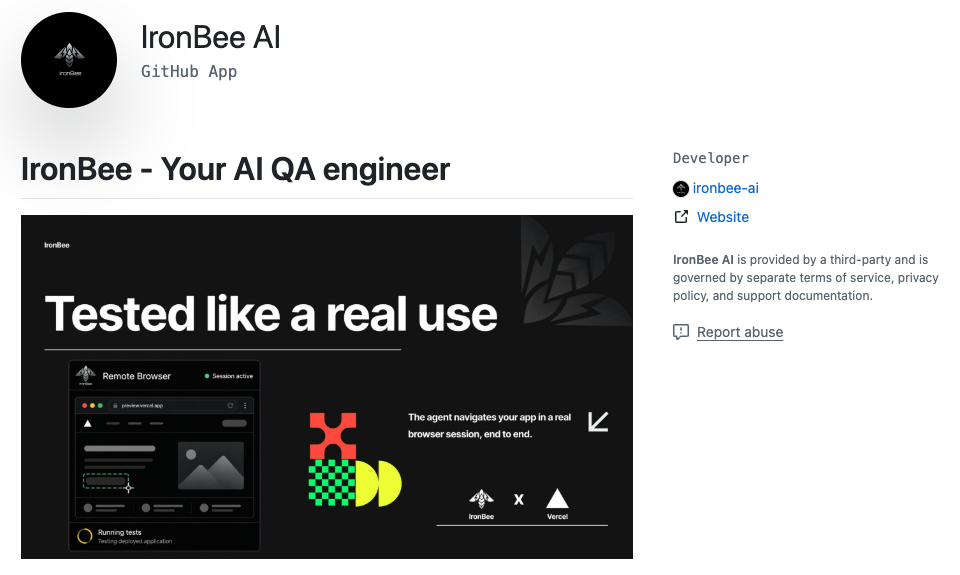
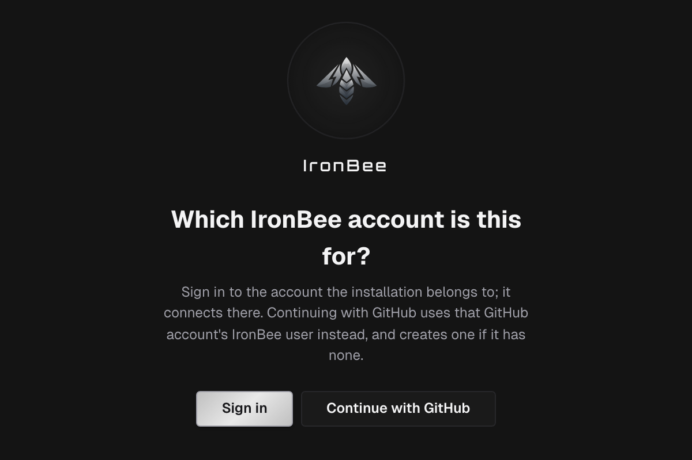
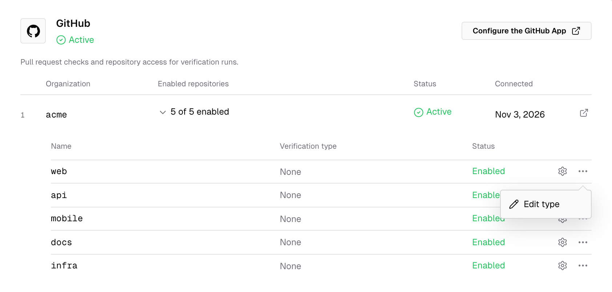
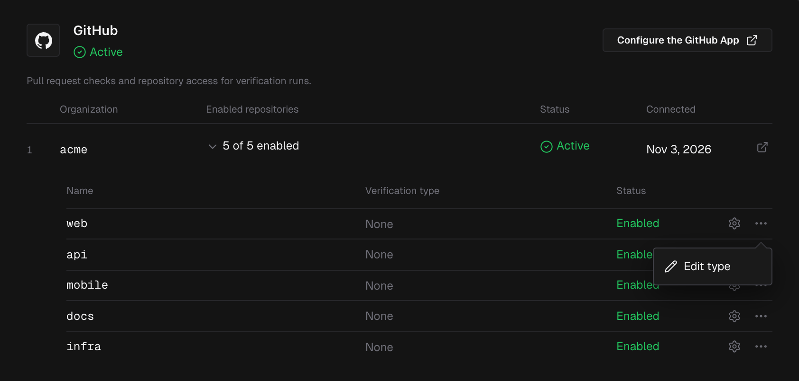

The IronBee GitHub App connects your repositories to IronBee. It gives IronBee six things:

- **Code review.** IronBee reviews the pull requests of the repositories the App covers, comments on what it finds and sets the **IronBee review** check. See [Code review of pull requests](/code-review/overview).
- **Code wiki.** IronBee writes a wiki of each repository the App covers, from its default branch, and keeps it current as pull requests merge. See [Code wiki of a repository](/console/code-wiki).
- **Repository access.** A verification run checks out the commit it verifies. A private repository needs the App for that; a public one doesn't.
- **The pull request behind a deployment.** For [Vercel](/integrations/vercel) and [Netlify](/integrations/netlify) deployments, the App finds the pull request behind the deployed commit. The run then verifies the pull request's changes.
- **Checks and comments.** For a verification run on a repository the App covers, IronBee opens a check on the commit, posts an inline comment on each finding, and posts the result as a pull request comment. This covers Vercel and Netlify deployments, and runs on IronBee from the GitHub Action, `ironbee verify` and the API.
- **Sign-in with GitHub.** You can create your IronBee account and sign in with your GitHub account.

The [IronBee GitHub Action](/github-action/get-started/getting-started) and [`ironbee verify`](/cli/guides/verification-jobs) use the same installation to check out private repositories, and to post their results on the pull request. For GitLab, see [GitLab](/integrations/gitlab).

---

## Install the App

Owners and admins can start from the console. Open **Integrations** in the sidebar, select **GitHub**, and click **Install the GitHub App**. In the **Set up IronBee** wizard that opens on a new account, on **Connect your repositories**, pick the **GitHub** card and click **Install on GitHub**; see the [Quickstart](/getting-started/quickstart). You can also start on GitHub, from the [IronBee GitHub App](https://github.com/apps/ironbee-ai) page.

<Steps>
  <Step title="Install on GitHub">
    Choose the organization or user account to install into, and the repositories: all repositories, or a selected set. IronBee only reads repositories in that scope.
  </Step>
  <Step title="Connect it to your IronBee account">
    GitHub sends you back to IronBee.
    - If you aren't signed in, IronBee asks **Which IronBee account is this for?** **Sign in** connects the installation to your account. **Continue with GitHub** uses the IronBee user of your GitHub account and creates one if it has none.
    - On **Connect GitHub to IronBee**, check the **GitHub organization** and the **Repositories**, pick the **IronBee account** and click **Connect**. When you installed the App yourself and administer exactly one account, this happens automatically.

    
    

  </Step>
  <Step title="Your repositories become projects">
    Every repository in the installation's scope becomes an IronBee project. There's nothing to pick: the console opens **Integrations > GitHub** and confirms **GitHub connected to** your account, "Its repositories are now IronBee projects." When you started from the **Set up IronBee** wizard, you go back to it instead, on **Pick repositories**.
  </Step>
</Steps>

<Note>
  Connecting an installation requires the **owner** or **admin** role in IronBee. If a different GitHub account installed the App, IronBee asks you to **Confirm this installation is yours**. Click **Confirm with GitHub** and authorize with the GitHub account that ran the installation.
</Note>

---

## Repositories and projects

Installing the App makes every repository it covers a project, named after the repository. A repository you add to the App on GitHub later becomes one the same way. For each new project:

- Code review starts, unless **Review new repositories automatically** is off. See [Code review settings](/code-review/settings).
- The [code wiki](/console/code-wiki) starts, unless **Write a wiki for newly connected repositories** is off. See [Code wiki settings](/console/code-wiki-settings).
- The verification type is **None**. Runs from the GitHub Action and from `ironbee verify` in that repository report to the project and name their own type.

A repository that was already a project keeps its verification type and settings, and an archived project stays archived.

To see the repositories, open **Integrations > GitHub** and expand the installation.

Each repository's row shows its **Verification type** and its **Status**, **Enabled** or **Not enabled**. The gear icon, **Project settings**, opens the project. The row's actions menu (the three dots) holds:
- **Edit type** sets the verification type: **Web**, **API** or **None**. The project's settings change it too.
- **Enable**, on a repository that didn't become a project. It makes it one.
- **Disable**, only on a project whose repository is no longer in the installation's scope.

A repository stays a project while the App covers it. To stop reviewing one, turn code review off in its [code review settings](/code-review/settings). To take it out of IronBee, remove it from the App's repositories on GitHub: its project becomes **Not active**.

---

## What the App uses its access for

| Access | Why |
|--------|-----|
| Repository contents (read and write) | Read the code to review a pull request and to write the code wiki, and check out the commit under verification during a run. The write access is what GitHub requires to resolve a review thread; IronBee uses it for nothing else |
| Issues (read) | Read the issues a pull request links to, and receive the `@ironbee-ai` commands in pull request comments |
| Pull requests (read and write) | Find the pull request behind a commit, post a verification's result as a comment with inline comments on its findings, and post code reviews, their replies and the summary in the description |
| Checks (read and write) | Open the **IronBee Verification** check on the commit and complete it with the verdict, and set the **IronBee review** check |
| Email addresses (read) | Sign up and sign in with GitHub |

The App never pushes to your repository and never opens or merges a pull request. When the GitHub Action fixes a finding, the action commits the fix with your workflow's own token.

---

## What appears on the pull request

This section covers verification runs. For code review, see [Code review on GitHub](/code-review/on-github).

A verification run posts on the pull request when it's bound to a repository the App covers: a Vercel or Netlify deployment, or a run on IronBee from the GitHub Action, `ironbee verify` or the API. A run started with **Run instant verification** in the console, a scenario run, and a run without the repository (`ironbee_bind_repository: false`, `--no-repo`) post nothing. So does a GitHub Action run on your runner, which reports through its own comment. See [The report](/github-action/guides/running-in-ci#the-report).

**Which pull request.** The check goes on the commit the run verified. The review and comment go on a pull request whose head that commit still is when the run ends:
- A run bound to **a commit**, as for a Vercel or Netlify deployment, a push, a schedule or `ironbee verify` with a commit, posts on the open pull request whose head it is.
- A run bound to **a pull request**, as for a GitHub Action run on a `pull_request` or `issue_comment` event, or `ironbee verify --pr`, verifies the pull request's head as it checked it out, and posts on that pull request.

With no such pull request, or after a newer push moved the pull request's head during the run, the run writes the check only.

**The check.** IronBee sets a check on the verified commit:
- It's named **IronBee Verification** for a Web project, and **IronBee Verification · API** for an API project.
- For a Vercel or Netlify deployment, the check opens when the run starts and reads **IronBee is verifying this deployment** while the agent works. For a run from the GitHub Action, `ironbee verify` or the API, the check appears when the run ends.
- When the run ends, the check is completed:

| Result | Check conclusion | Check title |
|--------|------------------|-------------|
| Pass | Success | Verification passed |
| Fail | Failure | Verification failed, with the findings counted, such as `Verification failed · 3 findings` |
| Not applicable | Neutral | Verification not applicable |
| The run couldn't complete | Neutral | IronBee could not run this verification |
| Cancelled | Cancelled | Verification canceled |
| Your team is out of credits | Neutral | IronBee did not run this verification · out of credits this month |

The check's summary holds the verdict's summary, then **Findings**, one line each with the severity, the place and the title, and closes with the credits the run used: "Used N IronBee credits." or "No IronBee credits were used."

When your team's credits for the month are used up, a deployment gets no run. Its check closes neutral with the title above and the summary "This team's IronBee credits for this month are used up. Verifications start again when the credits reset or the team's allowance is raised." See [Credit usage](/console/usage) and [Pricing](/console/pricing).

When IronBee doesn't start a run for a deployment for another reason, the check reads **IronBee did not verify this deployment** and gives the reason. The check's **Details** link opens the run's [verification detail](/console/verification-detail) page in the console.

**Inline comments.** For a real verdict, IronBee posts one GitHub review with an inline comment on each finding whose line is in the pull request's diff. The review is a comment: it never approves a pull request or requests changes. Each comment holds:
1. An **Open in IronBee** button, which opens the finding on the run's verification page.
2. The severity and the kind, with the same marks as [code review](/code-review/on-github#the-review-body): correctness, security, or editorial for the wording the app shows.
3. The finding, in bold, then **Happens when:** and **Then:**, and **Seen:** and **Impact:**.
4. The fix: a suggestion you can apply with **Commit suggestion** when it replaces lines around the finding, otherwise a code block under **Fix**, or a **Fix:** note in words.
5. **Where this rests**, a folded list of the lines the finding relies on.

A finding outside the diff gets no inline comment; it's listed in the comment's table. A later run of the same type deletes the earlier run's inline comments and posts its own.

**The comment.** IronBee also posts one comment per verification type, and edits it in place on every re-run. The comment contains:
- an **Open in IronBee** button and the **IronBee Verification** heading
- the verdict, such as **✅ Verification passed** on the commit, **❌ Verification failed** or **⚪ Verification not applicable**
- on a fail, the findings count by severity, and a table of the findings, each linked to its inline comment
- folded **Summary**, **Checks** and **Important files changed**
- a link to **View the full verification**
- the credits the run used

A Web and an API project on the same commit each get their own check, review and comment. A cancelled run and one that couldn't complete get the check only. When a newer run of the same type on the same commit has already posted, a Vercel or Netlify run only completes its check, and other runs post nothing. A run bound to a pull request that was cancelled or ended without a verdict gets no check at all.

The App has to have the repository among its repositories. A run in a repository of the same owner that the App doesn't cover is still treated as published by IronBee, but IronBee can't write there, so the pull request gets nothing. Add the repository to the App. `@ironbee-ai retract` doesn't remove what a verification run posted.

---

## Managing the installation

**Integrations > GitHub** lists every connected installation with its **Organization**, **Enabled repositories**, **Status** (**Active** or **Suspended**) and when it was **Connected**. **Manage on GitHub** opens the installation's settings on GitHub, and **Configure the GitHub App** changes its repositories.

Changes on GitHub flow back automatically:
- Adding or removing repositories refreshes the list, and each added repository becomes a project. When you return from GitHub, the console confirms it with **GitHub installation updated in** your account.
- Suspending the installation on GitHub shows it as **Suspended**. Unsuspending restores it.
- When a repository leaves the installation's scope, or the App is uninstalled, its project becomes **Not active**. It keeps its history and settings. Add the repository back to the App, or install the App again, and the same project comes back with them.

---

## Troubleshooting

| Symptom | Likely cause |
|---------|--------------|
| A run fails with "repo checkout failed", or the action's report says the run couldn't read the repository | The repository is private and the App doesn't cover it. Grant the App access, or verify without the repository: `ironbee_bind_repository: false` in the GitHub Action, `--no-repo` with `ironbee verify` |
| A GitHub Action run shows no IronBee check | The run verified on your runner (local mode) or ran with `ironbee_bind_repository: false`, and reports through the job result and the action's comment. A run on a pull request that was cancelled or ended without a verdict gets no check either |
| A GitHub Action run on IronBee shows nothing on the pull request, and no report comment | The App is installed on the repository's owner but doesn't cover this repository. Add the repository to the App, or set `ironbee_bind_repository: false` |
| A Vercel or Netlify run shows nothing on the pull request | The App isn't installed for the repository, or the repository is outside the installation's scope |
| The check appears, but there's no comment | Comments are posted only for a real verdict, and only when an open pull request heads the commit. The pull request the run named may be closed or merged, or a push moved its head during the run |
| A finding has no inline comment | Its line is outside the pull request's diff. It's listed in the comment's table |
| The verification works from a thin changeset | No pull request heads the commit, so the run compares against the commit's parent |
| A repository reads **Not enabled** under **Integrations > GitHub** | It didn't become a project when the App took it in. Choose **Enable** in its actions menu |
| **Already connected elsewhere** | The installation is connected to another IronBee account. Uninstall and reinstall the App to move it |

---

## What's next?

<CardGroup cols={2}>
  <Card title="Vercel" icon="/images/icons/vercel.svg" href="/integrations/vercel">
    Verify preview deployments as a Vercel deployment check.
  </Card>
  <Card title="Netlify" icon="/images/icons/netlify.svg" href="/integrations/netlify">
    Verify deploy previews, with the result on the deploy page.
  </Card>
  <Card title="GitHub Action" icon="github" href="/github-action/get-started/getting-started">
    Verify every push and pull request from your own workflow.
  </Card>
</CardGroup>
