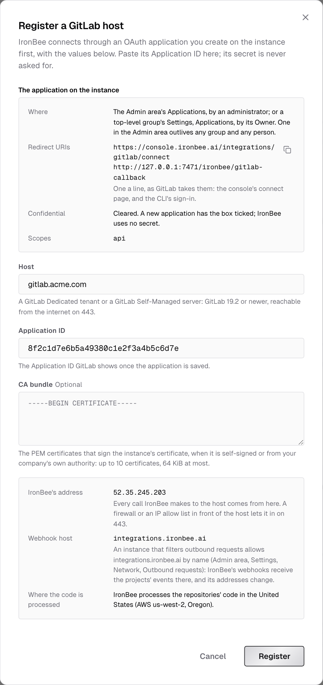
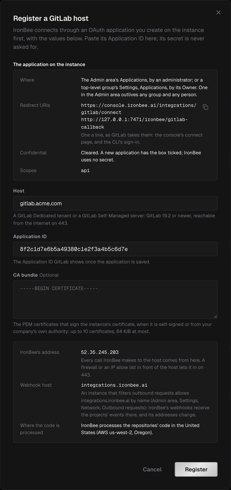
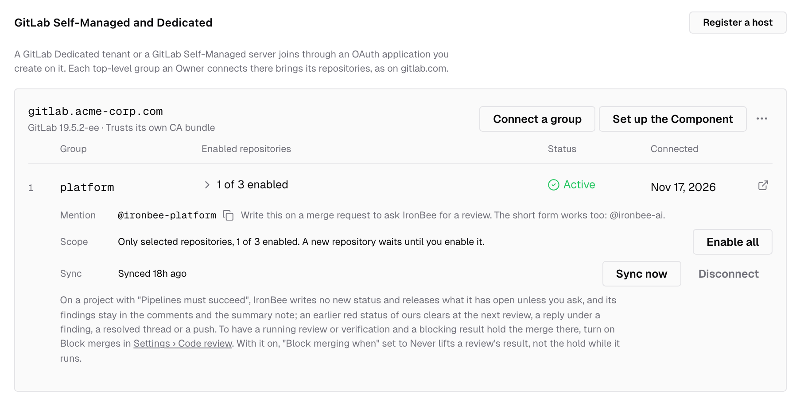
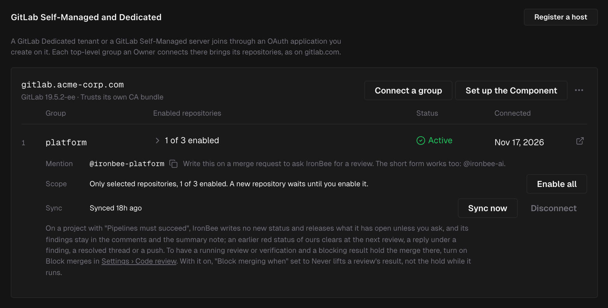

IronBee works on a GitLab Self-Managed server and on a GitLab Dedicated tenant as it does on gitlab.com: code review of merge requests, the code wiki, code security, and the pipeline statuses and comments of verification runs. You make an OAuth application for IronBee on your instance and register the instance in the console. Then the Owner of each top-level group connects it as on gitlab.com: IronBee creates its service account in the group and works through it, reaching your instance over the internet from one address.

A Self-Managed server and a Dedicated tenant register the same way. [GitLab Dedicated](#gitlab-dedicated) says only what differs. For groups on gitlab.com, including Premium and Ultimate, see [GitLab](/integrations/gitlab).

To review merge requests in your own GitLab CI/CD instead, with your own model, use the [self-hosted runner](/code-review/self-hosted-runner/gitlab). IronBee then never calls your instance, so nothing on this page is needed, and it also serves an instance IronBee can't reach from the internet.

---

## Before you start

- **The Enterprise plan.** Registering an instance needs it. On another plan, the **GitLab Self-Managed and Dedicated** section reads **Needs the Enterprise plan** and shows no form. A host registered earlier keeps working whatever the plan becomes: connecting its groups, replacing its certificate or its application, and deleting it ask for no plan. See [Pricing](/console/pricing).
- **The owner or admin role in IronBee,** to register a host, replace its CA bundle or its application, and delete it.
- **An administrator of the instance,** for [the application](#the-application) and [the instance's settings](#the-instances-settings). An Owner of a group can make a group's application instead.
- **For each top-level group, one person who is both** an Owner of the group on the instance and an owner or admin in IronBee, signed in to both in the same browser. They connect the group.
- **GitLab 19.2 or newer,** Enterprise Edition (with or without a license) or Community Edition, on any tier.
- **The instance's own host name:** the name of its external URL. Not an alias and not an IP address, with at least two labels (`gitlab.acme.com`, not `gitlab`). The instance answers at `https://<host>` on 443, with no port and no path, and the name resolves to public addresses only, an IPv4 address among them.
- **The certificate of the authority that signed the instance's certificate,** when it isn't a public one: a self-signed certificate, or your company's own authority.

Set the network and make the application first: the registration calls your instance and tries the application.

`ironbee host setup`, run from your machine by the instance's administrator, makes the application and two of [the instance's settings](#the-instances-settings): who creates IronBee's service account, and IronBee's webhook host among the allowed outbound requests. The other settings stay the administrator's. See [Prepare an instance with the CLI](#prepare-an-instance-with-the-cli).

---

## The network

| Direction | What to allow |
|---|---|
| In | IronBee's address, `52.35.245.203`, on TCP 443: every call IronBee makes to your instance and every clone comes from it. Let it in at the firewall in front of the instance, and in any other rule that filters who reaches it |
| Out | `integrations.ironbee.ai` on 443, by name: each repository IronBee works on gets a webhook that sends its events there. Its addresses change, so there's no address to allow |

The registration form in the console shows both, under **IronBee's address** and **Webhook host**.

- **Without IronBee's address,** the registration stops, saying the host refused IronBee's address or didn't answer in time, and later every review, wiki, code security scan and verification of the instance's repositories fails.
- **Without the webhook host,** no event reaches IronBee: no merge request is reviewed when it opens or changes, no comment is answered and no wiki is built on a push. A firewall that takes addresses only can't be served yet. GitLab's own filter of outbound requests is one of [the instance's settings](#the-instances-settings).
- **A group that restricts access by IP address,** on Premium and Ultimate, holds IronBee's service account to its list too. An Owner adds IronBee's address to the group's list, as on gitlab.com; see [Premium and Ultimate groups](/integrations/gitlab#premium-and-ultimate-groups). The firewall and the group's list are checked apart, so the address goes in both.

If your instance is down or slow, each of IronBee's calls gives up after a short wait, and the work is tried again later. A connected group stays connected.

---

## The application

Connecting a group is GitLab's authorization of an OAuth application, as on gitlab.com. IronBee's application on gitlab.com doesn't exist on your instance, so you make one there, once, for every group of the instance:

- **An instance-wide application,** by an administrator: in the **Admin area**, **Applications**, then **Add new application**. It outlives any group and any person, so prefer it.
- **A group's application,** by an Owner of the group: in the group, **Settings > Applications**, then **Add new application**. It serves the connect of any group of the instance, and is deleted with its own group.

| Field | Value |
|---|---|
| **Name** | `IronBee`, or a name of your choice: people see it on GitLab's authorization page |
| **Redirect URI** | `https://console.ironbee.ai/integrations/gitlab/connect`, the console page a connect returns to. On a second line, `http://127.0.0.1:7471/ironbee/gitlab-callback`, for the IronBee CLI's sign-in in a browser |
| **Trusted** (instance-wide applications) | Your choice. A trusted application skips GitLab's consent page, which changes nothing for IronBee |
| **Confidential** | Cleared. GitLab ticks it on a new application, and IronBee's connect, which sends no secret, is refused by a confidential one |
| **Scopes** | `api` only. The connect creates IronBee's service account, its membership and its tokens with it |

Click **Save application**, then copy the **Application ID** GitLab shows. Leave the secret where it is: IronBee never asks for it.

GitLab compares a redirect URI character by character, so copy both whole. The registration form shows them under **Redirect URIs**, and **Copy the redirect URIs** copies them one per line.

---

## The instance's settings

An administrator sets these in the **Admin area**, under **Settings**.

**Who creates IronBee's service account.** Connecting a group creates IronBee's service account in it, with the grant of the Owner who connects.
- On the Enterprise Edition, with or without a license, only administrators create a group's service account by default, and GitLab refuses the Owner's. The connect stops with GitLab's words, `User does not have permission to create a service account in this group.` Either an administrator turns on **Allow top-level group owners to create Service accounts** (**Settings > General**, **Account and limit**) and the Owner starts the connect again after about a minute, or an administrator who is also an Owner of the group connects it.
- On the Community Edition there's no such setting, and an Owner of a top-level group creates the service account as the instance comes.

**Token lifetimes.** IronBee asks for its service account's tokens for 364 days. On Ultimate, an administrator can set a lower limit, **Maximum allowable lifetime for access tokens (days)**. IronBee then asks for the next shorter lifetime of 180, 90, 60, 30 and 7 days, until the instance takes one, and renews each token before it expires. Under a limit below 7 days, the connect stops at its token step. A limit lowered after a group is connected has GitLab revoke IronBee's longer tokens: IronBee suspends the connection, and an Owner of the group clicks **Reconnect**.

**Access tokens turned off.** **Disable personal access tokens** (Premium and Ultimate) reaches service accounts' tokens too. While it's selected, the connect stops at its token step, and a connected group's connection is suspended at its next sync. Once the box is cleared again, the following sync makes the connection active again by itself.

**Outbound requests.** A webhook to a public name is created and delivered under the instance's defaults. If an administrator lets the instance call listed names and addresses only (**Settings > Network**, **Outbound requests**, **Block all requests, except for IP addresses, IP ranges, and domain names defined in the allowlist**), add `integrations.ironbee.ai` to **Local IP addresses and domain names that hooks and integrations can access** and save. Without it, the instance refuses IronBee's webhooks, and the console shows GitLab's answer on each repository's row, with the name to allow. The next sync after the name is added puts the hooks on.

**Git over HTTPS.** IronBee clones over HTTPS with its service account's tokens. Where **Enabled Git access protocols** is **Only SSH**, every clone is refused, and every review and analysis fails.

---

## Register the instance

In the console, open **Integrations** and select **GitLab**. In the **GitLab Self-Managed and Dedicated** section, click **Register a host**. Above its fields, the **Register a GitLab host** form shows what the application takes under **The application on the instance**. It asks for:

| Field | What to enter |
|---|---|
| **Host** | The instance's own host name, alone: no `https://`, no path and no port |
| **Application ID** | The application's ID, as GitLab shows it once the application is saved |
| **CA bundle** | Only when a public authority didn't sign the instance's certificate. The PEM certificates of the authority that did, root and intermediates, or the instance's own certificate when it's self-signed: 1 to 10 certificates, 64 KiB at most. IronBee trusts them for this instance only, beside the public authorities, on every call and every clone |

Below the fields, the form shows **IronBee's address**, the **Webhook host** and **Where the code is processed**, which reads "IronBee processes the repositories' code in the United States (AWS us-west-2, Oregon)."

Click **Register**. IronBee asks your instance who it is, without a credential, and tries the application. Nothing is authorized and nothing is made on your instance. The host is then listed in the section, with **Connect a group**. The form refuses the registration when:

| The form says | What to do |
|---|---|
| "gitlab.acme.com refused IronBee's address." | A rule in front of the instance, or a Dedicated tenant's IP allowlist, refused IronBee. Let IronBee's address in |
| "gitlab.acme.com did not answer as a GitLab instance at its own address." | Type the host name of the instance's external URL, not an alias, a proxy or a page in front of it. An instance under a path or on a port other than 443 answers this way too, and can't be served |
| "The instance's certificate is not trusted. Paste the CA bundle that signed it." | Give the CA bundle that signed the certificate |
| "gitlab.acme.com resolves to a private address." | The instance must be on the internet under a public name. The [self-hosted runner](/code-review/self-hosted-runner/gitlab) serves one that isn't |
| "gitlab.acme.com did not answer in time." | Let IronBee's address in on 443 |
| "gitlab.acme.com does not take this application" | Check that you copied the **Application ID**, not the secret, and clear **Confidential** in the application's settings |
| "gitlab.acme.com is already registered on this account." | [Replace its certificate or its application](#replace-the-certificate-or-the-application), or [delete it](#delete-a-host) first to register it again |
| "gitlab.acme.com is registered on this account as a GitHub Enterprise host." | One server serves one product. Delete that registration first, under **GitHub Enterprise** |
| "Registering a host needs the Enterprise plan." | See [Pricing](/console/pricing) |

It also refuses a host that isn't a name of the shape above, a name under gitlab.com (groups there connect from [GitLab](/integrations/gitlab)), an application ID that isn't 16 to 128 letters, digits, underscores and hyphens, and a CA bundle that isn't 1 to 10 readable certificates within 64 KiB.

---

## Connect a group

Each top-level group connects on its own, from the host's **Connect a group**, by the person [Before you start](#before-you-start) names:

<Steps>
  <Step title="Authorize on your instance">
    Your browser goes to your instance's authorization page for the application. Sign in there if asked, and authorize IronBee.
  </Step>
  <Step title="Pick the group">
    Your instance sends you back to **Connect GitLab to IronBee**, which reads the instance's version and lists the top-level groups you own there. Pick the group and click **Connect**.
  </Step>
  <Step title="Pick the repositories">
    Pick the group's repositories IronBee works on, as on gitlab.com. See [Connect a group](/integrations/gitlab#connect-a-group).
  </Step>
</Steps>

An instance tells its version only to someone signed in, so the connect reads it with your grant, each time. An instance older than 19.2 is refused, with nothing made on it. The section shows each host with the version its last connect read.

IronBee makes the same things on your instance as on gitlab.com: a service account in the group named **IronBee**, with the username `ironbee-<group path>`, a Maintainer of the group, which uses no seat; a webhook on each repository you pick; and an **IronBee reader** account in a project, at its first job. See [What IronBee creates in the group](/integrations/gitlab#what-ironbee-creates-in-the-group). On GitLab's Free tier, an instance holds 100 service accounts in all, IronBee's among them. Your own grant serves the connect only: IronBee revokes it when the connect ends.

### If the connect stops

| The page says | What to do |
|---|---|
| **This GitLab instance is too old for IronBee** | The page names the version it found. Upgrade the instance to 19.2 or newer, then start again |
| **The instance no longer takes IronBee's application** | The application was deleted on the instance, or **Confidential** was ticked since. Make it again or clear the box, [replace its ID](#replace-the-certificate-or-the-application), then start again |
| **GitLab refused a step of the connection** | The page names the step and quotes GitLab. For the service account, see who creates it in [the instance's settings](#the-instances-settings), or the Free tier's 100 service accounts. For the tokens, see token lifetimes, or access tokens turned off. Change what GitLab's words point to, then start again |
| **The instance did not answer as GitLab** | Signed in as you, the instance named no GitLab version. Check that the registered host is the instance's own name, then start again |
| **This GitLab host is no longer registered** | It was deleted from the account meanwhile. Register it again, then connect |

The other messages are the same as on gitlab.com. See [If the connect fails](/integrations/gitlab#if-the-connect-fails).

**Reconnect** and **Disconnect** work on a host's group as on gitlab.com. See [Managing the connection](/integrations/gitlab#managing-the-connection).

---

## GitLab Dedicated

A Dedicated tenant is a GitLab instance that GitLab runs for you alone, on Ultimate. Every step on this page holds for it, with your tenant in place of your server, except for what follows.

**The tenant's name.** Register the name your tenant answers under: `<tenant>.gitlab-dedicated.com`, or your own domain when the tenant was set up with one. Give a CA bundle only for a certificate a public authority didn't sign.

**The tenant's IP allowlist.** Your tenant can take requests from listed addresses only, through the IP allowlist you keep in Switchboard, GitLab's console for your tenant. The allowlist covers the whole tenant, its OAuth and API addresses included. If it's on, add IronBee's address, `52.35.245.203`, described as IronBee, before you register the tenant. Otherwise the form refuses the registration, saying the host refused IronBee's address. Switchboard has no API for its allowlist, so `ironbee host setup` only names the address. Opening only the tenant's OpenID Connect address to every address, which GitLab offers on request, doesn't serve IronBee: the registration also calls the tenant's API, and so does every later call.

A top-level group's own IP restriction holds on a tenant too, apart from the tenant's allowlist, so the address goes in both.

**The tenant's settings.** The [instance's settings](#the-instances-settings) are in your tenant's **Admin area**, as on the Enterprise Edition. GitLab keeps some of a tenant's settings for itself, such as its rate limits.

**Webhooks from the tenant.** Your tenant sends IronBee's webhooks from its own addresses, which GitLab can change. IronBee takes a delivery from any address, so there's nothing to allow on IronBee's side.

**Data residency.** A Dedicated tenant's region covers what GitLab itself stores. IronBee processes your repositories' code in the United States (AWS us-west-2, Oregon), whichever region your tenant is in. To keep code review in your own network, use the [self-hosted runner](/code-review/self-hosted-runner/gitlab).

---

## The host in the console

**Integrations > GitLab** lists each registered host in the **GitLab Self-Managed and Dedicated** section, with its GitLab version, read at the last connect, and **Trusts its own CA bundle** when it has one. Each host has:

- **Connect a group**
- **Set up the Component**, once an active group has a repository enabled, or covers all of its repositories and has at least one. See [The GitLab component](#the-gitlab-component)
- an actions menu with **Replace the CA bundle**, **Replace the application** and **Delete**

Under the host, its connected groups are listed as gitlab.com's are, with the same **Mention**, **Scope** and **Sync** rows and the same repository actions. See [Repositories and projects](/integrations/gitlab#repositories-and-projects). A repository whose webhook the instance refuses shows GitLab's answer on its row.

IronBee files a project of your instance under your instance, apart from a gitlab.com project of the same path, and once it's enabled, its IronBee project has its own settings, rules and memories. The console links its merge requests to your instance. Its IronBee name is made as on gitlab.com, from the path after the group. A repository whose name another project of the account already has, on another host or under another group, isn't enabled, and its row says why.

A group connects to one IronBee account at a time, as on gitlab.com. Two IronBee accounts may each register the same instance, each with its own application.

---

## Replace the certificate or the application

An owner or admin chooses **Replace the CA bundle** or **Replace the application** in the host's actions menu. No plan is asked.

- **The CA bundle,** when the instance's certificate changes to one the stored bundle doesn't verify, such as a renewed self-signed certificate or a move to another authority. Until it's replaced, every call IronBee makes to the instance is refused. IronBee calls your instance with the new bundle before it keeps it, so the instance must already serve a certificate the new bundle verifies. To change with no gap, replace the bundle before the change with one that holds both the old and the new authority, then with the new one alone after it. **Remove the bundle** is for an instance that moved to a certificate from a public authority.
- **The application,** when it was deleted and made again on the instance, or another one replaces it. IronBee tries the new ID as at the registration. The application serves only connecting a group, so a deleted one stops no review: it stops the next connect or reconnect, until its ID is replaced.

---

## The GitLab component

The [IronBee GitLab component](/gitlab-component/get-started/getting-started) runs in your instance's pipelines, from your copy of the component on the instance. See [The GitLab component on Self-Managed and Dedicated](/gitlab-component/guides/self-managed).

The console's setup steps open for a project on your instance from the host's **Set up the Component**, or from the prompt on a project's card. They ask for **Your copy of the IronBee Component**, write the pipeline file, and link to the project's CI/CD variables and pipeline editor on your instance.

---

## The IronBee CLI

Use CLI 0.54.0 or newer.

- **Your instance is GitLab to the CLI once IronBee names it among your account's hosts.** See [Your account's GitHub and GitLab hosts](/cli/concepts/projects#your-accounts-github-and-gitlab-hosts).
- **`ironbee review`, `ironbee verify` and the CLI's hooks** then name your repository by its whole path with its host, so their work lands in that repository's project. A local review needs the repository's group connected, with code review on, as on gitlab.com.
- **The CLI's own reads of your instance,** such as the merge requests a commit belongs to, use `GITLAB_TOKEN` when `GITLAB_HOST` names your instance. Without it they're anonymous, and a private project's work links to no merge request.
- **A private certificate authority.** The CLI is a Node program and doesn't read your system's trust store: set `NODE_EXTRA_CA_CERTS` to the authority's PEM file.
- **An instance named by an IP address or by one label** isn't named as a host. A run there goes on without a repository, and one that asks for a merge request or a commit (`--pr`, `--commit`) stops.

### Prepare an instance with the CLI

`ironbee host setup <host>`, run by an administrator of the instance, makes the application, turns on **Allow top-level group owners to create Service accounts** where it's off, and adds IronBee's webhook host to the outbound allowlist where the instance blocks all requests but that list. Token lifetimes, **Disable personal access tokens** and the Git access protocols stay the administrator's choices. It then opens the console's registration form with the host and the application's ID filled in. `ironbee host allow-address` adds IronBee's address to a group's IP restriction. What no API offers stays by hand: IronBee's address in your firewall or in your tenant's allowlist, and the registration itself, an act on your IronBee account in the console. See [Enterprise hosts](/cli/guides/hosts).

---

## Delete a host

An owner or admin chooses **Delete** in the host's actions menu. IronBee disables every repository of the host's groups, disconnects the groups, and removes the host. The projects stay in IronBee with their history, and are no longer reviewed. For each group, IronBee calls your instance as a disconnect does: it revokes its tokens and removes its project accounts and webhooks.

What stays on your instance, for you to remove. After the delete, the console links **Open the applications of** your instance and **Open the service accounts of** each group:

- **The application,** in the **Admin area**'s **Applications**, or in the group's **Settings > Applications**, where you made it
- **IronBee's service account of each group,** on the group's **Settings > Service accounts**, by an Owner, or in the **Admin area**'s **Users**, by an administrator. Deleting it also ends any token of it IronBee couldn't revoke
- **A webhook IronBee couldn't remove,** when your instance didn't answer or there were too many to remove at once: in the project's **Settings > Webhooks**, a hook to `integrations.ironbee.ai`
- **A project account IronBee couldn't remove,** named **IronBee reader**, in the **Admin area**'s **Users**

Registering the host again needs the Enterprise plan. On another plan, the dialog says so before the delete.

---

## Not available yet

- An instance IronBee can't reach from the internet, such as a Dedicated tenant reached only through AWS PrivateLink. The [self-hosted runner](/code-review/self-hosted-runner/gitlab) serves it
- GitLab Dedicated for Government
- An instance named by an IP address, by one label or by an international name; a port other than 443; an instance under a path; an instance with no IPv4 address
- GitLab older than 19.2
- Fixed addresses for IronBee's webhook endpoint, for a firewall that takes addresses only
- A group access token in place of IronBee's service account, where Owners may not create service accounts: an administrator who owns the group connects it instead
- A token pasted in place of the application, and creating the application from the console: `ironbee host setup` makes it from your machine
- Verification started by a Vercel or Netlify deployment of a repository on your instance
- Personal namespaces, as on gitlab.com

---

## What's next?

<CardGroup cols={2}>
  <Card title="Code review on GitLab" icon="git-merge" href="/code-review/on-gitlab">
    What IronBee posts on a merge request, the pipeline status and the commands.
  </Card>
  <Card title="GitLab component on your instance" icon="gitlab" href="/gitlab-component/guides/self-managed">
    Verify merge requests from your copy of the component.
  </Card>
  <Card title="Enterprise hosts in the CLI" icon="terminal" href="/cli/guides/hosts">
    Prepare an instance with `ironbee host setup`.
  </Card>
  <Card title="Self-hosted runner" icon="server" href="/code-review/self-hosted-runner/gitlab">
    Review merge requests in your own GitLab CI/CD, with your own model.
  </Card>
</CardGroup>
