The Netlify extension verifies your deploys. When a deploy preview or branch deploy of a site with verification turned on goes live, a cloud agent does three things:
- opens the deploy
- reads what the pull request changed
- exercises the affected flows

It reports the result on the Netlify deploy page. The full evidence is in the IronBee Console.

There is no workflow file to add and no test suite to maintain. Nothing waits on IronBee: the deploy completes as before, and the verification reports on it.

---

## Prerequisites

- A Netlify team with sites that build deploy previews or branch deploys from a GitHub repository, a gitlab.com project or a bitbucket.org repository.
- The **owner** or **admin** role on your IronBee account.
- The [IronBee GitHub App](/integrations/github). It's recommended for every repository and required for private ones:
  - It lets the run check out a private repository.
  - It finds the pull request behind a branch deploy.
  - It posts the result on the pull request: a check, an inline comment on each finding in the diff, and a comment with the result.
- For a site built from GitLab, connect the project's group instead. See [GitLab](/integrations/gitlab). For a site built from Bitbucket, connect the repository's workspace. See [Bitbucket](/integrations/bitbucket).

---

## Step 1: Install the extension

In the console, open **Integrations** in the sidebar, select **Netlify**, and click **Install the Netlify extension**. It opens the [IronBee extension on Netlify](https://app.netlify.com/extensions/y-0ak6dz-ironbee) in a new tab. Install it on your team.

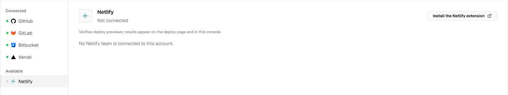
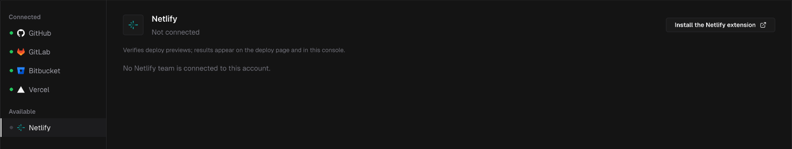

On **Settings > Getting started**, the same step is **Connect Netlify**. The console detects the installation and moves you forward automatically.

---

## Step 2: Connect the team to your IronBee account

1. On Netlify, open your team's **Extensions > IronBee** and click **Connect to IronBee**, then **Open IronBee**.
2. On **Connect Netlify to IronBee**, check the **Netlify team**, pick the **IronBee account** its results go to, and click **Connect**.
3. Once the extension has synced the team's sites, the site list opens on its own: keep the sites to verify checked, pick each one's verification type, **Web**, **API** or **None**, and click **Create N projects**. Closing the list leaves **You are connected**, where **Enable sites** opens it again.
4. Click **Back to Netlify**, then **I have connected, refresh** on the extension.

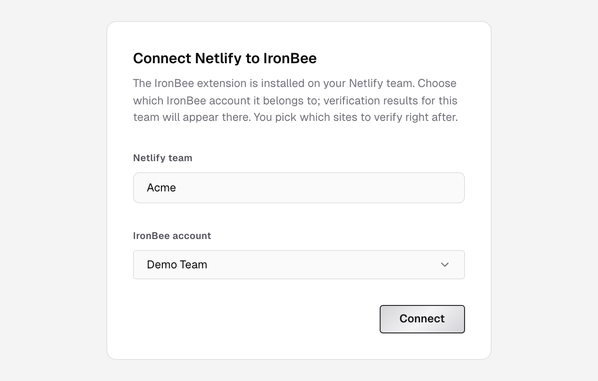
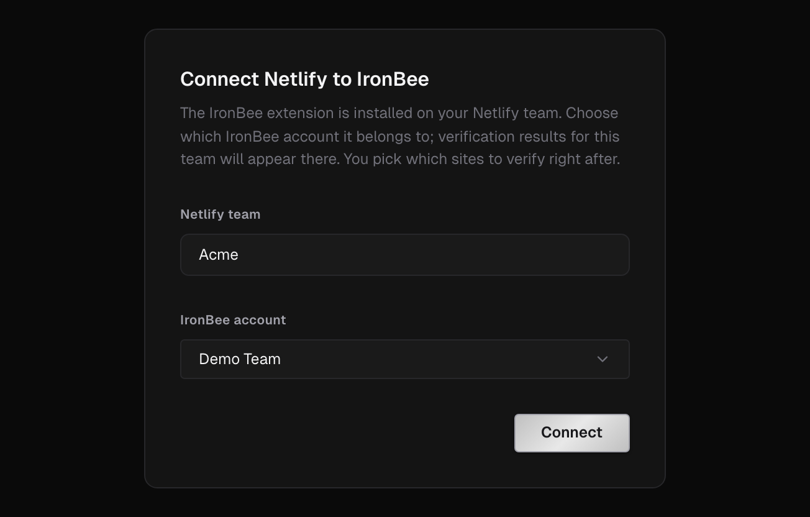

<Note>
  Only accounts where you hold the **owner** or **admin** role appear in the picker. A Netlify team can be connected to one IronBee account. If the link is no longer valid, click **Connect to IronBee** on Netlify again to get a fresh one.
</Note>

Once connected, the extension shows **Connected to IronBee** and the account the team reports to, with **Open IronBee settings** to jump to the console.

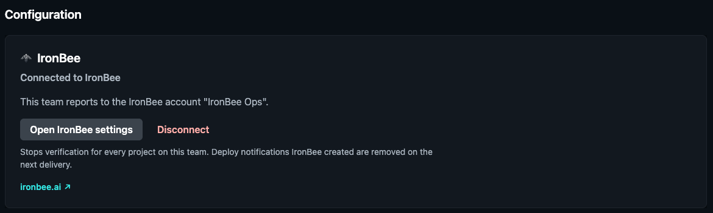

---

## Step 3: Turn on verification for a site

On Netlify, open the IronBee panel from a site's menu and click **Turn on verification**. This does two things:
- It creates the site's deploy notification, which tells IronBee when a deploy goes live.
- It enables the site in IronBee as a project with the **Web** verification type.

Under **Which deploys**, choose the deploy contexts to verify. **Deploy previews** and **Branch deploys** are on by default. **Production deploys** is off unless you turn it on.

<Warning>
  IronBee has to be able to open your previews.
  - If a site's deploy previews are private and production is public, **Turn on verification** makes the deploy previews public. The panel says **Deploy previews of this project were private; they are now public so IronBee can open them. Production was already public and is unchanged.**
  - If the whole site is private, verification turns on but nothing is made public. The panel warns that IronBee can't open private previews, and that making them public also makes production public on Netlify. Click **Make the project public** to make production and previews reachable by anyone with the link, or, on a Netlify Pro plan, protect the site with a password instead.

  See [Preview access](#preview-access).
</Warning>

To verify a site's API instead of its web UI, change its type in the console: **Integrations > Netlify**, expand the team, open the actions menu (the three dots) next to the site and choose **Edit type**.

You can also enable sites from the console: **Integrations > Netlify** or **Projects > New project**. A site enabled in the console starts runs once its deploy notification exists, so turn on verification for it in the extension too.

---

## Step 4: Install the GitHub App

The Netlify extension knows the deploy; the GitHub App knows the code behind it. With both, the run verifies the pull request's changes, and the result also lands on the pull request.

In **Integrations**, select **GitHub** and click **Install the GitHub App**. Then follow [GitHub App](/integrations/github).

---

## Preview access

Public previews need nothing. For protected previews:

- **Password protection** (Netlify Pro plan):
  1. In Netlify, set the site's visibility to a password under **Project configuration > General > Visitor access**.
  2. In the IronBee Console, open the project and go to **Settings > Secrets**.
  3. Click **New secret**, choose the **Password** tab and enter the same password as the **Site password**.

  IronBee signs in to the password page once and keeps only the cookie Netlify answers with. The password itself is never stored. After you change the password on Netlify, save the new one here.

  If the secret can't be saved, the dialog says why:
  - **Netlify did not accept this password. Check it in the project's Visitor access settings on Netlify and try again.**
  - **This project is not password-protected on Netlify, or its site is not connected here. Turn password protection on there first, or choose another type.**

  While the site has a password, its panel on Netlify shows **This project is password protected.** as a reminder to add the password to IronBee.
- **Basic authentication:** add an **HTTP headers** secret with an `Authorization` header in the project's **Settings > Secrets**.
- **Team login (SSO)** can't be bypassed. Use a password, Basic authentication or public previews.

---

## What the extension uses its access for

| Access | Why |
|--------|-----|
| `site:read`, `site:write` | Read the site, make its previews public when you turn on verification, and make the whole site public when you click **Make the project public** |
| `deploy:read` | Know which deploy a notification is about |
| `hook:read`, `hook:write`, `hook:delete` | Create and remove the site's deploy notification |

The extension doesn't change your builds. IronBee never stores a Netlify token.

---

## How it runs

<Steps>
  <Step title="The deploy goes live">
    Netlify builds exactly as before. When a deploy in a selected context goes live, the deploy notification tells IronBee.
  </Step>
  <Step title="The change is verified">
    IronBee starts a verification run with the deploy URL and its Git metadata.
    - **The changeset:** on a deploy preview, the run verifies the pull request's full diff. On a branch deploy, the GitHub App finds the pull request behind the commit.
    - **The environment:** the run is against the environment named after the deploy context: `deploy-preview`, `branch-deploy` or `production`. IronBee creates these automatically; their variables and secrets apply.
  </Step>
  <Step title="Watch it live, if you want">
    While a Web run is going, the run in the console streams live: every action as it executes, the browser view and the network requests. When it ends and its recording has uploaded, the recording replays the same workspace, action by action.

    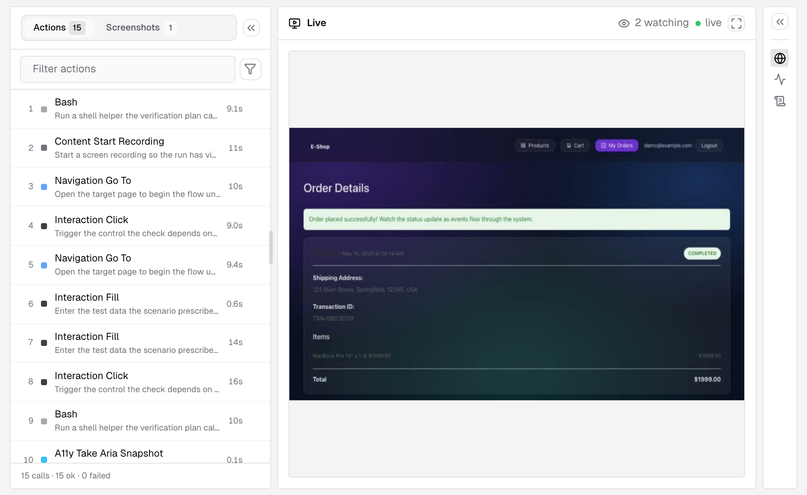
    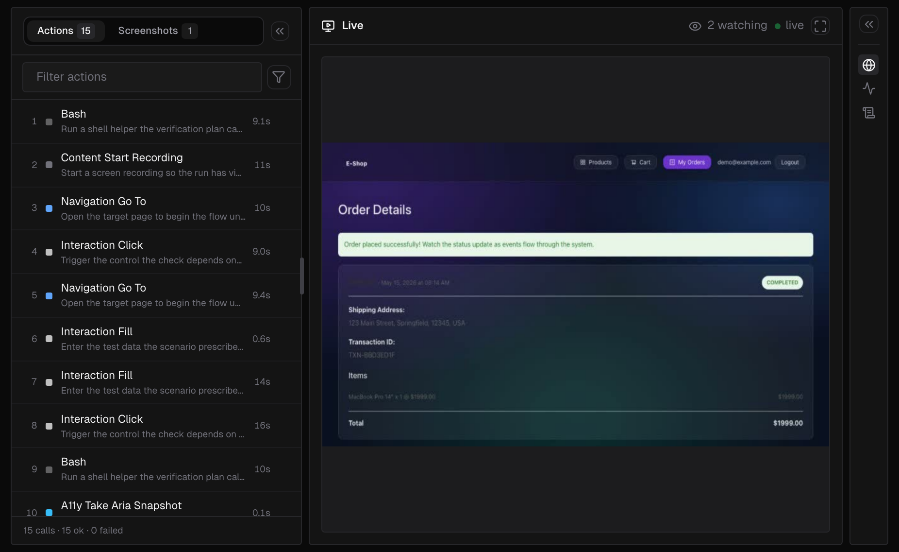

  </Step>
  <Step title="The result comes back to the deploy">
    The deploy page shows the **IronBee verification** card with the result. With the GitHub App installed, the same result lands on the pull request as a check, inline comments on the findings, and a comment.
  </Step>
</Steps>

---

## What you see on the deploy

The deploy page on Netlify gets an **IronBee verification** card. It shows one headline:

| Headline | Meaning |
|----------|---------|
| IronBee is verifying this deploy in a real browser... | The run is in progress |
| Verified: no issues found. | The verification passed |
| Verified: issues found. | The verification failed. The **Issues** list shows what was found |
| IronBee could not reach a verdict for this deploy. | The run ended without a verdict |
| The verification was cancelled. | The run was cancelled |

When there's no run to show, the card has one line instead:

| Message | Meaning |
|---------|---------|
| Verification is not turned on for this project. Enable it in the project's IronBee panel. | The site's verification is off. Turn it on in the site panel |
| IronBee has not verified this deploy. Only deploy previews and branch deploys are verified, and only after the deploy went live. | No run was started for this deploy: its context isn't selected under **Which deploys**, or the deploy hasn't gone live |

Below the headline are the summary, the **Issues** and **View details in IronBee**, which opens the full report in the console. The report has the actions, the recording synced to them, the network requests, traces and logs, and each issue with the evidence behind it and suggested fixes.

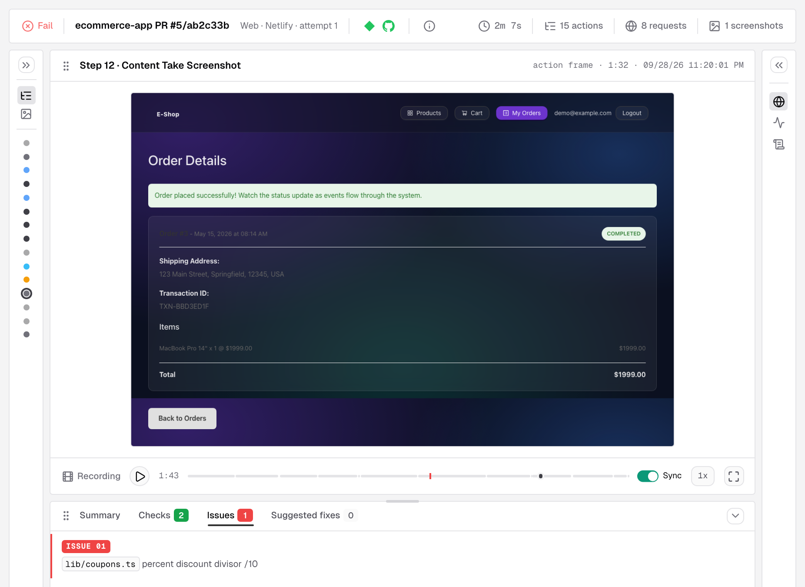
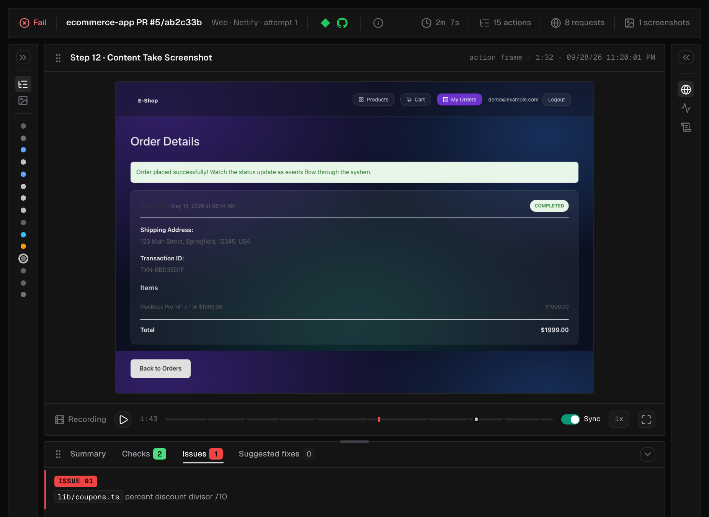

In the project's **Verifications** list, these runs carry the **Netlify** trigger. See [Verification detail](/console/verification-detail).

With the GitHub App installed, the check on the commit closes with the credits the run used: "Used N IronBee credits." or "No IronBee credits were used." When your team's credits for the month are used up, a deploy gets no run, and that check closes neutral as **IronBee did not run this verification · out of credits this month**. See [Credit usage](/console/usage) and [Pricing](/console/pricing).

---

## Scope

- **Deploy previews and branch deploys by default.** Production deploys are verified only on sites where you turned them on.
- **Sites with verification on.** Other sites are ignored.
- **Once per deploy.** Each deploy is verified once. To verify again, deploy again. Netlify doesn't resend a notification IronBee missed.
- **Non-blocking.** The verification never holds up a deploy.

---

## Managing the installation

**On Netlify**, the extension has two panels:

- **Team** (**Extensions > IronBee**): the connection and the IronBee account the team reports to. **Disconnect** stops verification for every site on the team. The sites' IronBee projects become **Not active** and keep their history. The deploy notifications IronBee created are removed on their next delivery.
- **Site** (from a site's menu):
  - **Turn off verification**
  - **Which deploys**
  - the health of the deploy notification: **Deploy notification is active.** If Netlify paused it after repeated failures, click **Resume notification**. If it's missing, turn verification off and on again.
  - **Last deploy notification:** with its time, or **No deploy notification received yet.**
  - whether IronBee can open the previews: **Previews are public; IronBee can open them.**, or a note that the site is private or password protected. See [Preview access](#preview-access).
  - **Preview access**, with **Open preview access settings**, which opens **Integrations > Netlify** in the console. Add a preview password as a project secret, as described in [Preview access](#preview-access).

To remove the extension, **Disconnect** first, then uninstall it from the team's extension page. Uninstalling alone doesn't tell IronBee.

**In the console**, **Integrations > Netlify** lists the connected team with its **Enabled sites**, **Status** and when it was **Connected**. **Manage on Netlify** and **Configure the Netlify extension** open the extension. Expand the team to manage its sites. Each site's actions menu (the three dots) holds:
- **Enable** turns on verification for a site, with the verification type you pick.
- **Edit type** changes its verification type: **Web**, **API** or **None**.
- **Disable** stops verification and keeps the project's history.

The gear icon next to an enabled site, **Project settings**, opens the project's settings.

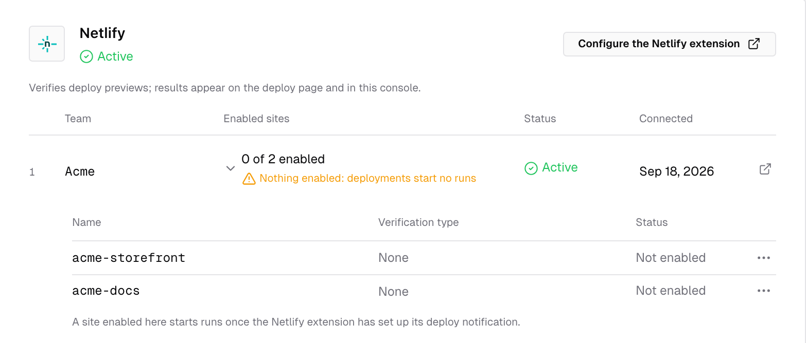
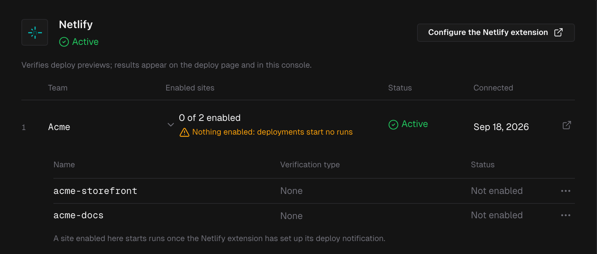

---

## Troubleshooting

| Symptom | Likely cause |
|---------|--------------|
| The card says **IronBee has not verified this deploy.** | The deploy context isn't selected under **Which deploys**, or the deploy never went live |
| The card says **Verification is not turned on for this project.** | Open the site's IronBee panel on Netlify and click **Turn on verification** |
| The site panel says **This team is not connected to IronBee yet.** | Connect the team first. See [Step 2](#step-2-connect-the-team-to-your-ironbee-account) |
| Deploys stopped being verified | Netlify paused or lost the deploy notification. Click **Resume notification** in the site panel, or turn verification off and on again. If the GitHub check reads **out of credits this month**, your team's credits are used up; see [Credit usage](/console/usage) |
| The run shows the agent stuck on a password page | Add the site password as a **Password** secret. See [Preview access](#preview-access) |
| The run verifies broad behavior instead of what the commit changed | The repository isn't on GitHub, gitlab.com or bitbucket.org, or the GitHub App or the GitLab or Bitbucket connection doesn't cover it. See [GitHub App](/integrations/github), [GitLab](/integrations/gitlab) and [Bitbucket](/integrations/bitbucket) |
| **This Netlify team is already connected** | Another IronBee account holds the team. Ask an owner of that account to invite you, or connect a different team |

---

## What's next?

<CardGroup cols={2}>
  <Card title="GitHub App" icon="/images/icons/github.svg" href="/integrations/github">
    Repository access, the check on the commit, and the comments on the pull request.
  </Card>
  <Card title="Vercel" icon="/images/icons/vercel.svg" href="/integrations/vercel">
    The same verification on Vercel preview deployments.
  </Card>
</CardGroup>
