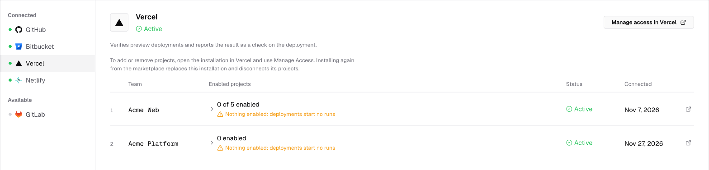
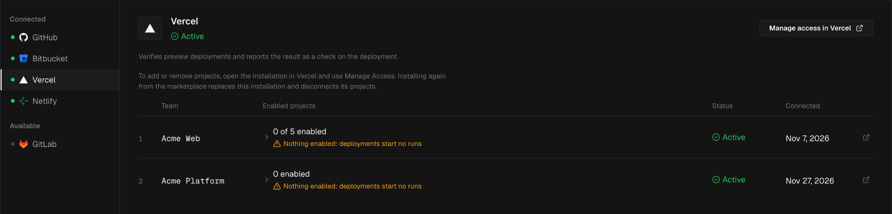
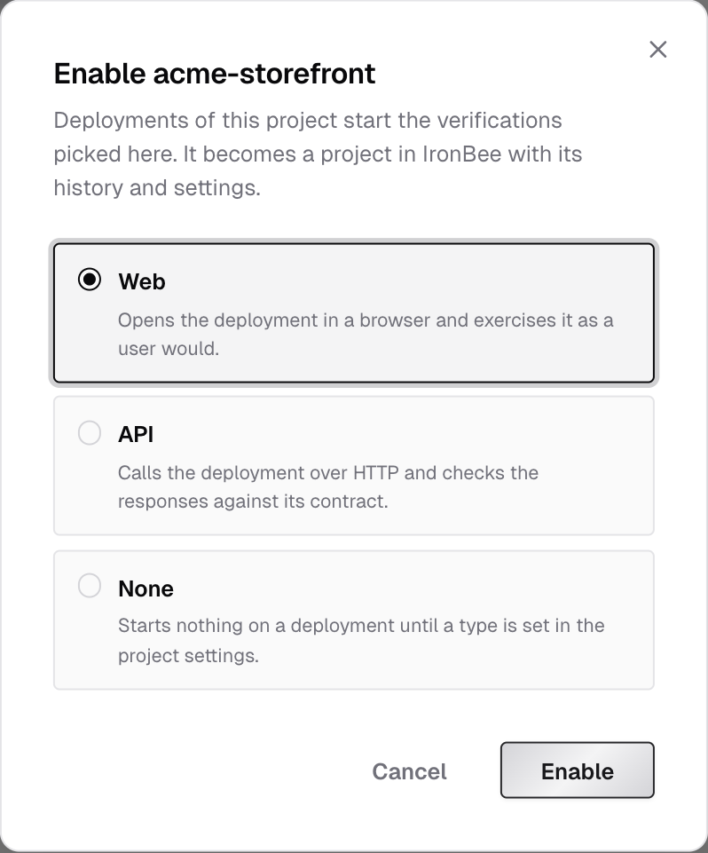
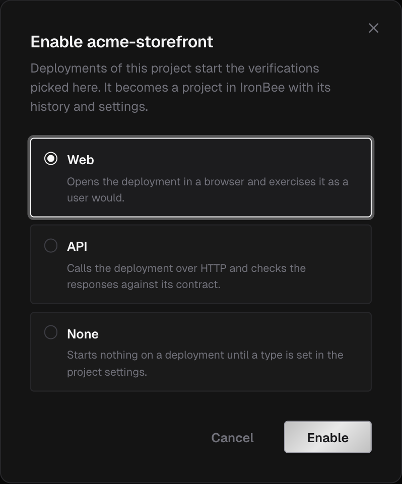

Integrations connect IronBee to where your code lives and deploys. The GitHub App and the GitLab connection make your repositories projects, so IronBee reviews their pull requests and merge requests. IronBee also verifies your changes:
- every deployment of an enabled project on Vercel or Netlify, with no workflow to maintain
- every push and pull request, with the GitHub Action
- every merge request and push to the default branch, with the GitLab component

Each run exercises the change like a QA engineer would and reports the result where you already look.

---

## The Integrations page

Owners and admins open **Integrations** in the console's sidebar. The page lists the providers under **Connected** and **Available**. Select one to see its installations and the projects in each.

| Provider | What you install | What starts a run |
|----------|------------------|-------------------|
| [GitHub](/integrations/github) | The IronBee GitHub App | No verification run on its own. It reviews pull requests, and gives runs access to your repositories and pull requests |
| [GitHub Action](/github-action/get-started/getting-started) | A workflow file in your repository | Pushes, pull requests, `/ironbee-verify` comments, schedules and manual runs |
| [GitLab](/integrations/gitlab) | A connection to a top-level group, from the console | No verification run on its own. It reviews merge requests, and gives runs access to your projects and merge requests |
| [GitLab component](/gitlab-component/get-started/getting-started) | An `include` in your `.gitlab-ci.yml` | Merge requests, pushes to the default branch, schedules and manual pipelines |
| [Vercel](/integrations/vercel) | The IronBee Vercel integration | Preview deployments of enabled projects |
| [Netlify](/integrations/netlify) | The IronBee Netlify extension | Deploy previews and branch deploys of enabled sites |

You can connect more than one. A common setup is Vercel or Netlify for deployments, plus the GitHub App or the GitLab connection so the runs verify each pull request's or merge request's changes and report on it.

---

## How a deployment gets verified

<Steps>
  <Step title="Connect the provider">
    Install the integration on the provider's side and connect it to your IronBee account. Connecting needs the **owner** or **admin** role.
  </Step>
  <Step title="Enable projects">
    A Vercel or Netlify deployment starts a run only once its project is enabled with a verification type. After you connect Vercel or Netlify, the console opens the list of projects or sites to enable. Until one is enabled, the Integrations page shows **Nothing enabled: deployments start no runs**. Enable more later with **Enable** in a project's actions menu on the provider's page, or from **Projects > New project**.
  </Step>
  <Step title="Give IronBee access to your previews">
    If your previews are protected, store the way in as a secret in the project's settings: a Vercel **Bypass token** or a Netlify site **Password**.
  </Step>
  <Step title="Deploy">
    The next deployment starts a verification run. Follow it live from **Projects**, and read the result on the provider, on the pull request, and in the console.
  </Step>
</Steps>

---

## Projects and verification types

Each GitHub repository the App covers becomes an IronBee project when the App is installed; there's nothing to enable. Each GitLab repository becomes one when you pick it for its connected group, and each Vercel project or Netlify site when you enable it. A project keeps its runs, its settings and its history.

Every project has a verification type:
- **Web** opens the deployment in a browser and exercises it as a user would.
- **API** calls the deployment over HTTP and checks the responses against its contract.
- **None** starts nothing on a deployment until a type is set in the project's settings.

A GitHub or GitLab repository starts with **None**. Runs from the GitHub Action, the GitLab component and `ironbee verify` name their own type. For a Vercel project or Netlify site, pick the type when you enable it; **Web** is selected to start with. Change it later with **Edit type** on the Integrations page, or in the project's settings. The change takes effect on the next deployment.

A project can be in one of three states:

| State | Meaning |
|-------|---------|
| Enabled | It's a project of the installation. On Vercel and Netlify, its deployments start runs of its verification type |
| Disabled | Vercel and Netlify only: you clicked **Disable**. Deployments stop starting runs; the project keeps its history, and runs from the CLI or the API still report to it |
| **Not active** | The project left the installation's scope, or the integration was uninstalled. It keeps its id, runs and settings. **Enable again** in **New project** brings back a Vercel project or Netlify site; adding a repository back to the GitHub App, or enabling it again under its GitLab group, brings back its project |

---

## Environments, variables and secrets

A run is against one of the project's environments, and uses that environment's variables and secrets on top of the project-wide ones. Integrations create environments automatically, named the way the provider names the deployment:

| Provider | Environments |
|----------|--------------|
| Vercel | `preview` |
| Netlify | `deploy-preview`, `branch-deploy`, `production` |
| GitHub Action | The name in `ironbee_environment`, or the deployment's environment on `deployment` events |
| GitLab component | The name in `ironbee_environment`, or the job's own `environment:` |

Manage them in the project's **Settings**: **Environments**, **Variables** and **Secrets**.

---

## Where results appear

| Provider | On the provider | On the pull request | In the console |
|----------|-----------------|---------------------|----------------|
| Vercel | The **IronBee Verification** deployment check | A check, inline comments on the findings and a comment, with the GitHub App or the GitLab connection | The project's **Verifications** tab, trigger **Vercel** |
| Netlify | The **IronBee verification** card on the deploy page | A check, inline comments on the findings and a comment, with the GitHub App or the GitLab connection | Trigger **Netlify** |
| GitHub Action | The job result and job summary | On IronBee, with the GitHub App: IronBee's check, inline comments and comment. Otherwise the action's report comment | Trigger **GitHub Actions** |
| GitLab component | The job result and the report in the job log | On IronBee, with the GitLab connection: IronBee's pipeline status where it writes one, inline comments and summary note. Otherwise the component's report note | Trigger **GitLab CI** |

Every run links to its [verification detail](/console/verification-detail) page, with the recording, the actions, the network requests, traces and logs, and the result.
